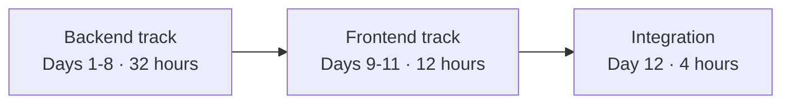
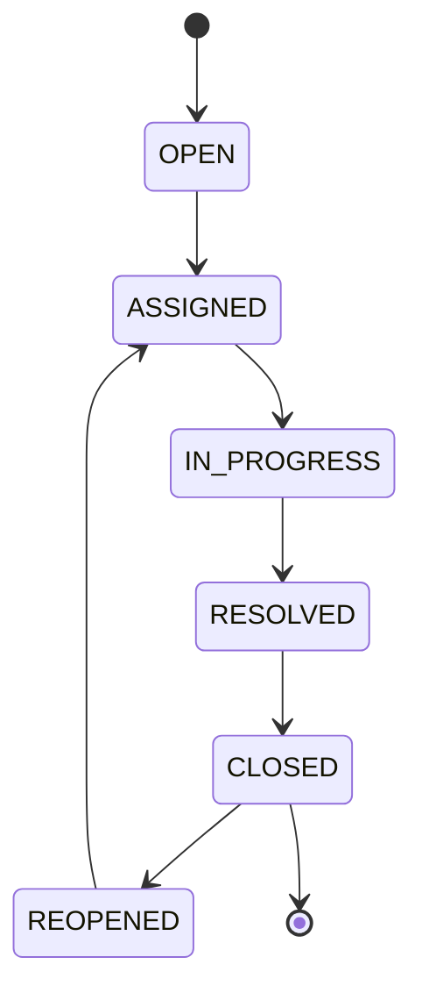
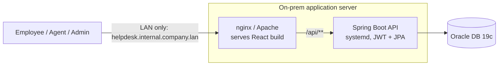

# Enterprise Application Development

**JDK 21 · Spring Boot 3 · Oracle · HTML5/CSS3/Bootstrap · React · On-Prem Deployment**

Welcome. Over 12 days (48 hours, 4 hours per day) you will move from modern Java and Spring Boot fundamentals, through data access, REST, security, testing, and on-prem deployment, to a React front end and a full-stack deployment on your organization's network.

This page gives you the agenda and the day-wise plan first. The case study that ties every day together follows the schedule.

## Training agenda

| Track | Days | Hours | What it covers |
|---|---|---|---|
| **Backend** | 1-8 | 32 | JDK 21, Spring Boot 3, Oracle, JPA/Hibernate, REST, service layer and PL/SQL, querying, Spring Security with JWT, testing, on-prem packaging and deployment |
| **Frontend** | 9-11 | 12 | HTML5/CSS3/Bootstrap and JavaScript ES6+, React fundamentals, React Router, role-based views |
| **Integration** | 12 | 4 | Full-stack deployment on the intranet, final integration, capstone |



The backend is built, secured, tested, and deployed **before** the frontend begins, so every frontend exercise calls a real API on the network. Each day starts from the previous day's finished project, so you always extend one running system.

## Day-wise schedule

### Backend track

| Day | Hours | Focus | You build | Hands-on result |
|---|---|---|---|---|
| **1** | 1-4 | JDK 21, Maven, Spring Boot bootstrap, Oracle connectivity | `helpdesk-pro` project, hand-written Oracle DDL, `application.yml`, health endpoint | Connection verified with `SELECT 1 FROM DUAL`; virtual threads switched on and observed |
| **2** | 5-8 | JPA and Hibernate deep dive | `Ticket`, `User`, `Comment` entities, relationships, repositories | N+1 query reproduced, then fixed and compared in the SQL log |
| **3** ✅ | 9-12 | REST API, DTOs, validation, error handling | `TicketController`, request/response DTOs, global `ApiError` handling | Postman flow: raise, fetch, comment, and an invalid payload |
| **4** | 13-16 | Service layer, state machine, transactions, PL/SQL | `TicketService` with legal transitions, trigger, `FN_TICKET_OPEN_COUNT` | Valid, invalid, and rollback tests; trigger and function checked in SQL and from Java |
| **5** | 17-20 | Pagination, Specifications, SLA logic | Dynamic `GET /tickets` search, `dueBy`, scheduled SLA-breach job, composite index | Execution plan compared before and after the index |
| **6** ✅ | 21-24 | Spring Security, JWT, roles | `/auth/register`, `/auth/login`, secured `/tickets/**`, admin endpoints | Employee, Agent, and Admin see different data; forged or expired tokens rejected |
| **7** | 25-28 | Testing, observability, production-readiness | `@WebMvcTest`, `@DataJpaTest`, correlation-ID logging, dev/prod profiles | Full `mvn test` run; state-machine edge cases covered |
| **8** ✅ | 29-32 | Packaging and on-prem deployment | Executable JAR, `helpdesk-api.service`, `application-prod.yml`, nginx proxy | Service running on a LAN server; `/actuator/health` reachable only internally |

### Frontend track

| Day | Hours | Focus | You build | Hands-on result |
|---|---|---|---|---|
| **9** | 33-36 | HTML5, CSS3, Bootstrap, JavaScript ES6+ | Login page, "Raise Ticket" form, "My Tickets" list using `fetch` | Log in, raise a ticket, and see it listed from another machine on the network |
| **10** | 37-40 | React fundamentals | Vite app with `LoginPage`, `Navbar`, `TicketList`, `TicketCard`, `TicketForm`; Axios JWT interceptor | `TicketList` with loading and error states |
| **11** ✅ | 41-44 | React Router, forms, agent and admin views | Protected routes, ticket detail with comments, agent queue, admin metrics dashboard | Full cycle across two sessions: Employee raises, Agent resolves, Admin sees updated counts |

### Integration

| Day | Hours | Focus | You build | Hands-on result |
|---|---|---|---|---|
| **12** | 45-48 | Full-stack deployment on the intranet and capstone | Production React build, single nginx server block for SPA and API | End-to-end demo of the application on a shared on-prem test server |

✅ marks a **checkpoint day**. Before moving on, confirm your environment and code match the checkpoint list at the end of that day's walkthrough.

**Optional overview (outside the 48 hours): JSP and Thymeleaf.** A short side-by-side look at server-side rendering, using the same "Raise Ticket" form and "My Tickets" list built two ways against `TicketService`.

## The case study: HelpDesk Pro

Every day builds on one application: **HelpDesk Pro**, an internal IT support ticketing system that replaces email- and chat-based tracking with a structured ticket lifecycle.

| Role | What they can do |
|---|---|
| Employee | Raise a ticket, track its progress, add comments |
| Support Agent | Pick up tickets, update status, resolve issues |
| IT Admin | Manage agents, view ticket volume and SLA metrics |

Every ticket moves through this lifecycle, which you will model as an explicit state machine on Day 4:



### What it looks like at the end

Everything runs on the intranet. Nothing is exposed to the internet and no cloud services are used at any point.



The browser talks to nginx. nginx serves the React build and forwards `/api/**` calls to the Spring Boot service, which reads and writes Oracle.

## How to work through each day

1. Open the day's walkthrough in `walkthroughs/` and read **What you will build** and **Before you start**.
2. Follow the **Build steps** in order. Each step ends with a **Verify** line; run it before moving on.
3. Complete the **Hands-on exercises**.
4. Tick off the **Checkpoint** (Days 3, 6, 8, 11) and skim **Common pitfalls** if something does not behave as expected.

Your project carries forward: Day N starts from your finished Day N-1 project.

## Repository branches

| Branch | What is in it |
|---|---|
| `main` | Walkthroughs for every day |
| `solutions` | Everything on `main` plus a reference snapshot of the project at the end of each day, in `solutions/day-NN/` |

Try each step yourself first. Use `solutions` to compare your work, or to start a day from a known-good project if you need to catch up.

## Before Day 1: set up your machine

| Tool | Needed from |
|---|---|
| JDK 21 | Day 1 |
| Maven 3.9 or later | Day 1 |
| An IDE with Java and Spring support (IntelliJ IDEA or VS Code) | Day 1 |
| Git | Day 1 |
| Oracle SQL Developer or SQL*Plus, plus the schema credentials for the on-prem Oracle instance | Day 1 |
| Postman (or an equivalent HTTP client) | Day 3 |
| SSH access to the shared on-prem Linux server | Day 8 |
| A modern browser with developer tools | Day 9 |
| Node.js (current LTS) and npm | Day 10 |

Quick check:

```bash
java -version      # should report 21
mvn -version       # should report Java 21 as the runtime
git --version
```

## One ground rule

Everything in this programme is built, deployed, and demonstrated **on your organization's own hardware and network**. When you hit a deployment question, the answer is a JAR, a `systemd` service, and an nginx server block, not a cloud service or a container.
