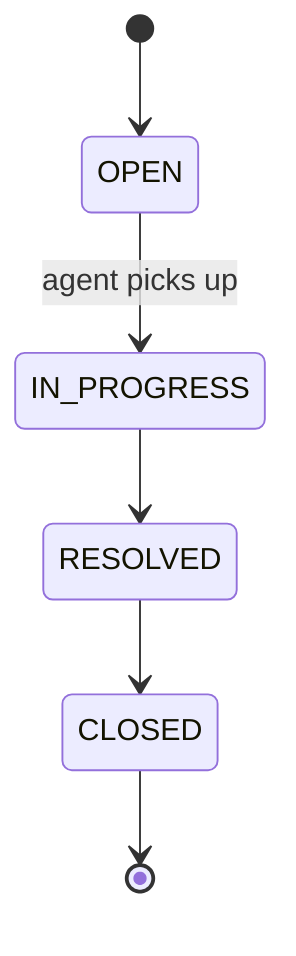

# HelpDesk Pro: Simpler Case Study (Proposal)

Status: **draft for approval**. This is a planning document for the course author. It is not learner material.

Once approved, section 5 (Case study) and section 6 (Day-by-day plan) of `CLAUDE.md` are updated to match.

## The idea in one line

An employee raises a ticket, an agent picks it up and resolves it, and a summary shows how many tickets are in each status.

## What gets simpler

| Area | Current plan | Simpler version | Why it is still enough |
|---|---|---|---|
| **Roles** | `EMPLOYEE`, `AGENT`, `ADMIN` | `EMPLOYEE` and `AGENT` only. Agents also see the summary counts | Role-based access is still taught, with one rule per role |
| **Ticket states** | `OPEN → ASSIGNED → IN_PROGRESS → RESOLVED → CLOSED` | `OPEN → IN_PROGRESS → RESOLVED → CLOSED` | It is still a state machine with invalid jumps. Picking up a ticket sets `assignedTo` and moves it to `IN_PROGRESS`, so there is no separate "assign" step |
| **Ticket fields** | Several SLA fields | `id`, `title`, `description`, `priority`, `status`, `raisedBy`, `assignedTo`, `createdAt`, `dueBy` | Enough for every feature below |
| **SLA** | Stored `slaBreached` flag plus a job that updates it | `dueBy` is set from the priority (`HIGH` 1 day, `MEDIUM` 3, `LOW` 7). `overdue` is worked out when the ticket is returned. One small `@Scheduled` job logs the overdue count | Teaches due dates and scheduling without extra state |
| **Filtering** | JPA Specifications | Spring Data query methods with `status` and `priority`, plus `Pageable` | Filtering and paging are taught, minus the advanced API |
| **Users** | `/auth/register` and login | Seeded users from a script, plus `/auth/login` only. Register is an optional exercise | Less code, same JWT flow |
| **Admin** | `/admin/agents`, `/admin/metrics` | One endpoint, `GET /tickets/summary` (counts by status), for agents | Same idea, and the Oracle function feeds it |
| **Oracle extras** | Trigger, function, `SYS_REFCURSOR`, execution plans | One trigger (`LAST_MODIFIED`) and one function (`FN_TICKET_OPEN_COUNT`). Execution plans become a single "add an index and compare" exercise | Oracle stays in the programme, with one small example of each |

## Final feature list

**Tables:** `USERS`, `TICKETS`, `COMMENTS`.

**API (8 endpoints):**

| Endpoint | Who | What it does |
|---|---|---|
| `POST /auth/login` | Anyone | Returns a token |
| `POST /tickets` | Employee | Raise a ticket |
| `GET /tickets` | Both | Employee sees their own, agent sees all. Optional `status`, `priority`, `page` |
| `GET /tickets/{id}` | Both | Ticket with its comments |
| `PATCH /tickets/{id}/status` | Agent | Move to the next state, only if allowed |
| `POST /tickets/{id}/comments` | Both | Add a comment |
| `GET /tickets/summary` | Agent | Counts by status and the overdue count |
| `GET /actuator/health` | Anyone | Health check |

**Screens (4):** login, ticket list (with the agent's summary on top), new ticket, ticket detail with comments and status buttons.

## Ticket lifecycle

`OPEN → CLOSED` is not allowed. Moving a ticket to `IN_PROGRESS` sets `assignedTo` to the agent making the change.

## What each day adds

| Day | Adds |
|---|---|
| 2 | The three entities and repositories |
| 3 | `POST /tickets`, `GET /tickets`, `GET /tickets/{id}`, DTOs, validation, `ApiError` |
| 4 | `TicketService`, the four-state rules, comments, the trigger and function |
| 5 | Paging, filters, `dueBy`, the scheduled job, `GET /tickets/summary` |
| 6 | Login, JWT, employee vs agent rules |
| 7 | A few tests, log files, profiles |
| 8 | JAR, service, nginx |
| 9–11 | The four screens, first in plain JavaScript, then React |
| 12 | Everything behind one nginx site |

## What this removes

- Re-opening tickets
- A separate assignment step
- The admin role and agent management
- Stored SLA-breach flag
- JPA Specifications
- Registration (kept as an optional exercise)
- PL/SQL cursor outputs

## Decisions needed

1. **Roles:** two roles (`EMPLOYEE`, `AGENT`), or keep `ADMIN` as a third? Dropping it removes the most code, but loses a three-way role comparison on Day 6.
2. **Ticket states:** is merging `ASSIGNED` into `IN_PROGRESS` fine? Keeping five states makes the diagram show "assigned" as its own step.
