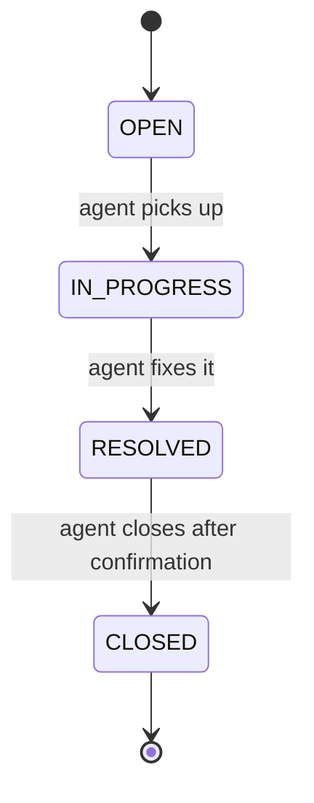
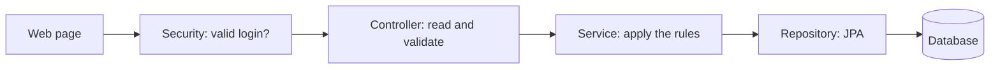
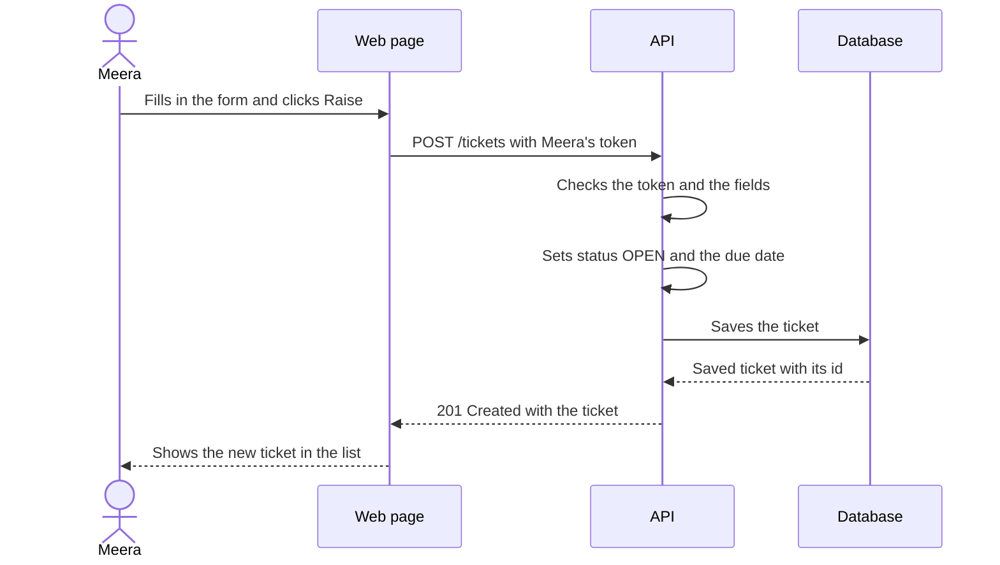
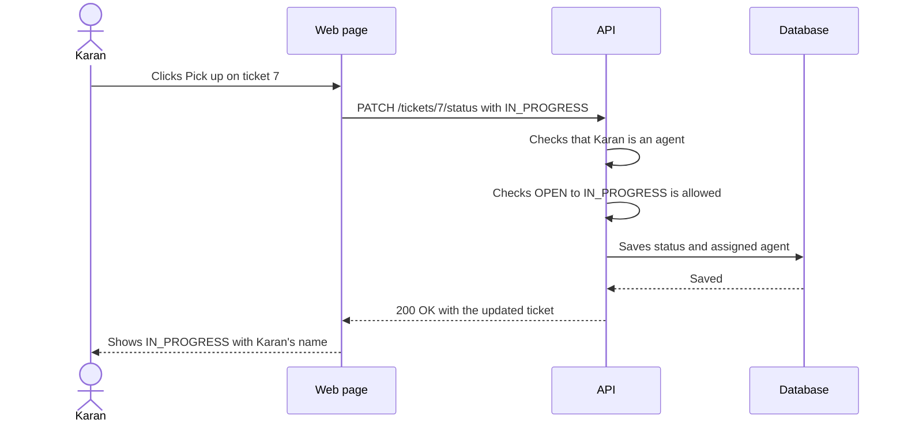
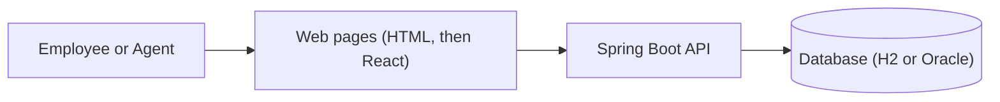
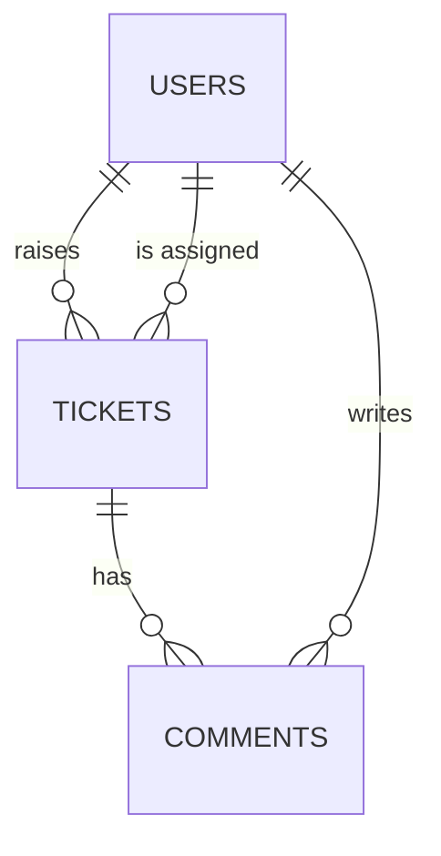
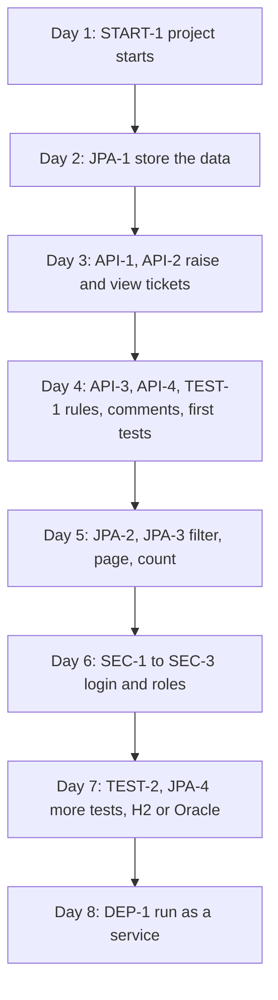
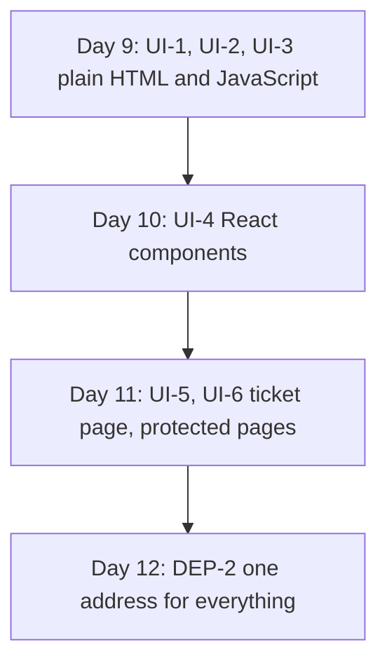

# The Case Study: HelpDesk Pro

Over the next days you build one application from start to finish. This page is the complete picture: the story, how the application works, and every user story you will build.

| Section | What it covers |
|---|---|
| [1. The story](#1-the-story) | Why HelpDesk Pro exists |
| [2. How one ticket lives](#2-how-one-ticket-lives) | The ticket from start to finish |
| [3. The visual flow](#3-the-visual-flow) | What happens inside the application |
| [4. The people](#4-the-people) | Who uses it |
| [5. What you build](#5-what-you-build-in-six-areas) | Six areas of features |
| [6. How the pieces fit](#6-how-the-pieces-fit) | Data, API, screens |
| [7. The 12-day plan](#7-the-12-day-plan) | What you add each day |
| [8. User stories](#8-user-stories) | The things to build, with "Done when" lists |
| [9. Extras](#9-extras-if-you-have-time) | Optional ideas |

---

## 1. The story

Brightway Logistics is a company with about 300 employees. It has one small IT support team.

Employees ask for help by email. A typical Monday morning looks like this.

Meera, who works in accounts, cannot print an invoice. She emails `it-help`. Her email lands in a shared mailbox with 200 others.

Karan, a support agent, sees it two hours later. Karan does not know if a colleague has already started on it. So Karan replies, "Did anyone pick this up?" Nobody answers. Meanwhile another agent fixes the printer, and Karan fixes it again.

By Friday, the IT manager asks a simple question: "How many issues are still open?"

Nobody can answer. The team has a spreadsheet, but it is two weeks out of date.

The company decides to replace the shared mailbox with a small web application. Each problem becomes a **ticket**. Each ticket has an owner, a status, and a due date. You are going to build it. It is called **HelpDesk Pro**.

---

## 2. How one ticket lives

Follow Meera's printer problem through HelpDesk Pro.

| Step | What happens | Ticket status |
|---|---|---|
| 1 | Meera logs in and raises a ticket: "Cannot print invoices", priority `HIGH`. The system sets a due date of tomorrow | `OPEN` |
| 2 | Karan sees it in the list and picks it up. The ticket now shows Karan's name | `IN_PROGRESS` |
| 3 | Karan adds a comment: "Restarted the print service. Please try again." Meera replies with a comment | `IN_PROGRESS` |
| 4 | Karan marks the ticket as fixed | `RESOLVED` |
| 5 | Meera confirms it works. Karan closes the ticket | `CLOSED` |

A ticket can only move forward one step at a time. A ticket that is `OPEN` cannot jump straight to `CLOSED`. That rule is the heart of the application.

How to read it: each arrow is a move the application allows. Any move that has no arrow is refused.

---

## 3. The visual flow

Three pictures show what happens inside HelpDesk Pro. Each one uses the areas you build: security, APIs, and JPA.

### 3.1 Where a request goes

Every request, from any screen, takes the same path through the application.

How to read it: the request moves left to right. If a step says no, the request stops there and an error goes back. For example, a missing login stops at Security, and a missing title stops at the Controller.

| Step | Area | Its one job |
|---|---|---|
| Security | Security | Checks who is asking and what they may do |
| Controller | APIs | Reads the request and checks the fields |
| Service | APIs | Applies the ticket rules, such as the allowed status moves |
| Repository | JPA | Saves and finds data |
| Database | JPA | Keeps the data |

### 3.2 Raising a ticket

How to read it: time runs from top to bottom. A solid arrow is a request, and a dotted arrow is the answer.

### 3.3 Picking up and resolving a ticket

How to read it: the API makes two checks before it saves anything. If either check fails, the database is never touched, and Karan sees an error instead.

---

## 4. The people

HelpDesk Pro has two kinds of users.

| Role | Example | What they can do |
|---|---|---|
| `EMPLOYEE` | Meera | Raise a ticket, see **their own** tickets, add comments |
| `AGENT` | Karan | See **all** tickets, pick up, resolve and close tickets, add comments, see the summary counts |

The IT manager's question ("how many are still open?") is answered by a **summary** that agents see: the number of tickets in each status.

---

## 5. What you build, in six areas

Every feature belongs to one of six areas. Each area is one theme of the programme.

| Area | What you build | Days |
|---|---|---|
| **JPA** (data) | Tables and entities for users, tickets, and comments. Finding tickets by status, in pages. Counting tickets by status | 2, 5 |
| **APIs** | Raise a ticket, view tickets, move a ticket forward, add a comment. Clear error messages | 3, 4 |
| **Unit testing** | Automatic tests for the status rules and the API | 4, 7 |
| **Security** | Log in. Employees see their own tickets. Only agents change status | 6 |
| **Frontend** | Login page, raise-ticket form, ticket list, ticket page, first in plain JavaScript and then in React | 9, 10, 11 |
| **Deployment** | Run the application as a service on a server, and put the web pages and the API behind one address | 8, 12 |

### Priority and due date

| Priority | Due date is set to |
|---|---|
| `HIGH` | 1 day after the ticket is created |
| `MEDIUM` | 3 days after |
| `LOW` | 7 days after |

---

## 6. How the pieces fit

How to read it: people use the web pages, the web pages call the API, and the API reads and writes the database.

> **Note:** Everything runs on your machine or on your organization's own network. Nothing is exposed to the internet.

### The data

HelpDesk Pro keeps three kinds of things.

| Table | Main fields |
|---|---|
| `USERS` | `ID`, `NAME`, `EMAIL`, `PASSWORD`, `ROLE` |
| `TICKETS` | `ID`, `TITLE`, `DESCRIPTION`, `PRIORITY`, `STATUS`, `RAISED_BY`, `ASSIGNED_TO`, `CREATED_AT`, `DUE_BY` |
| `COMMENTS` | `ID`, `TICKET_ID`, `AUTHOR_ID`, `TEXT`, `CREATED_AT` |

`RAISED_BY` and `ASSIGNED_TO` both point to a row in `USERS`. `ASSIGNED_TO` is empty until an agent picks the ticket up.

### The API

| Endpoint | Who | What it does |
|---|---|---|
| `POST /auth/login` | Anyone | Checks the login and returns a token |
| `POST /tickets` | Employee | Raises a ticket |
| `GET /tickets` | Both | Lists tickets. Employees see their own, agents see all. Optional `status`, `priority`, `page`, `size` |
| `GET /tickets/{id}` | Both | Shows one ticket with its comments |
| `PATCH /tickets/{id}/status` | Agent | Moves the ticket to the next status, if allowed |
| `POST /tickets/{id}/comments` | Both | Adds a comment |
| `GET /tickets/summary` | Agent | Counts of tickets by status |
| `GET /actuator/health` | Anyone | Says whether the application is running |

### The screens

| Screen | What it shows |
|---|---|
| Login | Email and password |
| Ticket list | The tickets, with a status badge on each. Agents also see the summary counts above the list |
| New ticket | A form to raise a ticket |
| Ticket detail | One ticket, its comments, an add-comment box, and (for agents) the buttons to move the status |

---

## 7. The 12-day plan

You never start over. Each day takes the project from the day before and adds one layer. Next to each day is a **small stand-alone example**. You try the idea on something tiny first, then apply it to HelpDesk Pro.

| Day | Area | You learn | Small example first | Stories |
|---|---|---|---|---|
| **1** ✅ | Setup | Java setup, Maven, a Spring Boot app | `Hello` class, a `/hello` endpoint | START-1 |
| **2** | Setup, JPA | Project structure, naming conventions, the Spring Boot flow, REST API basics, then entities, repositories, relationships | A `Book` that belongs to an `Author` | JPA-1 |
| **3** | APIs | Controllers, DTOs, validation, error responses | A `Student` form that must have a name | API-1, API-2 |
| **4** | APIs, testing | Service layer, status rules, transactions, first unit tests | A traffic light that can only go in order | API-3, API-4, TEST-1 |
| **5** | JPA | Query methods, paging, counting | A long list of books shown 5 at a time | JPA-2, JPA-3 |
| **6** | Security | Login, JWT, roles | A library where members and librarians can do different things | SEC-1, SEC-2, SEC-3 |
| **7** | Testing, JPA | Controller and repository tests, profiles | A `discount` method with three tests | TEST-2, JPA-4 |
| **8** | Deployment | Packaging, a background service, a reverse proxy | Run a `.jar` as a background service | DEP-1 |
| **9** | Frontend | HTML, CSS, Bootstrap, JavaScript, `fetch` | A to-do list page | UI-1, UI-2, UI-3 |
| **10** | Frontend | React basics | A counter button and a list of names | UI-4 |
| **11** | Frontend | React Router, forms, role-based screens | A two-page app with a menu | UI-5, UI-6 |
| **12** | Deployment | Production build, one address | n/a | DEP-2 |

✅ = delivered.

### The journey

Days 1 to 8 build the backend, one layer at a time.

Days 9 to 12 put a face on it and finish the delivery.

How to read them: each box adds to the box above it. You never throw work away.

### Which database, and when

- **H2** is a small database that runs inside your application. You use it from Day 2 and there is nothing to install.
- **Oracle** is used through its own profile (Day 7). The Java code stays the same.

---

## 8. User stories

A **user story** is one small thing a person wants from the application. It follows this pattern:

> As a **role**, I want **something**, so that **a reason**.

Each story has a **Done when** list. When every line is true, the story is done.

| Area | Stories | Days |
|---|---|---|
| [Start](#start) | START-1 | 1 |
| [JPA](#jpa) | JPA-1, JPA-2, JPA-3, JPA-4 | 2, 5, 7 |
| [APIs](#apis) | API-1, API-2, API-3, API-4 | 3, 4 |
| [Unit testing](#unit-testing) | TEST-1, TEST-2 | 4, 7 |
| [Security](#security) | SEC-1, SEC-2, SEC-3 | 6 |
| [Frontend](#frontend) | UI-1 to UI-6 | 9, 10, 11 |
| [Deployment](#deployment) | DEP-1, DEP-2 | 8, 12 |

### Start

#### START-1: The project starts · Day 1 ✅

> As a **developer**, I want a Spring Boot project that starts and answers a request, so that I know my setup works.

**Done when**
- `mvn clean package` ends with `BUILD SUCCESS`.
- `GET /hello` returns text.
- `GET /tickets` returns a list.

**Concepts:** JDK, Maven, `pom.xml`, `@SpringBootApplication`, `@RestController`, `@GetMapping`

---

### JPA

How HelpDesk Pro stores and finds its data.

#### JPA-1: Tickets are stored in tables · Day 2

> As a **developer**, I want users, tickets, and comments saved in database tables, so that the application keeps real data instead of a list in memory.

**Done when**
- Tables `USERS`, `TICKETS`, and `COMMENTS` exist.
- You can save a ticket that has a `raisedBy` user, then load it back.
- You can load a ticket and see its comments.

**Concepts:** `@Entity`, `@Id`, repository, `@ManyToOne`, `@OneToMany`, lazy loading, H2

#### JPA-2: Filter and page tickets · Day 5

> As an **agent**, I want to filter the list by status and priority and move through pages, so that I can find tickets quickly.

**Done when**
- `GET /tickets?status=OPEN` returns only open tickets.
- `GET /tickets?priority=HIGH&status=OPEN` returns tickets that match both.
- `page` and `size` control the page.
- Leaving the filters out returns everything.

**Concepts:** query methods, `Pageable`, `Page<T>`, `@RequestParam`

#### JPA-3: Count tickets by status · Day 5

> As an **agent**, I want to see how many tickets are in each status, so that I can answer "how many are still open?"

**Done when**
- `GET /tickets/summary` returns a count for each status.
- The numbers match what you see in `GET /tickets`.

**Concepts:** `@Query`, `GROUP BY`, a small response record

#### JPA-4: Run on H2 or Oracle · Day 7

> As a **developer**, I want to switch the database with a setting, so that I can learn on H2 and run on Oracle without changing code.

**Done when**
- Starting with no profile uses H2.
- Starting with the `oracle` profile uses Oracle.
- Each database has its own table script.
- No password appears in a committed file.

**Concepts:** Spring profiles, `application-dev.yml`, environment variables, a hand-written table script

---

### APIs

How people and programs talk to HelpDesk Pro.

#### API-1: Raise a ticket · Day 3

> As an **employee**, I want to raise a ticket with a title, description, and priority, so that IT knows what I need.

**Done when**
- `POST /tickets` with a valid body returns `201` and the new ticket.
- The new ticket has status `OPEN` and a due date based on its priority.
- A missing title returns `400` with an `ApiError` that names the field.
- A priority that is not `LOW`, `MEDIUM`, or `HIGH` returns `400`.
- The response is a `TicketResponseDTO`, never the entity itself.

**Concepts:** DTO, `@RequestBody`, `@Valid`, `@NotBlank`, `@RestControllerAdvice`, `ApiError`, HTTP status codes

#### API-2: See tickets · Day 3

> As an **employee**, I want to see my tickets and open one, so that I can follow its progress.

**Done when**
- `GET /tickets` returns a list of tickets.
- `GET /tickets/{id}` returns one ticket.
- An id that does not exist returns `404` with an `ApiError`.

**Concepts:** `@PathVariable`, `Optional`, exception handler, mapping an entity to a DTO

#### API-3: Move a ticket forward · Day 4

> As an **agent**, I want to pick up, resolve, and close a ticket, so that everyone knows where it stands.

**Done when**
- `PATCH /tickets/{id}/status` accepts `IN_PROGRESS`, `RESOLVED`, and `CLOSED`, one step at a time.
- Moving to `IN_PROGRESS` sets `assignedTo` to the agent.
- `OPEN → CLOSED` is refused with `409` and a clear message.
- Any move not shown in the status diagram is refused.

**Concepts:** service layer, `@Service`, constructor injection, `enum`, allowed-moves map, custom exception, `409 Conflict`

> **Note:** Before Day 6 the request names the agent. After Day 6 the agent comes from the login.

#### API-4: Comment on a ticket · Day 4

> As an **employee or agent**, I want to add a comment to a ticket, so that we can talk about the problem in one place.

**Done when**
- `POST /tickets/{id}/comments` saves a comment with the author and time.
- An empty comment is refused with `400`.
- `GET /tickets/{id}` shows the comments in time order.

**Concepts:** `@Transactional`, one-to-many, validation

---

### Unit testing

How you know the rules still work.

#### TEST-1: Test the status rules · Day 4

> As a **developer**, I want automatic tests for the status rules, so that I notice at once when I break one.

**Done when**
- One test shows an allowed move succeeds.
- One test shows `OPEN → CLOSED` is refused.
- The tests run without a database.

**Concepts:** JUnit 5, Mockito, `@Test`, assertions, `assertThrows`

#### TEST-2: Test the API and the repository · Day 7

> As a **developer**, I want tests for the endpoints and the queries, so that a change in one layer cannot quietly break another.

**Done when**
- A test shows a valid `POST /tickets` returns `201`.
- A test shows a missing title returns `400`.
- A test shows an unknown id returns `404`.
- A test shows the repository returns only tickets with the requested status.
- `mvn test` passes.

**Concepts:** `@WebMvcTest`, `MockMvc`, `@DataJpaTest`, test data

---

### Security

How HelpDesk Pro knows who you are and what you may do.

#### SEC-1: Log in · Day 6

> As a **user**, I want to log in with my email and password, so that the application knows who I am.

**Done when**
- `POST /auth/login` with correct details returns a token.
- Wrong details return `401`.
- Passwords are stored hashed, never as plain text.
- Requests to `/tickets` without a token return `401`.

**Concepts:** Spring Security, `PasswordEncoder`, JWT, `Authorization: Bearer`

#### SEC-2: Employees see only their own tickets · Day 6

> As an **employee**, I want to see only my own tickets, so that other people's problems stay private.

**Done when**
- An employee's `GET /tickets` returns only tickets raised by that employee.
- An employee opening someone else's ticket gets `404`.
- An agent sees every ticket.

**Concepts:** the current user, role-based filtering in the service

#### SEC-3: Only agents change status · Day 6

> As an **IT manager**, I want only agents to move tickets and see the summary, so that employees cannot close their own tickets.

**Done when**
- An employee calling `PATCH /tickets/{id}/status` gets `403`.
- An employee calling `GET /tickets/summary` gets `403`.
- A test shows `403` for an employee and `200` for an agent.

**Concepts:** roles, `@PreAuthorize`, `403 Forbidden`

---

### Frontend

How people actually use HelpDesk Pro.

#### UI-1: Log in from a page · Day 9

> As a **user**, I want a login page, so that I can use HelpDesk Pro from a browser.

**Done when**
- The page sends the email and password to `POST /auth/login`.
- The token is kept and sent with later calls.
- A wrong password shows a message on the page.
- The backend allows calls from the page's address (CORS), so the browser does not block them.

**Concepts:** HTML form, `fetch`, `async`/`await`, `localStorage`, Bootstrap form, CORS

#### UI-2: Raise a ticket from a page · Day 9

> As an **employee**, I want a form to raise a ticket, so that I do not need a command line.

**Done when**
- The form has title, description, and priority.
- Submitting it creates a ticket through the API.
- An error from the API is shown next to the form.

**Concepts:** DOM events, `FormData`, JSON body, showing API errors

#### UI-3: See tickets in a list · Day 9

> As an **employee**, I want to see my tickets in a list with a status badge, so that I can tell at a glance where each one is.

**Done when**
- The list is filled from `GET /tickets`.
- Each row has a coloured badge for its status.

**Concepts:** DOM updates, Bootstrap table and badge, rendering a list

#### UI-4: The same screens as React components · Day 10

> As a **developer**, I want the login, list, and form as React components, so that each part can be reused and changed on its own.

**Done when**
- `LoginPage`, `Navbar`, `TicketList`, `TicketCard`, and `TicketForm` exist.
- `TicketList` shows a loading message while waiting and an error message if the API is down.
- The token is added to every request in one place.

**Concepts:** components, props, `useState`, `useEffect`, Vite, Axios, interceptor

#### UI-5: A ticket page with comments and agent buttons · Day 11

> As an **employee or agent**, I want a page for one ticket with its comments, and as an agent I want buttons for the next status, so that the whole conversation and the next step are in one place.

**Done when**
- `/tickets/:id` shows the ticket and its comments.
- Adding a comment shows it in the list without a full page reload.
- Agents see only the status buttons that are allowed from the current status. Employees see none.
- The ticket list shows the summary counts to agents.

**Concepts:** React Router, route parameters, controlled form, conditional rendering, `AuthContext`

#### UI-6: Pages that need a login · Day 11

> As a **user**, I want to be sent to the login page if I am not logged in, so that I never see a broken screen.

**Done when**
- `/tickets`, `/tickets/new`, and `/tickets/:id` go to `/login` without a token.
- After login, I land on `/tickets`.
- Logging out clears the token and returns to `/login`.

**Concepts:** `ProtectedRoute`, `Navigate`

---

### Deployment

How HelpDesk Pro runs for real people.

#### DEP-1: Run as a service · Day 8

> As an **operator**, I want HelpDesk Pro to run as a background service on a server, so that it keeps running when nobody is logged in.

**Done when**
- `mvn clean package` produces one runnable `.jar`.
- `systemctl start helpdesk-api` starts it, and `systemctl status` shows it running.
- If the process stops, it starts again by itself.
- nginx forwards `/api/**` to the application.
- `GET /actuator/health` answers from another machine on the same network.

**Concepts:** executable JAR, `systemd` unit, environment file, reverse proxy, Actuator health

#### DEP-2: One address for everything · Day 12

> As a **user**, I want to open one address and use HelpDesk Pro, so that I do not need to know about ports or servers.

**Done when**
- `npm run build` produces the web pages.
- nginx serves the pages and forwards `/api/**` to the application on the same address.
- This full run works on the server: Meera raises a ticket, Karan picks it up and comments, Meera replies, Karan resolves it, Meera confirms, Karan closes it, and the summary counts change at each step.
- Only machines on your network can reach it.

**Concepts:** production build, static hosting, reverse proxy, end-to-end check

---

## 9. Extras if you have time

These are not part of the main build. Try them after the stories are done.

| Extra | Idea |
|---|---|
| Register | `POST /auth/register` to create a user |
| Re-open | Move a `CLOSED` ticket back to `OPEN` |
| Overdue | Mark a ticket as overdue when its due date has passed, and log the count with a `@Scheduled` job |
| Last change | A `LAST_MODIFIED` column filled by an Oracle trigger |
| Open count | An Oracle function that counts an agent's unresolved tickets, called from Java |
| Status log | Write one log line for each status change |

---

## How to work through it

1. Read the day's walkthrough.
2. Try the small example.
3. Build the matching user stories in HelpDesk Pro (section 8).
4. Check each story against its **Done when** list before moving on.

At the end of each day your project should run. The next day starts from it.
