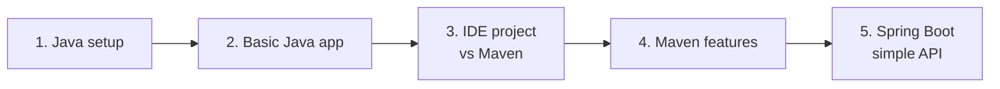
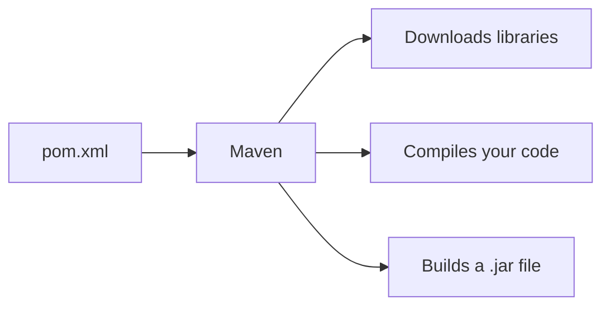
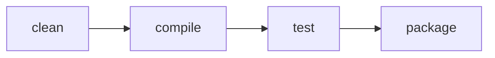
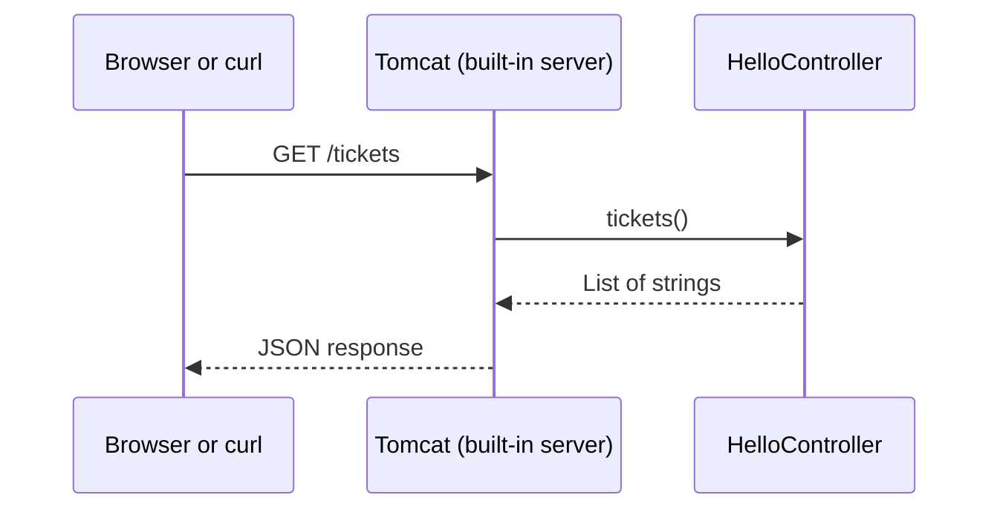

# Day 1 Recap: Java, Maven, and Your First Spring Boot API

This page recaps everything you did on Day 1. Read it top to bottom, or jump to the part you want to revisit. Every example here is small enough to type and run again.

## What you did on Day 1

| # | Topic | Result |
|---|---|---|
| 1 | Set up Java | `java` and `javac` run from the terminal |
| 2 | A basic Java app | You compiled and ran a class with a `main` method |
| 3 | IntelliJ project vs Maven project | You saw why a build tool helps |
| 4 | Features of Maven | `pom.xml`, dependencies, the build lifecycle |
| 5 | A basic Spring Boot app | A running server with a simple API |



How to read it: each step uses the one before it. Spring Boot needs Maven, and Maven needs Java.

---

## 1. Java setup

To write and run Java you need the **JDK** (Java Development Kit). It contains two tools you use all the time.

| Tool | What it does |
|---|---|
| `javac` | The compiler. Turns your `.java` file into a `.class` file |
| `java` | Runs a `.class` file |

**Check your setup**

```bash
java -version
javac -version
```

You should see a version number from both commands. This programme uses **Java 21**.

> **Note:** If `javac` is not found but `java` is, you have installed only a runtime. Install the full JDK.

> **Note:** Open a **new** terminal window after installing, so the terminal picks up the change.

---

## 2. A basic Java app

A Java program starts at the `main` method.

Create a file named `Hello.java`:

```java
public class Hello {
    public static void main(String[] args) {
        System.out.println("Hello, HelpDesk!");
    }
}
```

Compile it, then run it:

```bash
javac Hello.java
java Hello
```

**You should see:**

```text
Hello, HelpDesk!
```

What happened:

1. `javac Hello.java` created a file called `Hello.class`.
2. `java Hello` started the JVM, which looked for `main` in that class and ran it.

> **Note:** The file name must match the class name. `public class Hello` must be in `Hello.java`.

---

## 3. IntelliJ project vs Maven project

You can create a Java project in IntelliJ in two ways. Both let you write and run code. They differ in how the project is described.

| | Plain IntelliJ project | Maven project |
|---|---|---|
| **Project is described by** | IntelliJ's own files (`.idea`, `.iml`) | `pom.xml` |
| **Adding a library** | Download the `.jar` yourself and add it in the IDE settings | Add three lines to `pom.xml` and Maven downloads it |
| **Folder layout** | Whatever you choose | A standard layout every Maven project shares |
| **Build outside the IDE** | Not possible without extra setup | `mvn package` works in any terminal |
| **Share with a teammate** | They must repeat your IDE settings | They open the folder and Maven does the rest |

The main point: with a plain IntelliJ project, the project only really exists inside IntelliJ. With Maven, the project is described in a file that any machine, any IDE, and any build server can read.



How to read it: you describe the project once in `pom.xml`, and Maven does the repeated work.

---

## 4. Features of Maven

### The standard folder layout

Every Maven project looks the same, so you always know where things are.

```text
helpdesk-pro/
├── pom.xml
└── src/
    ├── main/
    │   ├── java/         your code
    │   └── resources/    configuration files
    └── test/
        └── java/         your tests
```

When you build, Maven creates a `target/` folder for its output. You never edit anything in `target/`.

### The `pom.xml`

`pom.xml` is the project's description. These are the parts you use most:

| Part | Meaning | Example |
|---|---|---|
| `groupId` | Your organization or package name | `com.helpdeskpro` |
| `artifactId` | The project name | `helpdesk-pro` |
| `version` | The project version | `0.0.1-SNAPSHOT` |
| `<dependencies>` | Libraries the project needs | `spring-boot-starter-web` |
| `<plugins>` | Extra build abilities | `spring-boot-maven-plugin` |

### Dependencies

A **dependency** is a library you want to use. You name it in `pom.xml`:

```xml
<dependency>
    <groupId>org.springframework.boot</groupId>
    <artifactId>spring-boot-starter-web</artifactId>
</dependency>
```

Maven downloads the library from **Maven Central** (a public store of Java libraries) into a folder on your machine, and also downloads anything that library itself needs.

### The build lifecycle

Maven runs a build in a fixed order. When you ask for one step, it runs every step before it.



| Command | What it does |
|---|---|
| `mvn clean` | Deletes the `target/` folder |
| `mvn compile` | Compiles the code in `src/main/java` |
| `mvn test` | Compiles and runs the tests |
| `mvn package` | Does all of the above, then builds the `.jar` file in `target/` |

In practice, you will most often run:

```bash
mvn clean package
```

---

## 5. A basic Spring Boot app with a simple API

**Spring Boot** is a framework that gives you a working web server with very little setup. An **API** is a set of URLs that a program (or a browser) can call to get data.

### The project

The `pom.xml` for the project has three important parts.

```xml
<parent>
    <groupId>org.springframework.boot</groupId>
    <artifactId>spring-boot-starter-parent</artifactId>
    <version>3.5.6</version>
</parent>

<properties>
    <java.version>21</java.version>
</properties>

<dependencies>
    <dependency>
        <groupId>org.springframework.boot</groupId>
        <artifactId>spring-boot-starter-web</artifactId>
    </dependency>
</dependencies>
```

| Part | Why it is there |
|---|---|
| `spring-boot-starter-parent` | Picks matching versions of all Spring libraries for you |
| `java.version` | Tells Maven to build for Java 21 |
| `spring-boot-starter-web` | One dependency that brings in everything needed for a web server and an API |

### The main class

This class starts the application.

```java
package com.helpdeskpro;

import org.springframework.boot.SpringApplication;
import org.springframework.boot.autoconfigure.SpringBootApplication;

@SpringBootApplication
public class HelpdeskProApplication {

    public static void main(String[] args) {
        SpringApplication.run(HelpdeskProApplication.class, args);
    }
}
```

`@SpringBootApplication` tells Spring Boot: "start from this class, and look for your other classes in this package and below."

### The controller

A **controller** is a class that receives requests and returns a response. Think of it as a receptionist: a request arrives, and the controller decides what to hand back.

```java
package com.helpdeskpro;

import java.util.List;
import org.springframework.web.bind.annotation.GetMapping;
import org.springframework.web.bind.annotation.RestController;

@RestController
public class HelloController {

    @GetMapping("/hello")
    public String hello() {
        return "Hello from HelpDesk Pro!";
    }

    @GetMapping("/tickets")
    public List<String> tickets() {
        return List.of("Printer is not working", "Cannot log in to email");
    }
}
```

| Annotation | Meaning |
|---|---|
| `@RestController` | This class handles web requests and returns data |
| `@GetMapping("/hello")` | When someone sends a `GET` request to `/hello`, run this method |

### Run it and call it

Build and start the application:

```bash
mvn clean package
java -jar target/helpdesk-pro-0.0.1-SNAPSHOT.jar
```

You can also start it with `mvn spring-boot:run`, or run the main class from IntelliJ.

In a second terminal, call the API:

```bash
curl http://localhost:8080/hello
curl http://localhost:8080/tickets
```

**You should see:**

```text
Hello from HelpDesk Pro!
["Printer is not working","Cannot log in to email"]
```

You can also open `http://localhost:8080/hello` in a browser.

Notice that the list came back as `["...","..."]`. Spring Boot turned the Java `List` into **JSON**, the standard text format for sending data between programs.

### What happens on a request



How to read it: Spring Boot starts a web server called Tomcat inside your application. Tomcat receives the request and hands it to your controller method. The result goes back the same way.

> **Note:** Press `Ctrl + C` in the terminal to stop the application.

---

## Common mistakes

| Symptom | Cause | Fix |
|---|---|---|
| `javac: command not found` | Only a Java runtime is installed, or the terminal is old | Install the full JDK and open a new terminal |
| `class Hello is public, should be declared in a file named Hello.java` | File name and class name differ | Rename the file or the class so they match |
| `release version 21 not supported` | The JDK on your machine is older than Java 21 | Install JDK 21 and point `JAVA_HOME` to it |
| `Port 8080 was already in use` | Another program, or an earlier run of your app, is using the port | Stop that program, or add `server.port=8081` to `src/main/resources/application.properties` |
| `404` on a URL you wrote a method for | The controller is outside the main class's package, or the path is misspelled | Keep the controller in `com.helpdeskpro` (or a sub-package) and check the path |
| You changed the code but the response is the same | The old application is still running | Stop it with `Ctrl + C` and start it again |
| `Could not transfer artifact` during a Maven build | Maven cannot reach the internet through the company proxy | Follow [Maven proxy troubleshooting](maven-proxy-troubleshooting.md) |
| IntelliJ fails on `apache-maven-...-bin.zip` | IntelliJ is using the Maven wrapper, which downloads Maven without your proxy settings | Choose the bundled Maven: [IntelliJ Maven home path](intellij-maven-home-path.md) |
| `git clone` fails with `Could not resolve host` or `407` | Git does not use Maven's or the browser's proxy settings | Follow [Git proxy troubleshooting](git-proxy-troubleshooting.md) |

---

## Check yourself

- [ ] `java -version` and `javac -version` both show Java 21.
- [ ] You can compile and run a class with `javac` and `java`.
- [ ] You can explain one reason to prefer Maven over a plain IntelliJ project.
- [ ] You know what `pom.xml`, a dependency, and `mvn clean package` do.
- [ ] `http://localhost:8080/hello` returns text, and `http://localhost:8080/tickets` returns JSON.

## Recap

- The **JDK** gives you `javac` to compile and `java` to run.
- A Java program starts at the `main` method.
- **Maven** describes a project in `pom.xml`, downloads dependencies, and builds the same way on every machine.
- `mvn clean package` builds a runnable `.jar` in `target/`.
- A **Spring Boot** app starts with `@SpringBootApplication`, and a `@RestController` with `@GetMapping` turns a method into a URL.

## Related notes

- [JAR vs WAR, and REST APIs vs pages with views](jar-vs-war-and-app-types.md): how to package an application, and what it returns.
- [Maven proxy troubleshooting](maven-proxy-troubleshooting.md)
- [Git proxy troubleshooting](git-proxy-troubleshooting.md)
- [IntelliJ: use the bundled Maven](intellij-maven-home-path.md)
- [Proxy issues ahead](proxy-issues-ahead.md)

## What comes next

On Day 2 you store tickets in a database instead of a hard-coded list. You will use **H2**, a small database that runs inside your application, so there is nothing extra to install.
