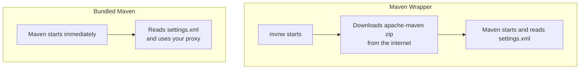

# IntelliJ: Use the Bundled Maven (Not the Maven Wrapper)

IntelliJ can run your project with one of several Maven installations. On a company network, the choice decides whether your build works. This page explains the two choices and shows how to select the right one.

## 1. The two choices

| | Maven Wrapper | Bundled Maven |
|---|---|---|
| **What it is** | A small script (`mvnw`) inside your project that downloads its own copy of Maven | A copy of Maven that already ships inside IntelliJ |
| **Where Maven comes from** | The internet, on first use | Your machine. Nothing to download |
| **Needs internet to start** | Yes | No |
| **Reads your proxy from `settings.xml`** | No, not for its own download | Yes |

Projects created by Spring Initializr contain the wrapper files (`mvnw`, `mvnw.cmd`, and a `.mvn` folder). When IntelliJ sees them, it can pick the wrapper for you.

## 2. Why this matters

The wrapper has to download Maven **before** Maven can start. Your proxy settings live in `settings.xml`, and `settings.xml` is read by Maven. Maven has not started yet, so the wrapper never sees them.



How to read it: with the wrapper, the first download happens without your proxy settings, so it can fail even when `settings.xml` is correct. With the bundled Maven there is no first download.

This is what the wrapper prints when it cannot reach the internet:

```text
curl: Failed to fetch https://repo.maven.apache.org/maven2/org/apache/maven/apache-maven/3.9.11/apache-maven-3.9.11-bin.zip
```

Notice that it fails on the Maven **zip file**, not on a project library. That is the sign that the wrapper is the problem and your `settings.xml` is not.

## 3. Set the bundled Maven in IntelliJ

1. Open IntelliJ's settings.
   - macOS: **IntelliJ IDEA → Settings** (or press `Cmd + ,`)
   - Windows and Linux: **File → Settings** (or press `Ctrl + Alt + S`)
2. In the left panel, open **Build, Execution, Deployment → Build Tools → Maven**.
3. Find the field **Maven home path**.
4. Open its drop-down and choose **Bundled (Maven 3)**.
5. Look just under the field. It shows the version, for example `(Version: 3.9.11)`. If you see a version number, the choice worked.
6. Look at **User settings file**. It should point to your `settings.xml`, for example `/Users/<your-name>/.m2/settings.xml` (on Windows, `C:\Users\<your-name>\.m2\settings.xml`).
   - If the path is right, leave **Override** unticked.
   - If your file is somewhere else, tick **Override** and choose the file.
7. Click **Apply**, then **OK**.
8. Reload the project. Open the **Maven** tool window (usually on the right side), then click the **Reload All Maven Projects** button (the circular arrows).

> **Note:** The drop-down may also list **Use Maven wrapper** and any Maven installed on your machine. Choose **Bundled (Maven 3)** for this programme.

> **Note:** IntelliJ remembers this choice per project. Check it again when you open or create a new project that contains `mvnw`.

## 4. Check that it works

1. In the **Maven** tool window, open **Lifecycle**.
2. Double-click **clean**, then double-click **package**.

**You should see** `BUILD SUCCESS` in the Run window.

If it fails with `Could not transfer artifact`, the Maven choice is now correct and the proxy in `settings.xml` is the next thing to check. Follow [Maven proxy troubleshooting](maven-proxy-troubleshooting.md).

## 5. The terminal is separate

This setting changes only what IntelliJ uses. In a terminal:

| Command | Uses |
|---|---|
| `mvn` | The Maven installed on your machine |
| `./mvnw` (or `mvnw.cmd` on Windows) | The wrapper, which downloads its own Maven |

If you run the wrapper from the terminal on a company network, it hits the same problem. Use `mvn` instead.

## Common problems

| Symptom | Cause | Fix |
|---|---|---|
| Build fails on `apache-maven-...-bin.zip` | The wrapper is selected and cannot download Maven | Choose **Bundled (Maven 3)** (section 3) |
| The drop-down shows no version under the field | The path is not a valid Maven folder | Choose **Bundled (Maven 3)** again |
| Changed the setting but the error is the same | The project has not been reloaded | Click **Reload All Maven Projects** |
| Works in IntelliJ, fails in the terminal | The terminal uses `mvn` or `./mvnw`, not IntelliJ's choice | Check `mvn -v`, and add the proxy to `settings.xml` |
| `Could not transfer artifact` after switching | Maven now starts, but cannot reach Maven Central | Follow [Maven proxy troubleshooting](maven-proxy-troubleshooting.md) |

## Check yourself

- [ ] **Maven home path** shows **Bundled (Maven 3)** and a version number.
- [ ] **User settings file** points to your `settings.xml`.
- [ ] **clean** and **package** in the Maven tool window end with `BUILD SUCCESS`.
- [ ] You can explain in one sentence why the wrapper ignores the proxy in `settings.xml`.
