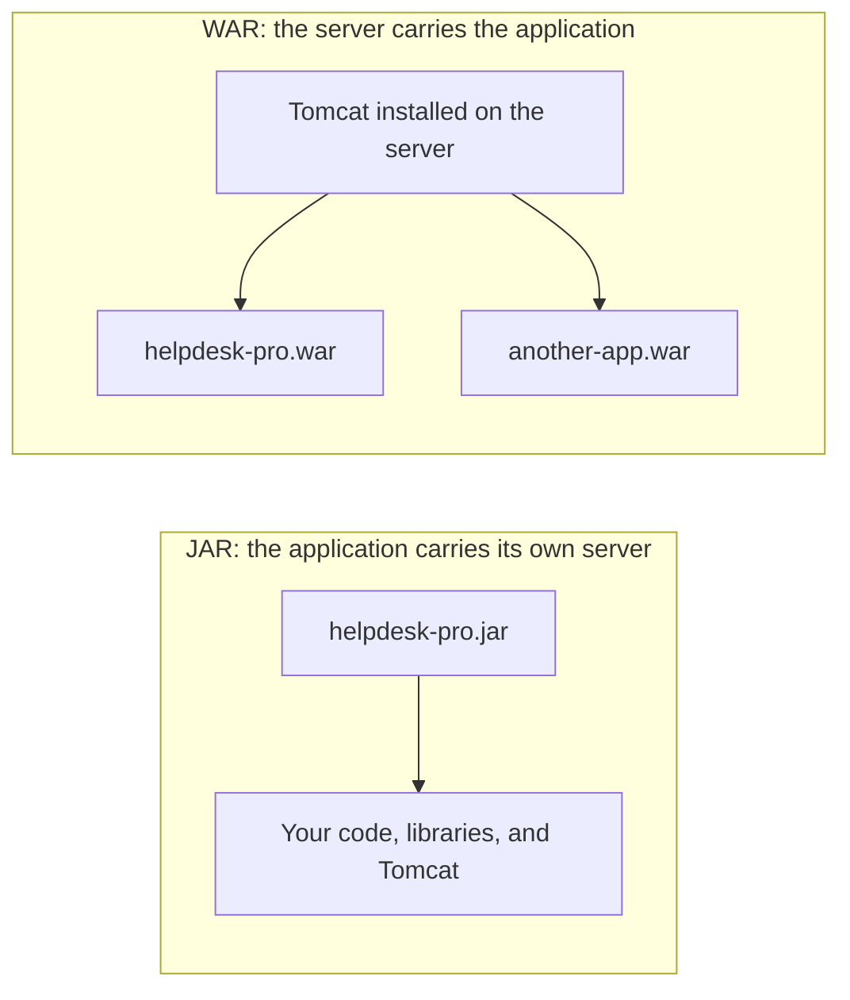
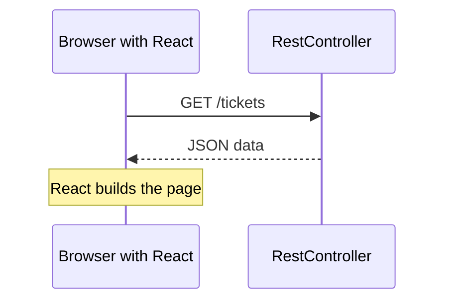
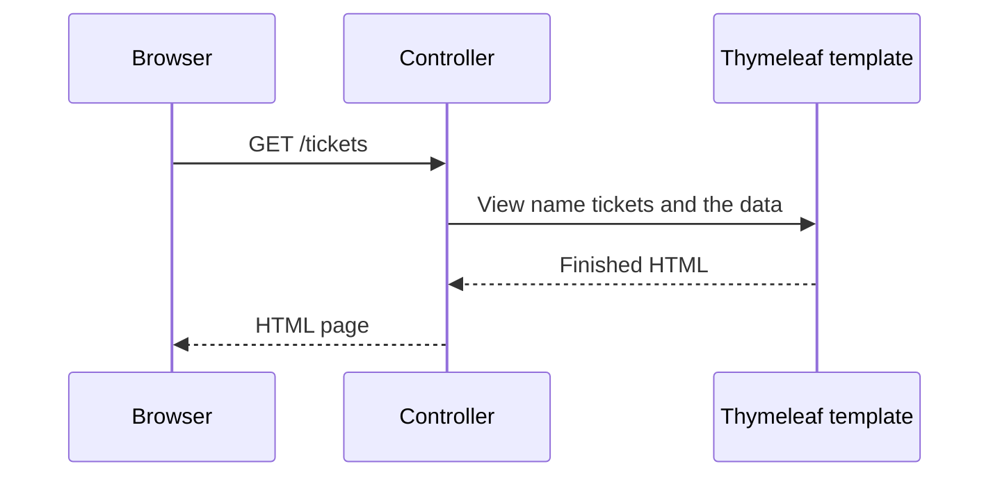

# JAR vs WAR, and REST APIs vs Pages with Views

Two decisions shape every Spring Boot web application. They are separate questions, so keep them apart.

| Question | The choices | What it decides |
|---|---|---|
| **How do you package it?** | JAR or WAR | How the application is shipped and started |
| **What does it return?** | Data (REST API) or HTML pages (views) | Who builds the page the user sees |

You make both choices for every project. This page explains each one and when to pick which.

---

## 1. JAR vs WAR

### What they are

| | JAR | WAR |
|---|---|---|
| **Stands for** | Java ARchive | Web ARchive |
| **What it holds** | Your classes and libraries | Your classes, libraries, and web files |
| **Who provides the web server** | **Your application.** Tomcat is inside the file | **The server.** Tomcat is installed separately |
| **How you start it** | `java -jar helpdesk-pro.jar` | Copy it into the server's `webapps` folder |
| **Maven setting** | `<packaging>jar</packaging>` (the default) | `<packaging>war</packaging>` |



How to read it: with a JAR, one file is the whole application and you start it yourself. With a WAR, a server that is already running holds several applications side by side.

> **Note:** A Servlet/JSP project is normally a WAR that you copy into Tomcat's `webapps` folder. A Spring Boot project is normally a JAR that starts its own Tomcat.

### What is inside

You can look inside either file:

```bash
jar tf target/helpdesk-pro-0.0.1-SNAPSHOT.jar
```

| | JAR | WAR |
|---|---|---|
| Your classes | `BOOT-INF/classes/` | `WEB-INF/classes/` |
| Libraries | `BOOT-INF/lib/` | `WEB-INF/lib/` |
| Tomcat | `BOOT-INF/lib/tomcat-embed-core-...jar` | `WEB-INF/lib-provided/` (only used when you run the WAR with `java -jar`) |

### When to choose a JAR

Choose a **JAR** when:

- You want one file that runs on any machine that has Java.
- You run the application as its own service (`systemd`, as on Day 8).
- Nobody in your organization requires a shared application server.
- Your application is a REST API behind nginx, as HelpDesk Pro is.

This is the default for Spring Boot and the choice for this programme.

### When to choose a WAR

Choose a **WAR** when:

- Your organization already runs a shared Tomcat (or WebLogic, WebSphere, JBoss) that another team manages, and you must deploy into it.
- You use **JSP**. JSP pages need a WAR (see section 2).
- Several applications must share one server and one Java process.

### How to turn a Spring Boot project into a WAR

Three changes:

1. In `pom.xml`, set the packaging:

   ```xml
   <packaging>war</packaging>
   ```

2. In `pom.xml`, mark Tomcat as provided, because the server brings its own:

   ```xml
   <dependency>
       <groupId>org.springframework.boot</groupId>
       <artifactId>spring-boot-starter-tomcat</artifactId>
       <scope>provided</scope>
   </dependency>
   ```

3. Make the main class extend `SpringBootServletInitializer`:

   ```java
   @SpringBootApplication
   public class HelpdeskProApplication extends SpringBootServletInitializer {

       public static void main(String[] args) {
           SpringApplication.run(HelpdeskProApplication.class, args);
       }
   }
   ```

Then build as usual:

```bash
mvn clean package
```

You get `target/helpdesk-pro-0.0.1-SNAPSHOT.war`. Copy it into Tomcat's `webapps` folder.

> **Warning:** In a WAR, the address includes the **file name**. If the file is `helpdesk-pro-0.0.1-SNAPSHOT.war`, then `GET /hello` is at `http://localhost:8080/helpdesk-pro-0.0.1-SNAPSHOT/hello`, and `http://localhost:8080/hello` gives `404`. To serve the application at `/`, deploy the file as `ROOT.war`.

> **Note:** A Spring Boot WAR can also be started with `java -jar`. The reason to choose a WAR is to deploy it into an existing server.

---

## 2. REST API vs pages with views

### What they are

| | REST API | Pages with views |
|---|---|---|
| **The controller returns** | Data, usually JSON | The name of a template |
| **Who builds the page** | The browser (React or JavaScript) | The server |
| **What the browser receives** | `["Printer is not working", ...]` | A finished HTML page |
| **Annotation** | `@RestController` | `@Controller` |
| **Starter** | `spring-boot-starter-web` | `spring-boot-starter-web` and a template engine, such as `spring-boot-starter-thymeleaf` |

### A REST API

```java
@RestController
public class TicketController {

    @GetMapping("/tickets")
    public List<String> tickets() {
        return List.of("Printer is not working", "Cannot log in to email");
    }
}
```



How to read it: the server only sends data. The page is built in the browser.

### A page with a view (Thymeleaf)

The controller puts data in a `Model` and returns the **name** of a template:

```java
@Controller
public class TicketPageController {

    @GetMapping("/tickets")
    public String tickets(Model model) {
        model.addAttribute("tickets", List.of("Printer is not working", "Cannot log in to email"));
        return "tickets";
    }
}
```

The template is `src/main/resources/templates/tickets.html`:

```html
<!DOCTYPE html>
<html xmlns:th="http://www.thymeleaf.org">
<body>
  <h1>My Tickets</h1>
  <ul>
    <li th:each="ticket : ${tickets}" th:text="${ticket}">Example ticket</li>
  </ul>
</body>
</html>
```

**The browser receives**

```html
<h1>My Tickets</h1>
<ul>
  <li>Printer is not working</li>
  <li>Cannot log in to email</li>
</ul>
```



How to read it: the server fills in the template and sends back a complete page. The browser only displays it.

### Thymeleaf and JSP

Both are ways to write the view.

| | Thymeleaf | JSP |
|---|---|---|
| **Template location** | `src/main/resources/templates/` | `src/main/webapp/` |
| **Packaging** | JAR or WAR | **WAR** |
| **Opens as a plain HTML file** | Yes | No, because of `<% %>` tags |
| **Extra dependency** | `spring-boot-starter-thymeleaf` | `tomcat-embed-jasper` |
| **Fits Spring Boot's JAR style** | Yes | No |

> **Warning:** JSP and a Spring Boot JAR do not work well together. A JSP may work when you run the JAR from the project folder, because Spring Boot finds `src/main/webapp` there. Copy the same JAR to a server, run it from another folder, and the JSP returns `404`. Package a JSP application as a WAR.

### When to choose a REST API

Choose a **REST API** when:

- Several clients use the same data: a web page, a mobile app, another system.
- The screens are interactive, like HelpDesk Pro's ticket list with filters and live updates.
- A front-end developer (or a separate React project) builds the screens.

### When to choose views

Choose **views** (Thymeleaf first, JSP only if you must) when:

- It is an internal tool with a handful of pages and simple forms.
- One team builds both the back end and the pages.
- You want to avoid a separate front-end project and a Node.js build.

### One application can do both

A Spring Boot application can have `@Controller` classes for pages and `@RestController` classes for data side by side. For example, an admin console in Thymeleaf next to a REST API for the main application.

---

## 3. Putting the two choices together

| | REST API | Views |
|---|---|---|
| **JAR** | **HelpDesk Pro in this programme** | Thymeleaf pages in a JAR |
| **WAR** | A REST API in a shared Tomcat | JSP pages, or Thymeleaf in a shared Tomcat |

### Which should I pick?

| If this is true | Then choose |
|---|---|
| Another team runs a shared application server and you must deploy to it | WAR |
| You need JSP | WAR |
| You want one file you can start as a service | JAR |
| A React app or another system will call it | REST API |
| It is a small internal tool with a few simple pages | Views with Thymeleaf |
| You are not sure | JAR and REST API |

### What HelpDesk Pro uses, and why

| Choice | HelpDesk Pro | Why |
|---|---|---|
| Packaging | **JAR** | It runs as the `helpdesk-api` service on Day 8, behind nginx |
| What it returns | **REST API** | A plain-JavaScript page (Day 9) and a React app (Days 10 and 11) both use the same API |

---

## Common mistakes

| Symptom | Cause | Fix |
|---|---|---|
| WAR deployed, but `http://localhost:8080/tickets` gives `404` | The address includes the WAR file name | Use `/<war-name>/tickets`, or deploy the file as `ROOT.war` |
| WAR fails to start on the server, with errors about Tomcat or servlet classes | `spring-boot-starter-tomcat` is not marked `provided`, so the WAR carries a second copy of Tomcat | Add `<scope>provided</scope>` |
| `@RestController` shows `tickets` as plain text instead of a page | A `@RestController` returns the value itself, not a view name | Use `@Controller` for pages |
| `@Controller` returns `Whitelabel Error Page` or "template might not exist" | There is no template with that name | Create `templates/tickets.html` and check the spelling |
| JSP works from the IDE or project folder, and `404`s on the server | A JSP is not supported in a runnable JAR | Package the application as a WAR |
| Both a JAR and a WAR are in `target` after a change | Old build output is still there | Run `mvn clean package` |

## Check yourself

- [ ] You can say in one sentence what is inside a JAR that is not inside a WAR (the server).
- [ ] You can name the three changes that turn a Spring Boot project into a WAR.
- [ ] You can explain why a WAR's address includes the file name.
- [ ] You can say what a `@RestController` returns, and what a `@Controller` returns.
- [ ] You can name one reason to choose a REST API and one reason to choose views.
- [ ] You know why JSP needs a WAR.

## Recap

- **JAR** carries its own server and starts with `java -jar`. **WAR** is deployed into a server that is already installed.
- Spring Boot defaults to a JAR. Choose a WAR for a shared server, or for JSP.
- A **REST API** returns data, and the browser builds the page. **Views** return finished HTML built on the server.
- Thymeleaf fits a JAR. JSP needs a WAR.
- HelpDesk Pro is a JAR with a REST API, so one back end serves both the plain-JavaScript page and the React app.
