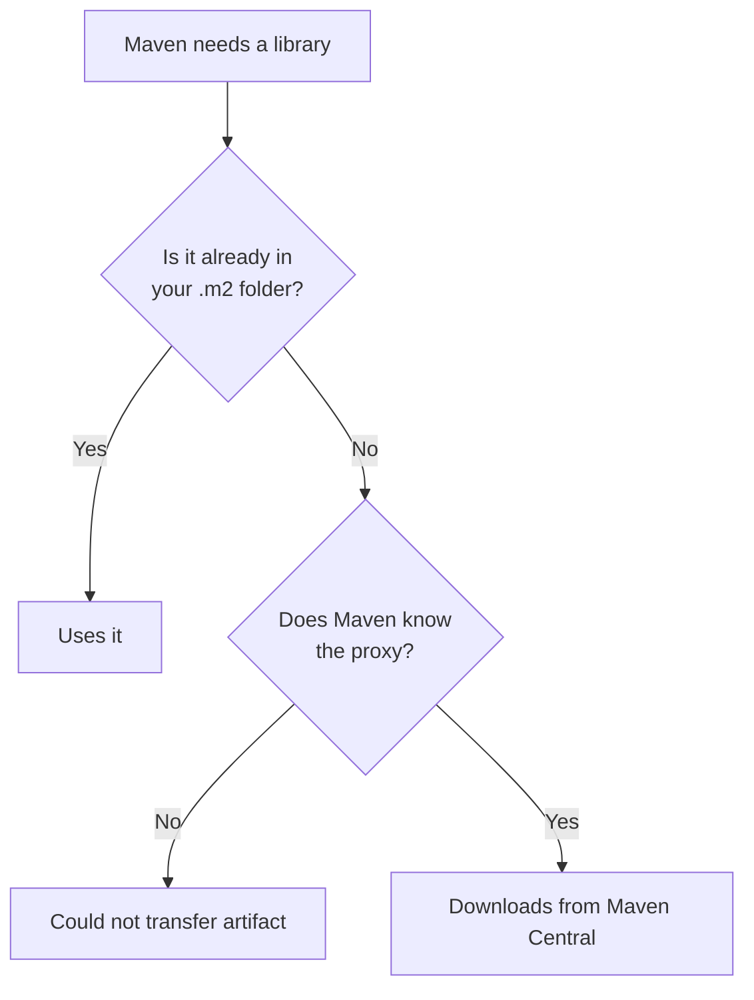

# Troubleshooting: Maven Cannot Download Libraries (Proxy Setup)

Maven downloads libraries from the internet the first time you build a project. On a company network, that traffic must go through the **proxy** (a server that forwards your requests to the internet). If Maven does not know about the proxy, the build fails before it compiles anything.

This page shows how to recognise the problem and fix it.

## 1. Recognise the problem

Run a build:

```bash
mvn clean package
```

These messages usually mean Maven cannot reach the internet:

```text
Could not transfer artifact org.springframework.boot:spring-boot-starter-parent:pom:3.5.6
from/to central (https://repo.maven.apache.org/maven2): Connect timed out
```

```text
Non-resolvable parent POM ... Could not transfer artifact ... Unknown host repo.maven.apache.org
```

Any message that says **Could not transfer artifact** is a download problem. The rest of this page helps you find out why.



How to read it: Maven only goes online for libraries it does not have yet. When it has to, it needs your proxy details from `settings.xml`.

---

## 2. Step by step

### Step 1: Find out your proxy details

Ask your network team (or use the value given to you) for:

| Detail | Example placeholder |
|---|---|
| Proxy host | `PROXY_HOST` |
| Proxy port | `PROXY_PORT` |
| Username and password | Only if your proxy asks for them |

> **Note:** Your browser already uses this proxy. In your browser's network or proxy settings you can see the same host and port.

### Step 2: Check that the proxy works outside Maven

This separates a proxy problem from a Maven problem.

```bash
curl -I -x http://PROXY_HOST:PROXY_PORT https://repo.maven.apache.org/maven2/
```

If the proxy needs a username and password, add `-U YOUR_USERNAME:YOUR_PASSWORD`.

**You should see** a line starting with `HTTP/1.1 200` or `HTTP/2 200`.

| Result | Meaning |
|---|---|
| `200` | The proxy works. Go to step 3 |
| `407 Proxy Authentication Required` | The proxy needs a username and password |
| Connection refused or timed out | The host or port is wrong, or the proxy is not reachable from your machine |

### Step 3: Find your `settings.xml`

Maven reads the proxy from a file called `settings.xml` in your user's `.m2` folder.

| System | Location |
|---|---|
| Windows | `C:\Users\<your-name>\.m2\settings.xml` |
| Linux and macOS | `~/.m2/settings.xml` |

If the `.m2` folder or the file does not exist, create it.

### Step 4: Add the proxy

If the file is new, use this whole file. If you already have a `settings.xml`, add only the `<proxies>` block inside the existing `<settings>` element.

```xml
<?xml version="1.0" encoding="UTF-8"?>
<settings xmlns="http://maven.apache.org/SETTINGS/1.2.0"
          xmlns:xsi="http://www.w3.org/2001/XMLSchema-instance"
          xsi:schemaLocation="http://maven.apache.org/SETTINGS/1.2.0 https://maven.apache.org/xsd/settings-1.2.0.xsd">

  <proxies>
    <proxy>
      <id>company-proxy-http</id>
      <active>true</active>
      <protocol>http</protocol>
      <host>PROXY_HOST</host>
      <port>PROXY_PORT</port>
      <username>YOUR_USERNAME</username>
      <password>YOUR_PASSWORD</password>
      <nonProxyHosts>localhost|127.0.0.1</nonProxyHosts>
    </proxy>

    <proxy>
      <id>company-proxy-https</id>
      <active>true</active>
      <protocol>https</protocol>
      <host>PROXY_HOST</host>
      <port>PROXY_PORT</port>
      <username>YOUR_USERNAME</username>
      <password>YOUR_PASSWORD</password>
      <nonProxyHosts>localhost|127.0.0.1</nonProxyHosts>
    </proxy>
  </proxies>

</settings>
```

| Tag | Meaning |
|---|---|
| `id` | Any name. Each proxy needs a different one |
| `active` | `true` turns the proxy on |
| `protocol` | `http` or `https`. Keep both blocks, because Maven Central uses `https` and other repositories may use `http` |
| `host`, `port` | Your proxy address |
| `username`, `password` | **Delete both tags** if your proxy does not ask for a login |
| `nonProxyHosts` | Hosts that should skip the proxy, separated by `\|`. Your internal servers go here, for example `localhost\|*.your-company.lan` |

> **Warning:** The password sits in the file in plain text. Keep this file in your own `.m2` folder. Never copy it into a project or commit it to Git.

> **Note:** If your password contains `&` or `<`, write it as `&amp;` or `&lt;`. XML does not accept the raw characters.

### Step 5: Clear the failed downloads

When a download fails, Maven remembers the failure by writing a `.lastUpdated` file, and it may not retry for a while. Remove those files so Maven tries again.

| System | Command |
|---|---|
| Linux and macOS | `find ~/.m2/repository -name "*.lastUpdated" -delete` |
| Windows (Command Prompt) | `del /s /q "%USERPROFILE%\.m2\repository\*.lastUpdated"` |

### Step 6: Build again

```bash
mvn -U clean package
```

`-U` tells Maven to check again for anything it could not download before.

**You should see** lines such as `Downloading from central: ...` followed by `BUILD SUCCESS`.

---

## 3. IntelliJ uses its own Maven settings

The terminal and IntelliJ can behave differently. IntelliJ may use its own copy of Maven.

1. Open **Settings → Build, Execution, Deployment → Build Tools → Maven**.
2. Next to **User settings file**, tick **Override** and choose your `settings.xml`.
3. Click **Apply**, then reload the project from the Maven tool window.

Also check **Maven home path** on the same page. It must be **Bundled (Maven 3)**, not the Maven wrapper. See [IntelliJ: use the bundled Maven](intellij-maven-home-path.md).

---

## 4. Common messages

| Message | Cause | Fix |
|---|---|---|
| `Connect timed out` | Maven is not using the proxy, or the proxy is not reachable | Check steps 2 and 4 |
| `Unknown host repo.maven.apache.org` | Your machine cannot resolve internet names without the proxy | Add the proxy (step 4) |
| `Connect to PROXY_HOST:PROXY_PORT failed: Connection refused` | The host or port in `settings.xml` is wrong | Compare with the browser's proxy settings and the `curl` check |
| `407 Proxy Authentication Required` | Username or password is missing or wrong | Check the `<username>` and `<password>` tags |
| `PKIX path building failed` | A certificate problem, not a proxy problem | Ask your network team for the company certificate |
| The same error right after fixing `settings.xml` | Maven is remembering the old failure | Do step 5, then run `mvn -U clean package` |
| Works in the terminal, fails in IntelliJ | IntelliJ is using a different settings file | Follow section 3 |
| `Non-parseable settings` | The XML has a typo, such as a missing closing tag | Check that every tag is closed and the proxies sit inside `<settings>` |

## Check yourself

- [ ] `curl -I -x http://PROXY_HOST:PROXY_PORT https://repo.maven.apache.org/maven2/` shows `200`.
- [ ] `settings.xml` is in your `.m2` folder and contains the `<proxies>` block.
- [ ] `mvn -U clean package` ends with `BUILD SUCCESS`.
- [ ] You did not copy `settings.xml` into a project folder.

## Later in the programme

Maven is not the only tool that needs the proxy. npm (Days 10 and 11), Git, the server's package manager (Day 8), and calls to `localhost` can all be affected. See [Proxy issues ahead](proxy-issues-ahead.md).
