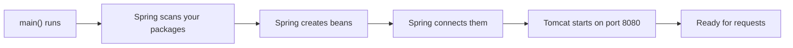
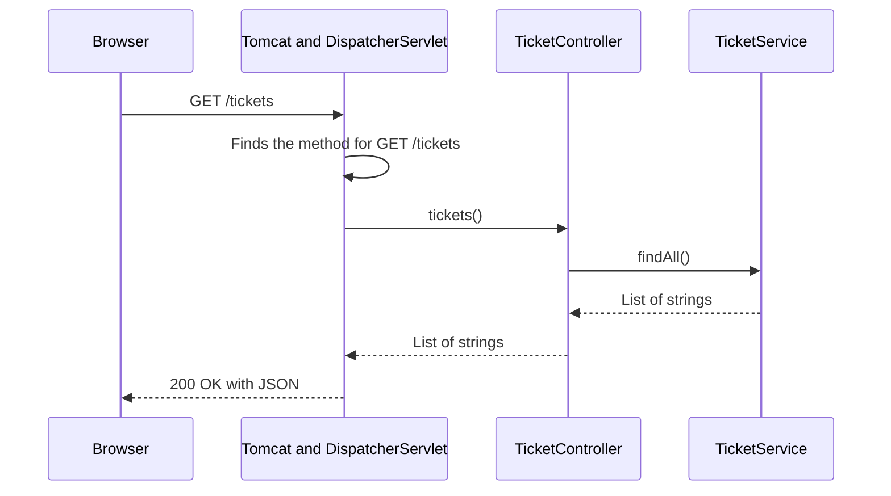
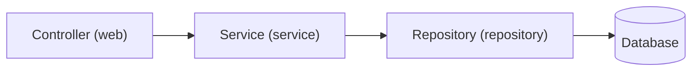

# The Spring Boot Flow

There are two flows to understand in a Spring Boot application. One happens **once**, when the application starts. The other happens **every time** someone calls your API.

| Flow | When | Question it answers |
|---|---|---|
| Startup flow | Once, when you run the application | How does `main` turn into a running server? |
| Request flow | Every request | How does a URL reach my method, and how does the answer get back? |

## What you will learn

- The steps from `main` to a running web server.
- What a **bean** and **dependency injection** are.
- The path a request takes through controller, service, and repository.

---

## 1. The startup flow

When you run `HelpdeskProApplication`, this happens:



How to read it: each box is one step. If a step fails, the application stops and prints a message, and the next steps never run.

| Step | What happens | What you see in the log |
|---|---|---|
| 1. `main()` runs | `SpringApplication.run(...)` starts Spring Boot | `Starting HelpdeskProApplication ...` |
| 2. Scan | Spring looks through the main class's package and below for classes marked `@RestController`, `@Service`, and similar | nothing, unless it fails |
| 3. Create | Spring creates one object of each marked class. These objects are called **beans** | nothing, unless it fails |
| 4. Connect | Spring passes each bean the other beans it needs (see section 2) | nothing, unless it fails |
| 5. Server starts | The built-in Tomcat starts and listens | `Tomcat started on port 8080 (http) with context path '/'` |
| 6. Ready | The application waits for requests | `Started HelpdeskProApplication in 1.0 seconds` |

---

## 2. Beans and dependency injection

A **bean** is an object that Spring creates and looks after for you.

You mark a class so that Spring knows to create it:

| Annotation | Means | Used for |
|---|---|---|
| `@RestController` | A bean that handles web requests and returns data | Controllers |
| `@Service` | A bean that holds the rules | Services |
| `@Repository` | A bean that talks to the database | Repositories (on Day 2 you write these as interfaces) |

**Dependency injection** means a class says what it needs, and Spring hands it over. You never write `new TicketService()` yourself.

```java
@Service
public class TicketService {

    public List<String> findAll() {
        return List.of("Printer is not working", "Cannot log in to email");
    }
}
```

```java
@RestController
public class TicketController {

    private final TicketService ticketService;

    public TicketController(TicketService ticketService) {
        this.ticketService = ticketService;
    }

    @GetMapping("/tickets")
    public List<String> tickets() {
        return ticketService.findAll();
    }
}
```

Look at the constructor of `TicketController`. It says: "to be created, I need a `TicketService`." Spring sees that, finds the `TicketService` bean, and passes it in.

Why this helps:

- The controller does not decide how the service is built.
- In a test, you can hand the controller a fake service instead.
- Each class does one job.

> **Note:** With a single constructor, you do not need to write `@Autowired`. Spring knows what to do.

---

## 3. The request flow

When a browser calls `GET /tickets`:



How to read it: time runs from top to bottom. The request goes in on the left and the answer comes back the same way.

| Step | Who | What happens |
|---|---|---|
| 1 | **Tomcat** | The built-in web server receives the HTTP request |
| 2 | **DispatcherServlet** | Spring's front desk. It looks at the method (`GET`) and the path (`/tickets`) and finds the method that handles them |
| 3 | **Controller** | Your `tickets()` method runs. It reads the request and asks the service |
| 4 | **Service** | `findAll()` does the work and returns the data |
| 5 | **Back to the controller** | The controller returns whatever the service gave it |
| 6 | **Conversion** | Spring turns the Java `List` into JSON. This is why a `@RestController` can return Java objects |
| 7 | **Response** | The browser receives `200 OK` and the JSON |

You do not write steps 1, 2, 6, and 7. Spring Boot does them. You write steps 3, 4, and 5.

---

## 4. The layers in HelpDesk Pro

The request flow grows as the project does. On Day 2 you add the database layer.



How to read it: each layer only talks to the one next to it. A controller never talks to the database directly.

| Layer | Package | Its one job | When you build it |
|---|---|---|---|
| Controller | `web` | Receives the request and returns the response | Day 3 |
| Service | `service` | Applies the rules, such as which status moves are allowed | Day 4 |
| Repository | `repository` | Reads and writes the database | Day 2 |
| Database | | Keeps the data | Day 2 |

Keeping the jobs apart makes each class small and easy to change. If the rules change, you touch the service. If the URL changes, you touch the controller.

---

## 5. Try it

1. In a Spring Boot project, add the two classes from section 2. Put `TicketService` in `com.helpdeskpro.service` and `TicketController` in `com.helpdeskpro.web`.
2. Run the application and look at the log.

   **You should see** lines like these, in this order:

   ```text
   Starting HelpdeskProApplication v0.0.1-SNAPSHOT using Java 21 ...
   Tomcat initialized with port 8080 (http)
   Tomcat started on port 8080 (http) with context path '/'
   Started HelpdeskProApplication in 1.0 seconds
   ```

3. Call the endpoint:

   ```bash
   curl http://localhost:8080/tickets
   ```

   **You should see:**

   ```text
   ["Printer is not working","Cannot log in to email"]
   ```

4. Watch the request flow in the log. Add this line to `application.properties` and restart:

   ```properties
   logging.level.org.springframework.web.servlet.DispatcherServlet=DEBUG
   ```

5. Call `/tickets` again.

   **You should see** two new log lines:

   ```text
   DispatcherServlet : GET "/tickets", parameters={}
   DispatcherServlet : Completed 200 OK
   ```

   These are the DispatcherServlet receiving the request (step 2) and finishing the response (step 7).

6. Remove the `DEBUG` line when you are done. It makes the log noisy.

---

## Common mistakes

| Symptom | Cause | Fix |
|---|---|---|
| The application does not start. The message says `required a bean of type 'com.helpdeskpro.service.TicketService' that could not be found` | `TicketService` is missing `@Service`, or is outside the base package | Add `@Service` and check the package |
| The application does not start. The message says `Port 8080 was already in use` | An earlier run is still going | Stop it, or set `server.port` to another number |
| `404 Not Found` | The path in `@GetMapping` does not match the URL, or the controller is not scanned | Check the path and the package |
| `405 Method Not Allowed` | The URL exists, but for a different method, for example you sent `POST` to a `@GetMapping` | Use the right HTTP method |
| The browser shows the text `tickets` or a `Whitelabel Error Page` | The class uses `@Controller` instead of `@RestController`, so the return value is treated as a page name | Use `@RestController` for APIs |

## Practice

1. Add a second method to `TicketService` called `count()` that returns the number of tickets. Add `GET /tickets/count` to the controller. Call it.
2. Remove `@Service` from `TicketService`. Start the application and read the message. Put it back.
3. Draw the request flow for `GET /tickets/count` on paper. Mark which steps you wrote and which Spring Boot did.

## Recap

- At startup, Spring scans your packages, creates beans, connects them, and starts Tomcat.
- A **bean** is an object Spring creates. **Dependency injection** means a class asks for what it needs in its constructor and Spring hands it over.
- A request goes Tomcat → DispatcherServlet → controller → service, and the answer returns the same way, converted to JSON.
- Each layer has one job: controller for requests, service for rules, repository for the database.
