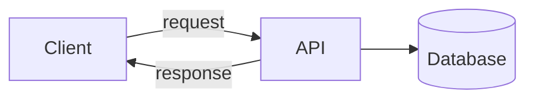

# REST APIs

HelpDesk Pro is a REST API. Every screen you build later, in plain JavaScript and in React, works by calling it. This note explains what a REST API is, how to read and write the calls, and how HelpDesk Pro's API is laid out.

## What you will learn

- What an API and a REST API are.
- What an HTTP request and response contain.
- Which method and which status code to use.
- How to design URLs, and how JSON carries the data.
- How to call an API with `curl`.

---

## 1. What is an API?

An **API** is a set of requests that one program can send to another to get something done.

Think of a restaurant. You do not walk into the kitchen. You tell the waiter what you want, and the waiter brings it back. The menu is the list of what you may ask for.

| Restaurant | Application |
|---|---|
| You | The **client**: a browser, a React page, `curl`, another program |
| The waiter | The **API** |
| The kitchen | The **server** and its database |
| The menu | The list of endpoints (URLs) you may call |



How to read it: the client only talks to the API. It never touches the database.

---

## 2. What "REST" means in practice

**REST** is a style for designing web APIs. It comes down to four simple habits:

| Habit | What it means | HelpDesk Pro example |
|---|---|---|
| **Everything is a resource** | Each thing has its own URL, named with a noun | `/tickets`, `/tickets/7` |
| **The method says the action** | You use a standard HTTP method, not a verb in the URL | `GET /tickets` reads, `POST /tickets` creates |
| **The status code says what happened** | The response has a number that tells the result | `201` created, `404` not found |
| **Each request is complete** | The server does not remember earlier calls. The request carries everything it needs | Day 6: every call carries the login token |

Data travels as **JSON**, a plain text format that every language can read.

---

## 3. A request and a response

Every call is one **request** and one **response**. Here is a real exchange with HelpDesk Pro.

**The request**

```text
POST /tickets HTTP/1.1
Host: localhost:8080
Content-Type: application/json
Content-Length: 43

{"title":"Reset password","priority":"LOW"}
```

**The response**

```text
HTTP/1.1 201
Content-Type: application/json
Content-Length: 66

{"id":2,"priority":"LOW","status":"OPEN","title":"Reset password"}
```

| Part | In the request | In the response |
|---|---|---|
| **First line** | Method, path, and protocol: `POST /tickets` | Protocol and **status code**: `201` |
| **Headers** | Information about the request, such as `Content-Type` | Information about the response |
| **Blank line** | Separates headers from the body | Same |
| **Body** | The data you send (optional) | The data you get back |

The header `Content-Type: application/json` says "the body is JSON". Without it, the server may refuse the request (see the mistakes table).

### Where does the data go?

| Where | Looks like | Use it for | Example |
|---|---|---|---|
| **Path** | `/tickets/7` | Which resource | The ticket with id 7 |
| **Query string** | `/tickets?status=OPEN&page=0` | Filters, sorting, paging | Only open tickets, first page |
| **Body** | `{"title":"..."}` | The data to create or change | A new ticket |

---

## 4. HTTP methods

| Method | Meaning | Has a body? | HelpDesk Pro example |
|---|---|---|---|
| `GET` | Read. Never changes data | No | `GET /tickets/7` |
| `POST` | Create something new | Yes | `POST /tickets` |
| `PUT` | Replace a whole resource | Yes | Not used in HelpDesk Pro |
| `PATCH` | Change part of a resource | Yes | `PATCH /tickets/7/status` |
| `DELETE` | Remove a resource | No | Not used in HelpDesk Pro |

> **Note:** A browser's address bar can only send `GET`. To try the other methods, use `curl`, Postman, or the IntelliJ HTTP client.

---

## 5. Status codes

The first digit tells you the kind of result.

| Range | Meaning |
|---|---|
| `2xx` | It worked |
| `4xx` | The **client** made a mistake. Fix the request |
| `5xx` | The **server** failed. Not your request's fault |

The codes you will use in HelpDesk Pro:

| Code | Name | When HelpDesk Pro returns it | Where you meet it |
|---|---|---|---|
| `200` | OK | A read or update worked | This note |
| `201` | Created | A ticket was raised | This note |
| `400` | Bad Request | The body is not valid JSON, or is missing a title | This note, then Day 3 |
| `401` | Unauthorized | No login token, or it is wrong | Day 6 |
| `403` | Forbidden | An employee tried an agent-only action | Day 6 |
| `404` | Not Found | The ticket id does not exist | This note |
| `405` | Method Not Allowed | The URL exists, but not for that method | This note |
| `409` | Conflict | A status move that is not allowed, such as `OPEN` to `CLOSED` | Day 4 |
| `415` | Unsupported Media Type | The body was sent without `Content-Type: application/json` | This note |
| `500` | Internal Server Error | A bug in your code | Any day |

---

## 6. Designing URLs

Name the **resource**, and let the method say the action.

| Rule | Poor | Better |
|---|---|---|
| Use nouns, not verbs | `/getTickets`, `/createTicket` | `GET /tickets`, `POST /tickets` |
| Use plural names | `/ticket` | `/tickets` |
| Put the id in the path | `/tickets?id=7` | `/tickets/7` |
| Use the method, not the path, for the action | `/tickets/delete/7` | `DELETE /tickets/7` |
| Nest what belongs to something | `/addComment?ticket=7` | `POST /tickets/7/comments` |
| Use the query string for filters | `/tickets/open` | `/tickets?status=OPEN` |
| Use lowercase and `-` | `/Tickets/PickUp` | `/tickets/pick-up` |

### HelpDesk Pro's API

| Request | What it does | Who | Day |
|---|---|---|---|
| `POST /auth/login` | Checks the login and returns a token | Anyone | 6 |
| `POST /tickets` | Raises a ticket | Employee | 3 |
| `GET /tickets` | Lists tickets (with `status`, `priority`, `page`, `size`) | Both | 3 |
| `GET /tickets/{id}` | Shows one ticket with its comments | Both | 3 |
| `PATCH /tickets/{id}/status` | Moves the ticket to the next status | Agent | 4 |
| `POST /tickets/{id}/comments` | Adds a comment | Both | 4 |
| `GET /tickets/summary` | Counts of tickets by status | Agent | 5 |
| `GET /actuator/health` | Says whether the application is running | Anyone | 8 |

`{id}` is a placeholder. The real URL has a number there, such as `/tickets/7`.

> **Note:** "Pick up a ticket" has no URL of its own. It is a `PATCH` to the status, with the new status `IN_PROGRESS`.

---

## 7. JSON

JSON describes data with a few simple pieces.

```json
{
  "id": 7,
  "title": "Cannot print invoices",
  "priority": "HIGH",
  "overdue": false,
  "assignedTo": null,
  "comments": ["Restarted the print service."]
}
```

| Piece | Looks like | Example |
|---|---|---|
| Object | `{ ... }` with `"name": value` pairs | The whole ticket |
| Array | `[ ... ]` | The list of comments |
| String | In double quotes | `"HIGH"` |
| Number | No quotes | `7` |
| Boolean | `true` or `false` | `false` |
| Null | `null` | `assignedTo` before an agent picks it up |

Rules to remember:

- Names and strings use **double** quotes. Single quotes are not valid JSON.
- No comma after the last item.
- The order of fields does not matter.
- Spring Boot turns a Java object into JSON, and back, for you. The field name `assignedTo` in Java becomes `"assignedTo"` in JSON.

---

## 8. Spring Boot: a small REST API

Here is a small API with the ticket list held in memory. In the JPA part of Day 2, the list is replaced by a database.

**The data class** (one field for each part of the ticket):

```java
package com.helpdeskpro.domain;

public class Ticket {

    private int id;
    private String title;
    private String priority;
    private String status;

    // a getter and a setter for each field
    // in IntelliJ: Alt + Insert, then Getter and Setter
}
```

**Reading data** in `com.helpdeskpro.web.TicketController`:

```java
@RestController
@RequestMapping("/tickets")
public class TicketController {

    private final List<Ticket> tickets = new ArrayList<>();

    @GetMapping
    public List<Ticket> findAll() {
        return tickets;
    }

    @GetMapping("/{id}")
    public Ticket findOne(@PathVariable int id) {
        for (Ticket ticket : tickets) {
            if (ticket.getId() == id) {
                return ticket;
            }
        }
        throw new ResponseStatusException(HttpStatus.NOT_FOUND, "Ticket not found");
    }
```

**Changing data**, in the same class:

```java
    @PostMapping
    @ResponseStatus(HttpStatus.CREATED)
    public Ticket create(@RequestBody Ticket ticket) {
        ticket.setId(tickets.size() + 1);
        ticket.setStatus("OPEN");
        tickets.add(ticket);
        return ticket;
    }

    @PatchMapping("/{id}/status")
    public Ticket updateStatus(@PathVariable int id, @RequestBody Ticket change) {
        Ticket ticket = findOne(id);
        ticket.setStatus(change.getStatus());
        return ticket;
    }
}
```

| Annotation | Meaning |
|---|---|
| `@RequestMapping("/tickets")` | Every method in this class starts its path with `/tickets` |
| `@GetMapping`, `@PostMapping`, `@PatchMapping` | The HTTP method this Java method answers |
| `@PathVariable` | Takes `{id}` from the path |
| `@RequestBody` | Turns the JSON body into a Java object |
| `@ResponseStatus(HttpStatus.CREATED)` | Sends `201` instead of `200` |
| `ResponseStatusException` | Stops and sends the status you name, here `404` |

> **Note:** Press **Alt + Enter** on a red class name in IntelliJ and choose **Import class** to add the `import` lines.

> **Note:** The list is in memory, so the tickets disappear when you restart. Day 3 adds proper request and response classes, validation, and the `ApiError` response. Day 4 adds the status rules, which refuse an `OPEN` to `CLOSED` move with `409`.

---

## 9. Try it

1. Put the classes from section 8 in your project and start the application.
2. In a second terminal, call the API with `curl`.

**List the tickets (empty at first)**

```bash
curl -i http://localhost:8080/tickets
```

```text
HTTP/1.1 200
Content-Type: application/json

[]
```

**Raise a ticket**

```bash
curl -i -X POST http://localhost:8080/tickets \
  -H "Content-Type: application/json" \
  -d '{"title":"Cannot print invoices","priority":"HIGH"}'
```

```text
HTTP/1.1 201
Content-Type: application/json

{"id":1,"priority":"HIGH","status":"OPEN","title":"Cannot print invoices"}
```

**Read it**

```bash
curl -i http://localhost:8080/tickets/1
```

```text
HTTP/1.1 200
{"id":1,"priority":"HIGH","status":"OPEN","title":"Cannot print invoices"}
```

**Ask for one that does not exist**

```bash
curl -i http://localhost:8080/tickets/99
```

```text
HTTP/1.1 404
{"timestamp":"...","status":404,"error":"Not Found","path":"/tickets/99"}
```

**Change the status**

```bash
curl -i -X PATCH http://localhost:8080/tickets/1/status \
  -H "Content-Type: application/json" \
  -d '{"status":"IN_PROGRESS"}'
```

```text
HTTP/1.1 200
{"id":1,"priority":"HIGH","status":"IN_PROGRESS","title":"Cannot print invoices"}
```

**Use a method that does not exist for the URL**

```bash
curl -i -X DELETE http://localhost:8080/tickets
```

```text
HTTP/1.1 405
Allow: POST, GET
```

The `Allow` header lists the methods that do work.

> **Warning:** On Windows Command Prompt, single quotes do not work in `curl`, and `\` does not continue a line. Write the command on one line and use double quotes with a backslash before the inner quotes: `-d "{\"title\":\"Cannot print invoices\",\"priority\":\"HIGH\"}"`.

> **Note:** If `curl` to `localhost` fails on a company network, the proxy may be catching it. See [calls to localhost go through the proxy](../day-01-java-maven-spring-boot/proxy-issues-ahead.md#3-calls-to-localhost-go-through-the-proxy).

---

## Common mistakes

| Symptom | Cause | Fix |
|---|---|---|
| `415 Unsupported Media Type` | The body was sent without `Content-Type: application/json` | Add `-H "Content-Type: application/json"` |
| `400 Bad Request` on a `POST` | The JSON is not valid, for example a missing quote or brace, or single quotes | Check the JSON. Use double quotes |
| `400 Bad Request` on `GET /tickets/abc` | The path value is not a number, and the method expects an `int` | Use a valid id |
| `405 Method Not Allowed` | The URL exists, but not for that method | Read the `Allow` header, or fix the method |
| `404 Not Found` on a URL that should exist | Wrong path, a missing `@RequestMapping`, or the class is outside the base package | Check the path and the package |
| The fields come back as `0` or `null` | The class has no setters, so the JSON cannot be filled in | Add a getter and a setter for each field |
| A `POST` from the browser address bar does nothing | The address bar only sends `GET` | Use `curl`, Postman, or the IntelliJ HTTP client |

## Practice

1. Raise three tickets with different priorities. Call `GET /tickets` and check you see all three.
2. Move ticket 2 to `IN_PROGRESS`. Read ticket 2 and check the status.
3. Raise a ticket with the body `{"title":}` and write down the status code.
4. Write on paper the method and URL for each of these: "list the comments of ticket 5", "add a comment to ticket 5", and "list the open tickets of priority `HIGH`".
5. Look at the table in section 6. Pick one HelpDesk Pro request and say which of path, query string, or body carries each piece of data.

## Recap

- An **API** is how one program asks another to do something. A **REST API** names resources with nouns and lets the HTTP method say the action.
- A request has a method, a path, headers, and an optional body. A response has a status code, headers, and a body.
- `2xx` means success, `4xx` means the client made a mistake, and `5xx` means the server failed.
- Put the id in the path, filters in the query string, and data to save in the body.
- JSON carries the data. Spring Boot converts between JSON and Java for you.
- In Spring Boot, `@RestController` and `@GetMapping`, `@PostMapping`, and `@PatchMapping` turn methods into endpoints.
