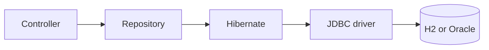
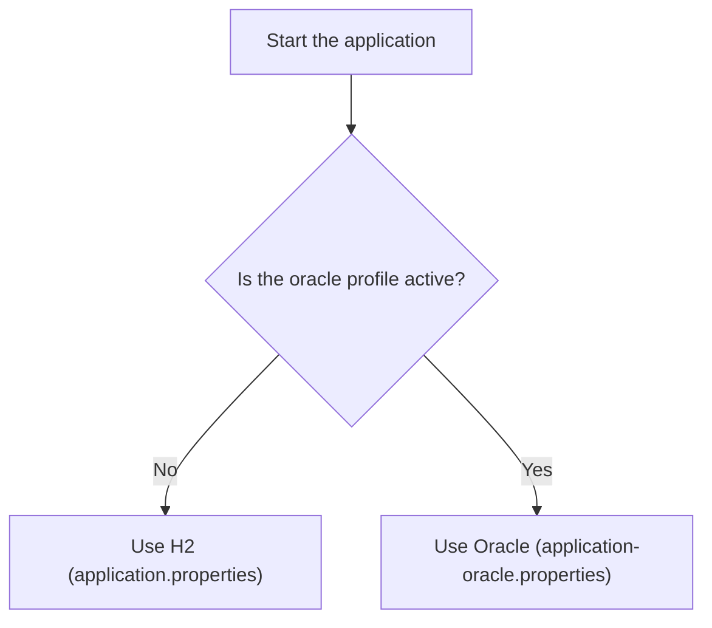

# Storing Data in a Database (H2 and Oracle)

In the REST API note, tickets lived in a Java list. Restart the application and they were gone. In this note you move them into a **database**, so the data is kept in tables and your code reads and writes it through a repository.

You build it twice, with the **same Java code**:

| Database | What it is | When you use it |
|---|---|---|
| **H2** | A small database that runs inside your application. Nothing to install | Learning and everyday work. It is the default |
| **Oracle** | The company's real database server | When you want your data kept for real |

## What you will learn

- What a table, a row, and a primary key are.
- What JPA, Hibernate, and Spring Data JPA each do.
- How to write an **entity** and a **repository**.
- How to run the same application on H2 and on Oracle.

---

## 1. Why a database?

A Java list lives in memory. When the application stops, the list is gone. A database keeps the data on disk, and many applications can share it.

A database holds **tables**. A table is like a spreadsheet:

| Term | Meaning | Example |
|---|---|---|
| **Table** | One kind of thing | `TICKETS` |
| **Column** | One piece of information | `TITLE`, `STATUS` |
| **Row** | One thing | One ticket |
| **Primary key** | A column that identifies a row. It is never repeated | `ID` |

`TICKETS` looks like this:

| ID | TITLE | PRIORITY | STATUS | CREATED_AT |
|---|---|---|---|---|
| 1 | Cannot print invoices | HIGH | IN_PROGRESS | 2026-10-13 00:34:38 |
| 2 | Reset password | LOW | OPEN | 2026-10-13 00:34:39 |

---

## 2. The pieces

Your code does not talk to the database directly. A few layers sit in between.



How to read it: you write the controller and the repository. The other boxes come with the libraries you add.

| Name | What it is | Your job |
|---|---|---|
| **JDBC** | Java's standard way to talk to a database. Each database has its own **driver** | Add the driver library |
| **JPA** | A standard that says how Java classes map to tables | Mark your classes with its annotations |
| **Hibernate** | The library that does the work JPA describes. It writes the SQL for you | Nothing. Spring Boot sets it up |
| **Spring Data JPA** | Gives you a repository from a one-line interface | Write the interface |

---

## 3. Two databases, one project

Only the **settings** and the **table script** change between H2 and Oracle. The entity, repository, and controller are identical.



How to read it: with no extra option you get H2. Adding `--spring.profiles.active=oracle` switches to Oracle.

| | H2 | Oracle |
|---|---|---|
| **Install** | None | Your organization's server |
| **Data lasts** | Until the application stops | Until you delete it |
| **Who creates the tables** | Spring runs `schema.sql` at start | You run `db/oracle/schema.sql` once |
| **Driver** | `h2` | `ojdbc17` |
| **Settings** | `application.properties` | `application-oracle.properties` |

---

## 4. Step 1: add the libraries

Create the project with these Spring Initializr dependencies: **Spring Web**, **Spring Data JPA**, **H2 Database**, and **Oracle Driver**. The generator adds these to `pom.xml`:

```xml
<dependency>
    <groupId>org.springframework.boot</groupId>
    <artifactId>spring-boot-starter-data-jpa</artifactId>
</dependency>
<dependency>
    <groupId>com.h2database</groupId>
    <artifactId>h2</artifactId>
    <scope>runtime</scope>
</dependency>
<dependency>
    <groupId>com.oracle.database.jdbc</groupId>
    <artifactId>ojdbc17</artifactId>
    <scope>runtime</scope>
</dependency>
<dependency>
    <groupId>org.springframework.boot</groupId>
    <artifactId>spring-boot-h2console</artifactId>
</dependency>
```

| Dependency | Why |
|---|---|
| `spring-boot-starter-data-jpa` | JPA, Hibernate, and Spring Data JPA |
| `h2` | The H2 database |
| `ojdbc17` | The Oracle driver |
| `spring-boot-h2console` | A web page to look at H2's tables |

> **Note:** On Spring Boot 3.x the Oracle driver is `ojdbc11`, and the H2 console is built in, so there is no `spring-boot-h2console`.

`runtime` scope means the library is needed when the application runs, not when you compile. You never write code against the driver.

---

## 5. Step 2: the table scripts

You create the tables yourself with SQL. Hibernate only **checks** them (see step 5).

**H2**: `src/main/resources/schema.sql`

```sql
CREATE SEQUENCE TICKETS_SEQ START WITH 1 INCREMENT BY 1;

CREATE TABLE TICKETS (
    ID          BIGINT        PRIMARY KEY,
    TITLE       VARCHAR(100)  NOT NULL,
    PRIORITY    VARCHAR(10)   NOT NULL,
    STATUS      VARCHAR(20)   NOT NULL,
    CREATED_AT  TIMESTAMP     DEFAULT CURRENT_TIMESTAMP NOT NULL
);
```

**Oracle**: `db/oracle/schema.sql` (a folder in the project root, outside `src`)

```sql
CREATE SEQUENCE TICKETS_SEQ START WITH 1 INCREMENT BY 1 NOCACHE;

CREATE TABLE TICKETS (
    ID          NUMBER(19)     PRIMARY KEY,
    TITLE       VARCHAR2(100)  NOT NULL,
    PRIORITY    VARCHAR2(10)   NOT NULL,
    STATUS      VARCHAR2(20)   NOT NULL,
    CREATED_AT  TIMESTAMP      DEFAULT SYSTIMESTAMP NOT NULL
);
```

| Part | Meaning |
|---|---|
| `CREATE SEQUENCE` | A counter the database keeps. Each call to `NEXTVAL` gives the next number. It gives every ticket a unique `ID` |
| `PRIMARY KEY` | The `ID` cannot repeat or be empty |
| `NOT NULL` | The column must have a value |
| `DEFAULT ... ` | The value used when none is given |

### What differs between the two

| Idea | H2 | Oracle |
|---|---|---|
| Big whole number | `BIGINT` | `NUMBER(19)` |
| Text | `VARCHAR(100)` | `VARCHAR2(100)` |
| Current time | `CURRENT_TIMESTAMP` | `SYSTIMESTAMP` |

> **Note:** Why two scripts? Hibernate checks that the column type matches the Java type. For a Java `Long`, H2 must say `BIGINT`. A `NUMBER(19)` on H2 stops the application with `found [numeric], but expecting [bigint]`. On Oracle, the type for a big whole number is `NUMBER(19)`.

---

## 6. Step 3: the entity

An **entity** is a Java class that maps to one table. One object is one row.

```java
package com.helpdeskpro.domain;

@Entity
@Table(name = "TICKETS")
public class Ticket {

    @Id
    @GeneratedValue(strategy = GenerationType.SEQUENCE, generator = "tickets_seq")
    @SequenceGenerator(name = "tickets_seq", sequenceName = "TICKETS_SEQ", allocationSize = 1)
    private Long id;

    private String title;
    private String priority;
    private String status;
    private LocalDateTime createdAt;

    // a getter and a setter for each field
}
```

The imports are from `jakarta.persistence` and `java.time`. Use **Alt + Enter** in IntelliJ to add them.

| Annotation | Meaning |
|---|---|
| `@Entity` | This class maps to a table |
| `@Table(name = "TICKETS")` | The table's name |
| `@Id` | This field is the primary key |
| `@GeneratedValue(strategy = SEQUENCE, ...)` | The database generates the id from a sequence |
| `@SequenceGenerator(...)` | Which sequence to use. `allocationSize = 1` must match `INCREMENT BY 1` in the script |

### Field names and column names

You do not write a column name for each field. Spring Boot converts `camelCase` to `UPPER_SNAKE_CASE` for you:

| Java field | Column |
|---|---|
| `id` | `ID` |
| `title` | `TITLE` |
| `createdAt` | `CREATED_AT` |

---

## 7. Step 4: the repository

A **repository** is the class you ask to save and find entities. With Spring Data JPA you write an interface, and Spring writes the class.

```java
package com.helpdeskpro.repository;

public interface TicketRepository extends JpaRepository<Ticket, Long> {

    List<Ticket> findByStatus(String status);
}
```

`JpaRepository<Ticket, Long>` means "a repository for `Ticket`, whose id is a `Long`". You get these methods without writing them:

| Method | What it does |
|---|---|
| `save(ticket)` | Inserts a new ticket, or updates an existing one |
| `findAll()` | Returns every ticket |
| `findById(id)` | Returns one ticket, wrapped in an `Optional` |
| `deleteById(id)` | Deletes one ticket |
| `count()` | Returns how many tickets there are |

`findByStatus` is a method you add by **naming** it. Spring reads the name (`find` `By` `Status`) and builds the query `where status = ?`.

---

## 8. Step 5: use the repository in the controller

Replace the in-memory list with the repository. Spring passes the repository in, as it did for the service in the flow note.

```java
@RestController
@RequestMapping("/tickets")
public class TicketController {

    private final TicketRepository ticketRepository;

    public TicketController(TicketRepository ticketRepository) {
        this.ticketRepository = ticketRepository;
    }

    @GetMapping
    public List<Ticket> findAll(@RequestParam(required = false) String status) {
        if (status != null) {
            return ticketRepository.findByStatus(status);
        }
        return ticketRepository.findAll();
    }

    @GetMapping("/{id}")
    public Ticket findOne(@PathVariable Long id) {
        Optional<Ticket> found = ticketRepository.findById(id);
        if (found.isEmpty()) {
            throw new ResponseStatusException(HttpStatus.NOT_FOUND, "Ticket not found");
        }
        return found.get();
    }
```

```java
    @PostMapping
    @ResponseStatus(HttpStatus.CREATED)
    public Ticket create(@RequestBody Ticket ticket) {
        ticket.setStatus("OPEN");
        ticket.setCreatedAt(LocalDateTime.now());
        return ticketRepository.save(ticket);
    }

    @PatchMapping("/{id}/status")
    public Ticket updateStatus(@PathVariable Long id, @RequestBody Ticket change) {
        Ticket ticket = findOne(id);
        ticket.setStatus(change.getStatus());
        return ticketRepository.save(ticket);
    }
}
```

| New idea | Meaning |
|---|---|
| `Optional<Ticket>` | A box that holds a ticket, or nothing. `isEmpty()` tells you which |
| `save(ticket)` | Writes to the database and returns the ticket with its generated `id` |

> **Note:** A client can send an `id` in the body, and `save` would then update that row. Day 3 adds request classes that stop this. Day 4 adds the service layer between the controller and the repository.

---

## 9. Step 6: the settings

**`src/main/resources/application.properties`**: the default, with H2

```properties
spring.application.name=helpdesk-pro

# H2: an in-memory database, nothing to install
spring.datasource.url=jdbc:h2:mem:helpdesk
spring.datasource.username=sa
spring.datasource.password=
spring.h2.console.enabled=true

# Hibernate checks the tables. It never creates or changes them
spring.jpa.hibernate.ddl-auto=validate
spring.jpa.show-sql=true
```

**`src/main/resources/application-oracle.properties`**: used only with the `oracle` profile

```properties
spring.datasource.url=jdbc:oracle:thin:@//ORACLE_HOST:1521/ORACLE_SERVICE
spring.datasource.username=${DB_USERNAME}
spring.datasource.password=${DB_PASSWORD}
spring.h2.console.enabled=false
```

| Setting | Meaning |
|---|---|
| `spring.datasource.url` | Where the database is. `jdbc:h2:mem:helpdesk` is an in-memory H2 called `helpdesk` |
| `spring.datasource.username`, `password` | The login |
| `spring.jpa.hibernate.ddl-auto=validate` | Hibernate checks that the tables match your entities. It stops the application if they do not. It never creates or changes tables |
| `spring.jpa.show-sql=true` | Prints the SQL Hibernate runs, so you can see it |
| `${DB_USERNAME}` | Take the value from an **environment variable** |

The Oracle URL has three parts:

| Part | Example | Where to get it |
|---|---|---|
| Host | `ORACLE_HOST` | Your database team |
| Port | `1521` | Usually `1521` |
| Service name | `ORACLE_SERVICE` | Your database team |

> **Warning:** Never write the Oracle password in a file that goes to Git. The file reads it from an environment variable, so the password stays on your machine.

---

## 10. Run it on H2

1. Start the application with no extra options.
2. Look for the profile line and the start line in the log:

   ```text
   No active profile set, falling back to 1 default profile: "default"
   Started HelpdeskProApplication in 3.0 seconds
   ```

3. Raise two tickets and read them back:

   ```bash
   curl -X POST http://localhost:8080/tickets \
     -H "Content-Type: application/json" \
     -d '{"title":"Cannot print invoices","priority":"HIGH"}'
   ```

   **You should see** a ticket with an `id`, status `OPEN`, and a `createdAt`:

   ```text
   {"createdAt":"2026-10-13T00:33:12.203018","id":1,"priority":"HIGH","status":"OPEN","title":"Cannot print invoices"}
   ```

4. List the tickets, filter, and change a status:

   ```bash
   curl http://localhost:8080/tickets
   curl "http://localhost:8080/tickets?status=OPEN"
   curl -X PATCH http://localhost:8080/tickets/1/status \
     -H "Content-Type: application/json" \
     -d '{"status":"IN_PROGRESS"}'
   ```

5. Look at the SQL in the log:

   ```text
   select next value for tickets_seq
   insert into tickets (created_at,priority,status,title,id) values (?,?,?,?,?)
   select t1_0.id,t1_0.created_at,t1_0.priority,t1_0.status,t1_0.title from tickets t1_0
   update tickets set created_at=?,priority=?,status=?,title=? where id=?
   ```

   Hibernate wrote all of this from your entity.

6. Open the **H2 console** at `http://localhost:8080/h2-console` and log in with:

   | Field | Value |
   |---|---|
   | JDBC URL | `jdbc:h2:mem:helpdesk` |
   | User name | `sa` |
   | Password | (empty) |

   Run `SELECT * FROM TICKETS` and compare it with `GET /tickets`.

7. Stop the application, start it again, and call `GET /tickets`.

   **You should see** `[]`. H2 here is **in memory**, so the data went with the application.

---

## 11. Run it on Oracle

You need four things from your database team: the **host**, the **port**, the **service name**, and a **schema user** with its password. The user needs permission to create a table and a sequence.

1. **Create the table.** Open `db/oracle/schema.sql` in SQL Developer (run it as a script with **F5**), or use SQL\*Plus:

   ```bash
   sqlplus YOUR_USERNAME@//ORACLE_HOST:1521/ORACLE_SERVICE @db/oracle/schema.sql
   ```

   **You should see** `Sequence created.` and `Table created.`

2. **Fill in the host and service name** in `application-oracle.properties`.

3. **Set the login in environment variables.**

   | System | Commands |
   |---|---|
   | Linux and macOS | `export DB_USERNAME=YOUR_USERNAME` and `export DB_PASSWORD=YOUR_PASSWORD` |
   | Windows Command Prompt | `set DB_USERNAME=YOUR_USERNAME` and `set DB_PASSWORD=YOUR_PASSWORD` |

   In IntelliJ, add them under **Environment variables** in the run configuration.

4. **Start with the profile.**

   ```bash
   java -jar target/helpdesk-pro-0.0.1-SNAPSHOT.jar --spring.profiles.active=oracle
   ```

   In IntelliJ, add `--spring.profiles.active=oracle` under **Program arguments**.

   **You should see** in the log:

   ```text
   The following 1 profile is active: "oracle"
   HikariPool-1 - Added connection oracle.jdbc.driver.T4CConnection@...
   Database dialect: OracleDialect
   Started HelpdeskProApplication in 5.8 seconds
   ```

5. **Call the same API** as in section 10. The responses are the same.

6. **Look at the SQL.** It is different, because Hibernate adapts to the database:

   | | H2 | Oracle |
   |---|---|---|
   | Next id | `select next value for tickets_seq` | `select tickets_seq.nextval from dual` |
   | Everything else | The same | The same |

7. **Look at the table.** In SQL Developer run:

   ```sql
   SELECT ID, TITLE, PRIORITY, STATUS FROM TICKETS ORDER BY ID;
   ```

   **You should see** the tickets you raised.

8. Stop the application and start it again with the `oracle` profile. Call `GET /tickets`.

   **You should see** your tickets. Oracle kept them.

---

## What is the same, what differs

| | H2 | Oracle |
|---|---|---|
| Entity, repository, controller | Same | Same |
| JSON responses | Same | Same |
| Table script | `schema.sql` | `db/oracle/schema.sql` |
| Who runs the script | Spring, at start | You, once |
| Settings | `application.properties` | `application-oracle.properties` |
| Sequence SQL | `next value for` | `.nextval from dual` |
| Data after restart | Gone | Kept |

---

## Common mistakes

| Symptom | Cause | Fix |
|---|---|---|
| `Schema validation: wrong column type encountered in column [id] ... found [numeric], but expecting [bigint]` | The H2 script uses `NUMBER(19)` | Use `BIGINT` in the H2 script |
| `Schema validation: missing table [tickets]` | The table does not exist in that database | Run the script. On Oracle, run `db/oracle/schema.sql` once |
| `ORA-01017: invalid username/password; logon denied` | A wrong login, **or** `DB_USERNAME` or `DB_PASSWORD` is not set in the terminal that started the application | Check both variables in the same terminal, or in the run configuration |
| `ORA-12514: Cannot connect to database. Service ... is not registered with the listener` | The service name in the URL is wrong | Ask your database team for the service name |
| Connection refused or timed out | The host or port is wrong, or a firewall blocks it | Check the host and port, and your network. A company proxy is not involved in a database connection |
| Tickets disappear after a restart | You are on H2, which keeps data in memory | Use the Oracle profile to keep data |
| A table-not-found error on H2 | `schema.sql` is not in `src/main/resources` | Move it there |
| The `oracle` profile does nothing | The option was not passed, or has a typo | Check the log for `The following 1 profile is active: "oracle"` |

## Practice

1. On H2, raise three tickets with different priorities. Call `GET /tickets?status=OPEN` and check the list.
2. In the H2 console, run `SELECT * FROM TICKETS WHERE STATUS = 'OPEN'`. Compare the rows with `GET /tickets?status=OPEN`.
3. Add a method `List<Ticket> findByPriority(String priority)` to the repository. Add `?priority=HIGH` support to `GET /tickets`.
4. Remove `spring.jpa.show-sql=true`, restart, and call the API. Notice what disappears from the log.
5. Change `ddl-auto=validate` to `none` and back. Then rename a field in `Ticket` to a name that has no column, and start the application with `validate`. Read the message, then undo.

## Recap

- A **table** has columns and rows. The **primary key** identifies a row.
- An **entity** is a Java class that maps to a table. A **repository** is an interface that saves and finds entities, and Spring writes it for you.
- **Hibernate** writes the SQL from your entity. `ddl-auto=validate` only checks the tables.
- The same code runs on **H2** (in memory, default) and **Oracle** (a profile). Only the settings and the table script change.
- Keep logins in environment variables, never in a committed file.
- Next: connect tickets to users and comments with relationships.
