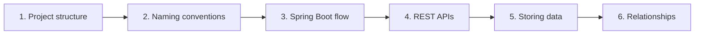

# Day 2: Spring Boot Basics and JPA

**Duration:** 4 hours · **Builds on:** Day 1 · **Stories:** JPA-1 (see the [case study](../case-study/README.md))

Day 1 gave you a running Spring Boot application. Day 2 explains how it is organised and how it works, and then connects it to a database.

## The plan

| Part | What | Notes |
|---|---|---|
| 1 | Spring Boot project structure | [01-spring-boot-project-structure.md](01-spring-boot-project-structure.md) |
| 2 | Java naming conventions | [02-java-naming-conventions.md](02-java-naming-conventions.md) |
| 3 | The Spring Boot flow | [03-spring-boot-flow.md](03-spring-boot-flow.md) |
| 4 | REST APIs | [04-rest-apis.md](04-rest-apis.md) |
| 5 | Storing data in a database, on H2 and Oracle | [05-storing-data-in-a-database.md](05-storing-data-in-a-database.md) |
| 6 | Relationships: users, tickets, and comments | To come |

How to read it: parts 1 to 4 give you the vocabulary. Parts 5 and 6 use it to store HelpDesk Pro's data.

## What you will build

- A project organised into `web`, `service`, `repository`, `domain`, and `dto` packages.
- Classes named the way Java and Spring developers expect.
- A controller that calls a service, with Spring passing the service in.
- A small REST API you call with `curl`: list, create, read, and change a ticket.
- In part 5: the `TICKETS` table, an entity and a repository, running on H2 and on Oracle with the same code.
- In part 6: the `USERS` and `COMMENTS` tables and the relationships between the three.

## Before you start

- Your Day 1 project builds with `mvn clean package`.
- IntelliJ uses the **Bundled (Maven 3)** Maven. See [IntelliJ: use the bundled Maven](../day-01-java-maven-spring-boot/intellij-maven-home-path.md).
- If a download fails, see [Maven proxy troubleshooting](../day-01-java-maven-spring-boot/maven-proxy-troubleshooting.md).

## Check yourself

- [ ] You can name what `pom.xml`, `src/main/java`, `src/main/resources`, and `target/` are for.
- [ ] You can explain why a class outside the main class's package gives `404`.
- [ ] You can name a class in `PascalCase`, a method in `camelCase`, and a constant in `UPPER_SNAKE_CASE`.
- [ ] You can describe what happens from `main()` to "Tomcat started".
- [ ] You can say what dependency injection does in one sentence.
- [ ] You can name the HTTP method and status code for creating a ticket, reading one, and asking for one that does not exist.
- [ ] You can explain what an entity and a repository are.
- [ ] You can run the application on H2 and on Oracle, and say what changes between them.
