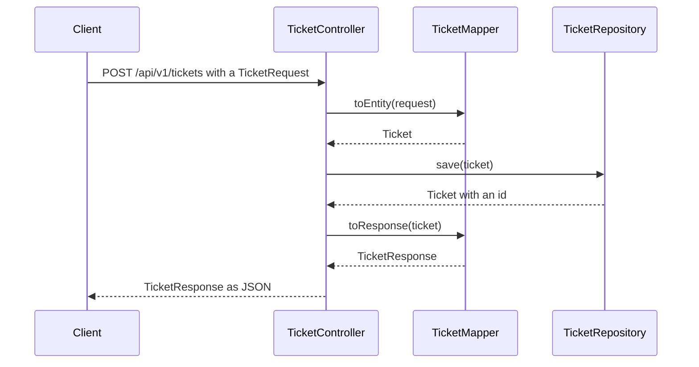

# DTOs: TicketRequest and TicketResponse

Your controller currently receives a `Ticket` and returns a `Ticket`. This note explains why that is a problem, and replaces it with two small classes: `TicketRequest` for what a client sends and `TicketResponse` for what a client receives.

**Starting point:** the `support-assistant` project from [Day 2](../../day-02-spring-boot-basics-and-jpa/code-and-walkthroughs/support-assistant/).
**Project:** [support-assistant](support-assistant/) in this folder. It holds the in-memory version of the application, with parts 1 to 4 applied. From part 6 on, the work continues in [support-assistant-jpa](support-assistant-jpa/).

## What you will build

- `TicketRequest`: the data a client is allowed to send.
- `TicketResponse`: the data a client receives.
- `TicketMapper`: a small class that converts between `Ticket`, `TicketRequest`, and `TicketResponse`.
- A controller that no longer uses `Ticket` in its method signatures.

---

## 1. What a DTO is

A **DTO** (Data Transfer Object) is a small class that only carries data between the client and your application. It holds no rules and talks to no database.

Think of a help desk counter. You fill in a **form** and hand it over. The desk keeps a **file** in a cabinet. You get a **receipt** back. The form, the file, and the receipt hold related information, but they are three different pieces of paper.

| Paper | Class | Who sees it |
|---|---|---|
| The form you fill in | `TicketRequest` | The client sends it to the API |
| The file in the cabinet | `Ticket` | Only the application |
| The receipt you get back | `TicketResponse` | The API sends it to the client |

---

## 2. The problem with using `Ticket` everywhere

Run the Day 2 project and create a ticket. Send an `id` and a `status` that a client should not choose:

```bash
curl -X POST http://localhost:8080/api/v1/tickets \
  -H "Content-Type: application/json" \
  -d '{"id":99,"title":"Cannot print invoices","status":"CLOSED","priority":"HIGH"}'
```

```json
{"description":null,"id":1,"priority":"HIGH","status":"CLOSED","title":"Cannot print invoices"}
```

The new ticket was created already `CLOSED`. The client decided something that the application should decide.

This is the first of three problems:

| # | Problem | Why it happens |
|---|---|---|
| 1 | The client can set fields it should not, such as `status` | The request body *is* the `Ticket`, so every field of `Ticket` is open to the client |
| 2 | Every field you add to `Ticket` appears in every response, and renaming a field breaks every client | The response *is* the `Ticket`, so the Java class is the public contract |
| 3 | One class does three jobs: it is the request, the stored data, and the response | The needs of each job pull in different directions, as you will see when validation and a database arrive |

A DTO fixes this by giving each job its own class.

---

## 3. A small Java feature: `record`

DTOs only carry data, so they are a good fit for a Java **record**. A record is a short way to write a class that holds values.

```java
public record Student(String name, int age) {
}
```

You create one and read its values like this:

```java
Student student = new Student("Asha", 20);
System.out.println(student.name());   // Asha
System.out.println(student.age());    // 20
```

What the record gives you without extra code:

- A constructor that takes every value.
- A reading method for each value, named like the value: `name()`, not `getName()`.
- Values that cannot be changed after the record is created.

Spring Boot turns JSON into a record, and a record into JSON, in the same way it does for a normal class.

---

## 4. How a DTO changes the flow

Here is what happens when a client creates a ticket after this change.



How to read it: time runs from top to bottom. The client only ever sees a `TicketRequest` going in and a `TicketResponse` coming out. The `Ticket` stays between the controller, the mapper, and the repository.

---

## Build steps

Work in a copy of the Day 2 project, or open the finished project in this folder and compare.

### Step 1: Create `TicketRequest`

Create the package `com.bsp.supportassistant.dto` and add this record:

```java
package com.bsp.supportassistant.dto;

import com.bsp.supportassistant.model.Priority;
import com.bsp.supportassistant.model.TicketStatus;

public record TicketRequest(
        String title,
        String description,
        TicketStatus status,
        Priority priority) {
}
```

It has no `id`. The client cannot send one that the application will use.

**Check:** `mvn -q compile` prints no errors.

### Step 2: Create `TicketResponse`

In the same package:

```java
package com.bsp.supportassistant.dto;

import com.bsp.supportassistant.model.Priority;
import com.bsp.supportassistant.model.TicketStatus;

public record TicketResponse(
        Long id,
        String title,
        String description,
        TicketStatus status,
        Priority priority) {
}
```

This one has the `id`, because the client needs it to ask for the ticket again.

**Check:** `mvn -q compile` prints no errors.

### Step 3: Create `TicketMapper`

A **mapper** copies values from one class to another. Create the package `com.bsp.supportassistant.mapper` and add:

```java
public class TicketMapper {

    public static Ticket toEntity(TicketRequest request) {
        Ticket ticket = new Ticket();
        ticket.setTitle(request.title());
        ticket.setDescription(request.description());
        ticket.setStatus(request.status());
        ticket.setPriority(request.priority());
        return ticket;
    }

    public static TicketResponse toResponse(Ticket ticket) {
        return new TicketResponse(
                ticket.getId(),
                ticket.getTitle(),
                ticket.getDescription(),
                ticket.getStatus(),
                ticket.getPriority());
    }
```

A `static` method is called on the class name, as in `TicketMapper.toResponse(ticket)`, so the controller does not need to create a mapper first.

Add a third method that converts a whole list:

```java
    public static List<TicketResponse> toResponseList(List<Ticket> tickets) {
        List<TicketResponse> responses = new ArrayList<>();
        for (Ticket ticket : tickets) {
            responses.add(toResponse(ticket));
        }
        return responses;
    }
}
```

**Check:** `mvn -q compile` prints no errors. Press **Alt + Enter** on a red class name and choose **Import class** if IntelliJ shows one.

### Step 4: Change the controller

Replace `Ticket` with the DTOs in the method signatures. The listing and the single read:

```java
@GetMapping
public List<TicketResponse> findAll(@RequestParam(required = false) TicketStatus status) {
    if (status == null) {
        return TicketMapper.toResponseList(ticketRepository.findAll());
    }
    return TicketMapper.toResponseList(ticketRepository.findAllByStatus(status));
}

@GetMapping("/{id}")
public TicketResponse findById(@PathVariable Long id) {
    Ticket ticket = ticketRepository.findById(id);
    if (ticket == null) {
        return null;
    }
    return TicketMapper.toResponse(ticket);
}
```

Create and update:

```java
@PostMapping
public TicketResponse create(@RequestBody TicketRequest request) {
    Ticket ticket = TicketMapper.toEntity(request);
    ticket.setStatus(TicketStatus.OPEN); // a new ticket always starts OPEN
    return TicketMapper.toResponse(ticketRepository.save(ticket));
}

@PatchMapping("/{id}")
public TicketResponse update(@PathVariable Long id, @RequestBody TicketRequest request) {
    Ticket updated = ticketRepository.update(id, TicketMapper.toEntity(request));
    if (updated == null) {
        return null;
    }
    return TicketMapper.toResponse(updated);
}
```

`delete` does not change. The repository does not change either: it still works with `Ticket`.

> **Note:** `TicketRequest` is used for both `POST` and `PATCH`. For `POST`, the controller sets the status to `OPEN`, so a `status` in the body is ignored.

> **Note:** The `null` checks keep today's behaviour: a ticket that does not exist still gives `200` with an empty body. A later note replaces them with a proper `404`.

**Check:** `mvn -q clean verify` ends with no errors.

### Step 5: Run it and try the same call again

Start the application and send the request from section 2:

```bash
curl -X POST http://localhost:8080/api/v1/tickets \
  -H "Content-Type: application/json" \
  -d '{"id":99,"title":"Cannot print invoices","status":"CLOSED","priority":"HIGH"}'
```

**Check:** you should see:

```json
{"id":1,"title":"Cannot print invoices","description":null,"status":"OPEN","priority":"HIGH"}
```

The `id` is `1`, not `99`, and the status is `OPEN`, not `CLOSED`. The client's `id` and `status` were not used.

Change only the status, then list by status:

```bash
curl -X PATCH http://localhost:8080/api/v1/tickets/1 \
  -H "Content-Type: application/json" \
  -d '{"status":"IN_PROGRESS"}'

curl "http://localhost:8080/api/v1/tickets?status=IN_PROGRESS"
```

**Check:** the first call returns the ticket with `"status":"IN_PROGRESS"`. The second returns a list with that one ticket.

Open <http://localhost:8080/swagger-ui.html> and scroll to **Schemas**.

**Check:** you see `TicketRequest` and `TicketResponse`. There is no `Ticket`.

> **Note:** The JSON fields now come out in the order of the record (`id` first), not alphabetically as in Day 2.

---

## Common mistakes

| Symptom | Cause | Fix |
|---|---|---|
| `500 Internal Server Error` when you ask for an id that does not exist, and `NullPointerException` in the console | `TicketMapper.toResponse(null)` was called, because the `null` check is missing | Check for `null` before mapping |
| A field comes back `null` after a `POST` | The name in the JSON does not match the record, for example `"Title"` instead of `"title"`. Names are case-sensitive and an unknown name is ignored without any error | Match the record's names exactly |
| A field you sent has no effect | The record does not have it (such as `id`), or the controller overrides it (such as `status` on create) | This is the DTO working. Add the field to the record if the client should send it |
| The controller still has `Ticket` in a method signature | The change was made in some methods only | Search the controller for `Ticket` and check that it appears only inside method bodies |

---

## Practice

1. Add a `String assignedTo` field to `Ticket`, with a getter and a setter. Restart, create a ticket, and read it. Is `assignedTo` in the response? Then add it to `TicketResponse` and the mapper and check again.
2. Send a `POST` with `"status":"RESOLVED"`. Write down the status in the response, and which line of the controller decided it.
3. In `TicketResponse`, rename `priority` to `urgency`. List every file that must change so the project compiles. Read a ticket and look at the JSON. Does `Ticket` or the repository need to change?
4. Open Swagger UI and find `POST /api/v1/tickets`. Write down the fields in its request body. Compare them with the Day 2 project.

---

## Recap

- A **DTO** is a small class that carries data between the client and the application. It is a different class from the one the application stores.
- `TicketRequest` is what a client may send. `TicketResponse` is what a client receives. `Ticket` stays inside the application.
- A **record** is a short way to write a class that only holds values. Its values are read with `name()`, not `getName()`.
- A **mapper** copies values between `Ticket` and the DTOs, so the controller stays short.

### State at end of this part

| Package | Classes |
|---|---|
| `model` | `Ticket`, `TicketStatus`, `Priority` |
| `dto` | `TicketRequest`, `TicketResponse` |
| `mapper` | `TicketMapper` |
| `repository` | `TicketRepository` |
| `api` | `TicketController` |

| Endpoint | Body in | Body out |
|---|---|---|
| `GET /api/v1/tickets` and `?status=OPEN` | none | list of `TicketResponse` |
| `GET /api/v1/tickets/{id}` | none | `TicketResponse` |
| `POST /api/v1/tickets` | `TicketRequest` | `TicketResponse` |
| `PATCH /api/v1/tickets/{id}` | `TicketRequest` (only the fields to change) | `TicketResponse` |
| `DELETE /api/v1/tickets/{id}` | none | empty |
