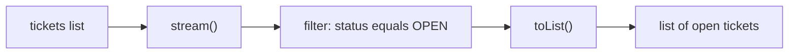
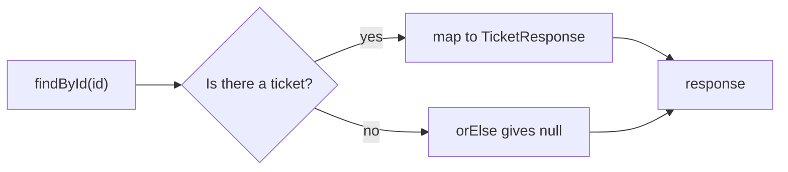

# Streams and Optional

Two Java features, both added in Java 8, make the repository and the controller shorter and safer. A **stream** replaces a `for` loop that filters or converts a list. An **Optional** replaces a method that returns `null` when nothing is found.

**Starting point:** your project at the end of [part 1](01-dto-request-and-response.md).
**Project:** [support-assistant](support-assistant/) in this folder. It holds the in-memory version of the application, with parts 1 to 4 applied. From part 6 on, the work continues in [support-assistant-jpa](support-assistant-jpa/).

## What you will build

- `findAllByStatus` and `toResponseList` written with streams instead of loops.
- `findById` and `update` that return an `Optional<Ticket>` instead of `null`.
- A controller with no `if (ticket == null)` checks.

The API behaves exactly as before. Only the code inside changes.

---

## 1. Streams

### A loop, and the same thing as a stream

Take a list of students and keep the ones who are 18 or older. The `Student` record is the one from part 1.

```java
List<Student> students = List.of(
        new Student("Asha", 20),
        new Student("Ravi", 17),
        new Student("Meera", 22));
```

With a loop:

```java
List<Student> adults = new ArrayList<>();
for (Student student : students) {
    if (student.age() >= 18) {
        adults.add(student);
    }
}
```

With a stream:

```java
List<Student> adults = students.stream()
        .filter(student -> student.age() >= 18)
        .toList();
```

Both give:

```text
[Student[name=Asha, age=20], Student[name=Meera, age=22]]
```

A **stream** is the list's items passed through a line of steps, one step after another. Read the stream version from top to bottom: "take the students, keep those aged 18 or more, make a list".

### The three parts

| Part | What it does | In the example |
|---|---|---|
| Start | `students.stream()` turns the list into a stream | `students.stream()` |
| Middle steps | Each one changes what flows through | `.filter(...)`, `.map(...)` |
| End | Collects the result | `.toList()` |

Nothing happens until the end step runs. A stream that does not end with `toList()` produces no list.

### The arrow: a lambda

`student -> student.age() >= 18` is a **lambda**: a short piece of code that you pass to a method. Read it as "given a `student`, answer whether the age is 18 or more".

- The name on the left of `->` is the item. You choose the name. `student`, `s`, and `ticket` all work.
- The expression on the right is what to do with it.

You have already written one. `deleteById` in the repository uses `removeIf(ticket -> ticket.getId().equals(id))`.

### `filter` and `map`

| Step | Meaning | Takes | Gives |
|---|---|---|---|
| `filter` | Keep the items for which the lambda is `true` | A yes/no question | The same items, fewer of them |
| `map` | Convert every item into something else | A conversion | One new item for each old one |

```java
List<String> names = students.stream()
        .map(student -> student.name())
        .toList();
```

```text
[Asha, Ravi, Meera]
```

Steps can be chained. Keep the adults, then take their names:

```java
List<String> adultNames = students.stream()
        .filter(student -> student.age() >= 18)
        .map(Student::name)
        .toList();
```

```text
[Asha, Meera]
```

`Student::name` is a **method reference**: a shorter way to write `student -> student.name()`. Use it when the lambda only calls one method on the item.

> **Note:** In code written before Java 16 you will see `.collect(Collectors.toList())` at the end of a stream. It does the same job as `.toList()`.

### The stream in this project



How to read it: the whole list goes in on the left. Only the tickets that pass the filter reach `toList()`.

---

## 2. Optional

### The problem with `null`

`findById` has to say something when there is no ticket with that id. In part 1 it returned `null`. Nothing in the method's signature warns the caller, so a caller that forgets to check gets a `NullPointerException`.

An **Optional** is a box that holds either one value or nothing. The method's return type says so: `Optional<Ticket>`, "a ticket, or nothing".

A stream can end with `findFirst()`, which returns an `Optional`:

```java
Optional<Student> found = students.stream()
        .filter(student -> student.name().equals("Ravi"))
        .findFirst();
```

```text
Optional[Student[name=Ravi, age=17]]
```

The same search for a name that is not in the list:

```text
Optional.empty
```

### Using what is in the box

| Method | What it does | Example | Result |
|---|---|---|---|
| `map(...)` | Converts the value if there is one. An empty box stays empty | `found.map(Student::name)` | `Optional[Ravi]` |
| `orElse(x)` | Gives the value, or `x` when the box is empty | `missing.map(Student::name).orElse("nobody")` | `nobody` |
| `ifPresent(...)` | Runs the lambda only when there is a value | `found.ifPresent(s -> System.out.println(s.name()))` | prints `Ravi` |
| `isPresent()` | `true` when there is a value | `found.isPresent()` | `true` |

`map` and `orElse` are the pair you will use most: convert if there is something, otherwise use a fallback.

### The Optional in this project



How to read it: `findById` always returns a box. The controller converts what is inside, or falls back to `null` when the box is empty.

> **Note:** `orElse(null)` keeps today's behaviour: a missing ticket still gives `200` with an empty body. A later part replaces it with a proper `404`.

---

## Build steps

Work in your part 1 project. The project folder shows the code of this part and of any later parts.

### Step 1: `findAllByStatus` with a stream

In `TicketRepository`, replace the loop:

```java
public List<Ticket> findAllByStatus(TicketStatus status) {
    return tickets.stream()
            .filter(ticket -> ticket.getStatus() == status)
            .toList();
}
```

**Check:** `mvn -q compile` prints no errors. Start the application, create two tickets, change one to `IN_PROGRESS`, and call `GET /api/v1/tickets?status=OPEN`. You should see only the ticket that is still open.

### Step 2: `toResponseList` with `map`

In `TicketMapper`, replace the loop. The `ArrayList` import is no longer used, so remove it.

```java
public static List<TicketResponse> toResponseList(List<Ticket> tickets) {
    return tickets.stream()
            .map(TicketMapper::toResponse)
            .toList();
}
```

**Check:** `GET /api/v1/tickets` returns the same list as before.

### Step 3: `findById` returns an `Optional`

In `TicketRepository`, import `java.util.Optional` and change `findById`:

```java
public Optional<Ticket> findById(Long id) {
    return tickets.stream()
            .filter(ticket -> ticket.getId().equals(id))
            .findFirst();
}
```

The old loop and the `return null` are gone.

**Check:** the project does not compile yet. IntelliJ marks `update` and the controller in red, because they still treat the result as a `Ticket`. The next two steps fix that.

### Step 4: `update` returns an `Optional`

Still in `TicketRepository`:

```java
public Optional<Ticket> update(Long id, Ticket changes) {
    Optional<Ticket> found = findById(id);
    found.ifPresent(ticket -> applyChanges(ticket, changes));
    return found;
}
```

Move the four `if (changes.getXxx() != null)` blocks from the old `update` into a private method `applyChanges(Ticket ticket, Ticket changes)`. The full class is in the project folder.

**Check:** the repository has no red lines. The controller still has some.

### Step 5: the controller uses `map` and `orElse`

In `TicketController`, replace the two methods that checked for `null`:

```java
@GetMapping("/{id}")
public TicketResponse findById(@PathVariable Long id) {
    return ticketRepository.findById(id)
            .map(TicketMapper::toResponse)
            .orElse(null);
}

@PatchMapping("/{id}")
public TicketResponse update(@PathVariable Long id, @RequestBody TicketRequest request) {
    return ticketRepository.update(id, TicketMapper.toEntity(request))
            .map(TicketMapper::toResponse)
            .orElse(null);
}
```

**Check:** `mvn -q clean verify` ends with no errors. Start the application and repeat these calls:

| Call | You should see |
|---|---|
| `POST /api/v1/tickets` with a title and priority | `200`, a ticket with `"status":"OPEN"` |
| `GET /api/v1/tickets/1` | `200`, the same ticket |
| `PATCH /api/v1/tickets/1` with `{"status":"IN_PROGRESS"}` | `200`, the ticket with the new status |
| `GET /api/v1/tickets/99` | `200`, empty body |
| `PATCH /api/v1/tickets/99` with `{"status":"CLOSED"}` | `200`, empty body |
| `GET /api/v1/tickets?status=IN_PROGRESS` | a list with ticket 1 |

Every result is the same as in part 1.

---

## Common mistakes

| Symptom | Cause | Fix |
|---|---|---|
| `incompatible types: Stream<Ticket> cannot be converted to List<Ticket>` | The stream has no end step, so it is still a stream | Finish with `.toList()` |
| `500 Internal Server Error` for an id that does not exist, and `NoSuchElementException: No value present` in the console | `get()` was called on an empty Optional | Use `map` and `orElse` instead of `get()` |

---

## Practice

1. In `findAllByStatus`, add a second `.filter(...)` so that only tickets that are both in the requested status and `HIGH` priority come back. Create tickets with different priorities and check the result.
2. In `TicketMapper.toResponseList`, replace `TicketMapper::toResponse` with the lambda `ticket -> toResponse(ticket)`. Does anything in the output change?
3. In the controller's `findById`, replace `.orElse(null)` with `.orElse(new TicketResponse(0L, "none", null, null, null))`. Call `GET /api/v1/tickets/99` and write down what you see.

---

## Recap

- A **stream** passes a list's items through steps: `filter` keeps some, `map` converts each, and `toList()` collects the result.
- A **lambda** such as `ticket -> ticket.getId().equals(id)` is a short piece of code passed to a step. `TicketMapper::toResponse` is a shorter way to write one that calls a single method.
- An **Optional** holds a value or nothing. The return type `Optional<Ticket>` tells the caller to expect both.
- Use `map` to convert what is inside and `orElse` for the fallback. Avoid `get()`.

### State at end of this part

| Class | What changed |
|---|---|
| `TicketRepository` | `findAllByStatus` uses a stream. `findById` and `update` return `Optional<Ticket>`. `applyChanges` is a private method |
| `TicketMapper` | `toResponseList` uses `map` |
| `TicketController` | `findById` and `update` use `map` and `orElse`. No `null` checks |

The endpoints and their results are the same as in part 1.
