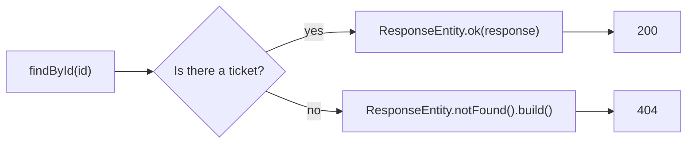

# Status codes

Every response has a **status code**: a number that tells the client what happened before it reads the body. Right now your API answers `200` to everything that works, and also `200` when a ticket does not exist. This note makes each answer say what really happened.

**Starting point:** your project at the end of [part 2](02-streams-and-optional.md).
**Project:** [support-assistant](support-assistant/) in this folder. It holds the in-memory version of the application, with parts 1 to 4 applied. From part 6 on, the work continues in [support-assistant-jpa](support-assistant-jpa/).

## What you will build

- `POST` answers `201 Created`.
- `GET` and `PATCH` for a ticket that does not exist answer `404 Not Found`.
- `DELETE` answers `204 No Content`, or `404` when there was nothing to delete.
- Controller methods that return a `ResponseEntity`, so they can choose the status.

---

## 1. Why the status code matters

A program that calls your API reads the status code first. It decides what to do from the number alone.

Ask for ticket `99`, which does not exist, in the project from part 2:

```bash
curl -i http://localhost:8080/api/v1/tickets/99
```

```text
HTTP/1.1 200
Content-Length: 0
```

`200` says "it worked", but there is no ticket and the body is empty. The caller has to guess from the empty body.

| Request | Today | After this note |
|---|---|---|
| `POST /api/v1/tickets` | `200` | `201` |
| `GET /api/v1/tickets/99` (does not exist) | `200`, empty body | `404`, empty body |
| `PATCH /api/v1/tickets/99` (does not exist) | `200`, empty body | `404`, empty body |
| `DELETE /api/v1/tickets/1` (exists) | `200`, empty body | `204`, empty body |
| `DELETE /api/v1/tickets/99` (does not exist) | `200`, empty body | `404`, empty body |

---

## 2. The codes this API uses

The first digit tells you the kind of result: `2xx` worked, `4xx` the client made a mistake, `5xx` the server failed. The full list is in the [REST APIs note from Day 2](../../day-02-spring-boot-basics-and-jpa/04-rest-apis.md).

| Code | Name | When this API sends it |
|---|---|---|
| `200` | OK | A read or an update worked, and there is a body |
| `201` | Created | A ticket was created |
| `204` | No Content | A ticket was deleted. There is nothing to send back |
| `400` | Bad Request | The JSON is not valid, or a value is not in an enum |
| `404` | Not Found | There is no ticket with that id |

Spring Boot already sends `400`, `405`, and `415` for you. For example, `"priority":"URGENT"` gives `400`, a `PUT` gives `405`, and a body without `Content-Type: application/json` gives `415`. You write the code only for `201`, `204`, and `404`.

---

## 3. `ResponseEntity`

A method that returns `TicketResponse` can send only a body, so the status is always `200`.

A **`ResponseEntity<T>`** carries the status and the body together. The method chooses both.

| You write | The client gets |
|---|---|
| `ResponseEntity.ok(body)` | `200` and the body |
| `ResponseEntity.status(HttpStatus.CREATED).body(body)` | `201` and the body |
| `ResponseEntity.noContent().build()` | `204` and no body |
| `ResponseEntity.notFound().build()` | `404` and no body |

`build()` finishes a response that has no body.

### How `findById` decides



How to read it: this is the `Optional` from part 2. When the box holds a ticket the answer is `200`. When it is empty the answer is `404`.

---

## Build steps

### Step 1: `deleteById` reports what it did

The controller needs to know whether anything was deleted. In `TicketRepository`, `removeIf` already returns `true` when it removed something, so return it:

```java
public boolean deleteById(Long id) {
    return tickets.removeIf(ticket -> ticket.getId().equals(id));
}
```

**Check:** `mvn -q compile` prints no errors.

### Step 2: `GET` and `PATCH` answer `404`

In `TicketController`, change the return type to `ResponseEntity<TicketResponse>` and replace `.orElse(null)`:

```java
@GetMapping("/{id}")
public ResponseEntity<TicketResponse> findById(@PathVariable Long id) {
    return ticketRepository.findById(id)
            .map(TicketMapper::toResponse)
            .map(ResponseEntity::ok)
            .orElse(ResponseEntity.notFound().build());
}
```

The second `map` wraps the response in a `200`. `orElse` supplies the `404` when the box is empty. Make the same change in `update`. The full class is in the project folder.

**Check:** `mvn -q compile` prints no errors. After a restart, `curl -i http://localhost:8080/api/v1/tickets/99` shows `HTTP/1.1 404`.

### Step 3: `POST` answers `201`

```java
@PostMapping
public ResponseEntity<TicketResponse> create(@RequestBody TicketRequest request) {
    Ticket ticket = TicketMapper.toEntity(request);
    ticket.setStatus(TicketStatus.OPEN); // a new ticket always starts OPEN
    TicketResponse response = TicketMapper.toResponse(ticketRepository.save(ticket));
    return ResponseEntity.status(HttpStatus.CREATED).body(response);
}
```

Import `org.springframework.http.HttpStatus` and `org.springframework.http.ResponseEntity`.

**Check:** `curl -i -X POST` with a title and priority shows `HTTP/1.1 201` and the new ticket in the body.

### Step 4: `DELETE` answers `204` or `404`

```java
@DeleteMapping("/{id}")
public ResponseEntity<Void> delete(@PathVariable Long id) {
    if (ticketRepository.deleteById(id)) {
        return ResponseEntity.noContent().build();
    }
    return ResponseEntity.notFound().build();
}
```

`Void` means "no body".

**Check:** `mvn -q clean verify` ends with no errors.

### Step 5: Try every code

Start the application. Use `-i` so that `curl` prints the status line.

```bash
# 201
curl -i -X POST http://localhost:8080/api/v1/tickets \
  -H "Content-Type: application/json" \
  -d '{"title":"Cannot print invoices","priority":"HIGH"}'

# 200
curl -i http://localhost:8080/api/v1/tickets/1

# 404
curl -i http://localhost:8080/api/v1/tickets/99

# 204, then 404 for the same id
curl -i -X DELETE http://localhost:8080/api/v1/tickets/1
curl -i -X DELETE http://localhost:8080/api/v1/tickets/1
```

**Check:** you should see this status line for each call, in this order:

```text
HTTP/1.1 201
HTTP/1.1 200
HTTP/1.1 404
HTTP/1.1 204
HTTP/1.1 404
```

> **Note:** The `404` has an empty body. A JSON error message in the body comes with error handling, in a later part.

> **Note:** Swagger UI still lists only `200` for every endpoint. It reads annotations, not the `ResponseEntity` in your code. The real codes are the ones in the table above.

---

## Common mistakes

| Symptom | Cause | Fix |
|---|---|---|
| `curl` prints nothing for a `404` or `204` | The body is empty. `curl` prints only the body by default | Add `-i` to see the status line, or `-w "%{http_code}"` to print the code |
| `incompatible types: org.springframework.http.ResponseEntity.HeadersBuilder<capture#1 of ?> cannot be converted to org.springframework.http.ResponseEntity<java.lang.Void>` | `ResponseEntity.notFound()` was returned without `.build()` | Add `.build()` |
| The second `DELETE` of the same id gives `404` | The ticket was removed by the first call | This is correct. Nothing is left to delete |

---

## Practice

1. Delete a ticket twice with `curl -i`. Write down both status codes and say why they differ.
2. Send a `POST` with the body `{"title":}`. Then send a valid body without the `Content-Type` header. Write down the two status codes.
3. Before you run anything, write down the status code you expect for `GET /api/v1/tickets` when there are no tickets, and for `GET /api/v1/tickets?status=CLOSED` when no ticket is closed. Then check with `curl -i`.

---

## Recap

- The **status code** tells the client the result before it reads the body: `2xx` worked, `4xx` the client made a mistake, `5xx` the server failed.
- A method that returns a plain object always sends `200`. A **`ResponseEntity`** lets the method choose the status and the body.
- `201` for a created ticket, `204` for a deleted one, and `404` when the id does not exist.
- An empty list is still `200`. Only a missing single resource is `404`.

### State at end of this part

| Endpoint | Success | Not found |
|---|---|---|
| `GET /api/v1/tickets` and `?status=OPEN` | `200` | |
| `GET /api/v1/tickets/{id}` | `200` | `404` |
| `POST /api/v1/tickets` | `201` | |
| `PATCH /api/v1/tickets/{id}` | `200` | `404` |
| `DELETE /api/v1/tickets/{id}` | `204` | `404` |

| Class | What changed |
|---|---|
| `TicketRepository` | `deleteById` returns `boolean` |
| `TicketController` | `findById`, `create`, `update`, and `delete` return `ResponseEntity` |
