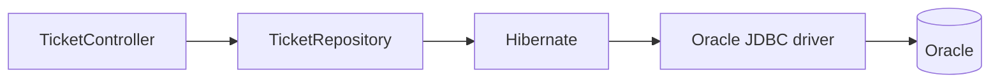
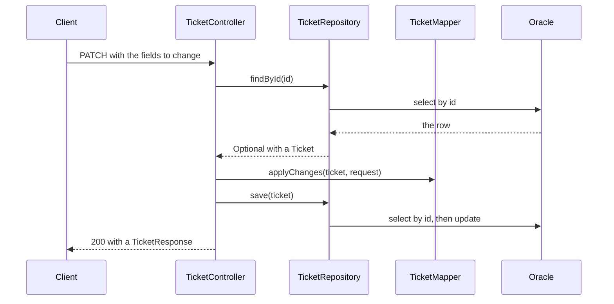

# Store tickets in Oracle with Spring Data JPA

Tickets live in a Java list, so they disappear when the application stops. In this note you store them in an Oracle database. You add two libraries, mark `Ticket` as an **entity**, replace the repository class with an interface, and write the settings in `application.yaml`.

**Starting point:** the [support-assistant](support-assistant/) project, with parts 1 to 4 applied, and a database from [05-oracle-database-setup.md](05-oracle-database-setup.md).
**Project:** [support-assistant-jpa](support-assistant-jpa/) in this folder. This is the first part that changes how the data is stored, so it works in a new copy of the project.

## What you will build

- A `Ticket` that maps to the `TICKETS` table.
- A `TicketRepository` that Spring writes for you.
- An `application.yaml` that holds the database address and login.
- The same API as before, now keeping its data across restarts.

---

## 1. The pieces

Your code does not talk to Oracle directly. A few layers sit in between. Day 2 introduced them in [Storing data in a database](../../day-02-spring-boot-basics-and-jpa/05-storing-data-in-a-database.md).



How to read it: you write the controller and the repository interface. Hibernate and the driver come with the libraries you add in step 1.

| Name | What it is | Your job |
|---|---|---|
| **JPA** | A standard that says how Java classes map to tables | Mark your class with its annotations |
| **Hibernate** | The library that does the work JPA describes, and writes the SQL | Nothing. Spring Boot sets it up |
| **Spring Data JPA** | Writes a repository class from an interface | Write the interface |
| **JDBC driver** | Java's way to talk to one kind of database | Add the library |

---

## Build steps

### Step 1: add the libraries

In `pom.xml`, add two dependencies:

```xml
<dependency>
    <groupId>org.springframework.boot</groupId>
    <artifactId>spring-boot-starter-data-jpa</artifactId>
</dependency>

<dependency>
    <groupId>com.oracle.database.jdbc</groupId>
    <artifactId>ojdbc17</artifactId>
    <scope>runtime</scope>
</dependency>
```

| Dependency | Why |
|---|---|
| `spring-boot-starter-data-jpa` | JPA, Hibernate, and Spring Data JPA |
| `ojdbc17` | The Oracle driver. It works with Oracle 19c and 21c |

You do not write a version. Spring Boot chooses one that works with the other libraries. `runtime` means the library is needed when the application runs, and you never write code against it.

> **Note:** On Spring Boot 3.x the driver is `ojdbc11`.

**Check:** reload Maven in IntelliJ, or run `mvn -q compile`. There are no errors.

### Step 2: make `Ticket` an entity

An **entity** is a Java class that maps to one table. One object is one row.

```java
@Entity
@Table(name = "TICKETS")
public class Ticket {

    @Id
    @GeneratedValue(strategy = GenerationType.UUID)
    @JdbcTypeCode(SqlTypes.VARCHAR)
    private UUID id;

    private String title;
    private String description;

    @Enumerated(EnumType.STRING)
    private TicketStatus status;

    @Enumerated(EnumType.STRING)
    private Priority priority;

    // getters and setters, as before
}
```

The imports come from `jakarta.persistence`, and `org.hibernate`. Use **Alt + Enter** in IntelliJ to add them.

| Annotation | Meaning |
|---|---|
| `@Entity` | This class maps to a table |
| `@Table(name = "TICKETS")` | The table's name |
| `@Id` | This field is the primary key |
| `@GeneratedValue(strategy = GenerationType.UUID)` | Hibernate creates a random UUID when you save a new ticket |
| `@JdbcTypeCode(SqlTypes.VARCHAR)` | Store the UUID as text, in the `VARCHAR2(36)` column |
| `@Enumerated(EnumType.STRING)` | Store the enum's name, such as `OPEN`, instead of its position |

You do not write a column name for each field. Spring Boot maps `title` to `TITLE`, and `description` to `DESCRIPTION`.

> **Warning:** Without `@Enumerated(EnumType.STRING)`, JPA stores the position of the enum value (`0`, `1`, `2`). It does not match the text column, and the application stops at start.

**Check:** `mvn -q compile` prints no errors. The application still stores tickets in the list. Only the class has changed.

### Step 3: replace the repository with an interface

Replace the whole content of `TicketRepository`:

```java
package com.bsp.supportassistant.repository;

public interface TicketRepository extends JpaRepository<Ticket, UUID> {

    List<Ticket> findAllByStatus(TicketStatus status);
}
```

There is no class, no list, and no `UUID.randomUUID()`. `JpaRepository<Ticket, UUID>` means "a repository for `Ticket`, whose id is a `UUID`". Spring writes the class at start.

You get these methods without writing them:

| Method | What it does |
|---|---|
| `save(ticket)` | Inserts a new ticket, or updates one that has an id |
| `findAll()` | Returns every ticket |
| `findById(id)` | Returns one ticket, wrapped in an `Optional` |
| `existsById(id)` | `true` when a ticket with that id exists |
| `deleteById(id)` | Deletes one ticket |

`findAllByStatus` is a method you add by **naming** it. Spring reads the name (`find` `All` `By` `Status`) and builds `where status = ?`. The name must match the field in `Ticket`.

**Check:** the repository has no red lines. The controller still has some.

### Step 4: change `update` and `delete`

The old repository had its own `update` and a `deleteById` that returned a `boolean`. The interface has neither, so the controller does the work.

First, add a method to `TicketMapper` that copies a request onto a ticket that already exists:

```java
public static void applyChanges(Ticket ticket, TicketRequest request) {
    if (request.title() != null) {
        ticket.setTitle(request.title());
    }
    if (request.description() != null) {
        ticket.setDescription(request.description());
    }
    // the same for status and priority
}
```

Then, in `TicketController`:

```java
@PatchMapping("/{id}")
public ResponseEntity<TicketResponse> update(@PathVariable UUID id, @RequestBody TicketRequest request) {
    return ticketRepository.findById(id)
            .map(ticket -> {
                TicketMapper.applyChanges(ticket, request);
                return ticketRepository.save(ticket);
            })
            .map(TicketMapper::toResponse)
            .map(ResponseEntity::ok)
            .orElse(ResponseEntity.notFound().build());
}
```

```java
@DeleteMapping("/{id}")
public ResponseEntity<Void> delete(@PathVariable UUID id) {
    if (!ticketRepository.existsById(id)) {
        return ResponseEntity.notFound().build();
    }
    ticketRepository.deleteById(id);
    return ResponseEntity.noContent().build();
}
```

`findById`, `create`, and `findAll` do not change. The names of the repository methods are the same as before.

**Check:** `mvn -q compile` prints no errors.

### Step 5: write `application.yaml`

Delete `src/main/resources/application.properties`. Create `src/main/resources/application.yaml`:

```yaml
spring:
  application:
    name: support-assistant

  datasource:
    # Option B: Oracle XE 21 in Docker on your own machine
    url: jdbc:oracle:thin:@//localhost:1521/XEPDB1
    username: support
    password: YOUR_PASSWORD

    # Option A: Oracle 19c on your organization's network.
    # Comment out the three lines above and use these instead.
    # url: jdbc:oracle:thin:@//ORACLE_HOST:1521/ORACLE_SERVICE
    # username: YOUR_USERNAME
    # password: YOUR_PASSWORD

  jpa:
    hibernate:
      ddl-auto: validate
    show-sql: true
    open-in-view: false
```

In YAML, the indentation shows what is inside what. Use spaces, never tabs. `spring: datasource: url:` is the same setting as `spring.datasource.url` in a `.properties` file. A line that starts with `#` is a comment and is ignored.

| Setting | Meaning |
|---|---|
| `spring.datasource.url` | Where the database is |
| `spring.datasource.username`, `password` | The login |
| `ddl-auto: validate` | Hibernate checks that the tables match your entities. It stops the application if they do not. It never creates or changes tables |
| `show-sql: true` | Print the SQL Hibernate runs, so you can see it |
| `open-in-view: false` | Without it, Spring Boot prints `spring.jpa.open-in-view is enabled by default.` at start. The setting matters only for pages built on the server |

Choose your option:

| You use | Do this |
|---|---|
| Option B (XE 21 in Docker) | Replace `YOUR_PASSWORD` with the `APP_USER_PASSWORD` you gave `docker run` |
| Option A (19c) | Comment out the three Option B lines, remove the `#` from the three Option A lines, and replace `ORACLE_HOST`, `ORACLE_SERVICE`, `YOUR_USERNAME`, and `YOUR_PASSWORD` with the values from your database team |

> **Warning:** The password is now written in this file. Never commit the file with a real password in it. The file in the project holds only the placeholder `YOUR_PASSWORD`.

**Check:** the file is in `src/main/resources`, `application.properties` is gone, and exactly one set of `url`, `username`, and `password` lines is active.

### Step 6: run it

```bash
mvn clean package
java -jar target/support-assistant-0.0.1-SNAPSHOT.jar
```

`mvn clean package` also runs the test. The test starts the whole application, so the database must be running and `application.yaml` must hold the right values.

**Check:** look for these lines in the log:

```text
HikariPool-1 - Added connection oracle.jdbc.driver.T4CConnection@...
Database dialect: OracleDialect
Started SupportAssistantApplication in 4.9 seconds
```

The first line means the application is connected. The second means Hibernate chose the Oracle SQL. If the application stops instead, see the common mistakes below.

### Step 7: use the API and look at the table

Create a ticket:

```bash
curl -i -X POST http://localhost:8080/api/v1/tickets \
  -H "Content-Type: application/json" \
  -d '{"title":"Cannot print invoices","description":"Printer on floor 2","priority":"HIGH"}'
```

**Check:** `HTTP/1.1 201` and a ticket with an `id` and `"status":"OPEN"`. The log has the SQL Hibernate wrote from your entity:

```text
Hibernate: insert into tickets (description,priority,status,title,id) values (?,?,?,?,?)
```

Now look at the table. At the `SQL>` prompt from the setup note:

```sql
SELECT ID, TITLE, STATUS, PRIORITY FROM TICKETS;
```

**Check:** you see your ticket, with the same `id` as the response:

```text
ID                                   TITLE                    STATUS       PRIORITY
------------------------------------ ------------------------ ------------ --------
0dfb593d-ffd8-4bef-9a55-21c505b9346e Cannot print invoices    OPEN         HIGH
```

Change its status, using the `id` from the response in place of `TICKET_ID`, and list by status:

```bash
curl -X PATCH http://localhost:8080/api/v1/tickets/TICKET_ID \
  -H "Content-Type: application/json" \
  -d '{"status":"IN_PROGRESS"}'

curl "http://localhost:8080/api/v1/tickets?status=IN_PROGRESS"
```

**Check:** the first call returns the ticket with `IN_PROGRESS`. The second returns a list with that one ticket. In the log, the `PATCH` ran two `select` statements and one `update`, and the list ran `... where t1_0.status=?`.

### Step 8: restart

Stop the application, start it again, and call `GET /api/v1/tickets`.

**Check:** your ticket is still there. With the Java list it was gone. The data is in Oracle, not in the application.

---

## What happens on a `PATCH`



How to read it: the controller loads the ticket, the mapper changes the fields that were sent, and `save` writes the result. When `findById` finds nothing, the controller answers `404` and nothing else happens.

---

## What changed, what did not

| | Before | Now |
|---|---|---|
| Where tickets live | A `List` in the repository class | The `TICKETS` table in Oracle |
| After a restart | Gone | Kept |
| `Ticket` | A plain class | An entity |
| `TicketRepository` | A class that you wrote | An interface that Spring implements |
| The id | `UUID.randomUUID()` in `save` | `@GeneratedValue(strategy = GenerationType.UUID)` |
| Settings | `application.properties` | `application.yaml` |
| Endpoints, DTOs, status codes | | The same |

### Oracle 19c and Oracle XE 21

Only the three connection settings differ.

| | Option A: 19c | Option B: XE 21 in Docker |
|---|---|---|
| `url` | `jdbc:oracle:thin:@//ORACLE_HOST:1521/ORACLE_SERVICE` | `jdbc:oracle:thin:@//localhost:1521/XEPDB1` |
| `username` | The user from your database team | `support` |
| Driver, entity, repository, the rest of `application.yaml` | Same | Same |

---

## Common mistakes

> **Note:** Hibernate starts its schema messages with `Schema validation:` on Spring Boot 4 and with `Schema-validation:` (a hyphen) on Spring Boot 3.5. The rest of each message is the same.

| Symptom | Cause | Fix |
|---|---|---|
| `Schema validation: missing table [tickets]` | The table is not in the database you connected to | Run `db/oracle/schema.sql` as the same user that `username` names in `application.yaml` |
| `Schema validation: wrong column type encountered in column [status] in table [tickets]; found [varchar2 (Types#VARCHAR)], but expecting [number(3,0) (Types#TINYINT)]` | The entity has no `@Enumerated(EnumType.STRING)` | Add it to `status` and `priority` |
| `Schema validation: missing column [details] in table [tickets]` | A field in the entity has no column of that name | Rename the field, or add the column to the table |
| `ORA-01017: invalid username/password; logon denied` | The `username` or `password` in `application.yaml` is wrong. With Option B, it is not the `APP_USER_PASSWORD` you gave `docker run` | Make both the same |
| `ORA-12514: Cannot connect to database. Service ... is not registered with the listener` | The service name in `url` is wrong | Option A: ask your database team. Option B: `XEPDB1` |
| `ORA-12541: Cannot connect. No listener at host ... port ...` | The host or port in `url` is wrong, or the database is not running | Check `url`. Option B: run `docker ps` |
| `ORA-17868: Unknown host specified.: ORACLE_HOST: nodename nor servname provided, or not known` | The Option A lines are active, but `ORACLE_HOST` was not replaced | Write your database host |
| `found duplicate key url` when the application starts | The Option A and Option B lines are both active | Keep one set. Put `#` in front of the other three lines |
| `Failed to load ApplicationContext` when `mvn clean package` runs the test | The test cannot connect, for any reason in this table | Fix the connection. The real cause is further down in the output |
| `500` for a `POST` without a `title` or a `priority`, and `ORA-01400: cannot insert NULL into ("SUPPORT"."TICKETS"."TITLE")` in the log | The column is `NOT NULL`, and nothing checked the request first | Send both fields. Checking them comes with validation, in a later part |

---

## Practice

1. Create three tickets. Restart the application and list them. Then run `SELECT COUNT(*) FROM TICKETS` and compare the number.
2. Add `List<Ticket> findAllByPriority(Priority priority);` to the repository. Add an optional `priority` parameter to `GET /api/v1/tickets` and use the new method. Check `?priority=HIGH`.
3. In `Ticket`, rename `description` to `details`. Start the application, read the message, and undo the change.
4. Set `show-sql: false`, restart, and call the API. Write down what disappears from the log.

---

## Recap

- An **entity** is a class that maps to a table. `@Entity`, `@Table`, `@Id`, and `@Enumerated(EnumType.STRING)` describe the mapping.
- A **repository interface** that extends `JpaRepository` gives you `save`, `findAll`, `findById`, `existsById`, and `deleteById`. A method named `findAllByStatus` becomes a query.
- `ddl-auto: validate` checks the tables. You create them with a script.
- The database address and login are in `application.yaml`. Keep a real password out of Git. The same code runs on Oracle 19c and on Oracle XE 21.

### State at end of this part

| File | What it holds |
|---|---|
| `db/oracle/schema.sql` | The `TICKETS` table, run once by hand |
| `src/main/resources/application.yaml` | The settings: the database `url`, `username`, and `password`, and the JPA options |
| `model/Ticket.java` | The entity |
| `repository/TicketRepository.java` | An interface with `findAllByStatus` |
| `mapper/TicketMapper.java` | Has `applyChanges` |
| `api/TicketController.java` | `update` and `delete` use the repository interface |
