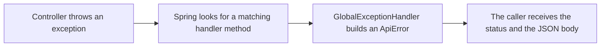

# Exception handling

When a request goes wrong, the API answers with an empty `404`, or a `500` that says nothing. In this note every error gets the same JSON body, with a message that tells the caller what to fix. You write the error body, one exception of your own, and one class that turns exceptions into responses.

**Starting point:** your project at the end of [Day 3, part 6](../../day-03-rest-api-dtos-and-validation/code-and-walkthroughs/06-spring-data-jpa-with-oracle.md), with the `TICKETS` table in your Oracle database.
**Project:** [support-assistant-jpa](support-assistant-jpa/) in this folder. Parts 1 to 4 of Day 4 change it in place, one after another.

## What you will build

- An `ApiError` record: the body of every error response.
- A `TicketNotFoundException` that the controller throws when a ticket does not exist.
- A `GlobalExceptionHandler` that turns exceptions into `ApiError` responses.

---

## 1. What the caller sees today

Start the application and try these requests. Use `00000000-0000-0000-0000-000000000000` as an id that no ticket has.

| Request | Status | Body |
|---|---|---|
| `GET /api/v1/tickets/00000000-0000-0000-0000-000000000000` | `404` | Empty |
| `GET /api/v1/tickets/abc` | `400` | `{"timestamp":"...","status":400,"error":"Bad Request","path":"/api/v1/tickets/abc"}` |
| `GET /api/v1/tickets?status=WRONG` | `400` | The same shape. Nothing says that `WRONG` is the problem |
| `POST /api/v1/tickets` with `{"priority":"HIGH"}` | `500` | `{"timestamp":"...","status":500,"error":"Internal Server Error","path":"/api/v1/tickets"}` |
| `POST /api/v1/tickets` with `{"title":` | `400` | The same shape, with no message |

Three problems:

- The `404` has no body at all.
- The `400` responses do not say what was wrong.
- A missing `title` is the caller's mistake, but the status is `500`, which means "the server broke".

---

## 2. The idea: throw where it happens, handle in one place

An **exception** is Java's way to say "this cannot continue". A method *throws* it, and the code that called the method, or the code that called that code, *catches* it. When nothing in your code catches it, Spring catches it last and answers with an error.

You do not write `try` and `catch` in every controller method. You write one class that knows how to answer for each kind of exception.



How to read it: the controller reports the problem by throwing. The handler decides the status and the message. No controller method has error code in it.

---

## Build steps

### Step 1: the error body

Create the package `exception`, and in it the record `ApiError`:

```java
public record ApiError(
        int status,
        String error,
        String message,
        LocalDateTime timestamp) {
}
```

| Field | Example |
|---|---|
| `status` | `404` |
| `error` | `Not Found`, the standard name of the status |
| `message` | `Ticket 0000... was not found`, written for the caller |
| `timestamp` | When the error happened |

Every error response will have this shape, so a caller reads errors one way.

### Step 2: your own exception

In the same package, create `TicketNotFoundException`:

```java
public class TicketNotFoundException extends RuntimeException {

    public TicketNotFoundException(UUID id) {
        super("Ticket " + id + " was not found");
    }
}
```

`extends RuntimeException` makes it an **unchecked** exception: methods that throw it do not have to declare it. The text passed to `super(...)` becomes `getMessage()`.

**Check:** `mvn -q compile` prints no errors.

### Step 3: the handler

Create `GlobalExceptionHandler` in the same package:

```java
@RestControllerAdvice
public class GlobalExceptionHandler {

    @ExceptionHandler(TicketNotFoundException.class)
    public ResponseEntity<ApiError> handleNotFound(TicketNotFoundException ex) {
        return build(HttpStatus.NOT_FOUND, ex.getMessage());
    }

    private ResponseEntity<ApiError> build(HttpStatus status, String message) {
        ApiError body = new ApiError(status.value(), status.getReasonPhrase(), message, LocalDateTime.now());
        return ResponseEntity.status(status).body(body);
    }
}
```

| Part | Meaning |
|---|---|
| `@RestControllerAdvice` | This class gives advice to every controller. Its return values are written as JSON |
| `@ExceptionHandler(TicketNotFoundException.class)` | Call this method when a controller throws that exception |
| `build` | A helper that every handler method uses, so the body is made in one place |

### Step 4: throw from the controller

In `TicketController`, replace the `404` code in three places.

In `findById` and `update`, replace the last line of the chain:

```java
.orElseThrow(() -> new TicketNotFoundException(id));
```

It replaces `.orElse(ResponseEntity.notFound().build());`. `orElseThrow` returns the value when the `Optional` has one. When it is empty, it throws the exception that the lambda creates.

In `delete`:

```java
if (!ticketRepository.existsById(id)) {
    throw new TicketNotFoundException(id);
}
```

**Check:** restart and call:

```bash
curl -i http://localhost:8080/api/v1/tickets/00000000-0000-0000-0000-000000000000
```

You should see `HTTP/1.1 404` and a body:

```json
{"status":404,"error":"Not Found","message":"Ticket 00000000-0000-0000-0000-000000000000 was not found","timestamp":"2026-10-14T15:37:36.99456"}
```

Then call `PATCH` and `DELETE` with the same id:

```bash
curl -i -X PATCH http://localhost:8080/api/v1/tickets/00000000-0000-0000-0000-000000000000 \
  -H "Content-Type: application/json" \
  -d '{"title":"New title"}'

curl -i -X DELETE http://localhost:8080/api/v1/tickets/00000000-0000-0000-0000-000000000000
```

**Check:** both answer `404` with the same kind of body.

### Step 5: errors that Spring finds

Some errors happen before your controller runs: Spring cannot read the id, the status, or the JSON. Spring throws its own exceptions. Add two methods to the handler:

```java
@ExceptionHandler(MethodArgumentTypeMismatchException.class)
public ResponseEntity<ApiError> handleTypeMismatch(MethodArgumentTypeMismatchException ex) {
    String message = "'" + ex.getValue() + "' is not a valid value for '" + ex.getName() + "'";
    return build(HttpStatus.BAD_REQUEST, message);
}

@ExceptionHandler(HttpMessageNotReadableException.class)
public ResponseEntity<ApiError> handleUnreadableBody(HttpMessageNotReadableException ex) {
    return build(HttpStatus.BAD_REQUEST, "The request body is missing or is not valid JSON");
}
```

| Exception | Thrown when | Example |
|---|---|---|
| `MethodArgumentTypeMismatchException` | A value in the URL cannot become the Java type | `/tickets/abc`, `?status=WRONG` |
| `HttpMessageNotReadableException` | The body is missing, is not JSON, or holds a value of the wrong type | `{"title":`, `"priority":"URGENT"` |

`ex.getValue()` is what the caller sent. `ex.getName()` is the name of the parameter. Both come from Spring, so you never type them.

**Check:** call:

```bash
curl -i http://localhost:8080/api/v1/tickets/abc
curl -i "http://localhost:8080/api/v1/tickets?status=WRONG"
```

You should see `400` for both, with these messages:

```text
'abc' is not a valid value for 'id'
'WRONG' is not a valid value for 'status'
```

### Step 6: errors from the database

A `POST` without a `title` reaches Oracle, and Oracle refuses the row. Spring turns the Oracle error into a `DataIntegrityViolationException`. Add a method for it:

```java
@ExceptionHandler(DataIntegrityViolationException.class)
public ResponseEntity<ApiError> handleDataIntegrity(DataIntegrityViolationException ex) {
    return build(HttpStatus.BAD_REQUEST,
            "The request breaks a database rule. For example, a required value is missing, or other records still refer to this one");
}
```

The message is written by you, not taken from `ex.getMessage()`. The exception's own message holds the SQL statement and the table and column names. A caller must not see those.

**Check:**

```bash
curl -i -X POST http://localhost:8080/api/v1/tickets \
  -H "Content-Type: application/json" \
  -d '{"priority":"HIGH"}'
```

You should see `400`, where it was `500`. The application log still has the Oracle error, so you can find the cause:

```text
ORA-01400: cannot insert NULL into ("SUPPORT"."TICKETS"."TITLE")
```

> **Note:** `400` for a missing `title` works, but the message cannot say *which* field is missing. Field-by-field messages come with validation, in a later part.

### Step 7: try them all

| Request | Status | `message` |
|---|---|---|
| `GET /api/v1/tickets/00000000-0000-0000-0000-000000000000` | `404` | `Ticket 00000000-0000-0000-0000-000000000000 was not found` |
| `PATCH` or `DELETE` with the same id | `404` | The same |
| `GET /api/v1/tickets/abc` | `400` | `'abc' is not a valid value for 'id'` |
| `GET /api/v1/tickets?status=WRONG` | `400` | `'WRONG' is not a valid value for 'status'` |
| `POST` with `{"priority":"HIGH"}` | `400` | `The request breaks a database rule. ...` |
| `POST` with `{"title":` | `400` | `The request body is missing or is not valid JSON` |
| `POST` with `{"title":"x","priority":"URGENT"}` | `400` | `The request body is missing or is not valid JSON` |

**Check:** each row gives the status and message shown.

Open Swagger UI and try the same requests from the page.

---

## What is still the default

Errors that you did not write a handler for keep Spring's own response:

| Request | Status | Body |
|---|---|---|
| `GET /api/v1/nothing` | `404` | `{"timestamp":"...","status":404,"error":"Not Found","path":"/api/v1/nothing"}` |
| `PUT /api/v1/tickets/{id}` | `405` | The same shape, with `Method Not Allowed` |

These responses are safe: they hold no internal details. Their shape differs from `ApiError`. Practice task 2 makes one of them match.

---

## Common mistakes

| Symptom | Cause | Fix |
|---|---|---|
| The response is `500` with `"error":"Internal Server Error"`, and the log shows `TicketNotFoundException` | The handler class has no `@RestControllerAdvice`, so Spring does not use it. Nothing handles the exception | Add `@RestControllerAdvice` above the class |
| `unreported exception ...TicketNotFoundException; must be caught or declared to be thrown` | The exception extends `Exception`, which is a checked exception | Extend `RuntimeException` |
| An unknown URL or a wrong method answers `500` with your `Something went wrong` message, after you added `@ExceptionHandler(Exception.class)` | A handler for `Exception` also catches Spring's own `404` and `405` exceptions, and answers `500` for them | Handle the exceptions you know. Leave the others to Spring |
| The response message holds `insert into tickets ...` and column names | The handler returns `ex.getMessage()` of a database exception | Write your own message. Keep the details in the log |

---

## Practice

1. Send `PATCH /api/v1/tickets/TICKET_ID` with `{"priority":"URGENT"}`, using the id of a ticket that exists. Read the message. Write down one piece of information that a caller needs and the message does not give.
2. Add a handler for `HttpRequestMethodNotSupportedException` that answers `405` with an `ApiError`. Check it with `PUT /api/v1/tickets/TICKET_ID`.
3. Change the text of `TicketNotFoundException` to `No ticket has the id ...`. Restart and check that `GET`, `PATCH`, and `DELETE` all show the new text without any other change.

---

## Recap

- Throw an exception where the problem is found. Handle it in one `@RestControllerAdvice` class.
- `@ExceptionHandler` picks the exception, and the method returns the status and an `ApiError`.
- Your own exceptions extend `RuntimeException`. Spring and the database throw their own, and you handle those the same way.
- Write the message yourself. Never return the message of a database exception.

### State at end of this part

| Class | What it holds |
|---|---|
| `exception/ApiError` | `status`, `error`, `message`, `timestamp` |
| `exception/TicketNotFoundException` | Thrown for a ticket that does not exist |
| `exception/GlobalExceptionHandler` | Handlers for not found, wrong type, unreadable body, and database rules |
| `api/TicketController` | Throws `TicketNotFoundException` and has no `notFound()` calls |

| Request | Result |
|---|---|
| Unknown ticket id | `404` with an `ApiError` |
| Id or status of the wrong type | `400` with an `ApiError` that names the value |
| Body missing or not JSON | `400` with an `ApiError` |
| Missing required value | `400` with an `ApiError` |
