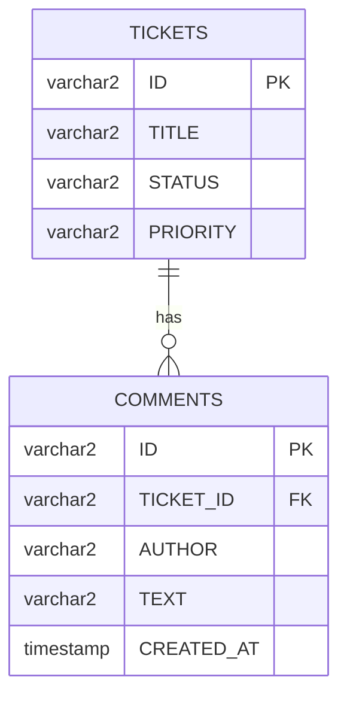

# Entity relationships: tickets and comments

A ticket is a conversation. Karan writes "Checking the printer queue", Meera answers, and both messages belong to that one ticket. In the database this is two tables joined by a **foreign key**. In this note you add a `COMMENTS` table, a `Comment` entity, and the annotations that tell JPA how the two entities relate.

**Starting point:** your project at the end of [part 2](02-custom-repository-methods.md).
**Project:** [support-assistant-jpa](support-assistant-jpa/) in this folder.

## What you will build

- A `COMMENTS` table that points to `TICKETS`.
- A `Comment` entity, with a `@ManyToOne` link to its ticket.
- A `@OneToMany` list of comments in `Ticket`, so that deleting a ticket deletes its comments.
- `POST` and `GET` on `/api/v1/tickets/{ticketId}/comments`.

---

## 1. The idea: one ticket, many comments



How to read it: the line between the tables says one ticket has zero or more comments. Each comment stores the id of its ticket in `TICKET_ID`. A column that holds the id of a row in another table is a **foreign key** (FK).

Only the comment's table has a column for the link. The ticket's table does not change.

| Word | Meaning | In your code |
|---|---|---|
| **Foreign key** | A column whose value must be the id of an existing row in another table | `COMMENTS.TICKET_ID` |
| **Many-to-one** | Many comments point to one ticket. Seen from the comment | `Comment.ticket`, with `@ManyToOne` |
| **One-to-many** | One ticket has many comments. Seen from the ticket | `Ticket.comments`, with `@OneToMany` |

It is one relationship, described from both sides. The side that has the foreign key column is the **owner** of the relationship: `Comment`.

---

## Build steps

### Step 1: create the `COMMENTS` table

The script [db/oracle/schema.sql](support-assistant-jpa/db/oracle/schema.sql) now holds two statements. You already have `TICKETS`, so run only the second one, at your `SQL>` prompt from [Day 3, part 5](../../day-03-rest-api-dtos-and-validation/code-and-walkthroughs/05-oracle-database-setup.md):

```sql
CREATE TABLE COMMENTS (
    ID          VARCHAR2(36)   PRIMARY KEY,
    TICKET_ID   VARCHAR2(36)   NOT NULL REFERENCES TICKETS (ID),
    AUTHOR      VARCHAR2(50)   NOT NULL,
    TEXT        VARCHAR2(500)  NOT NULL,
    CREATED_AT  TIMESTAMP      NOT NULL
);
```

| Column | Meaning |
|---|---|
| `ID` | The comment's own id, a UUID as text, like `TICKETS.ID` |
| `TICKET_ID` | The ticket this comment belongs to. `REFERENCES TICKETS (ID)` makes it a foreign key: Oracle refuses a value that is not the `ID` of a ticket |
| `NOT NULL` | A comment cannot exist without a ticket, an author, and text |
| `CREATED_AT` | When the comment was written |

> **Note:** If you run the whole script, the first statement stops with `ORA-00955: name is already used by an existing object`. That means `TICKETS` is already there. The second statement still runs.

**Check:** `DESC COMMENTS` lists five columns, and `ID`, `TICKET_ID`, `AUTHOR`, `TEXT`, and `CREATED_AT` are all `NOT NULL`.

### Step 2: the `Comment` entity

Create `Comment` in the `model` package:

```java
@Entity
@Table(name = "COMMENTS")
public class Comment {

    @Id
    @GeneratedValue(strategy = GenerationType.UUID)
    @JdbcTypeCode(SqlTypes.VARCHAR)
    private UUID id;

    @ManyToOne(fetch = FetchType.LAZY, optional = false)
    @JoinColumn(name = "TICKET_ID")
    private Ticket ticket;

    private String author;
    private String text;
    private LocalDateTime createdAt;

    // getters and setters for every field
}
```

The id is the same as in `Ticket`. The new part is `ticket`:

| Annotation | Meaning |
|---|---|
| `@ManyToOne` | Many `Comment` objects point to one `Ticket` |
| `optional = false` | A comment must have a ticket. This matches `NOT NULL` |
| `fetch = FetchType.LAZY` | Read the ticket from the database only when the code asks for it. Part 4 explains this |
| `@JoinColumn(name = "TICKET_ID")` | The foreign key column in `COMMENTS` |

The field is a `Ticket` object, not a `UUID`. In Java you write `comment.getTicket().getTitle()`. JPA keeps the `TICKET_ID` column for you.

`createdAt` maps to `CREATED_AT`: Spring Boot turns the camel-case name into an underscore name.

**Check:** `mvn -q compile` prints no errors.

### Step 3: the request, the response, the mapper, and the repository

Create two records in `dto`:

```java
public record CommentRequest(String author, String text) {
}

public record CommentResponse(UUID id, String author, String text, LocalDateTime createdAt) {
}
```

`CommentResponse` has no `ticket` field. The caller already knows the ticket: it is in the URL.

Create `CommentMapper` in `mapper`, in the same style as `TicketMapper`:

```java
public class CommentMapper {

    public static Comment toEntity(CommentRequest request, Ticket ticket) {
        Comment comment = new Comment();
        comment.setTicket(ticket);
        comment.setAuthor(request.author());
        comment.setText(request.text());
        comment.setCreatedAt(LocalDateTime.now());
        return comment;
    }

    public static CommentResponse toResponse(Comment comment) {
        return new CommentResponse(comment.getId(), comment.getAuthor(),
                comment.getText(), comment.getCreatedAt());
    }

    public static List<CommentResponse> toResponseList(List<Comment> comments) {
        return comments.stream().map(CommentMapper::toResponse).toList();
    }
}
```

`toEntity` takes the ticket as a second argument, because a comment is always created for one ticket, and the time is set by the application, not by the caller.

Create `CommentRepository` in `repository`:

```java
public interface CommentRepository extends JpaRepository<Comment, UUID> {

    // where ticket_id = ? order by created_at, oldest first
    List<Comment> findAllByTicketIdOrderByCreatedAtAsc(UUID ticketId);
}
```

`TicketId` in the method name means "the `id` of the `ticket` field". Spring Data follows the relationship from `Comment` to `Ticket` to its `id`. No join is needed, because `TICKET_ID` is already in the comments table.

**Check:** `mvn -q compile` prints no errors.

### Step 4: the controller

Create `CommentController` in `api`. The URL has the ticket id in it, so a comment is always reached through its ticket:

```java
@RestController
@RequestMapping("/api/v1/tickets/{ticketId}/comments")
public class CommentController {

    private final TicketRepository ticketRepository;
    private final CommentRepository commentRepository;

    public CommentController(TicketRepository ticketRepository, CommentRepository commentRepository) {
        this.ticketRepository = ticketRepository;
        this.commentRepository = commentRepository;
    }

    @GetMapping
    public List<CommentResponse> findAll(@PathVariable UUID ticketId) {
        if (!ticketRepository.existsById(ticketId)) {
            throw new TicketNotFoundException(ticketId);
        }
        return CommentMapper.toResponseList(
                commentRepository.findAllByTicketIdOrderByCreatedAtAsc(ticketId));
    }

    @PostMapping
    public ResponseEntity<CommentResponse> create(@PathVariable UUID ticketId,
                                                  @RequestBody CommentRequest request) {
        Ticket ticket = ticketRepository.findById(ticketId)
                .orElseThrow(() -> new TicketNotFoundException(ticketId));
        Comment saved = commentRepository.save(CommentMapper.toEntity(request, ticket));
        return ResponseEntity.status(HttpStatus.CREATED).body(CommentMapper.toResponse(saved));
    }
}
```

The `404` comes from the exception and the handler from [part 1](01-exception-handling.md). This controller has no error code of its own.

**Check:** `mvn -q compile` prints no errors. Restart the application.

### Step 5: add and read comments

Create a ticket, and use its `id` in place of `TICKET_ID`:

```bash
curl -i -X POST http://localhost:8080/api/v1/tickets/TICKET_ID/comments \
  -H "Content-Type: application/json" \
  -d '{"author":"Karan","text":"Checking the printer queue now."}'

curl -X POST http://localhost:8080/api/v1/tickets/TICKET_ID/comments \
  -H "Content-Type: application/json" \
  -d '{"author":"Meera","text":"Thank you. It is the third floor printer."}'

curl http://localhost:8080/api/v1/tickets/TICKET_ID/comments
```

**Check:** the first call answers `HTTP/1.1 201`, and the last returns both comments, Karan's first:

```json
[{"id":"da788251-...","author":"Karan","text":"Checking the printer queue now.","createdAt":"2026-10-14T15:41:34.100434"},
 {"id":"3e683922-...","author":"Meera","text":"Thank you. It is the third floor printer.","createdAt":"2026-10-14T15:41:34.192326"}]
```

Now look in the table:

```sql
SELECT TICKET_ID, AUTHOR, TEXT FROM COMMENTS;
```

**Check:** both rows show the same `TICKET_ID`, the `id` of your ticket.

Try an unknown ticket and a missing field:

```bash
curl -i http://localhost:8080/api/v1/tickets/00000000-0000-0000-0000-000000000000/comments

curl -i -X POST http://localhost:8080/api/v1/tickets/TICKET_ID/comments \
  -H "Content-Type: application/json" \
  -d '{"author":"Karan"}'
```

**Check:** the first answers `404` with `Ticket 0000... was not found`. The second answers `400`, and the log has `ORA-01400: cannot insert NULL into ("SUPPORT"."COMMENTS"."TEXT")`.

### Step 6: delete a ticket that has comments

```bash
curl -i -X DELETE http://localhost:8080/api/v1/tickets/TICKET_ID
```

**Check:** you get `400`. The log shows why:

```text
ORA-02292: integrity constraint (SUPPORT.SYS_C008310) violated - child record found
```

The number in the constraint name differs on your database. The meaning is the same: the foreign key protects the data. A ticket that still has comments cannot be deleted, because the comments would point to a ticket that no longer exists.

Java does not know about the comments of a ticket yet, so it cannot remove them first. The next step fixes that.

### Step 7: the ticket side, and delete with its comments

In `Ticket`, add the list:

```java
// The other side of Comment.ticket. This field has no column in TICKETS.
@OneToMany(mappedBy = "ticket", cascade = CascadeType.REMOVE)
private List<Comment> comments = new ArrayList<>();

public List<Comment> getComments() {
    return comments;
}
```

| Part | Meaning |
|---|---|
| `@OneToMany` | One `Ticket` has many `Comment` objects |
| `mappedBy = "ticket"` | The link is already described by the field `ticket` in `Comment`. Do not create another column or table |
| `cascade = CascadeType.REMOVE` | When a ticket is deleted, delete its comments first |

The setter is not needed. The list belongs to JPA, and comments are added through `CommentRepository`.

**Check:** restart, call the same `DELETE` on a ticket with comments.

You should see `HTTP/1.1 204`. In the log, Hibernate removed the comments first, and then the ticket:

```text
Hibernate: select count(*) from tickets t1_0 where t1_0.id=?
Hibernate: select ... from tickets t1_0 where t1_0.id=?
Hibernate: select c1_0.ticket_id,c1_0.id,... from comments c1_0 where c1_0.ticket_id=?
Hibernate: delete from comments where id=?
Hibernate: delete from comments where id=?
Hibernate: delete from tickets where id=?
```

Then run `SELECT COUNT(*) FROM COMMENTS WHERE TICKET_ID = 'TICKET_ID';`.

**Check:** the count is `0`.

---

## Common mistakes

> **Note:** Hibernate starts its schema messages with `Schema validation:` on Spring Boot 4 and with `Schema-validation:` (a hyphen) on Spring Boot 3.5. The rest of each message is the same.

| Symptom | Cause | Fix |
|---|---|---|
| `400` for a `DELETE`, and `ORA-02292: ... child record found` in the log | The ticket has comments, and nothing removes them first | Add `cascade = CascadeType.REMOVE` to the `@OneToMany` field |
| `Schema validation: missing table [tickets_comments]` when the application starts | `@OneToMany` has no `mappedBy`, so JPA looks for a third table that joins the two | Add `mappedBy = "ticket"`. The value is the field name in `Comment` |
| `Schema validation: missing table [comments]` when the application starts | The `COMMENTS` table was not created in this database | Run the `CREATE TABLE COMMENTS` statement |
| `400` for a `POST` comment, and `ORA-01400` for `TEXT` or `AUTHOR` in the log | The body has no `text` or no `author` | Send both fields. Messages per field come with validation, in a later part |

---

## Practice

1. Add three comments to one ticket and two to another. Run `SELECT TICKET_ID, COUNT(*) FROM COMMENTS GROUP BY TICKET_ID;` and compare with `GET .../comments` for each ticket.
2. Add `long countByTicketId(UUID ticketId);` to `CommentRepository`, and a `GET /api/v1/tickets/{ticketId}/comments/count` method to `CommentController`. Check the number for each ticket.
3. Remove `cascade = CascadeType.REMOVE`, restart, and delete a ticket that has comments. Read the log, then restore the line.

---

## Recap

- A relationship is a foreign key in the database and a field in each entity.
- The "many" side, `Comment`, owns the foreign key. It has `@ManyToOne` and `@JoinColumn`.
- The "one" side, `Ticket`, has `@OneToMany(mappedBy = "...")`. `mappedBy` names the field on the other side.
- `cascade = CascadeType.REMOVE` deletes the children together with the parent. Without it, the foreign key blocks the delete.
- A repository method name can follow a relationship: `findAllByTicketId...` reads `ticket.id`.

### State at end of this part

| File | What it holds |
|---|---|
| `db/oracle/schema.sql` | `TICKETS` and `COMMENTS` |
| `model/Comment.java` | The entity, with `@ManyToOne` to `Ticket` |
| `model/Ticket.java` | A `comments` list with `@OneToMany(mappedBy = "ticket", cascade = REMOVE)` |
| `dto/CommentRequest.java`, `dto/CommentResponse.java` | The comment's request and response |
| `mapper/CommentMapper.java` | `toEntity`, `toResponse`, `toResponseList` |
| `repository/CommentRepository.java` | `findAllByTicketIdOrderByCreatedAtAsc` |
| `api/CommentController.java` | `GET` and `POST` under `/api/v1/tickets/{ticketId}/comments` |

| Request | Result |
|---|---|
| `POST /api/v1/tickets/{ticketId}/comments` | `201`, or `404` for an unknown ticket, or `400` for a missing field |
| `GET /api/v1/tickets/{ticketId}/comments` | `200` with the comments, oldest first, or `404` |
| `DELETE /api/v1/tickets/{id}` | `204`. The comments of the ticket are deleted too |
