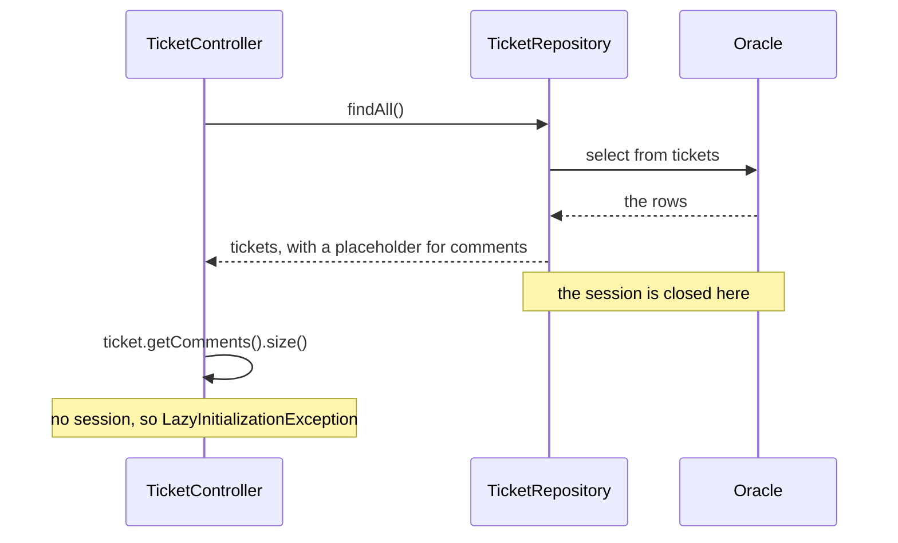

# Lazy loading and the N+1 problem

A ticket list is more useful when it shows how many comments each ticket has. It looks like a one-line change. It breaks, and the reason is how JPA loads the comments. In this note you see the error, a fix that works but is slow, and the fix that works well.

**Starting point:** your project at the end of [part 3](03-entity-relationships.md).
**Project:** [support-assistant-jpa](support-assistant-jpa/) in this folder.

## What you will build

- A `commentCount` in every `TicketResponse`.
- A list that reads tickets and their comments with **one** SQL statement.

---

## 1. The idea: lazy loading

When JPA reads a `Ticket`, it does not read the comments. The `comments` list holds a placeholder. The first time your code touches the list (`size()`, a loop), JPA runs a `select` on `COMMENTS`. This is **lazy loading**: read the data when it is asked for.

The `select` needs an open database **session**: Hibernate's working connection for one piece of work. A repository method opens a session, reads, and closes it before it returns. Your controller then holds a `Ticket` whose session is gone.



How to read it: the tickets arrive without their comments. Asking for the comments after the repository call has no session to read them with.

---

## Build steps

### Step 1: add `commentCount`

In `TicketResponse`, add a field at the end:

```java
public record TicketResponse(
        UUID id,
        String title,
        String description,
        TicketStatus status,
        Priority priority,
        int commentCount) {
}
```

In `TicketMapper.toResponse`, pass the number of comments:

```java
return new TicketResponse(
        ticket.getId(),
        ticket.getTitle(),
        ticket.getDescription(),
        ticket.getStatus(),
        ticket.getPriority(),
        ticket.getComments().size());
```

A `TicketResponse` is a DTO, so the new field is added here and the database does not change.

**Check:** `mvn -q compile` prints no errors.

### Step 2: see it fail

Restart. Create a ticket, add two comments to it, and then list the tickets:

```bash
curl -i -X POST http://localhost:8080/api/v1/tickets \
  -H "Content-Type: application/json" \
  -d '{"title":"Count demo","description":"d","priority":"LOW"}'

curl -X POST http://localhost:8080/api/v1/tickets/TICKET_ID/comments \
  -H "Content-Type: application/json" \
  -d '{"author":"Karan","text":"one"}'

curl -X POST http://localhost:8080/api/v1/tickets/TICKET_ID/comments \
  -H "Content-Type: application/json" \
  -d '{"author":"Meera","text":"two"}'

curl -i http://localhost:8080/api/v1/tickets
```

**Check:** the `POST` for the ticket answers `201` with `"commentCount":0`. The list answers `500`. The log has:

```text
org.hibernate.LazyInitializationException: Cannot lazily initialize collection of role 'com.bsp.supportassistant.model.Ticket.comments' with key '...' (no session)
```

On Spring Boot 3.5 the same error reads `failed to lazily initialize a collection of role: com.bsp.supportassistant.model.Ticket.comments: could not initialize proxy - no Session`. The name `LazyInitializationException` and the cause are the same.

The `POST` worked because the ticket was created in Java: its `comments` is a plain empty list, and no database read is needed. The list reads tickets from Oracle, so `comments` is a placeholder, and the session is gone.

### Step 3: a fix that works, and what it costs

Make the whole controller method run inside one session. In `TicketController`, add `@Transactional(readOnly = true)` to `findAll`:

```java
@GetMapping
@Transactional(readOnly = true)
public List<TicketResponse> findAll(...) {
```

The import is `org.springframework.transaction.annotation.Transactional`. A **transaction** keeps one session open from the start of the method to its end. `readOnly = true` says the method only reads.

> **Note:** In a larger application this annotation goes on a service class. The controller is used here because it is the only layer you have.

**Check:** restart and call `GET /api/v1/tickets`. The list answers `200`, and each ticket has its `commentCount`.

Now count the statements in the log for that one call:

```text
Hibernate: select t1_0.id,... from tickets t1_0
Hibernate: select c1_0.ticket_id,c1_0.id,... from comments c1_0 where c1_0.ticket_id=?
Hibernate: select c1_0.ticket_id,c1_0.id,... from comments c1_0 where c1_0.ticket_id=?
Hibernate: select c1_0.ticket_id,c1_0.id,... from comments c1_0 where c1_0.ticket_id=?
... one more for every ticket
```

**Check:** count the `select` lines for that one call: one for `tickets`, and one for `comments` per ticket. With 8 tickets, that is 9 statements.

This is the **N+1 problem**: one query for the list, then one more query for each of the N tickets. It works with 8 tickets. With 1,000 tickets it is 1,001 round trips to the database for one page. Nothing in the Java code looks wrong, which is why it goes unnoticed.

### Step 4: read tickets and comments together

Remove the `@Transactional` from `findAll`. You will not need it. Ask the repository to load the comments in the same query. In `TicketRepository`:

```java
// Read each ticket together with its comments, in one query.
@Override
@EntityGraph(attributePaths = "comments")
List<Ticket> findAll();

@Override
@EntityGraph(attributePaths = "comments")
Optional<Ticket> findById(UUID id);

@EntityGraph(attributePaths = "comments")
List<Ticket> findAllByStatus(TicketStatus status);

@EntityGraph(attributePaths = "comments")
List<Ticket> findAllByPriority(Priority priority);

@EntityGraph(attributePaths = "comments")
List<Ticket> findAllByStatusAndPriority(TicketStatus status, Priority priority);
```

Put the same annotation above `search`, next to its `@Query`.

| Part | Meaning |
|---|---|
| `@EntityGraph(attributePaths = "comments")` | Load the `comments` field in the same query as the ticket |
| `@Override` | `findAll` and `findById` already exist in `JpaRepository`. You declare them again to add the annotation |

The import is `org.springframework.data.jpa.repository.EntityGraph`.

**Check:** restart and call `GET /api/v1/tickets`. The log has one statement, with a join:

```text
Hibernate: select t1_0.id,c1_0.ticket_id,c1_0.id,c1_0.author,c1_0.created_at,c1_0.text,
t1_0.description,t1_0.priority,t1_0.status,t1_0.title
from tickets t1_0 left join comments c1_0 on t1_0.id=c1_0.ticket_id
```

The tickets and their comments now cost one statement, however many tickets there are. `left join` keeps tickets that have no comments, with `commentCount` `0`.

### Step 5: `PATCH` still fails

Call:

```bash
curl -i -X PATCH http://localhost:8080/api/v1/tickets/TICKET_ID \
  -H "Content-Type: application/json" \
  -d '{"priority":"HIGH"}'
```

**Check:** `GET /api/v1/tickets/TICKET_ID` shows `commentCount` `2`, but this `PATCH` answers `500` with the same `LazyInitializationException`.

The ticket was loaded with its comments. `save` then returns a **new copy** of the ticket, read again from the database without the comments. The mapper asked that copy for its comments.

The `ticket` you loaded already has the new values and the comments. In `update`, save it, and build the response from it:

```java
@PatchMapping("/{id}")
public ResponseEntity<TicketResponse> update(@PathVariable UUID id, @RequestBody TicketRequest request) {
    Ticket ticket = ticketRepository.findById(id)
            .orElseThrow(() -> new TicketNotFoundException(id));
    TicketMapper.applyChanges(ticket, request);
    ticketRepository.save(ticket);
    return ResponseEntity.ok(TicketMapper.toResponse(ticket));
}
```

**Check:** the same `PATCH` answers `200` with `"priority":"HIGH"` and `"commentCount":2`. `GET` shows `HIGH` too.

---

## Common mistakes

| Symptom | Cause | Fix |
|---|---|---|
| `500` and `LazyInitializationException` (`Cannot lazily initialize collection of role '...Ticket.comments' ... (no session)`, or `failed to lazily initialize a collection of role` on Spring Boot 3.5) | The code reads `comments` after the repository call finished | Load the comments in the repository call with `@EntityGraph` |
| One `select` for tickets and then many `select ... from comments ... where c1_0.ticket_id=?` in the log | Lazy loading inside a transaction: the N+1 problem | Add `@EntityGraph(attributePaths = "comments")` to the repository method |
| `500` with the same exception, only for `PATCH` or `?status=`, after you fixed `findAll` | One method that returns tickets has no `@EntityGraph`, or the response is built from the copy that `save` returns | Add the annotation to every method that feeds a response. In `update`, build the response from the loaded ticket |
| A `PATCH` answers `200` with the new value, but a later `GET` shows the old value, and no `update` is in the log | `@Transactional(readOnly = true)` on a method that changes data. A read-only transaction never writes | Use `@Transactional` without `readOnly` for methods that save |

---

## Practice

1. Create five tickets with 0, 1, 2, 3, and 4 comments. Call `GET /api/v1/tickets` and compare `commentCount` with `SELECT TICKET_ID, COUNT(*) FROM COMMENTS GROUP BY TICKET_ID;`.
2. Remove `@EntityGraph` from `findAllByStatus` only. Call `?status=OPEN`, read the error, and restore the line.
3. Call `GET /api/v1/tickets/search?keyword=printer` and count the `select` statements in the log. Write down why the number does not depend on how many tickets match.

---

## Recap

- A `@OneToMany` list is **lazy**: it is read when the code first touches it, and that needs an open session.
- After a repository call returns, the session is closed. Touching a lazy list then gives `LazyInitializationException`.
- Wrapping the work in a transaction makes the error go away, but costs one extra query per ticket: the **N+1 problem**.
- `@EntityGraph(attributePaths = "comments")` reads tickets and comments in one query.
- `save` on an existing ticket returns a new copy. Use the ticket you loaded to build the response.

### State at end of this part

| Class | What changed |
|---|---|
| `TicketResponse` | Has `commentCount` |
| `TicketMapper` | `toResponse` passes `ticket.getComments().size()` |
| `TicketRepository` | `findAll`, `findById`, and every method that returns tickets have `@EntityGraph(attributePaths = "comments")` |
| `TicketController` | `update` builds the response from the loaded ticket. No `@Transactional` |

| Request | Result |
|---|---|
| `GET /api/v1/tickets` | `200`, one SQL statement, each ticket with `commentCount` |
| `GET`, `PATCH /api/v1/tickets/{id}` | `200` with `commentCount` |
