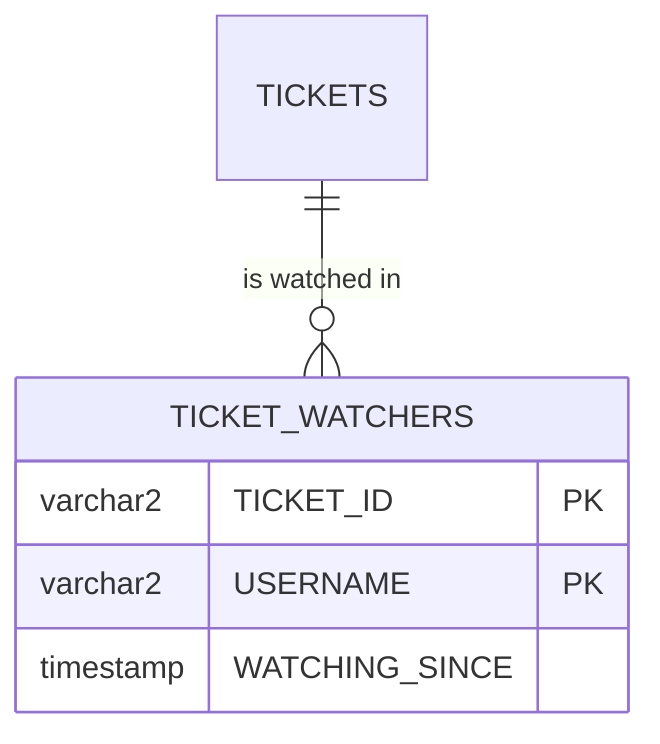

# Composite keys

Every table so far has one `ID` column as its primary key. Some tables are identified by **two columns together**. A person can watch many tickets, and a ticket can have many watchers, but a person watches a ticket once. The pair (ticket, person) is what makes a row unique. In this note you store ticket watchers in a table with a **composite key**.

**Starting point:** your project at the end of [part 4](04-lazy-loading-and-n-plus-1.md).
**Project:** [support-assistant-composite-key](support-assistant-composite-key/) in this folder. It is a copy of [support-assistant-jpa](support-assistant-jpa/) at the end of part 4, with the watcher classes added. A separate copy keeps the main project simple: it does not need a composite key.

## What you will build

- A `TICKET_WATCHERS` table whose primary key has two columns.
- A key class, `TicketWatcherId`, and an entity, `TicketWatcher`, that uses it.
- `POST`, `GET`, and `DELETE` on `/api/v1/tickets/{ticketId}/watchers`.

---

## 1. The idea: a key made of two columns



How to read it: both `TICKET_ID` and `USERNAME` are marked `PK`. Together they identify one row. `TICKET_ID` is also a foreign key to `TICKETS`.

| `TICKET_ID` | `USERNAME` | Allowed? |
|---|---|---|
| ticket 1 | karan | Yes |
| ticket 1 | meera | Yes. A different person on the same ticket |
| ticket 2 | karan | Yes. The same person on a different ticket |
| ticket 1 | karan, again | No. The pair already exists |

| | One-column key | Composite key |
|---|---|---|
| Primary key columns | `ID` | `TICKET_ID` and `USERNAME` |
| A row is unique when | The `ID` is unique | The **pair** is unique |
| Created by | `@GeneratedValue` | Your code. Both values come from the request |
| Annotation in Java | `@Id` on one field | `@EmbeddedId` on a key object |
| Key type in the repository | `UUID` | `TicketWatcherId` |

---

## Build steps

### Step 1: create the table

Run this statement at your `SQL>` prompt. The file [db/oracle/schema.sql](support-assistant-composite-key/db/oracle/schema.sql) has it after the other two tables:

```sql
CREATE TABLE TICKET_WATCHERS (
    TICKET_ID       VARCHAR2(36)  NOT NULL REFERENCES TICKETS (ID) ON DELETE CASCADE,
    USERNAME        VARCHAR2(50)  NOT NULL,
    WATCHING_SINCE  TIMESTAMP     NOT NULL,
    PRIMARY KEY (TICKET_ID, USERNAME)
);
```

| Part | Meaning |
|---|---|
| `PRIMARY KEY (TICKET_ID, USERNAME)` | The key is the pair. Oracle refuses a second row with the same pair |
| `REFERENCES TICKETS (ID)` | `TICKET_ID` must be the id of a ticket, as in part 3 |
| `ON DELETE CASCADE` | When a ticket is deleted, Oracle deletes its watchers |

`ON DELETE CASCADE` does in the database what `cascade = CascadeType.REMOVE` did in Java for comments. Watchers have no list in `Ticket`, so the database does the work and no Java code is needed.

**Check:** `DESC TICKET_WATCHERS` lists three columns, all `NOT NULL`.

### Step 2: the key class

Create `TicketWatcherId` in the `model` package:

```java
@Embeddable
public record TicketWatcherId(
        @JdbcTypeCode(SqlTypes.VARCHAR) UUID ticketId,
        String username) implements Serializable {
}
```

| Part | Meaning |
|---|---|
| `@Embeddable` | This class is a group of columns that another entity embeds, not a table of its own |
| `record` | Gives you `equals` and `hashCode`. A key class needs them, because JPA compares keys to know whether two objects are the same row |
| `@JdbcTypeCode(SqlTypes.VARCHAR)` | Store the `UUID` as text, as in `Ticket.id` |
| `implements Serializable` | JPA asks a key class for this |

The two fields are the two columns: `ticketId` is `TICKET_ID`, and `username` is `USERNAME`.

### Step 3: the entity

Create `TicketWatcher` in the same package:

```java
@Entity
@Table(name = "TICKET_WATCHERS")
public class TicketWatcher {

    @EmbeddedId
    private TicketWatcherId id;

    private LocalDateTime watchingSince;

    // getters and setters
}
```

`@EmbeddedId` marks a field that holds a whole key object, where `@Id` marks one value. There is no `@GeneratedValue`: nothing can generate "karan". Your code creates the key.

**Check:** `mvn -q compile` prints no errors.

### Step 4: the repository

```java
public interface TicketWatcherRepository extends JpaRepository<TicketWatcher, TicketWatcherId> {

    // where ticket_id = ? order by watching_since, oldest first
    List<TicketWatcher> findAllByIdTicketIdOrderByWatchingSinceAsc(UUID ticketId);
}
```

The second type in `JpaRepository<...>` is the key type, and it is now `TicketWatcherId`. So `findById`, `existsById`, and `deleteById` take a `TicketWatcherId`:

```java
watcherRepository.existsById(new TicketWatcherId(ticketId, "karan"));
```

In the method name, `Id` is the field `id` of `TicketWatcher`, and `TicketId` is the field `ticketId` inside the key. Spring Data follows the path `id.ticketId`.

### Step 5: the request, the response, the mapper, and an exception

Create the records in `dto`:

```java
public record WatcherRequest(String username) {
}

public record WatcherResponse(String username, LocalDateTime watchingSince) {
}
```

Create `WatcherMapper` in `mapper`:

```java
public class WatcherMapper {

    public static TicketWatcher toEntity(UUID ticketId, String username) {
        TicketWatcher watcher = new TicketWatcher();
        watcher.setId(new TicketWatcherId(ticketId, username));
        watcher.setWatchingSince(LocalDateTime.now());
        return watcher;
    }

    public static WatcherResponse toResponse(TicketWatcher watcher) {
        return new WatcherResponse(watcher.getId().username(), watcher.getWatchingSince());
    }

    public static List<WatcherResponse> toResponseList(List<TicketWatcher> watchers) {
        return watchers.stream().map(WatcherMapper::toResponse).toList();
    }
}
```

A record's accessor has the name of the field: `watcher.getId().username()`, with no `get`.

A person who already watches a ticket needs an answer of their own. In `exception`, create:

```java
public class AlreadyWatchingException extends RuntimeException {

    public AlreadyWatchingException(UUID ticketId, String username) {
        super(username + " already watches ticket " + ticketId);
    }
}
```

and add a handler to `GlobalExceptionHandler`:

```java
@ExceptionHandler(AlreadyWatchingException.class)
public ResponseEntity<ApiError> handleAlreadyWatching(AlreadyWatchingException ex) {
    return build(HttpStatus.CONFLICT, ex.getMessage());
}
```

`409 Conflict` means: the request is fine, but it clashes with what is stored.

**Check:** `mvn -q compile` prints no errors.

### Step 6: the controller

Create `WatcherController` in `api`:

```java
@RestController
@RequestMapping("/api/v1/tickets/{ticketId}/watchers")
public class WatcherController {

    private final TicketRepository ticketRepository;
    private final TicketWatcherRepository watcherRepository;

    // constructor, as in CommentController

    @GetMapping
    public List<WatcherResponse> findAll(@PathVariable UUID ticketId) {
        if (!ticketRepository.existsById(ticketId)) {
            throw new TicketNotFoundException(ticketId);
        }
        return WatcherMapper.toResponseList(
                watcherRepository.findAllByIdTicketIdOrderByWatchingSinceAsc(ticketId));
    }

    @PostMapping
    public ResponseEntity<WatcherResponse> create(@PathVariable UUID ticketId,
                                                  @RequestBody WatcherRequest request) {
        if (!ticketRepository.existsById(ticketId)) {
            throw new TicketNotFoundException(ticketId);
        }
        TicketWatcherId id = new TicketWatcherId(ticketId, request.username());
        if (watcherRepository.existsById(id)) {
            throw new AlreadyWatchingException(ticketId, request.username());
        }
        TicketWatcher saved = watcherRepository.save(WatcherMapper.toEntity(ticketId, request.username()));
        return ResponseEntity.status(HttpStatus.CREATED).body(WatcherMapper.toResponse(saved));
    }

    @DeleteMapping("/{username}")
    public ResponseEntity<Void> delete(@PathVariable UUID ticketId, @PathVariable String username) {
        watcherRepository.deleteById(new TicketWatcherId(ticketId, username));
        return ResponseEntity.noContent().build();
    }
}
```

`delete` answers `204` whether or not the person was watching. The result is the same: the person does not watch the ticket.

**Check:** `mvn -q clean verify` ends with no errors. Restart the application.

### Step 7: try it

Create a ticket and use its `id` in place of `TICKET_ID`:

```bash
curl -i -X POST http://localhost:8080/api/v1/tickets/TICKET_ID/watchers \
  -H "Content-Type: application/json" -d '{"username":"karan"}'

curl -X POST http://localhost:8080/api/v1/tickets/TICKET_ID/watchers \
  -H "Content-Type: application/json" -d '{"username":"meera"}'

curl -i -X POST http://localhost:8080/api/v1/tickets/TICKET_ID/watchers \
  -H "Content-Type: application/json" -d '{"username":"karan"}'

curl http://localhost:8080/api/v1/tickets/TICKET_ID/watchers
```

| Call | You should see |
|---|---|
| First | `201` and `{"username":"karan","watchingSince":"..."}` |
| Second | `{"username":"meera","watchingSince":"..."}` |
| Third (`karan` again) | `409` and `"message":"karan already watches ticket ..."` |
| List | `karan` and `meera`, oldest first |

Now stop watching, and delete the ticket:

```bash
curl -i -X DELETE http://localhost:8080/api/v1/tickets/TICKET_ID/watchers/karan
curl http://localhost:8080/api/v1/tickets/TICKET_ID/watchers
curl -i -X DELETE http://localhost:8080/api/v1/tickets/TICKET_ID
```

**Check:** the first answers `204`. The list shows only `meera`. The ticket `DELETE` answers `204`.

Then, in SQL:

```sql
SELECT COUNT(*) FROM TICKET_WATCHERS WHERE TICKET_ID = 'TICKET_ID';
```

**Check:** the count is `0`. Oracle deleted the watcher with the ticket.

### Step 8: see the key work in the database

The check in the controller is for a clean answer. The key protects the table even when the check is not there. At the `SQL>` prompt, use the `id` of a ticket that has a watcher:

```sql
INSERT INTO TICKET_WATCHERS (TICKET_ID, USERNAME, WATCHING_SINCE)
VALUES ('TICKET_ID', 'karan', SYSTIMESTAMP);
```

**Check:** Oracle answers:

```text
ORA-00001: unique constraint (SUPPORT.SYS_C008314) violated
```

The constraint name differs on your database. The same statement with `'meera'` as the username is accepted: a different pair.

---

## Common mistakes

> **Note:** Hibernate starts its schema messages with `Schema validation:` on Spring Boot 4 and with `Schema-validation:` (a hyphen) on Spring Boot 3.5. The rest of each message is the same.

| Symptom | Cause | Fix |
|---|---|---|
| `Schema validation: wrong column type encountered in column [ticket_id] in table [ticket_watchers]; found [varchar2 (Types#VARCHAR)], but expecting [raw(16) (Types#BINARY)]` | The `UUID` in the key class has no `@JdbcTypeCode(SqlTypes.VARCHAR)`, so JPA expects a binary column | Add the annotation to `ticketId`, as on `Ticket.id` |
| A second `POST` for the same person answers `201`, and the old `watchingSince` is replaced | The `existsById` check is missing. `save` with a key that exists updates that row and gives no error | Check with `existsById` first, and throw `AlreadyWatchingException` |
| `No property 'ticketId' found for type 'TicketWatcher'` when the application starts | The method is named `findAllByTicketId...`, but `ticketId` is inside the key | Name the path: `findAllByIdTicketId...` |
| `incompatible types: ...TicketWatcherId cannot be converted to java.util.UUID` | The repository is declared as `JpaRepository<TicketWatcher, UUID>` | Use the key class: `JpaRepository<TicketWatcher, TicketWatcherId>` |
| `Schema validation: missing table [ticket_watchers]` when the application starts | The table was not created in this database | Run the `CREATE TABLE TICKET_WATCHERS` statement |

---

## Practice

1. Create two tickets. Make `karan` watch both and `meera` watch one. Run `SELECT * FROM TICKET_WATCHERS ORDER BY USERNAME;` and check that every pair appears once.
2. Add `List<TicketWatcher> findAllByIdUsername(String username);` to the repository. Add `ticketId` to `WatcherResponse`, and a `GET /api/v1/watchers/karan` endpoint that returns where `karan` is watching. Check that both tickets are listed.
3. Remove the `existsById` check from `create`, restart, and send the same `POST` twice. Read the answers and the log, then restore the check. Write down why `save` does not fail.

---

## Recap

- A **composite key** is a primary key of two or more columns. The row is unique by the combination.
- In Java, the key is a class marked `@Embeddable`, and the entity has one `@EmbeddedId` field of that type. A `record` gives the `equals` and `hashCode` that a key needs.
- The repository's key type is the key class: `JpaRepository<TicketWatcher, TicketWatcherId>`.
- Your code creates the key. `save` on a key that exists updates the row, so check with `existsById` when a second row should be refused.
- A repository method reaches a field of the key through the path: `findAllByIdTicketId...`.

### State at end of this part

| File | What it holds |
|---|---|
| `db/oracle/schema.sql` | `TICKETS`, `COMMENTS`, and `TICKET_WATCHERS` |
| `model/TicketWatcherId.java` | The key: `ticketId` and `username` |
| `model/TicketWatcher.java` | The entity, with `@EmbeddedId` |
| `repository/TicketWatcherRepository.java` | Key type `TicketWatcherId`, and `findAllByIdTicketIdOrderByWatchingSinceAsc` |
| `exception/AlreadyWatchingException.java` | Thrown for a person who already watches the ticket |
| `api/WatcherController.java` | `GET`, `POST`, and `DELETE` under `/api/v1/tickets/{ticketId}/watchers` |

| Request | Result |
|---|---|
| `POST .../watchers` | `201`, `409` if the person already watches, or `404` for an unknown ticket |
| `GET .../watchers` | `200` with the watchers, oldest first, or `404` |
| `DELETE .../watchers/{username}` | `204` |
