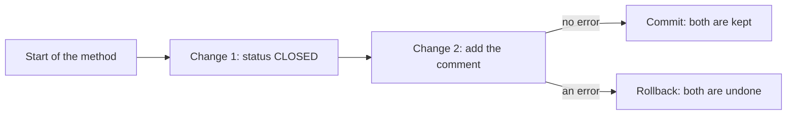

# Transactions

Closing a ticket needs two changes: the status becomes `CLOSED`, and a closing note is added as a comment. If the second change fails, the first must not stay. In this note you group the two changes into one **transaction**, so that either both are saved or neither is.

**Starting point:** your project at the end of [Day 4, part 4](../../day-04-exception-handling-relationships-and-composite-keys/code-and-walkthroughs/04-lazy-loading-and-n-plus-1.md), with the `TICKETS` and `COMMENTS` tables.
**Project:** [support-assistant-jpa](support-assistant-jpa/) in this folder. Parts 1 to 5 of Day 5 change it in place, one after another.

## What you will build

- `POST /api/v1/tickets/{id}/close`, with a body that holds the agent and the note.
- `TicketService`: the first service class, which holds the closing rule.
- The proof that a failed close leaves the ticket as it was.

---

## 1. The idea: all or nothing

A **transaction** is a group of database changes that are kept together. At the end, one of two things happens:

| End | What it does |
|---|---|
| **Commit** | Every change in the group is saved |
| **Rollback** | Every change in the group is undone, as if none had happened |

A bank transfer is the usual example: take 100 from one account and add 100 to another. If the second step fails, the first must be undone, or the money is lost.



How to read it: the two changes sit between the start and the end of one method. An error at change 2 sends the whole group to rollback.

Until now, each repository call was a transaction of its own. `save(ticket)` committed as soon as it returned. That is fine for one change, and wrong for two changes that belong together.

---

## Build steps

### Step 1: the request

Create `CloseRequest` in `dto`:

```java
public record CloseRequest(
        String agent,
        String note) {
}
```

### Step 2: the service class

Rules that involve more than one repository belong between the controller and the repositories, in a **service** class. Create the package `service`, and in it `TicketService`:

```java
@Service
public class TicketService {

    private final TicketRepository ticketRepository;
    private final CommentRepository commentRepository;

    public TicketService(TicketRepository ticketRepository, CommentRepository commentRepository) {
        this.ticketRepository = ticketRepository;
        this.commentRepository = commentRepository;
    }

    // Two changes that belong together: the status, and the closing note.
    public void close(UUID id, CloseRequest request) {
        Ticket ticket = ticketRepository.findById(id)
                .orElseThrow(() -> new TicketNotFoundException(id));

        ticket.setStatus(TicketStatus.CLOSED);
        ticketRepository.save(ticket);

        CommentRequest note = new CommentRequest(request.agent(), request.note());
        commentRepository.save(CommentMapper.toEntity(note, ticket));
    }
}
```

`@Service` tells Spring to create one `TicketService` and pass it to classes that ask for it, like a controller does with a repository.

**Check:** `mvn -q compile` prints no errors.

### Step 3: the endpoint

In `TicketController`, receive the service in the constructor and add the endpoint:

```java
private final TicketRepository ticketRepository;
private final TicketService ticketService;

public TicketController(TicketRepository ticketRepository, TicketService ticketService) {
    this.ticketRepository = ticketRepository;
    this.ticketService = ticketService;
}
```

```java
// POST /api/v1/tickets/{id}/close closes the ticket and adds the note as a comment.
@PostMapping("/{id}/close")
public TicketResponse close(@PathVariable UUID id, @RequestBody CloseRequest request) {
    ticketService.close(id, request);
    return ticketRepository.findById(id)
            .map(TicketMapper::toResponse)
            .orElseThrow(() -> new TicketNotFoundException(id));
}
```

After the service has closed the ticket, the controller reads the ticket again, so the response shows what is stored, including the new comment count.

**Check:** `mvn -q clean verify` ends with no errors.

### Step 4: see the problem

Restart. Create a ticket, and close it **without** a note, using its `id` in place of `TICKET_ID`:

```bash
curl -X POST http://localhost:8080/api/v1/tickets \
  -H "Content-Type: application/json" \
  -d '{"title":"Close demo","priority":"LOW"}'

curl -i -X POST http://localhost:8080/api/v1/tickets/TICKET_ID/close \
  -H "Content-Type: application/json" \
  -d '{"agent":"Karan"}'
```

The comment needs a `text`, and the note is missing, so the second change fails.

**Check:** the close answers `400`. Now read the ticket:

```bash
curl http://localhost:8080/api/v1/tickets/TICKET_ID
```

You should see `"status":"CLOSED"`. This is the problem: the request failed, and the ticket is closed anyway, with no note. The first `save` was committed before the second one failed.

### Step 5: add `@Transactional`

In `TicketService`, add the annotation above `close`:

```java
// Both changes are saved, or neither is.
@Transactional
public void close(UUID id, CloseRequest request) {
```

The import is `org.springframework.transaction.annotation.Transactional`.

Spring now starts a transaction when `close` is called, and ends it when `close` returns:

| How `close` ends | Result |
|---|---|
| It returns normally | **Commit**: the status and the comment are saved |
| It throws a `RuntimeException` | **Rollback**: nothing is saved |

**Check:** restart. Create a new ticket and close it without a note, as in step 4. The close answers `400` again. Read the ticket.

You should see `"status":"OPEN"`. The status change was undone together with the failed comment.

Then close a ticket with a note:

```bash
curl -X POST http://localhost:8080/api/v1/tickets/TICKET_ID/close \
  -H "Content-Type: application/json" \
  -d '{"agent":"Karan","note":"Fixed the printer queue."}'
```

**Check:** the answer has `"status":"CLOSED"` and `"commentCount":1`. `GET .../TICKET_ID/comments` shows the note.

---

## Where to put `@Transactional`

| Put it on | Why |
|---|---|
| A **service** method that changes more than one thing | The method is the unit of work: it starts and ends the transaction |
| Not on a repository method | `save`, `deleteById`, and the others are already transactions of their own |
| Not on a controller method | The controller only receives the request and builds the response |

A method that changes one row does not need it.

---

## Common mistakes

| Symptom | Cause | Fix |
|---|---|---|
| A request fails with `400` or `500`, and a first change is still in the database | The method has no `@Transactional`, so each `save` committed by itself | Add `@Transactional` to the service method |
| The ticket is `CLOSED` after a failure, and the method has `@Transactional` and `throws SomeCheckedException` | Rollback happens only for `RuntimeException` and `Error`. A **checked** exception (one that extends `Exception`) commits | Throw a `RuntimeException`, or write `@Transactional(rollbackFor = Exception.class)` |
| The ticket is `CLOSED` after a failure, and `close` is called from another method **of the same class** | A call from inside the class does not pass through Spring, so no transaction starts | Call the transactional method from another class, such as the controller |
| A `PATCH` answers `200` with the new value, and a later `GET` shows the old value | `@Transactional(readOnly = true)` on a method that changes data. A read-only transaction never writes | Use `@Transactional` without `readOnly` where data changes |

---

## Practice

1. Remove `@Transactional`, restart, and close a ticket without a note. Put it back and repeat with a new ticket. Write down the status in each case.
2. In `close`, after `ticketRepository.save(ticket);`, add `throw new IllegalStateException("test");`. Close a ticket **with** a note, with and without `@Transactional`. Read the status and the comments each time, then remove the line.
3. Close a ticket id that does not exist. Write down the status code and say why no comment was created.

---

## Recap

- A **transaction** keeps changes together: commit saves all, rollback undoes all.
- Without `@Transactional`, every repository call commits by itself.
- `@Transactional` on a service method makes the whole method one transaction. A `RuntimeException` rolls it back.
- A checked exception, a call inside the same class, and `readOnly = true` are the three ways it quietly does not do what you expect.

### State at end of this part

| Class | What it holds |
|---|---|
| `dto/CloseRequest` | `agent` and `note` |
| `service/TicketService` | `close`, with `@Transactional` |
| `api/TicketController` | Has `TicketService`, and `POST /{id}/close` |

| Request | Result |
|---|---|
| `POST /api/v1/tickets/{id}/close` with a note | `200`, the ticket is `CLOSED` and has the comment |
| The same without a note | `400`, and the ticket keeps its status |
| The same for an unknown id | `404` |
