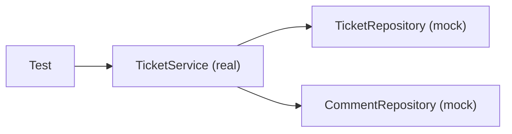

# Mocks

`SlaPolicy` was easy to test because it needs nothing. Most classes are not like that. `TicketService` needs a `TicketRepository`, and the real repository needs Oracle. A test that needs a database is slow, needs setup, and fails when the database is down for a reason that has nothing to do with your code. In this note you replace the repositories with **mocks**.

**Starting point:** your project at the end of [part 1](01-unit-testing-basics.md).
**Project:** [support-assistant-jpa](support-assistant-jpa/) in this folder.

## What you will build

- A first test with mocks written out step by step (`TicketServiceByHandTest`).
- Tests of `TicketService`: `create`, `close`, a `close` that fails, and `escalateOverdue` (`TicketServiceMockitoTest`).

---

## 1. The idea

A **mock** is a stand-in object. It has the same type as the real one, so the class under test accepts it, and you decide what it answers. It also remembers how it was called.



How to read it: the test calls the real `TicketService`. The service calls its repositories as always, and the repositories are mocks. Nothing reaches the database.

A mock does two things:

| Job | Mockito code | Meaning |
|---|---|---|
| **Answer** | `when(repository.findById(id)).thenReturn(Optional.of(ticket))` | "When called like this, answer this" |
| **Remember** | `verify(repository).save(ticket)` | "Check that it was called like this" |

**Mockito** is the library that makes mocks. The test starter already brings it.

A mock that was not told what to answer gives an empty value: `Optional.empty()`, an empty list, `0`, or `null`.

---

## Build steps

### Step 1: a mock, step by step

Create `TicketServiceByHandTest` in `src/test/java/com/bsp/supportassistant/service`:

```java
class TicketServiceByHandTest {

    @Test
    void aServiceCanBeBuiltWithMocksInsteadOfRealRepositories() {
        // 1. make the stand-ins
        TicketRepository ticketRepository = mock(TicketRepository.class);
        CommentRepository commentRepository = mock(CommentRepository.class);
        OverdueRepository overdueRepository = mock(OverdueRepository.class);

        // 2. give them to the real class under test
        TicketService service = new TicketService(ticketRepository, commentRepository, overdueRepository);

        // 3. decide what the mock answers
        when(overdueRepository.countOverdue(Priority.HIGH)).thenReturn(4);

        // 4. call the real class, and check the result
        assertEquals(4, service.countOverdue(Priority.HIGH));

        // 5. check that the mock was called
        verify(overdueRepository).countOverdue(Priority.HIGH);
    }
}
```

The imports are static: `org.mockito.Mockito.mock`, `when`, and `verify`.

`TicketService` has a constructor that takes its three repositories. That is why this works: the test passes in mocks the same way Spring passes in the real ones.

**Check:** run the test. You should see `1 test passed`, with no database running.

### Step 2: what an unstubbed mock answers

Add a second test to the same class:

```java
@Test
void aMockThatWasNotToldWhatToAnswerGivesAnEmptyValue() {
    TicketRepository ticketRepository = mock(TicketRepository.class);

    assertTrue(ticketRepository.findById(UUID.randomUUID()).isEmpty());
    assertEquals(0, ticketRepository.countByStatus(null));
}
```

**Check:** it passes. A mock that is not told anything is safe: it never throws, and it never returns a surprise.

### Step 3: the annotation form

Writing `mock(...)` and `new TicketService(...)` in every test is long. Mockito can create them from annotations. Create `TicketServiceMockitoTest`:

```java
@ExtendWith(MockitoExtension.class)
class TicketServiceMockitoTest {

    @Mock
    private TicketRepository ticketRepository;

    @Mock
    private CommentRepository commentRepository;

    @Mock
    private OverdueRepository overdueRepository;

    @InjectMocks
    private TicketService ticketService;
```

| Annotation | Meaning |
|---|---|
| `@ExtendWith(MockitoExtension.class)` | Tells JUnit to let Mockito prepare the fields before each test |
| `@Mock` | Create a mock of this type |
| `@InjectMocks` | Create the real class, and pass it the mocks through its constructor |

It is the same as step 1, written once for the whole class. The imports are in `org.mockito` and `org.mockito.junit.jupiter`.

### Step 4: test `create`

```java
@Test
void createStartsTheTicketOpenAndSetsItsDueDate() {
    // save returns the ticket it was given
    when(ticketRepository.save(any(Ticket.class))).thenAnswer(call -> call.getArgument(0));
    TicketRequest request = new TicketRequest("Printer is offline", null, null, Priority.HIGH);

    Ticket created = ticketService.create(request);

    assertEquals(TicketStatus.OPEN, created.getStatus());
    assertEquals(created.getCreatedAt().plusDays(1), created.getDueBy());
}
```

| Part | Meaning |
|---|---|
| `any(Ticket.class)` | Match any `Ticket`. The test does not care which |
| `thenAnswer(call -> call.getArgument(0))` | Answer with the first argument of the call. The mock `save` gives back the ticket it receives, as the real one does |

The real `save` would also give the ticket an `id`. The test does not need one here.

**Check:** run it. It passes, and it tests two rules of `create` in the service: the status is `OPEN`, and the due date is one day after creation for `HIGH`.

### Step 5: test `close`, and check what was saved

```java
@Test
void closeSetsTheStatusAndSavesTheNoteAsAComment() {
    UUID id = UUID.randomUUID();
    Ticket ticket = new Ticket();
    ticket.setStatus(TicketStatus.IN_PROGRESS);
    when(ticketRepository.findById(id)).thenReturn(Optional.of(ticket));

    ticketService.close(id, new CloseRequest("Karan", "Fixed the printer queue."));

    assertEquals(TicketStatus.CLOSED, ticket.getStatus());

    ArgumentCaptor<Comment> saved = ArgumentCaptor.forClass(Comment.class);
    verify(commentRepository).save(saved.capture());
    assertEquals("Karan", saved.getValue().getAuthor());
    assertEquals("Fixed the printer queue.", saved.getValue().getText());
}
```

`close` does not return the comment. It hands it to `commentRepository.save`. An **argument captor** catches what was passed, so the test can look inside it.

**Check:** run it. It passes.

### Step 6: test the failure path

```java
@Test
void closeOfAnUnknownTicketThrowsAndSavesNothing() {
    UUID id = UUID.randomUUID();
    when(ticketRepository.findById(id)).thenReturn(Optional.empty());

    assertThrows(TicketNotFoundException.class,
            () -> ticketService.close(id, new CloseRequest("Karan", "Done")));

    verify(ticketRepository, never()).save(any());
    verify(commentRepository, never()).save(any());
}
```

| Part | Meaning |
|---|---|
| `assertThrows(Type.class, () -> ...)` | The test passes only if the code in the lambda throws that exception |
| `verify(x, never()).save(any())` | The test passes only if `save` was never called |

The second part matters. A failed `close` must change nothing, and the test checks it.

A last, small one:

```java
@Test
void escalateOverdueReturnsTheNumberThatTheProcedureChanged() {
    when(overdueRepository.escalateOverdue()).thenReturn(3);

    assertEquals(3, ticketService.escalateOverdue());
}
```

**Check:** run the class. You should see `4 tests passed`, and the whole class finishes in well under a second.

> **Note:** Mockito may print `Mockito is currently self-attaching to enable the inline-mock-maker.` This is a message about the Java version. The tests still pass.

---

## What a mock test does not show

A mock test of `close` proves the logic of the method: the status is set, and the comment is saved. It does **not** prove the rollback of part 1 of Day 5. `@Transactional` is done by Spring and by the database, and there is neither here. The rollback is checked with a real database.

---

## Common mistakes

| Symptom | Cause | Fix |
|---|---|---|
| `UnnecessaryStubbingException: Unnecessary stubbings detected` | A `when(...)` was written, and the code under test never made that call | Remove the `when`. It says the test and the code do not agree |
| `Wanted but not invoked: commentRepository.save(<any>)` and `there were zero interactions with this mock` | `verify` expected a call that did not happen | Check the code path. Or the test expects the wrong thing |
| `NullPointerException` on the first line that uses `ticketService` or a mock | The fields are `null` because Mockito did not prepare them: `@ExtendWith(MockitoExtension.class)` is missing | Add it above the class |
| `when(...)` with a plain value fails to match | The arguments differ: `any()` matches anything, a value matches only an equal value | Use `any()`, or the same value that the code passes |

---

## Practice

1. Add a `close` test where the note is `null`. Check what the comment holds. Is that what you want? Write down what the service should do.
2. Write `updateMovesTheDueDateWhenThePriorityChanges`. Make `findById` return a ticket created now, with priority `LOW` and a due date 7 days ahead. Call `update` with priority `HIGH`. Check that `getDueBy()` is one day after `getCreatedAt()`.
3. In `TicketService.close`, swap the two lines `ticket.setStatus(...)` and `ticketRepository.save(ticket)` so that `save` comes first. Run the tests. Write down whether any test notices, and why. Restore the lines.

---

## Recap

- A **mock** is a stand-in with the same type. It answers what you tell it, and it remembers its calls.
- `when(...).thenReturn(...)` sets an answer. `verify(...)` checks a call. `never()` checks that there was none.
- `@Mock` makes the mocks, and `@InjectMocks` builds the real class with them.
- An `ArgumentCaptor` catches what was passed to a mock.
- A mock test checks the logic of a class. It does not check the database or the transaction.

### State at end of this part

| File | What it holds |
|---|---|
| `src/test/.../service/TicketServiceByHandTest.java` | 2 tests with `mock(...)` written out |
| `src/test/.../service/TicketServiceMockitoTest.java` | 4 tests with `@Mock` and `@InjectMocks` |
