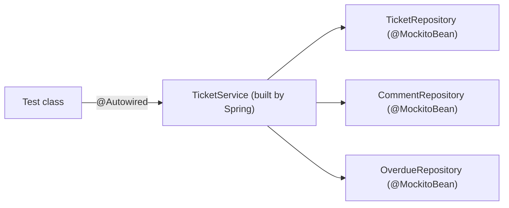

# Mocking the repository in a Spring test

In part 2, the test built `TicketService` itself and passed it mocks. In the application, Spring builds `TicketService` and passes it the repositories. This note puts a mock **into Spring**: Spring builds the service as usual, and the repositories it receives are mocks. The tool is `@MockitoBean`.

**Starting point:** your project at the end of [part 2](02-mocks-with-mockito.md).
**Project:** [support-assistant-jpa](support-assistant-jpa/) in this folder.

## What you will build

- `TicketServiceSpringTest`: a Spring test that creates `TicketService` with three mocked repositories.
- The difference between `@Mock` and `@MockitoBean`, in your own code.

---

## 1. The idea

Spring keeps its objects, called **beans**, in one container, the application context. A test can start a context too, and ask Spring to put a mock in it **in place of** a real bean.

| | `@Mock` (part 2) | `@MockitoBean` (this part) |
|---|---|---|
| From | Mockito | Spring |
| Needs Spring | No | Yes, a test context |
| Who builds the class under test | Your test, with `@InjectMocks` | Spring, through the constructor |
| Where the mock lives | In the test only | In the application context, so every bean that needs that type receives it |
| Use it for | Plain unit tests | Tests where Spring builds the objects, and tests of the web layer (part 4) |

The first row of use is the reason for this part. In part 4, the controller is built by Spring, and you have no constructor call to put a mock into. `@MockitoBean` is how the mock gets there.



How to read it: Spring builds `TicketService` and hands it the three mocks. The test asks Spring for the service, and for each mock to set its answers.

---

## Build steps

### Step 1: a small Spring context

Do not start the whole application: it needs Oracle. Start a context that holds only `TicketService`. Create `TicketServiceSpringTest` in `src/test/java/com/bsp/supportassistant/service`:

```java
@SpringJUnitConfig(TicketService.class)
class TicketServiceSpringTest {

    @MockitoBean
    private TicketRepository ticketRepository;

    @MockitoBean
    private CommentRepository commentRepository;

    @MockitoBean
    private OverdueRepository overdueRepository;

    @Autowired
    private TicketService ticketService;

    @Test
    void springGivesTheServiceItsMockedRepositories() {
        assertNotNull(ticketService);
    }
}
```

| Part | Meaning |
|---|---|
| `@SpringJUnitConfig(TicketService.class)` | Start a Spring context with this one class in it |
| `@MockitoBean` | Put a mock of this type in the context. Whoever needs a `TicketRepository` gets the mock |
| `@Autowired` | Take `TicketService` out of the context. It is the real class, with the mocks inside |

The imports are `org.springframework.test.context.junit.jupiter.SpringJUnitConfig` and `org.springframework.test.context.bean.override.mockito.MockitoBean`.

**Check:** run the test. It passes, and no database is needed.

### Step 2: set an answer and check the call

The mock is a normal Mockito mock. `when` and `verify` work as in part 2:

```java
@Test
void countOverdueAsksTheRepositoryForTheGivenPriority() {
    when(overdueRepository.countOverdue(Priority.LOW)).thenReturn(7);

    int count = ticketService.countOverdue(Priority.LOW);

    assertEquals(7, count);
    verify(overdueRepository).countOverdue(Priority.LOW);
}
```

**Check:** run it. It passes.

### Step 3: let the mock do what the database would

```java
@Test
void createSavesTheTicketThroughTheRepository() {
    UUID id = UUID.randomUUID();
    when(ticketRepository.save(any(Ticket.class))).thenAnswer(call -> {
        Ticket saved = call.getArgument(0);
        saved.setId(id); // the database would do this
        return saved;
    });

    Ticket created = ticketService.create(new TicketRequest("VPN drops", null, null, Priority.MEDIUM));

    assertEquals(id, created.getId());
    assertEquals(TicketStatus.OPEN, created.getStatus());
}
```

The real `save` gives the new ticket an `id`. The mock does the same, so the test can check the code that follows `save`.

**Check:** run the class. You should see `3 tests passed`.

### Step 4: look at what the context holds

The service has no `@Transactional` effect in this test. The context has only the three mocks and the service: there is no transaction manager, so `@Transactional` on `close` does nothing here. This is what part 2 said: transactions are checked with a real database.

The mocks do not carry answers from one test to the next. Spring resets each `@MockitoBean` after every test, so the `when` of one test does not leak into another.

---

## Common mistakes

| Symptom | Cause | Fix |
|---|---|---|
| `No qualifying bean of type '...OverdueRepository' available` and `Failed to load ApplicationContext` | The service needs a repository, and no `@MockitoBean` of that type is in the test | Add a `@MockitoBean` for every type that the bean needs |
| `package org.springframework.boot.test.mock.mockito does not exist`, with `@MockBean` | `@MockBean` was removed in Spring Boot 4. `@MockitoBean` replaces it | Import `org.springframework.test.context.bean.override.mockito.MockitoBean` |
| `NullPointerException` on `ticketService` | `@SpringJUnitConfig` is missing, so nothing fills `@Autowired` | Add the annotation above the class |
| `Failed to load ApplicationContext` with a `DataSource` or Oracle message | The test uses `@SpringBootTest`, which starts the whole application | Use `@SpringJUnitConfig(ThatClass.class)`, or a slice such as `@WebMvcTest` |
| The answer of a mock is `null`, and the test sets it up | `when(...)` uses another argument than the code passes | Use `any()`, or the same value |

---

## Practice

1. Add a test of `escalateOverdue` in this class. Make the mock answer `5`, call the service, and check `5` and the call.
2. Remove the `@MockitoBean` for `CommentRepository`. Run the class, read the message, and put it back.
3. Write down one difference between this test and `TicketServiceMockitoTest` that you can see in the code, and one thing that is the same.

---

## Recap

- `@MockitoBean` puts a Mockito mock into the Spring context, in place of a real bean.
- Spring builds the class under test, and the mocks go in through its constructor.
- Use plain `@Mock` when you build the class yourself. Use `@MockitoBean` when Spring builds it.
- `@SpringJUnitConfig(SomeClass.class)` gives a small context. It is much faster than the whole application, and needs no database.
- A mock context has no transaction manager. Rollbacks are not tested here.

### State at end of this part

| File | What it holds |
|---|---|
| `src/test/.../service/TicketServiceSpringTest.java` | 3 tests, with `@SpringJUnitConfig` and three `@MockitoBean` fields |
