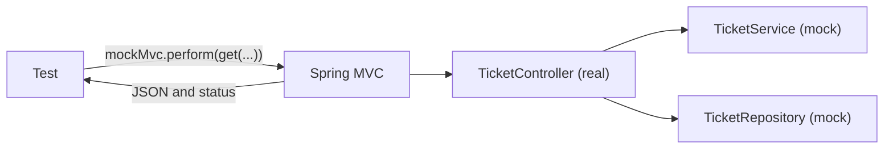

# Testing the API with MockMvc

Until now you checked the endpoints with `curl`. In this note a test sends the request, and checks the status code and the JSON that come back. It uses `MockMvc`, which sends a request into your controllers without starting a web server, and `@MockitoBean`, which replaces everything behind the controller.

**Starting point:** your project at the end of [part 3](03-mocking-in-spring-boot.md).
**Project:** [support-assistant-jpa](support-assistant-jpa/) in this folder.

## What you will build

- `TicketControllerTest`: nine tests of `TicketController`, with no database.
- Tests for the success path, for `404`, for `400`, and for `201`.

---

## 1. The idea

A request goes through several layers before your controller method runs: URL matching, reading the path and the JSON, and after it, writing JSON and handling exceptions. A test that calls the controller method directly skips all of them. `MockMvc` goes through them.



How to read it: the test sends a request to the real controller, inside Spring MVC. The controller's collaborators are mocks. The test reads the response.

`@WebMvcTest` starts only the **web layer**: controllers, `@RestControllerAdvice` classes such as your `GlobalExceptionHandler`, and JSON conversion. It does not start the repositories, JPA, or the database. Every other bean that a controller needs must be given as a `@MockitoBean`.

| Piece | Meaning |
|---|---|
| `@WebMvcTest(TicketController.class)` | Start the web layer for this controller |
| `MockMvc` | The object that sends fake requests. Spring creates it, and you `@Autowired` it |
| `perform(get("/url"))` | Send the request. Also `post`, `patch`, and `delete` |
| `.andExpect(status().isOk())` | Check the status code |
| `.andExpect(jsonPath("$.title").value("..."))` | Check one value in the JSON. `$` is the whole body |

---

## Build steps

### Step 1: the test class

Create `TicketControllerTest` in `src/test/java/com/bsp/supportassistant/api`:

```java
@WebMvcTest(TicketController.class)
class TicketControllerTest {

    @Autowired
    private MockMvc mockMvc;

    @MockitoBean
    private TicketService ticketService;

    @MockitoBean
    private TicketRepository ticketRepository;
```

`TicketController` takes a `TicketRepository` and a `TicketService` in its constructor. The test gives both as mocks.

A helper at the bottom of the class builds a ticket:

```java
private Ticket ticket(UUID id, String title) {
    Ticket ticket = new Ticket();
    ticket.setId(id);
    ticket.setTitle(title);
    ticket.setStatus(TicketStatus.OPEN);
    ticket.setPriority(Priority.MEDIUM);
    ticket.setDueBy(LocalDateTime.now().plusDays(3));
    return ticket;
}
```

The imports for this class:

| Import | For |
|---|---|
| `org.springframework.boot.webmvc.test.autoconfigure.WebMvcTest` | `@WebMvcTest` |
| `org.springframework.test.web.servlet.MockMvc` | `MockMvc` |
| `static ...MockMvcRequestBuilders.get`, `post`, `patch` | Build a request |
| `static ...MockMvcResultMatchers.status`, `jsonPath` | Check the response |
| `org.springframework.test.context.bean.override.mockito.MockitoBean` | `@MockitoBean` |

> **Note:** On Spring Boot 3.x, `WebMvcTest` is in `org.springframework.boot.test.autoconfigure.web.servlet`. The rest of the test is the same.

### Step 2: a `200` with a body

```java
@Test
void getByIdAnswers200WithTheTicket() throws Exception {
    UUID id = UUID.randomUUID();
    when(ticketRepository.findById(id)).thenReturn(Optional.of(ticket(id, "Printer is offline")));

    mockMvc.perform(get("/api/v1/tickets/" + id))
            .andExpect(status().isOk())
            .andExpect(jsonPath("$.id").value(id.toString()))
            .andExpect(jsonPath("$.title").value("Printer is offline"))
            .andExpect(jsonPath("$.status").value("OPEN"))
            .andExpect(jsonPath("$.overdue").value(false));
}
```

`throws Exception` is on the method because `perform` declares it.

**Check:** run the test. It passes. It checked the URL, the path variable, the JSON field names, and the mapper, in one go, and no database ran.

To see exactly what was sent and received, add `.andDo(print())` before the first `andExpect`. The import is `static ...MockMvcResultHandlers.print`. It prints the request, the handler, and the response to the console.

### Step 3: the errors

Your `GlobalExceptionHandler` is part of the web layer, so the error tests check the body that a caller gets:

```java
@Test
void getByIdAnswers404WithAnApiErrorWhenTheTicketIsMissing() throws Exception {
    UUID id = UUID.randomUUID();
    when(ticketRepository.findById(id)).thenReturn(Optional.empty());

    mockMvc.perform(get("/api/v1/tickets/" + id))
            .andExpect(status().isNotFound())
            .andExpect(jsonPath("$.status").value(404))
            .andExpect(jsonPath("$.message").value("Ticket " + id + " was not found"));
}

@Test
void getByIdAnswers400WhenTheIdIsNotAUuid() throws Exception {
    mockMvc.perform(get("/api/v1/tickets/abc"))
            .andExpect(status().isBadRequest())
            .andExpect(jsonPath("$.message").value("'abc' is not a valid value for 'id'"));

    verify(ticketRepository, never()).findById(any());
}
```

The second test also checks that the repository was never called: a bad id must stop before the controller method.

**Check:** run both. They pass.

### Step 4: a request with a body

```java
@Test
void postAnswers201WithTheCreatedTicket() throws Exception {
    UUID id = UUID.randomUUID();
    when(ticketService.create(any())).thenReturn(ticket(id, "VPN drops"));

    mockMvc.perform(post("/api/v1/tickets")
                    .contentType(MediaType.APPLICATION_JSON)
                    .content("{\"title\":\"VPN drops\",\"priority\":\"MEDIUM\"}"))
            .andExpect(status().isCreated())
            .andExpect(jsonPath("$.id").value(id.toString()))
            .andExpect(jsonPath("$.title").value("VPN drops"));
}

@Test
void postAnswers400WhenTheBodyIsNotJson() throws Exception {
    mockMvc.perform(post("/api/v1/tickets")
                    .contentType(MediaType.APPLICATION_JSON)
                    .content("{\"title\":"))
            .andExpect(status().isBadRequest())
            .andExpect(jsonPath("$.message").value("The request body is missing or is not valid JSON"));
}
```

`contentType` and `content` are the `-H "Content-Type: ..."` and `-d '...'` of your `curl` commands. The JSON is written as a Java string, so each `"` inside it has a `\` in front.

**Check:** run both. They pass.

### Step 5: a page, and a refused sort

```java
@Test
void listAnswersOnePageOfTickets() throws Exception {
    Ticket first = ticket(UUID.randomUUID(), "Printer is offline");
    when(ticketService.findAll(any(), any(), any(), anyBoolean(), any()))
            .thenReturn(new PageImpl<>(List.of(first), PageRequest.of(0, 5), 1));

    mockMvc.perform(get("/api/v1/tickets?status=OPEN"))
            .andExpect(status().isOk())
            .andExpect(jsonPath("$.content[0].title").value("Printer is offline"))
            .andExpect(jsonPath("$.totalElements").value(1))
            .andExpect(jsonPath("$.totalPages").value(1));
}

@Test
void listAnswers400ForAFieldThatCannotBeSortedBy() throws Exception {
    mockMvc.perform(get("/api/v1/tickets?sort=colour"))
            .andExpect(status().isBadRequest())
            .andExpect(jsonPath("$.message").value("Cannot sort by 'colour'"));
}
```

`PageImpl` is a ready-made `Page`. It stands in for what the repository would give. `anyBoolean()` matches the `overdue` flag, and `any()` matches the other, nullable, parameters.

`$.content[0].title` reads the `title` of the first item of the `content` list.

**Check:** run both. They pass.

### Step 6: `close` and `patch`

```java
@Test
void closeCallsTheServiceAndAnswersWithTheClosedTicket() throws Exception {
    UUID id = UUID.randomUUID();
    Ticket closed = ticket(id, "Printer is offline");
    closed.setStatus(TicketStatus.CLOSED);
    when(ticketRepository.findById(id)).thenReturn(Optional.of(closed));

    mockMvc.perform(post("/api/v1/tickets/" + id + "/close")
                    .contentType(MediaType.APPLICATION_JSON)
                    .content("{\"agent\":\"Karan\",\"note\":\"Fixed\"}"))
            .andExpect(status().isOk())
            .andExpect(jsonPath("$.status").value("CLOSED"));

    verify(ticketService).close(eq(id), eq(new CloseRequest("Karan", "Fixed")));
}
```

The last line checks that the JSON became a `CloseRequest` with the right values, and that it reached the service with the right id. `eq(...)` says "equal to this value". A record is equal to another record with the same values.

The full file also has a `PATCH` test, with `ticketService.update(...)` mocked.

**Check:** run the class. You should see `9 tests passed`. Then run all your tests without the database test:

```bash
mvn test -Dtest='!SupportAssistantApplicationTests'
```

You should see `Tests run: 27`.

### Step 7: see one fail

In `getByIdAnswers200WithTheTicket`, change `value("Printer is offline")` to `value("Printer is on fire")` and run the test.

**Check:** the message names the path and both values:

```text
java.lang.AssertionError: JSON path "$.title" expected:<Printer is on fire> but was:<Printer is offline>
```

Change `isOk()` to `isNotFound()` instead, and you get `Status expected:<404> but was:<200>`. Restore the test.

---

## What this does and does not test

| Tested | Not tested |
|---|---|
| The URL and the HTTP method | The SQL, and the database |
| Reading the path, the query, and the JSON body | `@Transactional` and rollback |
| The status code and the JSON that is written | The PL/SQL programs |
| The exception handler | The service logic. It is a mock here, and part 2 tested it |

Each layer has its own tests: the rules in plain unit tests, the service with mocks, the endpoints with `MockMvc`. A test that needs the real database is a different, slower kind. The application test that starts everything is the one you run before you release.

---

## Common mistakes

| Symptom | Cause | Fix |
|---|---|---|
| `No qualifying bean of type '...TicketRepository' available` and `Failed to load ApplicationContext` | The controller needs a repository, and the test has no `@MockitoBean` for it | Add a `@MockitoBean` for every constructor parameter of the controller |
| `Status expected:<200> but was:<404>`, and the ticket exists in your head | The mock was not told to return it: `when(...findById(id))` is missing, so the controller got `Optional.empty()` | Add the `when` with the same `id` that the URL has |
| `Status expected:<201> but was:<415>` | `contentType` is missing, so Spring does not know the body is JSON | Add `.contentType(MediaType.APPLICATION_JSON)` |
| `Status expected:<201> but was:<400>` | The JSON in `content(...)` is invalid, for example a missing quote or a `\"` that is not escaped | Check the string. Print the exchange with `.andDo(print())` |
| `No value at JSON path "$.title"` | The field name or the nesting is wrong | Print the response with `.andDo(print())`, and read the real JSON |
| `package org.springframework.boot.test.autoconfigure.web.servlet does not exist` | That is the Spring Boot 3 package of `WebMvcTest`. This project uses Spring Boot 4 | Import `org.springframework.boot.webmvc.test.autoconfigure.WebMvcTest` |
| `Failed to load ApplicationContext` with an Oracle message | The test uses `@SpringBootTest`, not `@WebMvcTest` | Use `@WebMvcTest(YourController.class)` |

---

## Practice

1. Write a test for `DELETE /api/v1/tickets/{id}`. `existsById` answers `false`, so expect `404`. Add a second test where it answers `true`, and expect `204` and a call to `deleteById`.
2. Write `CommentControllerTest` with `@WebMvcTest(CommentController.class)`. Mock `TicketRepository` and `CommentRepository`. Test `GET .../comments` for a ticket that does not exist: expect `404`.
3. Add a test of `GET /api/v1/tickets/count?status=OPEN` with the repository's `countByStatus` answering `3`. The body is only the number. Check it with `content().string("3")`.

---

## Recap

- `@WebMvcTest` starts only the web layer. `MockMvc` sends requests into it without a server.
- Everything behind the controller is a `@MockitoBean`. One for each constructor parameter.
- `status()` checks the status code, and `jsonPath(...)` checks the body. `.andDo(print())` shows the whole exchange.
- The same test checks the URL, the JSON in, the JSON out, and the exception handler.
- Each kind of test has its job: rules, service logic, endpoints, and the whole application.

### State at end of this part

| File | What it holds |
|---|---|
| `src/test/.../api/TicketControllerTest.java` | 9 tests of the ticket endpoints, with `@WebMvcTest` and `MockMvc` |

| Test class | Tests | Needs |
|---|---|---|
| `SlaPolicyTest` | 6 | Nothing |
| `TicketMapperTest` | 3 | Nothing |
| `TicketServiceByHandTest` | 2 | Mockito |
| `TicketServiceMockitoTest` | 4 | Mockito |
| `TicketServiceSpringTest` | 3 | A small Spring context |
| `TicketControllerTest` | 9 | The web layer of Spring |
| `SupportAssistantApplicationTests` | 1 | The Oracle database |
