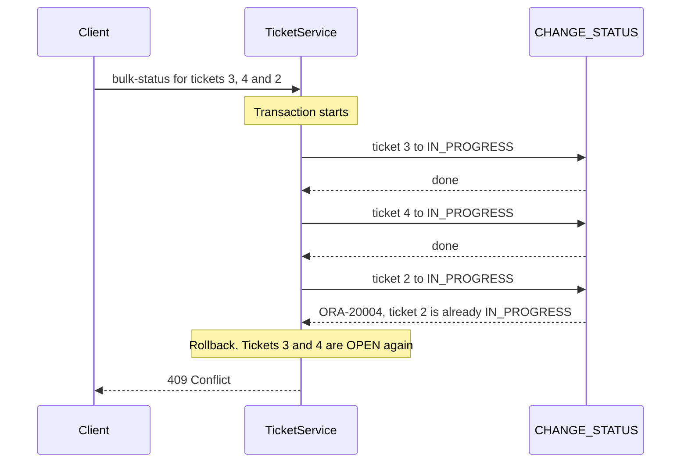

# Errors and transactions

In this part you turn the errors that the package raises into clear answers, and you decide who commits.

**Time:** about 40 minutes.
**Starting point:** your project at the end of [part 2](02-calling-plsql-programs.md).
**Project:** [support-assistant-plsql](support-assistant-plsql/) in this folder.

## What you will build

- `PATCH /api/tickets/{id}/status`, which calls `CHANGE_STATUS`.
- An exception handler that turns `RAISE_APPLICATION_ERROR` into `400`, `404`, and `409`.
- `POST /api/tickets/bulk-status`, which changes several tickets, all or none.
- A test that calls the package and rolls back.

---

## 1. The ideas

### An error leaves PL/SQL as an exception

`RAISE_APPLICATION_ERROR(-20004, 'text')` stops the program. Java receives an exception with the number `20004` and the text. The package author owns the numbers, so they are listed at the top of the package specification:

| Number | Meaning | Answer |
|---|---|---|
| `20001` | The title is missing | `400 Bad Request` |
| `20002` | The priority is not `HIGH`, `MEDIUM` or `LOW` | `400 Bad Request` |
| `20003` | The ticket does not exist | `404 Not Found` |
| `20004` | The status change is not allowed | `409 Conflict` |

### Who commits?

| | Without `@Transactional` | With `@Transactional` |
|---|---|---|
| When the data is saved | After each call. Each procedure call is its own transaction | When the Java method ends |
| If the third call fails | The first two calls stay saved | All three are undone |

The programs in this package have no `COMMIT`. Spring decides.

---

## Build steps

### Step 1: call `CHANGE_STATUS`

Try the rule in SQL first. The ticket must exist, so use the id from part 2:

```sql
EXEC SUPPORT_TICKET_PKG.change_status(2, 'CLOSED')
```

**Check:** you should see:

```text
ORA-20004: Ticket 2 is OPEN. The next status is IN_PROGRESS
ORA-06512: at "YOUR_USERNAME.SUPPORT_TICKET_PKG", line 64
```

Call it from Java. In `TicketRepository`, build a fourth call, and add a method. The procedure has no `OUT` parameter, so there is nothing to read:

```java
this.changeStatus = new SimpleJdbcCall(jdbcTemplate)
        .withCatalogName("SUPPORT_TICKET_PKG")
        .withProcedureName("CHANGE_STATUS");
```

```java
public void changeStatus(long ticketId, String newStatus) {
    changeStatus.execute(ticketId, newStatus);
}
```

`execute(ticketId, newStatus)` passes the values in the order of the `IN` parameters.

In `TicketService`, add `changeStatus(long ticketId, String newStatus)`, which calls the repository. Add the records `StatusRequest(String status)`, and the route in the controller:

```java
@PatchMapping("/{id}/status")
@ResponseStatus(HttpStatus.NO_CONTENT)
public void changeStatus(@PathVariable long id, @RequestBody StatusRequest request) {
    ticketService.changeStatus(id, request.status());
}
```

Restart, and try a change that the rule refuses:

```bash
curl -i -X PATCH http://localhost:8080/api/tickets/2/status \
  -H "Content-Type: application/json" -d '{"status":"CLOSED"}'
```

**Check:** you get `500`, because nothing handles the exception yet. The log shows `UncategorizedSQLException ... ORA-20004`. Step 2 fixes this.

### Step 2: turn the error number into an answer

Spring wraps an error number from `20000` to `20999` in an `UncategorizedSQLException`. Its method `getSQLException()` gives the original `SQLException`, and that holds the number and the text.

Create the record `ApiError(int status, String error, String message, LocalDateTime timestamp)` in the package `exception`. It is the body of every error answer, as in Day 3.

Create `GlobalExceptionHandler` in the same package:

```java
@RestControllerAdvice
public class GlobalExceptionHandler {

    @ExceptionHandler(UncategorizedSQLException.class)
    public ResponseEntity<ApiError> handleDatabase(UncategorizedSQLException ex) {
        SQLException sqlException = ex.getSQLException();
        int code = sqlException.getErrorCode();
        if (code >= 20000 && code <= 20999) {
            return build(statusFor(code), messageOf(sqlException));
        }
        // Any other database error is a fault of the server. Do not show the client its text.
        return build(HttpStatus.INTERNAL_SERVER_ERROR, "The database call failed");
    }

    private HttpStatus statusFor(int oracleCode) {
        if (oracleCode == 20003) {
            return HttpStatus.NOT_FOUND;
        }
        if (oracleCode == 20004) {
            return HttpStatus.CONFLICT;
        }
        return HttpStatus.BAD_REQUEST;
    }
}
```

The project has the full class, with the two small helpers `messageOf` and `build`. `messageOf` cuts the first line of the Oracle message and keeps the text after the colon, so the client reads only what the package author wrote.

> **Note:** a number outside 20000 to 20999 is a database error, not a rule of the package. Examples are `ORA-01017` and `ORA-04063`. The client gets `500` and a general message. The real text goes to the log.

Restart, and try every rule:

```bash
curl -s -X POST http://localhost:8080/api/tickets -H "Content-Type: application/json" \
  -d '{"description":"no title","priority":"LOW"}'
curl -s -X POST http://localhost:8080/api/tickets -H "Content-Type: application/json" \
  -d '{"title":"x","priority":"URGENT"}'
curl -s -X PATCH http://localhost:8080/api/tickets/9999/status -H "Content-Type: application/json" \
  -d '{"status":"IN_PROGRESS"}'
curl -s -X PATCH http://localhost:8080/api/tickets/2/status -H "Content-Type: application/json" \
  -d '{"status":"CLOSED"}'
```

**Check:** you should see four answers:

```json
{"status":400,"error":"Bad Request","message":"Title is required","timestamp":"..."}
{"status":400,"error":"Bad Request","message":"Priority must be HIGH, MEDIUM or LOW","timestamp":"..."}
{"status":404,"error":"Not Found","message":"Ticket 9999 does not exist","timestamp":"..."}
{"status":409,"error":"Conflict","message":"Ticket 2 is OPEN. The next status is IN_PROGRESS","timestamp":"..."}
```

Now make a legal change:

```bash
curl -i -X PATCH http://localhost:8080/api/tickets/2/status \
  -H "Content-Type: application/json" -d '{"status":"IN_PROGRESS"}'
```

**Check:** `HTTP/1.1 204`, with no body.

### Step 3: change several tickets, all or none

An agent picks up three tickets at once. Either all three move, or none.

In `TicketService`, add a method with `@Transactional`:

```java
// All or nothing: if one ticket cannot change, the tickets before it are put back.
@Transactional
public void changeStatus(List<Long> ticketIds, String newStatus) {
    for (Long ticketId : ticketIds) {
        ticketRepository.changeStatus(ticketId, newStatus);
    }
}
```

The method calls `CHANGE_STATUS` once for each id. All the calls share one transaction. If one call raises an error, the exception leaves the method, and Spring rolls back every call before it.

The sequence for the request `[3, 4, 2]`, where ticket 2 is already `IN_PROGRESS`:



**How to read it:** the transaction starts when the service method starts. The third call fails. The rollback undoes the two calls that worked.

The service in the project also refuses an empty list, with `InvalidRequestException` and a `400` answer. The controller route:

```java
@PostMapping("/bulk-status")
@ResponseStatus(HttpStatus.NO_CONTENT)
public void changeStatus(@RequestBody BulkStatusRequest request) {
    ticketService.changeStatus(request.ticketIds(), request.status());
}
```

`BulkStatusRequest` is a record with `List<Long> ticketIds` and `String status`.

Restart. Ticket 2 is `IN_PROGRESS`, and tickets 3 and 4 are `OPEN`. Ask for all three to move:

```bash
curl -i -X POST http://localhost:8080/api/tickets/bulk-status \
  -H "Content-Type: application/json" -d '{"ticketIds":[3,4,2],"status":"IN_PROGRESS"}'
curl -s "http://localhost:8080/api/tickets?status=OPEN"
```

**Check:** the first call answers `409` with `Ticket 2 is IN_PROGRESS. The next status is RESOLVED`. The list of `OPEN` tickets still holds tickets 3 and 4. Neither one moved.

Now ask for only the two tickets that can move:

```bash
curl -i -X POST http://localhost:8080/api/tickets/bulk-status \
  -H "Content-Type: application/json" -d '{"ticketIds":[3,4],"status":"IN_PROGRESS"}'
```

**Check:** `HTTP/1.1 204`. Tickets 3 and 4 are `IN_PROGRESS`.

### Step 4: test the package, and roll back

A test can call the repository against your real database. `@Transactional` on a test class rolls each test back, so the tables stay clean:

```java
@SpringBootTest
@Transactional
class TicketPackageTests {

    @Autowired
    private TicketRepository ticketRepository;

    @Test
    void aTicketCannotSkipAStep() {
        long id = ticketRepository.createTicket("Reset my password", null, "LOW");

        assertThatThrownBy(() -> ticketRepository.changeStatus(id, "CLOSED"))
                .isInstanceOf(UncategorizedSQLException.class)
                .hasMessageContaining("ORA-20004");
    }
}
```

The project has four tests: the id and the status of a new ticket, the open count, the due date of a `HIGH` ticket, and the refused step.

Run them with the connection variables set:

```bash
mvn clean verify
```

**Check:** you should see `Tests run: 4, Failures: 0, Errors: 0` and `BUILD SUCCESS`. The tests need the database to be running with the package from part 2.

---

## Common mistakes

| Symptom | Cause | Fix |
|---|---|---|
| The bulk call answers `409`, and the first tickets are still changed | `@Transactional` is missing, so each call committed on its own | Put `@Transactional` on the service method that makes the calls |
| A procedure raises an error, and the client gets `500` and `The database call failed` | The error is not from `RAISE_APPLICATION_ERROR` (not 20000 to 20999), for example `ORA-04063` | Read the log. Fix the package |
| A rollback in Spring does not undo a procedure's work | The procedure has its own `COMMIT`. Spring cannot undo a commit | Take the `COMMIT` out of the procedure, or accept that it commits |
| A ticket created in SQL Developer is not seen by the API | The SQL Developer session did not commit | `COMMIT` in SQL Developer. The API sees only committed rows |
| A new `RAISE_APPLICATION_ERROR(-20006, ...)` answers `400`, but you wanted `404` | `statusFor` has no line for the new number, so it answers `400` | Add the number to `statusFor` |

The `COMMIT` row was tried: a procedure with an `INSERT` and a `COMMIT`, called inside a Spring transaction that then failed, left its row behind. The same procedure without `COMMIT` left nothing.

---

## Practice

1. Remove `@Transactional` from the bulk method, rebuild, and send `[3,4,2]` again. Say which tickets changed. Put `@Transactional` back.
2. Add a rule to `create_ticket`: a title shorter than 5 characters raises `-20005`. Run `02-package.sql` again. Call `POST /api/tickets` with the title `"abc"`. Say why the answer is `400` with no change in Java.
3. Add a test that creates a `MEDIUM` ticket and checks that `dueBy` is three days after `createdAt`.

---

## Recap

- `RAISE_APPLICATION_ERROR` numbers from 20000 to 20999 reach Java as an `UncategorizedSQLException`. One exception handler turns each number into a status code and a message.
- The package decides the rule. Java only maps the number to `400`, `404`, or `409`.
- A procedure without `COMMIT` lets Spring decide. `@Transactional` makes several calls succeed or fail together.
- A test class with `@Transactional` calls the real package and leaves the tables as they were.

### State at end of this part

| File | What it holds |
|---|---|
| `exception/GlobalExceptionHandler.java` | Error numbers to status codes |
| `exception/ApiError.java` | The error body |
| `service/TicketService.java` | `changeStatus` for one ticket, and for a list in one transaction |
| `api/TicketController.java` | Five endpoints |
| `test/.../TicketPackageTests.java` | Four tests that roll back |

| Request | Result |
|---|---|
| `PATCH /api/tickets/2/status` | `204`, or `404`, `409` |
| `POST /api/tickets/bulk-status` | `204`, or `400`, `404`, `409`. All or none |
