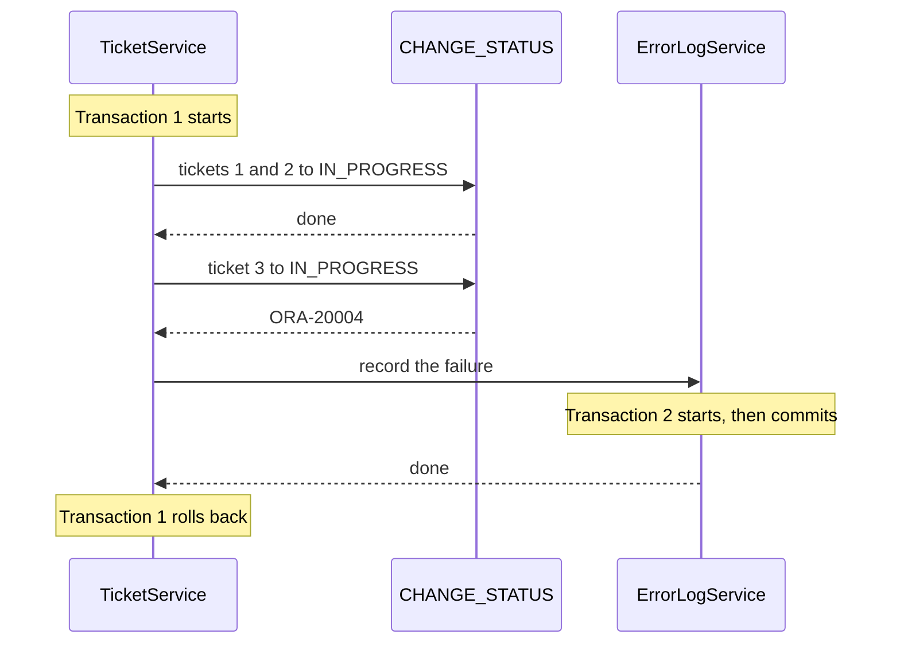

# Transaction management

In [part 3](03-errors-and-transactions.md) you made a bulk status change all or none with `@Transactional`. In this part you control **which** work is undone. When the bulk change is refused, every ticket is put back, and one line about the failure is still saved in an error log.

**Time:** about 60 minutes.
**Starting point:** your project at the end of [part 3](03-errors-and-transactions.md), or the finished [support-assistant-plsql](support-assistant-plsql/).
**Project:** [support-assistant-plsql-transactions](support-assistant-plsql-transactions/) in this folder.
**Step by step:** the same build, with the full files after every step, is in [support-assistant-plsql-transactions-walkthrough](support-assistant-plsql-transactions-walkthrough/README.md).

## What you will build

- A table `SUPPORT_ERROR_LOG` and a package `SUPPORT_ERROR_PKG` that writes to it.
- An `ErrorLogService` whose method runs in a transaction of its own.
- A bulk change that puts every ticket back, and keeps the line that says why.
- Two tests that look at the database **after** the transaction has ended.

---

## 1. The ideas

### Where a transaction starts and ends

You saw this table in part 3. Everything in this part builds on it.

| | Without `@Transactional` | With `@Transactional` on a service method |
|---|---|---|
| When the data is saved | After each procedure call | When the method returns |
| What an exception does | Nothing. The calls before it stay saved | Undoes every call made in the method |

The procedures in `SUPPORT_TICKET_PKG` have no `COMMIT`. Spring decides.

### One transaction inside another

A method with `@Transactional` can call another method with `@Transactional`. The second one does not start a fresh transaction by default. It **joins** the one that is running. This setting is called the **propagation**.

| Propagation | What the inner method does | When the outer method rolls back |
|---|---|---|
| `REQUIRED` (the default) | Joins the outer transaction | The inner work is undone too |
| `REQUIRES_NEW` | Pauses the outer transaction, runs its own, and commits it when it returns | The inner work stays |

A log line about a failure is the usual reason for `REQUIRES_NEW`. The failure undoes the real work, and the line must stay.

The picture shows a bulk change that is refused at the third ticket.



**How to read it:** transaction 1 holds the ticket changes. Transaction 2 holds only the log line. Transaction 2 commits before transaction 1 rolls back, so the rollback cannot reach it.

### Why the inner method must be in another class

Spring puts a **proxy** in front of each bean. A proxy is a stand-in object that receives the call first, starts or joins the transaction, and then calls your method. It is like a receptionist at the door of an office: a visitor from outside passes the desk, and a colleague walking between two rooms of the same office does not.

A call such as `this.record(...)` stays inside the class, so it never passes the proxy. Its `@Transactional` is ignored. Put a method with `REQUIRES_NEW` in a **different** class, and call it through a field.

---

## Build steps

### Step 1: copy the project

Start from a copy, so that the project of part 3 stays as it is. In the folder that holds `support-assistant-plsql`:

```bash
cp -r support-assistant-plsql support-assistant-plsql-transactions
cd support-assistant-plsql-transactions
rm -rf target
```

On Windows, copy the folder in Explorer and delete `target` in the copy.

Give the copy its own name, so that its JAR file has a new name too:

| File | Line | New value |
|---|---|---|
| `pom.xml` | `<artifactId>` | `support-assistant-plsql-transactions` |
| `pom.xml` | `<name>` | `support-assistant-plsql-transactions` |
| `src/main/resources/application.yaml` | `spring.application.name` | `support-assistant-plsql-transactions` |

Leave the `<artifactId>` of the parent (`spring-boot-starter-parent`) as it is. Open the folder in IntelliJ as a new project.

**Check:** with `DB_USERNAME` and `DB_PASSWORD` set, `mvn clean verify` ends with `Tests run: 4, Failures: 0, Errors: 0` and `BUILD SUCCESS`.

### Step 2: the error log in the database

Create `db/oracle/03-error-log.sql`:

```sql
CREATE TABLE SUPPORT_ERROR_LOG (
    MESSAGE    VARCHAR2(500)  NOT NULL,
    LOGGED_AT  TIMESTAMP      DEFAULT LOCALTIMESTAMP NOT NULL
);

CREATE OR REPLACE PACKAGE SUPPORT_ERROR_PKG AS
    PROCEDURE log_error (p_message IN VARCHAR2);
END SUPPORT_ERROR_PKG;
/

CREATE OR REPLACE PACKAGE BODY SUPPORT_ERROR_PKG AS
    PROCEDURE log_error (p_message IN VARCHAR2) IS
    BEGIN
        INSERT INTO SUPPORT_ERROR_LOG (MESSAGE) VALUES (SUBSTR(p_message, 1, 500));
    END log_error;
END SUPPORT_ERROR_PKG;
/
```

The project file has the same statements with comments. Like the ticket package, `log_error` has no `COMMIT`. `SUPPORT_TICKET_PKG` is not changed, so the other projects in this folder keep working.

Run the script in SQL Developer as your application user. Then try the procedure, and undo it:

```sql
EXEC SUPPORT_ERROR_PKG.log_error('sql rollback check')
ROLLBACK;
SELECT COUNT(*) FROM SUPPORT_ERROR_LOG;
```

**Check:** the count is `0`. The procedure did not commit, so `ROLLBACK` removed its line.

Add the two new objects to the top of `db/oracle/99-drop.sql`:

```sql
DROP PACKAGE SUPPORT_ERROR_PKG;
DROP TABLE SUPPORT_ERROR_LOG;
```

### Step 3: call the procedure from Java

Create `ErrorLogRepository` in the package `repository`. It is the same pattern as `TicketRepository`, with one call:

```java
@Repository
public class ErrorLogRepository {

    private final SimpleJdbcCall logError;

    public ErrorLogRepository(JdbcTemplate jdbcTemplate) {
        this.logError = new SimpleJdbcCall(jdbcTemplate)
                .withCatalogName("SUPPORT_ERROR_PKG").withProcedureName("LOG_ERROR");
    }

    public void logError(String message) {
        logError.execute(message);
    }
}
```

Create `ErrorLogService` in the package `service`. Start with a plain `@Transactional`, so that you can see what the default does:

```java
@Service
public class ErrorLogService {

    private final ErrorLogRepository errorLogRepository;

    public ErrorLogService(ErrorLogRepository errorLogRepository) {
        this.errorLogRepository = errorLogRepository;
    }

    @Transactional
    public void record(String message) {
        errorLogRepository.logError(message);
    }
}
```

**Check:** `mvn -q compile` prints no errors.

### Step 4: record the failure in the bulk change

In `TicketService`, receive the new service in the constructor:

```java
private final TicketRepository ticketRepository;
private final ErrorLogService errorLogService;

public TicketService(TicketRepository ticketRepository, ErrorLogService errorLogService) {
    this.ticketRepository = ticketRepository;
    this.errorLogService = errorLogService;
}
```

Change the loop of the bulk method. Catch the error, record it, and throw it again:

```java
for (Long ticketId : ticketIds) {
    try {
        ticketRepository.changeStatus(ticketId, newStatus);
    } catch (DataAccessException ex) {
        errorLogService.record("Bulk change to " + newStatus + " stopped at ticket " + ticketId);
        throw ex;
    }
}
```

`DataAccessException` is the parent of every database exception that Spring throws, including the `UncategorizedSQLException` of part 3. Its import is `org.springframework.dao.DataAccessException`.

`throw ex;` matters. The exception must leave the method, or Spring commits. The exception handler of part 3 still turns it into `409` or `404`.

**Check:** `mvn -q clean verify` ends with no errors.

### Step 5: see the problem

Restart the application. Create three tickets, and move the third one to `IN_PROGRESS`. In this note the new ids are 1, 2 and 3. Use the ids you get back.

```bash
curl -s -X POST http://localhost:8080/api/tickets \
  -H "Content-Type: application/json" -d '{"title":"Printer is jammed","priority":"LOW"}'
curl -s -X POST http://localhost:8080/api/tickets \
  -H "Content-Type: application/json" -d '{"title":"VPN drops every hour","priority":"LOW"}'
curl -s -X POST http://localhost:8080/api/tickets \
  -H "Content-Type: application/json" -d '{"title":"Reset my password","priority":"LOW"}'
curl -i -X PATCH http://localhost:8080/api/tickets/3/status \
  -H "Content-Type: application/json" -d '{"status":"IN_PROGRESS"}'
```

Ask for all three to move. Ticket 3 is already `IN_PROGRESS`, so the package refuses it:

```bash
curl -i -X POST http://localhost:8080/api/tickets/bulk-status \
  -H "Content-Type: application/json" -d '{"ticketIds":[1,2,3],"status":"IN_PROGRESS"}'
```

**Check:** you get `409` with `Ticket 3 is IN_PROGRESS. The next status is RESOLVED`. Then, in SQL Developer:

```sql
SELECT MESSAGE, LOGGED_AT FROM SUPPORT_ERROR_LOG;
```

You should see no rows. `record` joined the transaction of the bulk change (`REQUIRED`), so the rollback removed the line together with the ticket changes.

### Step 6: give the log line its own transaction

In `ErrorLogService`, change the annotation:

```java
// REQUIRES_NEW: pause the caller's transaction, run this one on its own, and commit it at once.
@Transactional(propagation = Propagation.REQUIRES_NEW)
public void record(String message) {
    errorLogRepository.logError(message);
}
```

The import is `org.springframework.transaction.annotation.Propagation`.

Restart, and send the same bulk request again. Tickets 1 and 2 are still `OPEN`, so the request is the same as before.

**Check:** you get `409` again. The `OPEN` list still holds tickets 1 and 2:

```bash
curl -s "http://localhost:8080/api/tickets?status=OPEN"
```

And the error log now has one line:

```text
MESSAGE
--------------------------------------------------
Bulk change to IN_PROGRESS stopped at ticket 3
```

Now send only the two tickets that can move:

```bash
curl -i -X POST http://localhost:8080/api/tickets/bulk-status \
  -H "Content-Type: application/json" -d '{"ticketIds":[1,2],"status":"IN_PROGRESS"}'
```

**Check:** `HTTP/1.1 204`. No new line in the error log.

### Step 7: test what is left after the rollback

The tests of part 3 are `@Transactional`, so every test rolls back. That is the wrong tool here: you want to see what the **service's** transaction left behind. Create `TicketTransactionTests` **without** `@Transactional`:

```java
@SpringBootTest
class TicketTransactionTests {

    @Autowired private TicketService ticketService;
    @Autowired private TicketRepository ticketRepository;
    @Autowired private JdbcTemplate jdbcTemplate;

    @Test
    void theErrorLineStaysAfterTheRollback() {
        long ticket = ticketRepository.createTicket("Transaction test: closed", null, "LOW");
        ticketRepository.changeStatus(ticket, "IN_PROGRESS");

        assertThatThrownBy(() -> ticketService.changeStatus(List.of(ticket), "IN_PROGRESS"))
                .isInstanceOf(UncategorizedSQLException.class);

        Integer lines = jdbcTemplate.queryForObject(
                "SELECT COUNT(*) FROM SUPPORT_ERROR_LOG WHERE MESSAGE = ?", Integer.class,
                "Bulk change to IN_PROGRESS stopped at ticket " + ticket);
        assertThat(lines).isEqualTo(1);
    }
}
```

The project has a second test, `aRefusedBulkChangePutsEveryTicketBack`, which checks that the first ticket of a refused bulk change is still `OPEN`.

Because the class is not `@Transactional`, its tickets and log lines stay in the tables. Their titles start with `Transaction test`, so you can find them.

**Check:** `mvn clean verify` ends with `Tests run: 6, Failures: 0, Errors: 0` and `BUILD SUCCESS`. Change `REQUIRES_NEW` back to a plain `@Transactional` and run again: `theErrorLineStaysAfterTheRollback` fails with `expected: 1 but was: 0`. Put `REQUIRES_NEW` back.

---

## Common mistakes

> **Warning:** each row below was tried against Oracle with this project. The symptom is what you see.

| Symptom | Cause | Fix |
|---|---|---|
| The bulk call answers `409`, and the tickets before the refused one are changed | The bulk method has no `@Transactional` | Put `@Transactional` on the service method that makes the calls |
| The bulk call answers `409`, and the error log has no line | `record` has `@Transactional` without `REQUIRES_NEW`, so it joined the transaction that was rolled back | Use `@Transactional(propagation = Propagation.REQUIRES_NEW)` |
| The error log has no line, and the method does have `REQUIRES_NEW` | The method is in the same class as its caller, so the call did not pass the proxy | Move it to another class, such as `ErrorLogService` |
| The bulk call answers `204`, and only some tickets moved | The `catch` block records the error and does not throw it again. The method ends normally, so Spring commits | End the `catch` block with `throw ex;` |
| A method throws an exception, and its change is saved anyway | The exception is a **checked** exception (it extends `Exception`, not `RuntimeException`). Spring rolls back only for `RuntimeException` and `Error` | Throw a `RuntimeException`, or write `@Transactional(rollbackFor = Exception.class)` |
| A method marked `@Transactional(readOnly = true)` changes a ticket | `readOnly` is only a hint. The Oracle driver does not stop a procedure from writing | Do not use `readOnly` to protect data. Use it only on methods that read |
| A log line written by a procedure stays after a Spring rollback, and the procedure has no `COMMIT` | The procedure has `PRAGMA AUTONOMOUS_TRANSACTION`. That is the database's own version of `REQUIRES_NEW` | Choose one place to decide. In this module, Spring decides, so the package has no `PRAGMA` |

---

## Practice

1. Copy the `record` method into `TicketService`, with `REQUIRES_NEW`, and call it as `record(...)` from the bulk method. Send the refused bulk request. Count the lines in `SUPPORT_ERROR_LOG` before and after. Put the code back.
2. Remove `throw ex;` from the `catch` block. Create two new tickets, move the second to `IN_PROGRESS`, and send both in a bulk request. Write down the status code, the status of each ticket, and the number of new log lines. Put `throw ex;` back.
3. Add `POST /api/tickets/bulk-status-each`. It moves every ticket it can, records one line for each ticket it cannot move, and answers `204`. Decide where `@Transactional` goes, if anywhere. Check it with a list where the middle ticket is refused.

---

## Recap

- `@Transactional` on a service method makes every procedure call in it one transaction. A `RuntimeException` that leaves the method rolls it back.
- A `@Transactional` method called from inside a transaction **joins** it by default (`REQUIRED`), and is rolled back with it.
- `REQUIRES_NEW` runs a method in its own transaction, which commits when the method returns. Use it for a record that must outlive a failure.
- A transaction setting works only when the call comes from another class. A checked exception, a swallowed exception, and `readOnly = true` do not roll back or protect anything.

### State at end of this part

| File | What it holds |
|---|---|
| `db/oracle/03-error-log.sql` | `SUPPORT_ERROR_LOG` and `SUPPORT_ERROR_PKG.log_error` |
| `repository/ErrorLogRepository.java` | One `SimpleJdbcCall` for `LOG_ERROR` |
| `service/ErrorLogService.java` | `record`, with `REQUIRES_NEW` |
| `service/TicketService.java` | The bulk change records a failure, then throws it again |
| `test/.../TicketTransactionTests.java` | Two tests without `@Transactional` |

| Request | Result |
|---|---|
| `POST /api/tickets/bulk-status`, all tickets can move | `204` |
| The same, one ticket is refused | `409` or `404`. No ticket moved. One new line in `SUPPORT_ERROR_LOG` |
