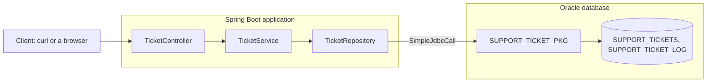

# Calling PL/SQL from Spring Boot

**Builds on:** the Spring Boot flow (controller, service, repository) and the JPA basics of [Day 2](../day-02-spring-boot-basics-and-jpa/README.md). [Day 5, part 3](../day-05-transactions-plsql-pagination-and-specifications/code-and-walkthroughs/03-calling-plsql.md) shows a first call. This module goes further: a whole package, a result set, errors, and transactions.

A Spring Boot application can use the PL/SQL procedures and functions that already live in your Oracle database. You keep the rules in the database. Spring Boot receives the web request, calls the program, and sends back the answer as JSON.

## The short answer

| Question | Answer |
|---|---|
| Can a Spring Boot application call PL/SQL procedures and functions? | Yes. It connects to Oracle and calls the program by name. |
| Do you need entity classes? | No. An entity is a Java class that stands for a table. A call to a program does not need one. |
| Do you need ORM concepts? | No. ORM is object-relational mapping, the part of JPA that turns rows into objects. There is no persistence context, no lazy loading, and no relationship mapping in a PL/SQL call. |
| What do you need? | A database connection, `SimpleJdbcCall` to call the program, a small record for each row that comes back, and `@Transactional` when several calls must succeed or fail together. |

## How a request travels

The picture shows one request, from the client to the database.

**How to read it:** each box passes the call to the next one. The rules (the order of statuses, the due date) are in the package, in the Oracle box. The Spring Boot box holds no entity class.

## Parts

| Part | What | Notes | Time |
|---|---|---|---|
| 1 | Entities or not: what a call needs, and when to use JPA | [01-entities-or-not.md](01-entities-or-not.md) | 20 min |
| 2 | Call a function, a procedure with an `OUT` parameter, and a result set | [02-calling-plsql-programs.md](02-calling-plsql-programs.md) | 60 min |
| 3 | Errors from `RAISE_APPLICATION_ERROR`, commits, and rollback | [03-errors-and-transactions.md](03-errors-and-transactions.md) | 40 min |
| 4 (optional) | The same calls with MyBatis annotations, in a separate project | [04-the-same-calls-with-mybatis.md](04-the-same-calls-with-mybatis.md) | 30 min |
| 5 | Transaction management: `REQUIRED` and `REQUIRES_NEW`, a log line that outlives a rollback, and testing what a rollback left | [05-transaction-management.md](05-transaction-management.md) | 60 min |
| 6 | Pagination: one page from a procedure with `OFFSET ... FETCH`, a total as a second `OUT` value, and a safe sort | [06-pagination.md](06-pagination.md) | 60 min |

Parts 5 and 6 each start from a **copy** of the finished `support-assistant-plsql` project, so you can do them in either order.

## Project

| Project | Holds | Parts |
|---|---|---|
| [support-assistant-plsql](support-assistant-plsql/) | A ticket API that calls the package `SUPPORT_TICKET_PKG` with `SimpleJdbcCall`. No entity, no JPA | 2 and 3 |
| [support-assistant-plsql-mybatis](support-assistant-plsql-mybatis/) | The same API, calling the same package through MyBatis annotations | 4 (optional) |
| [support-assistant-plsql-relations](support-assistant-plsql-relations/) | Tickets and their comments: a foreign key, two cursors for one ticket, one joined cursor for many tickets, and one transaction for a ticket and its first comment. Own `DESK_` tables and package | Relationships (optional) |
| [support-assistant-plsql-transactions](support-assistant-plsql-transactions/) | A copy of the first project. A refused bulk change is rolled back, and its reason is kept in `SUPPORT_ERROR_LOG` through `REQUIRES_NEW` | 5 |
| [support-assistant-plsql-pagination](support-assistant-plsql-pagination/) | A copy of the first project. `GET /api/tickets` returns one page, read by `SUPPORT_TICKET_PAGE_PKG` | 6 |

Each project has a README with build and run steps, and the SQL scripts in `db/oracle/`. The first two projects use the same package, so run their scripts once. The relations project has its own tables and package, so it can live in the same schema. The transactions and pagination projects use the first package too, and add their own small package in a `03-` script, so they can live in the same schema as well.

Each project with a step-by-step build has a walkthrough folder next to it: [support-assistant-plsql-walkthrough](support-assistant-plsql-walkthrough/README.md), [support-assistant-plsql-relations-walkthrough](support-assistant-plsql-relations-walkthrough/README.md), [support-assistant-plsql-transactions-walkthrough](support-assistant-plsql-transactions-walkthrough/README.md), and [support-assistant-plsql-pagination-walkthrough](support-assistant-plsql-pagination-walkthrough/README.md).

## Relationships: tickets and comments (optional)

The first project has one table of tickets. Real data has links between tables. This optional project adds a comments table and answers the questions that a link raises, with no entity class.

| Question | Answer |
|---|---|
| Do you need `@OneToMany`? | No. The link is a foreign key column, and the package reads and writes both tables |
| How do you read a ticket with its comments? | One call, two `SYS_REFCURSOR` parameters, joined into one record |
| How do you read many tickets with their comments? | One call, one cursor from a `LEFT JOIN`, grouped in Java. A loop of calls would be the N+1 problem |
| Who checks that a comment may be added? | The package. A closed ticket takes no comments (`409`) |
| What if the ticket is saved and its first comment is refused? | `@Transactional` on the service undoes both |

Start at the [walkthrough](support-assistant-plsql-relations-walkthrough/README.md). It needs the knowledge of parts 2 and 3.

## Before you start

- A running Spring Boot application with a controller and a service, as in Day 2 and Day 3.
- Java 21 and Maven.
- An Oracle database, and a user that can create tables, a sequence, and a package.
- A SQL tool: SQL Developer or SQL\*Plus.

## What you will have at the end

- One PL/SQL package with a function and three procedures, including one that opens a `SYS_REFCURSOR`.
- Five endpoints that call it.
- Error numbers from `RAISE_APPLICATION_ERROR` turned into `400`, `404`, and `409` answers.
- A test that calls the package and rolls back, so the tables stay clean.
