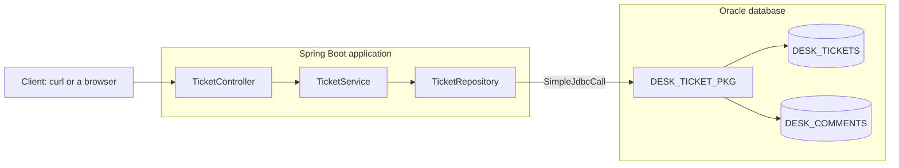

# Step 1 — Concepts and overview

> [Back to index](README.md) · Previous: none · Next: [Tables and the relationship](02-tables-and-relationship.md)

## Goal

Know the three questions that a relationship raises, and where each answer lives in this project.

## Why this matters

A ticket alone is simple. A ticket with comments raises new questions: how are they linked, how do you read them together, and how do you write them safely? With JPA, annotations such as `@OneToMany` hide the answers. Here there are no entities, so each answer is visible. If you know where each one lives, you will know where to look when a comment goes missing.

## The picture

**How to read it:** the layers are the same as in the first project. The new part is the Oracle box: one package works on two tables, and the second table points to the first.

## The words

| Word | Meaning |
|---|---|
| Parent and child | A ticket is the parent. Its comments are the children. One parent has many children, and each child has one parent |
| Foreign key | A column in the child table (`TICKET_ID`) that holds the id of its parent. Oracle refuses a value that is not the id of a real ticket |
| Join | A query that puts the columns of two tables side by side, row by row |
| Entity | A Java class that stands for a table. This project has none |

## The three questions

| Question | Answer in this project | Step |
|---|---|---|
| How is the link stored? | A foreign key column, `DESK_COMMENTS.TICKET_ID` | 2 |
| How is a child written? | `ADD_COMMENT` checks the parent, then inserts | 3, 6 |
| How are parent and children read together? | Two cursors for one ticket. One joined cursor for many tickets | 7, 8 |

A fourth question comes after these: what if a parent is saved but its child is refused? Step 10 answers it with a transaction.

## What JPA would do

For comparison only. In JPA, the `Ticket` entity would hold `List<Comment> comments` with `@OneToMany`, and JPA would load the comments when you ask for them. That is convenient, and it is also where the N+1 problem comes from: one call for a list of tickets, then one more for the comments of each ticket (step 8). In this project you decide how many calls to make, so you can see the cost.

| | JPA with `@OneToMany` | This project |
|---|---|---|
| The link | An annotation on a field | A foreign key column, and a join in SQL |
| Reading parent and children | `ticket.getComments()`, loaded when used | A cursor for each, or one joined cursor |
| The shape of the answer | An entity with a list inside | A record with a list inside (`TicketWithComments`) |
| A rule between parent and child | Java code in a service | PL/SQL in the package |

Next: **[Tables and the relationship](02-tables-and-relationship.md)**.
