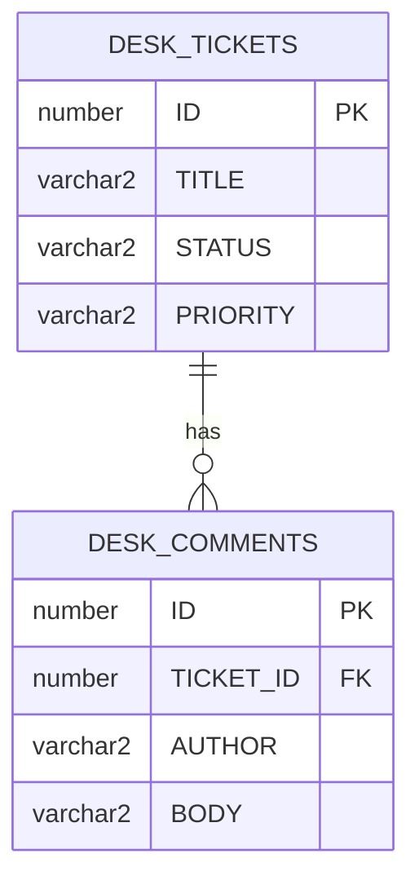

# Step 2 — Tables and the relationship

> [Back to index](README.md) · Previous: [Concepts and overview](01-concepts-and-overview.md) · Next: [The package](03-the-package.md)

## Goal

Create two tables, link them with a foreign key, and watch Oracle protect the link.

## Why this matters

The relationship is stored in one place: the `TICKET_ID` column of the child table. If Oracle enforces it, no program can leave a comment without a ticket, whatever Java or PL/SQL does. The names start with `DESK_`, so they do not clash with the `SUPPORT_` tables of the first project. Both projects can live in one schema.



**How to read it:** the line between the boxes means "one ticket has zero or more comments". The `FK` column is the link.

### 2.1 The parent table

`DESK_TICKETS` is the same as in the first project, and has its own sequence:

```sql
CREATE SEQUENCE DESK_TICKETS_SEQ START WITH 1 INCREMENT BY 1;

CREATE TABLE DESK_TICKETS (
    ID           NUMBER         PRIMARY KEY,
    TITLE        VARCHAR2(100)  NOT NULL,
    DESCRIPTION  VARCHAR2(500),
    STATUS       VARCHAR2(20)   NOT NULL,
    PRIORITY     VARCHAR2(10)   NOT NULL,
    CREATED_AT   TIMESTAMP      NOT NULL,
    DUE_BY       TIMESTAMP      NOT NULL
);
```

### 2.2 The child table and the link

`TICKET_ID` carries the link. `REFERENCES DESK_TICKETS (ID)` makes it a foreign key:

```sql
CREATE TABLE DESK_COMMENTS (
    ID          NUMBER         PRIMARY KEY,
    TICKET_ID   NUMBER         NOT NULL REFERENCES DESK_TICKETS (ID),
    AUTHOR      VARCHAR2(50)   NOT NULL,
    BODY        VARCHAR2(500)  NOT NULL,
    CREATED_AT  TIMESTAMP      NOT NULL
);
```

`NOT NULL` means a comment must have a ticket. Without it, a comment could exist with no parent.

### 2.3 The index

Oracle does not index a foreign key by itself. Every "comments of ticket 7" query filters on `TICKET_ID`, so add the index:

```sql
CREATE INDEX DESK_COMMENTS_TICKET_IX ON DESK_COMMENTS (TICKET_ID);
```

### 2.4 Run the script

Type or copy the file from the checkpoint below. Run it as the user that your application will connect as. In SQL Developer, use **F5**. With SQL\*Plus:

```bash
sqlplus YOUR_USERNAME/YOUR_PASSWORD@//ORACLE_HOST:1521/ORACLE_SERVICE @db/oracle/01-tables.sql
```

## Try it

Ask Oracle to break the link. There is no ticket with the id `999`:

```sql
INSERT INTO DESK_COMMENTS (ID, TICKET_ID, AUTHOR, BODY, CREATED_AT)
VALUES (500, 999, 'x', 'y', LOCALTIMESTAMP);
```

Expected:

```text
ORA-02291: integrity constraint (YOUR_USERNAME.SYS_C008348) violated - parent key not found
```

The number in the constraint name is different on your database. The text after it is the same.

The foreign key also protects the parent. In step 3 you will try to delete a ticket that has a comment, and Oracle answers `ORA-02292`.

## Checkpoint

`db/oracle/01-tables.sql` - Matches [../support-assistant-plsql-relations/db/oracle/01-tables.sql](../support-assistant-plsql-relations/db/oracle/01-tables.sql) exactly.

<details>
<summary>Full <code>db/oracle/01-tables.sql</code></summary>

```sql
-- Oracle only. Run once, as the user that your application connects as.
-- The names start with DESK_ so they do not clash with the SUPPORT_ tables of the other projects.

CREATE SEQUENCE DESK_TICKETS_SEQ START WITH 1 INCREMENT BY 1;
CREATE SEQUENCE DESK_COMMENTS_SEQ START WITH 1 INCREMENT BY 1;

-- The parent table.
CREATE TABLE DESK_TICKETS (
    ID           NUMBER         PRIMARY KEY,
    TITLE        VARCHAR2(100)  NOT NULL,
    DESCRIPTION  VARCHAR2(500),
    STATUS       VARCHAR2(20)   NOT NULL,
    PRIORITY     VARCHAR2(10)   NOT NULL,
    CREATED_AT   TIMESTAMP      NOT NULL,
    DUE_BY       TIMESTAMP      NOT NULL
);

-- The child table. TICKET_ID is the relationship: every comment belongs to exactly one ticket.
-- The REFERENCES clause makes Oracle refuse a comment for a ticket that does not exist.
CREATE TABLE DESK_COMMENTS (
    ID          NUMBER         PRIMARY KEY,
    TICKET_ID   NUMBER         NOT NULL REFERENCES DESK_TICKETS (ID),
    AUTHOR      VARCHAR2(50)   NOT NULL,
    BODY        VARCHAR2(500)  NOT NULL,
    CREATED_AT  TIMESTAMP      NOT NULL
);

-- Oracle does not index a foreign key by itself. This index makes "the comments of ticket 7" fast.
CREATE INDEX DESK_COMMENTS_TICKET_IX ON DESK_COMMENTS (TICKET_ID);
```

</details>

## Common mistakes

| Symptom | Cause | Fix |
|---|---|---|
| `ORA-00955: name is already used by an existing object` | `01-tables.sql` was run twice | Run `99-drop.sql` (step 3), then the script again |
| `ORA-00942: table or view does not exist` while you create `DESK_COMMENTS` | The first `CREATE TABLE` failed, so the parent does not exist | Read the first error, fix it, and run the script again from a clean schema |
| A comment query is slow on a big table | The index on `TICKET_ID` is missing. Oracle does not create one for a foreign key | Create `DESK_COMMENTS_TICKET_IX` |

Next: **[The package](03-the-package.md)**.
