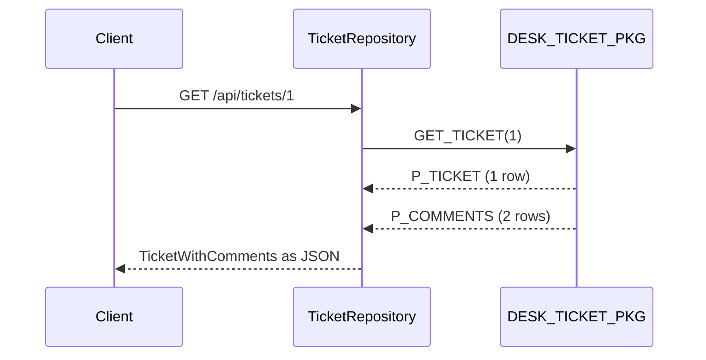

# Step 7 — One ticket with its comments

> [Back to index](README.md) · Previous: [Add a comment](06-add-a-comment.md) · Next: [Many tickets with comments](08-many-tickets-with-comments.md)

## Goal

`GET /api/tickets/1` answers with the ticket and its comments in one JSON object. One call goes to Oracle, and it reads two cursors.

## Why this matters

This is where a relationship becomes visible to a client: a parent with a list inside it. With JPA that list is a field on the entity. Here you build it yourself, from two cursors, into a record that holds a ticket and a list of comments. Both cursors come back from one procedure call, so there is one round trip to the database.



**How to read it:** one call goes out, and two result sets come back. The repository joins them into one object.

### 7.1 The records

A comment, as one row of the second cursor. It has no ticket id, because the object around it is the ticket:

```java
public record CommentResponse(long id, String author, String body, LocalDateTime createdAt) { }
```

The parent and its children together:

```java
public record TicketWithComments(TicketResponse ticket, List<CommentResponse> comments) { }
```

The JSON has the same shape: `{"ticket": {...}, "comments": [...]}`.

### 7.2 The repository: name both cursors

`returningResultSet` is called once for each cursor. Each name must match the parameter name in the package, in upper case, and each cursor gets its own row mapper. `toTicket` is the one from step 5:

```java
this.getTicket = new SimpleJdbcCall(jdbcTemplate)
        .withCatalogName(PACKAGE).withProcedureName("GET_TICKET")
        .returningResultSet("P_TICKET", this::toTicket)
        .returningResultSet("P_COMMENTS", this::toComment);
```

The new row mapper reads one comment:

```java
private CommentResponse toComment(ResultSet rs, int rowNumber) throws SQLException {
    return new CommentResponse(
            rs.getLong("ID"),
            rs.getString("AUTHOR"),
            rs.getString("BODY"),
            rs.getTimestamp("CREATED_AT").toLocalDateTime());
}
```

Each cursor comes back in the `Map` as a `List`. The ticket list has exactly one row, so take the first:

```java
@SuppressWarnings("unchecked")
public TicketWithComments getTicket(long ticketId) {
    Map<String, Object> out = getTicket.execute(ticketId);
    List<TicketResponse> ticket = (List<TicketResponse>) out.get("P_TICKET");
    List<CommentResponse> comments = (List<CommentResponse>) out.get("P_COMMENTS");
    return new TicketWithComments(ticket.get(0), comments);
}
```

A ticket without comments gives an empty list, not `null`. A missing ticket never reaches this line, because the package raises `-20003` first.

### 7.3 The service and the controller

```java
public TicketWithComments get(long ticketId) {
    return ticketRepository.getTicket(ticketId);
}
```

```java
@GetMapping("/{id}")
public TicketWithComments get(@PathVariable long id) {
    return ticketService.get(id);
}
```

## Try it

Restart the application. Ticket 1 has two comments:

```bash
curl http://localhost:8080/api/tickets/1
```

Expected:

```json
{"ticket":{"id":1,"title":"Printer is jammed","description":"Second floor printer","status":"OPEN",
  "priority":"HIGH","createdAt":"2026-10-17T02:09:44.807781","dueBy":"2026-10-18T02:09:44.807781"},
 "comments":[
  {"id":1,"author":"Meera","body":"The paper tray is stuck","createdAt":"2026-10-17T02:09:45.011359"},
  {"id":2,"author":"Karan","body":"On my way","createdAt":"2026-10-17T02:09:45.031372"}]}
```

Ticket 2 has none:

```bash
curl http://localhost:8080/api/tickets/2
```

Expected: the ticket, and `"comments":[]`.

A ticket that does not exist gives a `500` until step 9, as in step 6. The log shows `ORA-20003: Ticket 999 does not exist`.

## Checkpoint

`src/main/java/com/bsp/supportassistant/dto/CommentResponse.java` - Matches [../support-assistant-plsql-relations/src/main/java/com/bsp/supportassistant/dto/CommentResponse.java](../support-assistant-plsql-relations/src/main/java/com/bsp/supportassistant/dto/CommentResponse.java) exactly.

<details>
<summary>Full <code>src/main/java/com/bsp/supportassistant/dto/CommentResponse.java</code></summary>

```java
package com.bsp.supportassistant.dto;

import java.time.LocalDateTime;

// One row of a comment cursor. The ticket it belongs to is the record around it, not a field here.
public record CommentResponse(
        long id,
        String author,
        String body,
        LocalDateTime createdAt) {
}
```

</details>

`src/main/java/com/bsp/supportassistant/dto/TicketWithComments.java` - Matches [../support-assistant-plsql-relations/src/main/java/com/bsp/supportassistant/dto/TicketWithComments.java](../support-assistant-plsql-relations/src/main/java/com/bsp/supportassistant/dto/TicketWithComments.java) exactly.

<details>
<summary>Full <code>src/main/java/com/bsp/supportassistant/dto/TicketWithComments.java</code></summary>

```java
package com.bsp.supportassistant.dto;

import java.util.List;

// A parent and its children, as one JSON object: {"ticket": {...}, "comments": [...]}.
public record TicketWithComments(TicketResponse ticket, List<CommentResponse> comments) {
}
```

</details>

`src/main/java/com/bsp/supportassistant/repository/TicketRepository.java` - Grows in a later step.

<details>
<summary>Full <code>src/main/java/com/bsp/supportassistant/repository/TicketRepository.java</code></summary>

```java
package com.bsp.supportassistant.repository;

import com.bsp.supportassistant.dto.CommentResponse;
import com.bsp.supportassistant.dto.TicketResponse;
import com.bsp.supportassistant.dto.TicketWithComments;
import org.springframework.jdbc.core.JdbcTemplate;
import org.springframework.jdbc.core.simple.SimpleJdbcCall;
import org.springframework.stereotype.Repository;

import java.sql.ResultSet;
import java.sql.SQLException;
import java.util.List;
import java.util.Map;

// Calls the programs of the PL/SQL package DESK_TICKET_PKG. There is no entity and no JPA here.
@Repository
public class TicketRepository {

    private static final String PACKAGE = "DESK_TICKET_PKG";

    private final SimpleJdbcCall createTicket;
    private final SimpleJdbcCall changeStatus;
    private final SimpleJdbcCall findTickets;
    private final SimpleJdbcCall addComment;
    private final SimpleJdbcCall getTicket;

    public TicketRepository(JdbcTemplate jdbcTemplate) {
        this.createTicket = new SimpleJdbcCall(jdbcTemplate)
                .withCatalogName(PACKAGE).withProcedureName("CREATE_TICKET");
        this.changeStatus = new SimpleJdbcCall(jdbcTemplate)
                .withCatalogName(PACKAGE).withProcedureName("CHANGE_STATUS");
        // P_TICKETS is the SYS_REFCURSOR. Each row of it is turned into a TicketResponse by toTicket.
        this.findTickets = new SimpleJdbcCall(jdbcTemplate)
                .withCatalogName(PACKAGE).withProcedureName("FIND_TICKETS")
                .returningResultSet("P_TICKETS", this::toTicket);
        this.addComment = new SimpleJdbcCall(jdbcTemplate)
                .withCatalogName(PACKAGE).withProcedureName("ADD_COMMENT");
        // Two cursors. Each one is named, and each has its own row mapper.
        this.getTicket = new SimpleJdbcCall(jdbcTemplate)
                .withCatalogName(PACKAGE).withProcedureName("GET_TICKET")
                .returningResultSet("P_TICKET", this::toTicket)
                .returningResultSet("P_COMMENTS", this::toComment);
    }

    // A procedure with an OUT parameter: the values go in the order of the IN parameters.
    // The OUT value comes back in a Map. The key is the parameter name, in upper case.
    public long createTicket(String title, String description, String priority) {
        Map<String, Object> out = createTicket.execute(title, description, priority);
        return ((Number) out.get("P_TICKET_ID")).longValue();
    }

    // A procedure with no OUT parameter. A rule that fails comes back as an exception.
    public void changeStatus(long ticketId, String newStatus) {
        changeStatus.execute(ticketId, newStatus);
    }

    // A procedure with a result set. A null status asks for every ticket.
    @SuppressWarnings("unchecked")
    public List<TicketResponse> findTickets(String status) {
        Map<String, Object> out = findTickets.execute(status);
        return (List<TicketResponse>) out.get("P_TICKETS");
    }

    // The ticket id goes in with the other values. The package checks that the ticket exists.
    public long addComment(long ticketId, String author, String body) {
        Map<String, Object> out = addComment.execute(ticketId, author, body);
        return ((Number) out.get("P_COMMENT_ID")).longValue();
    }

    // One call, two cursors. Each comes back in the Map as a List, under its own name.
    @SuppressWarnings("unchecked")
    public TicketWithComments getTicket(long ticketId) {
        Map<String, Object> out = getTicket.execute(ticketId);
        List<TicketResponse> ticket = (List<TicketResponse>) out.get("P_TICKET");
        List<CommentResponse> comments = (List<CommentResponse>) out.get("P_COMMENTS");
        return new TicketWithComments(ticket.get(0), comments);
    }

    private TicketResponse toTicket(ResultSet rs, int rowNumber) throws SQLException {
        return new TicketResponse(
                rs.getLong("ID"),
                rs.getString("TITLE"),
                rs.getString("DESCRIPTION"),
                rs.getString("STATUS"),
                rs.getString("PRIORITY"),
                rs.getTimestamp("CREATED_AT").toLocalDateTime(),
                rs.getTimestamp("DUE_BY").toLocalDateTime());
    }

    private CommentResponse toComment(ResultSet rs, int rowNumber) throws SQLException {
        return new CommentResponse(
                rs.getLong("ID"),
                rs.getString("AUTHOR"),
                rs.getString("BODY"),
                rs.getTimestamp("CREATED_AT").toLocalDateTime());
    }
}
```

</details>

`src/main/java/com/bsp/supportassistant/service/TicketService.java` - Grows in a later step.

<details>
<summary>Full <code>src/main/java/com/bsp/supportassistant/service/TicketService.java</code></summary>

```java
package com.bsp.supportassistant.service;

import com.bsp.supportassistant.dto.CommentRequest;
import com.bsp.supportassistant.dto.CreateTicketRequest;
import com.bsp.supportassistant.dto.TicketResponse;
import com.bsp.supportassistant.dto.TicketWithComments;
import com.bsp.supportassistant.repository.TicketRepository;
import org.springframework.stereotype.Service;

import java.util.List;

// The business rules are in the PL/SQL package. The service decides what happens together.
@Service
public class TicketService {

    private final TicketRepository ticketRepository;

    public TicketService(TicketRepository ticketRepository) {
        this.ticketRepository = ticketRepository;
    }

    public long create(CreateTicketRequest request) {
        return ticketRepository.createTicket(request.title(), request.description(), request.priority());
    }

    public void changeStatus(long ticketId, String newStatus) {
        ticketRepository.changeStatus(ticketId, newStatus);
    }

    public List<TicketResponse> find(String status) {
        return ticketRepository.findTickets(status);
    }

    public long addComment(long ticketId, CommentRequest request) {
        return ticketRepository.addComment(ticketId, request.author(), request.body());
    }

    public TicketWithComments get(long ticketId) {
        return ticketRepository.getTicket(ticketId);
    }
}
```

</details>

`src/main/java/com/bsp/supportassistant/api/TicketController.java` - Grows in a later step.

<details>
<summary>Full <code>src/main/java/com/bsp/supportassistant/api/TicketController.java</code></summary>

```java
package com.bsp.supportassistant.api;

import com.bsp.supportassistant.dto.CommentCreated;
import com.bsp.supportassistant.dto.CommentRequest;
import com.bsp.supportassistant.dto.CreateTicketRequest;
import com.bsp.supportassistant.dto.StatusRequest;
import com.bsp.supportassistant.dto.TicketCreated;
import com.bsp.supportassistant.dto.TicketResponse;
import com.bsp.supportassistant.dto.TicketWithComments;
import com.bsp.supportassistant.service.TicketService;
import org.springframework.http.HttpStatus;
import org.springframework.web.bind.annotation.GetMapping;
import org.springframework.web.bind.annotation.PatchMapping;
import org.springframework.web.bind.annotation.PathVariable;
import org.springframework.web.bind.annotation.PostMapping;
import org.springframework.web.bind.annotation.RequestBody;
import org.springframework.web.bind.annotation.RequestMapping;
import org.springframework.web.bind.annotation.RequestParam;
import org.springframework.web.bind.annotation.ResponseStatus;
import org.springframework.web.bind.annotation.RestController;

import java.util.List;

@RestController
@RequestMapping("/api/tickets")
public class TicketController {

    private final TicketService ticketService;

    public TicketController(TicketService ticketService) {
        this.ticketService = ticketService;
    }

    // Calls the procedure FIND_TICKETS. The status is optional.
    @GetMapping
    public List<TicketResponse> find(@RequestParam(required = false) String status) {
        return ticketService.find(status);
    }

    // Calls the procedure CREATE_TICKET.
    @PostMapping
    @ResponseStatus(HttpStatus.CREATED)
    public TicketCreated create(@RequestBody CreateTicketRequest request) {
        return new TicketCreated(ticketService.create(request));
    }

    // Calls the procedure CHANGE_STATUS.
    @PatchMapping("/{id}/status")
    @ResponseStatus(HttpStatus.NO_CONTENT)
    public void changeStatus(@PathVariable long id, @RequestBody StatusRequest request) {
        ticketService.changeStatus(id, request.status());
    }

    // Calls the procedure ADD_COMMENT. The comment belongs to the ticket in the URL.
    @PostMapping("/{id}/comments")
    @ResponseStatus(HttpStatus.CREATED)
    public CommentCreated addComment(@PathVariable long id, @RequestBody CommentRequest request) {
        return new CommentCreated(ticketService.addComment(id, request));
    }

    // Calls the procedure GET_TICKET: one ticket and its comments.
    @GetMapping("/{id}")
    public TicketWithComments get(@PathVariable long id) {
        return ticketService.get(id);
    }
}
```

</details>

## Common mistakes

| Symptom | Cause | Fix |
|---|---|---|
| `ClassCastException: LinkedCaseInsensitiveMap cannot be cast to ...CommentResponse` | The name in `returningResultSet("P_COMMENT", ...)` does not match the parameter `P_COMMENTS`. Spring reads the unnamed cursor as rows of maps. There is no other error | Copy the parameter name from the specification, in upper case |
| `"comments":null` in the JSON | `out.get("p_comments")` was written in lower case, so it returns `null` | Use the upper-case name: `P_COMMENTS` |
| `ORA-17006: Invalid column name` | A name in `rs.getString("...")` is not a column of the cursor | Compare it with the `SELECT` list in the package |

Next: **[Many tickets with comments](08-many-tickets-with-comments.md)**.
