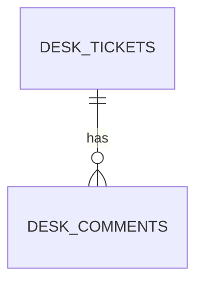

# support-assistant-plsql-relations

A ticket API where **a ticket has many comments**, built on an Oracle PL/SQL package. It shows how a one-to-many relationship is stored, written, and read when there is no entity class and no JPA. The step-by-step build is in [support-assistant-plsql-relations-walkthrough](../support-assistant-plsql-relations-walkthrough/README.md).

It follows [support-assistant-plsql](../support-assistant-plsql/). The calls, the records, the error handler, and the tests work the same way. What is new is the second table, three package programs, and the Java that reads a parent together with its children.

## Versions

| Item | Version |
|---|---|
| Java | 21 |
| Spring Boot | 4.1.1 |
| Oracle JDBC driver | `ojdbc17` (comes with Spring Boot) |
| Oracle Database | 19c, or 21c Express Edition |

## Before you build or run

1. Run the scripts in [db/oracle](db/oracle/), in order, as the user that your application connects as:

   | Script | What it does |
   |---|---|
   | `01-tables.sql` | Creates two sequences, `DESK_TICKETS`, `DESK_COMMENTS` (with a foreign key to `DESK_TICKETS`), and an index on the foreign key |
   | `02-package.sql` | Creates the package `DESK_TICKET_PKG`. You can run it again at any time |
   | `99-drop.sql` | Removes everything above, child table first, so that you can start again |

2. Set the connection in environment variables. Do not write a password in a file.

   | Variable | Meaning |
   |---|---|
   | `DB_USERNAME` | The Oracle user |
   | `DB_PASSWORD` | The password of that user |
   | `DB_URL` | Optional. Default `jdbc:oracle:thin:@//localhost:1521/XEPDB1` |

> **Note:** a variable that is not set reaches Oracle as the text `${DB_PASSWORD}`. The application still starts, and the first call fails with `ORA-01017`.

## Build and run

```bash
export DB_USERNAME=YOUR_USERNAME
export DB_PASSWORD=YOUR_PASSWORD
mvn clean verify
java -jar target/support-assistant-plsql-relations-0.0.1-SNAPSHOT.jar
```

The application starts on port `8080`. `mvn clean verify` runs six tests that call the package in your database. Five roll back. The sixth (`TicketTransactionTests`) is not `@Transactional` on purpose, and leaves no data behind because the service undoes its own work. The database must be running, with the scripts applied.

## Layout

```text
db/oracle/01-tables.sql                      # sequences, DESK_TICKETS, DESK_COMMENTS, index
db/oracle/02-package.sql                     # DESK_TICKET_PKG
db/oracle/99-drop.sql                        # start again
src/main/resources/application.yaml          # connection from environment variables
src/main/java/com/bsp/supportassistant
├── SupportAssistantApplication.java
├── dto/                                     # records: requests, answers, TicketWithComments
├── repository/TicketRepository.java         # one SimpleJdbcCall for each program
├── service/TicketService.java               # @Transactional for ticket plus first comment
├── exception/                               # ApiError, GlobalExceptionHandler
└── api/TicketController.java
src/test/java/com/bsp/supportassistant
├── TicketRelationTests.java                 # five tests, each rolled back
└── TicketTransactionTests.java              # one test, checks a real rollback
```

## The relationship



`DESK_COMMENTS.TICKET_ID` refers to `DESK_TICKETS.ID`. Oracle refuses a comment for a missing ticket (`ORA-02291`), and refuses to delete a ticket that has comments (`ORA-02292`).

## The package

| Program | Kind | Called by |
|---|---|---|
| `create_ticket(p_title, p_description, p_priority, p_ticket_id OUT)` | Procedure | `POST /api/tickets`, `POST /api/tickets/with-first-comment` |
| `change_status(p_ticket_id, p_new_status)` | Procedure | `PATCH /api/tickets/{id}/status` |
| `find_tickets(p_status, p_tickets OUT SYS_REFCURSOR)` | Procedure | `GET /api/tickets?status=OPEN` |
| `add_comment(p_ticket_id, p_author, p_body, p_comment_id OUT)` | Procedure | `POST /api/tickets/{id}/comments`, `POST /api/tickets/with-first-comment` |
| `get_ticket(p_ticket_id, p_ticket OUT, p_comments OUT)` | Procedure, two cursors | `GET /api/tickets/{id}` |
| `find_tickets_with_comments(p_status, p_rows OUT)` | Procedure, one joined cursor | `GET /api/tickets/with-comments` |

`lock_ticket` is a private function in the package body. `change_status` and `add_comment` use it to read the status of a ticket and lock the row.

| Error number | Meaning | Status |
|---|---|---|
| `20001` | The title is missing | `400` |
| `20002` | The priority is not `HIGH`, `MEDIUM` or `LOW` | `400` |
| `20003` | The ticket does not exist | `404` |
| `20004` | The status change is not allowed | `409` |
| `20005` | The author or the text of a comment is missing | `400` |
| `20006` | The ticket is `CLOSED`, so it takes no comments | `409` |

## Endpoints

| Method | URL | Status codes |
|---|---|---|
| `POST` | `/api/tickets`, body `{"title":"...","description":"...","priority":"HIGH"}` | `201`, `400` |
| `GET` | `/api/tickets?status=OPEN` (status is optional). Tickets only | `200` |
| `PATCH` | `/api/tickets/{id}/status`, body `{"status":"IN_PROGRESS"}` | `204`, `404`, `409` |
| `POST` | `/api/tickets/{id}/comments`, body `{"author":"Meera","body":"..."}` | `201`, `400`, `404`, `409` |
| `GET` | `/api/tickets/{id}`. One ticket and its comments | `200`, `404` |
| `GET` | `/api/tickets/with-comments?status=OPEN` (status is optional). Many tickets, each with its comments | `200` |
| `POST` | `/api/tickets/with-first-comment`, body `{"title":"...","priority":"HIGH","author":"Meera","comment":"..."}` | `201`, `400` |

An error from the package answers `{"status":409,"error":"Conflict","message":"...","timestamp":"..."}`.

`GET /api/tickets/{id}` and `GET /api/tickets/with-comments` answer `{"ticket":{...},"comments":[{...}]}`. A ticket with no comments has `"comments":[]`.

## Running on Spring Boot 3.5

The Java code and `application.yaml` are the same. Only these lines of `pom.xml` change:

| Item in `pom.xml` | Spring Boot 4.1.1 (this project) | Spring Boot 3.5.x |
|---|---|---|
| Parent version | `4.1.1` | `3.5.16`, or another 3.5.x |
| Web starter | `spring-boot-starter-webmvc` | `spring-boot-starter-web` |
| Test starter | `spring-boot-starter-webmvc-test` | `spring-boot-starter-test` |
| Oracle driver | `ojdbc17` | `ojdbc11` |

## What this project does not do

- It does not check the request fields in Java. The package checks them.
- It has no login. Any caller can add a comment to any ticket.
- It has no way to edit or delete a comment or a ticket. Deleting a ticket would need a rule for its comments (an exercise in the walkthrough).
- It does not have `open_count`, the status log table, or the bulk status change of [support-assistant-plsql](../support-assistant-plsql/). They are about calls and transactions, not relationships.
- It is not a copy of the Day 5 project. The names start with `DESK_`, so this project, the `SUPPORT_` tables of the other projects, and the Day 5 `TICKETS` table can all live in one schema.
