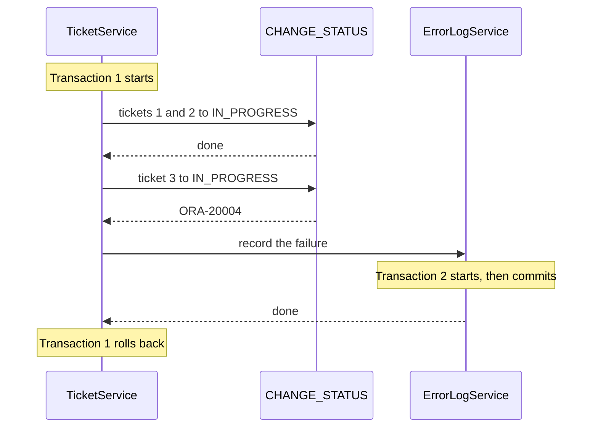

# Step 5 — A transaction of its own

> [Back to index](README.md) · Previous: [Record the failure](04-record-the-failure.md) · Next: [Test after the rollback](06-test-after-the-rollback.md)

## Goal

`record` runs in a transaction of its own, which commits at once. The tickets are still put back, and the log line stays.

## Why this matters

A `@Transactional` method called from inside a running transaction **joins** it by default. That setting is called the **propagation**, and the default is `REQUIRED`. You saw its effect in step 4. `REQUIRES_NEW` asks for the opposite: pause the running transaction, start a new one, and commit it when the method returns.

| Propagation | What `record` does | When the bulk change rolls back |
|---|---|---|
| `REQUIRED` (step 4) | Joins the bulk change's transaction | The line is undone too |
| `REQUIRES_NEW` (this step) | Runs its own transaction, and commits it | The line stays |

### 5.1 The picture

The request `[1, 2, 3]`, where ticket 3 is already `IN_PROGRESS`:



**How to read it:** transaction 1 holds the ticket changes. Transaction 2 holds only the log line. Transaction 2 commits before transaction 1 rolls back, so the rollback cannot reach it.

### 5.2 Change the annotation

In `ErrorLogService`:

```java
// REQUIRES_NEW: pause the caller's transaction, run this one on its own, and commit it at once.
@Transactional(propagation = Propagation.REQUIRES_NEW)
public void record(String message) {
    errorLogRepository.logError(message);
}
```

The import is `org.springframework.transaction.annotation.Propagation`.

### 5.3 Why `record` is in its own class

Spring puts a **proxy** in front of each bean: a stand-in object that receives the call first, starts or joins the transaction, and then calls your method. It is like a receptionist at the door of an office. A visitor from outside passes the desk. A colleague walking between two rooms of the same office does not.

A call such as `this.record(...)` inside `TicketService` never passes the proxy, so its `@Transactional` is ignored. That is why `record` lives in `ErrorLogService`, and `TicketService` calls it through a field.

## Try it

Restart. Tickets 1 and 2 are still `OPEN` after step 4, so send the same request again:

```bash
curl -i -X POST http://localhost:8080/api/tickets/bulk-status \
  -H "Content-Type: application/json" -d '{"ticketIds":[1,2,3],"status":"IN_PROGRESS"}'
curl -s "http://localhost:8080/api/tickets?status=OPEN"
```

Expected: `409` again, and the `OPEN` list still holds tickets 1 and 2. In SQL Developer:

```sql
SELECT MESSAGE, LOGGED_AT FROM SUPPORT_ERROR_LOG;
```

Expected, one line:

```text
MESSAGE
--------------------------------------------------
Bulk change to IN_PROGRESS stopped at ticket 3
```

Now send only the tickets that can move:

```bash
curl -i -X POST http://localhost:8080/api/tickets/bulk-status \
  -H "Content-Type: application/json" -d '{"ticketIds":[1,2],"status":"IN_PROGRESS"}'
```

Expected: `HTTP/1.1 204`. Tickets 1, 2 and 3 are now `IN_PROGRESS`, and the log still has one line.

A ticket that does not exist is recorded too:

```bash
curl -i -X POST http://localhost:8080/api/tickets/bulk-status \
  -H "Content-Type: application/json" -d '{"ticketIds":[1,99],"status":"RESOLVED"}'
```

Expected: `404` with `Ticket 99 does not exist`. Ticket 1 is still `IN_PROGRESS`, and the log has a second line: `Bulk change to RESOLVED stopped at ticket 99`.

## Checkpoint

`src/main/java/com/bsp/supportassistant/service/ErrorLogService.java` - Matches [../support-assistant-plsql-transactions/src/main/java/com/bsp/supportassistant/service/ErrorLogService.java](../support-assistant-plsql-transactions/src/main/java/com/bsp/supportassistant/service/ErrorLogService.java) exactly.

<details>
<summary>Full <code>src/main/java/com/bsp/supportassistant/service/ErrorLogService.java</code></summary>

```java
package com.bsp.supportassistant.service;

import com.bsp.supportassistant.repository.ErrorLogRepository;
import org.springframework.stereotype.Service;
import org.springframework.transaction.annotation.Propagation;
import org.springframework.transaction.annotation.Transactional;

// Writes a line to SUPPORT_ERROR_LOG that stays, even when the caller's transaction is rolled back.
// It is a class of its own on purpose: a call from inside the same class does not pass through Spring.
@Service
public class ErrorLogService {

    private final ErrorLogRepository errorLogRepository;

    public ErrorLogService(ErrorLogRepository errorLogRepository) {
        this.errorLogRepository = errorLogRepository;
    }

    // REQUIRES_NEW: pause the caller's transaction, run this one on its own, and commit it at once.
    @Transactional(propagation = Propagation.REQUIRES_NEW)
    public void record(String message) {
        errorLogRepository.logError(message);
    }
}
```

</details>

## Common mistakes

| Symptom | Cause | Fix |
|---|---|---|
| The log still has no line | The application was not restarted, or the annotation still reads `@Transactional` | Check the annotation, rebuild, and restart |
| The log has no line, and `REQUIRES_NEW` is on a method of `TicketService` | A call inside the same class does not pass the proxy | Keep `record` in `ErrorLogService` |
| Ticket 1 is `RESOLVED` after the `[1,99]` call | The bulk method lost its `@Transactional` | Put it back on `changeStatus(List<Long>, String)` |

Next: **[Test after the rollback](06-test-after-the-rollback.md)**.
