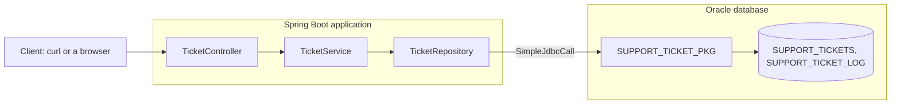

# Step 1 — Concepts and overview

> [Back to index](README.md) · Previous: none · Next: [Tables and the PL/SQL package](02-database-objects.md)

## Goal

Know what you are building and the words that the next steps use.

## Why this matters

The rules of the application (the due date, the order of statuses) already live in the package. The Java side must not copy them. It receives a web request, calls a program by name, and returns the answer as JSON. If you know which layer does what, you will not write a rule twice.

## The picture

**How to read it:** each box passes the call to the next one. The rules are in the package. There is no entity class in the Spring Boot box.

## The layers

| Layer | Class | Job |
|---|---|---|
| Controller | `TicketController` | Receives the request, returns JSON |
| Service | `TicketService` | Decides what is called, and what happens together |
| Repository | `TicketRepository` | Calls the package programs |
| Package | `SUPPORT_TICKET_PKG` | Holds the rules and the SQL |

## The words

| Word | Meaning |
|---|---|
| `SimpleJdbcCall` | The Spring class that calls a function or a procedure by name |
| `OUT` parameter | A value that a procedure gives back. Java reads it from a `Map` |
| `SYS_REFCURSOR` | A result set that a procedure opens. Java reads each row with a row mapper |
| Record | A small Java class that only holds values. Used for request and response bodies |
| Transaction | A group of calls that is saved together, or undone together |

Next: **[Tables and the PL/SQL package](02-database-objects.md)**.
