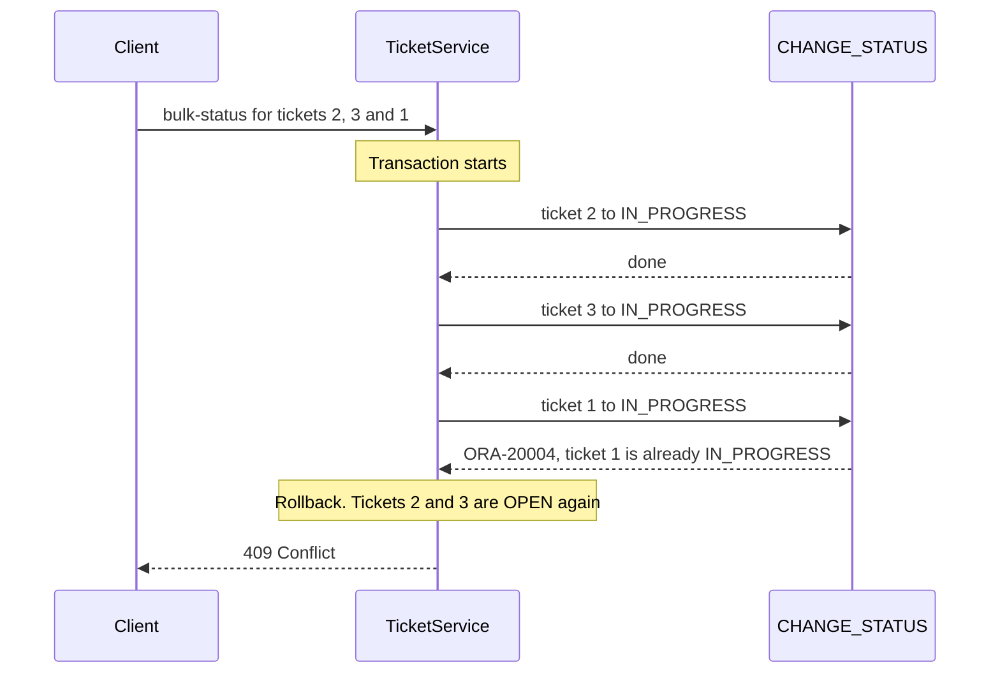

# Step 9 — Several calls, all or none

> [Back to index](README.md) · Previous: [Turn package errors into answers](08-error-handling.md) · Next: [Test the package](10-test-the-package.md)

## Goal

`POST /api/tickets/bulk-status` moves several tickets, all or none.

## Why this matters

The package has no `COMMIT`, so the caller decides. Without a transaction, each procedure call is saved when it ends. If the third ticket is refused, the first two stay changed. `@Transactional` puts all the calls of one service method into one transaction. An exception leaves the method, and Spring undoes every call before it.

### 9.1 The picture

The request `[2, 3, 1]`, where ticket 1 is already `IN_PROGRESS`:



**How to read it:** the transaction starts when the service method starts. The third call fails, and the rollback undoes the two calls that worked.

### 9.2 Two small classes

```java
public record BulkStatusRequest(List<Long> ticketIds, String status) {
}
```

```java
public class InvalidRequestException extends RuntimeException {

    public InvalidRequestException(String message) {
        super(message);
    }
}
```

### 9.3 The service

```java
@Transactional
public void changeStatus(List<Long> ticketIds, String newStatus) {
    if (ticketIds == null || ticketIds.isEmpty()) {
        throw new InvalidRequestException("ticketIds must hold at least one id");
    }
    for (Long ticketId : ticketIds) {
        ticketRepository.changeStatus(ticketId, newStatus);
    }
}
```

### 9.4 The handler and the controller

Add to `GlobalExceptionHandler`, so that an empty list answers `400`:

```java
@ExceptionHandler(InvalidRequestException.class)
public ResponseEntity<ApiError> handleInvalidRequest(InvalidRequestException ex) {
    return build(HttpStatus.BAD_REQUEST, ex.getMessage());
}
```

The controller route:

```java
@PostMapping("/bulk-status")
@ResponseStatus(HttpStatus.NO_CONTENT)
public void changeStatus(@RequestBody BulkStatusRequest request) {
    ticketService.changeStatus(request.ticketIds(), request.status());
}
```

## Try it

Restart. Ticket 1 is `IN_PROGRESS`, tickets 2 and 3 are `OPEN`. Ask for all three to move:

```bash
curl -i -X POST http://localhost:8080/api/tickets/bulk-status \
  -H "Content-Type: application/json" -d '{"ticketIds":[2,3,1],"status":"IN_PROGRESS"}'
curl -s "http://localhost:8080/api/tickets?status=OPEN"
```

Expected: `HTTP/1.1 409` with `Ticket 1 is IN_PROGRESS. The next status is RESOLVED`. The `OPEN` list still holds tickets 2 and 3.

Now ask for only the two that can move:

```bash
curl -i -X POST http://localhost:8080/api/tickets/bulk-status \
  -H "Content-Type: application/json" -d '{"ticketIds":[2,3],"status":"IN_PROGRESS"}'
```

Expected: `HTTP/1.1 204`. Tickets 2 and 3 are `IN_PROGRESS`.

## Checkpoint

`src/main/java/com/bsp/supportassistant/dto/BulkStatusRequest.java` - Matches [../support-assistant-plsql/src/main/java/com/bsp/supportassistant/dto/BulkStatusRequest.java](../support-assistant-plsql/src/main/java/com/bsp/supportassistant/dto/BulkStatusRequest.java) exactly.

<details>
<summary>Full <code>src/main/java/com/bsp/supportassistant/dto/BulkStatusRequest.java</code></summary>

```java
package com.bsp.supportassistant.dto;

import java.util.List;

// The body of POST /api/tickets/bulk-status.
public record BulkStatusRequest(List<Long> ticketIds, String status) {
}
```

</details>

`src/main/java/com/bsp/supportassistant/exception/InvalidRequestException.java` - Matches [../support-assistant-plsql/src/main/java/com/bsp/supportassistant/exception/InvalidRequestException.java](../support-assistant-plsql/src/main/java/com/bsp/supportassistant/exception/InvalidRequestException.java) exactly.

<details>
<summary>Full <code>src/main/java/com/bsp/supportassistant/exception/InvalidRequestException.java</code></summary>

```java
package com.bsp.supportassistant.exception;

// The request is wrong before any PL/SQL program is called.
public class InvalidRequestException extends RuntimeException {

    public InvalidRequestException(String message) {
        super(message);
    }
}
```

</details>

`src/main/java/com/bsp/supportassistant/service/TicketService.java` - Matches [../support-assistant-plsql/src/main/java/com/bsp/supportassistant/service/TicketService.java](../support-assistant-plsql/src/main/java/com/bsp/supportassistant/service/TicketService.java) exactly.

<details>
<summary>Full <code>src/main/java/com/bsp/supportassistant/service/TicketService.java</code></summary>

```java
package com.bsp.supportassistant.service;

import com.bsp.supportassistant.dto.CreateTicketRequest;
import com.bsp.supportassistant.dto.TicketResponse;
import com.bsp.supportassistant.exception.InvalidRequestException;
import com.bsp.supportassistant.repository.TicketRepository;
import org.springframework.stereotype.Service;
import org.springframework.transaction.annotation.Transactional;

import java.util.List;

// The business rules are in the PL/SQL package. The service decides what happens together.
@Service
public class TicketService {

    private final TicketRepository ticketRepository;

    public TicketService(TicketRepository ticketRepository) {
        this.ticketRepository = ticketRepository;
    }

    public int openCount(String priority) {
        return ticketRepository.openCount(priority);
    }

    public long create(CreateTicketRequest request) {
        return ticketRepository.createTicket(request.title(), request.description(), request.priority());
    }

    public void changeStatus(long ticketId, String newStatus) {
        ticketRepository.changeStatus(ticketId, newStatus);
    }

    // All or nothing: if one ticket cannot change, the tickets before it are put back.
    @Transactional
    public void changeStatus(List<Long> ticketIds, String newStatus) {
        if (ticketIds == null || ticketIds.isEmpty()) {
            throw new InvalidRequestException("ticketIds must hold at least one id");
        }
        for (Long ticketId : ticketIds) {
            ticketRepository.changeStatus(ticketId, newStatus);
        }
    }

    public List<TicketResponse> find(String status) {
        return ticketRepository.findTickets(status);
    }
}
```

</details>

`src/main/java/com/bsp/supportassistant/exception/GlobalExceptionHandler.java` - Matches [../support-assistant-plsql/src/main/java/com/bsp/supportassistant/exception/GlobalExceptionHandler.java](../support-assistant-plsql/src/main/java/com/bsp/supportassistant/exception/GlobalExceptionHandler.java) exactly.

<details>
<summary>Full <code>src/main/java/com/bsp/supportassistant/exception/GlobalExceptionHandler.java</code></summary>

```java
package com.bsp.supportassistant.exception;

import org.springframework.http.HttpStatus;
import org.springframework.http.ResponseEntity;
import org.springframework.jdbc.UncategorizedSQLException;
import org.springframework.web.bind.annotation.ExceptionHandler;
import org.springframework.web.bind.annotation.RestControllerAdvice;

import java.sql.SQLException;
import java.time.LocalDateTime;

// One place that turns exceptions from every controller into an ApiError.
@RestControllerAdvice
public class GlobalExceptionHandler {

    // A PL/SQL program called RAISE_APPLICATION_ERROR. Oracle numbers these from 20000 to 20999.
    // Any other database error is a fault of the server, so the client gets a general message.
    @ExceptionHandler(UncategorizedSQLException.class)
    public ResponseEntity<ApiError> handleDatabase(UncategorizedSQLException ex) {
        SQLException sqlException = ex.getSQLException();
        int code = sqlException.getErrorCode();
        if (code >= 20000 && code <= 20999) {
            return build(statusFor(code), messageOf(sqlException));
        }
        return build(HttpStatus.INTERNAL_SERVER_ERROR, "The database call failed");
    }

    @ExceptionHandler(InvalidRequestException.class)
    public ResponseEntity<ApiError> handleInvalidRequest(InvalidRequestException ex) {
        return build(HttpStatus.BAD_REQUEST, ex.getMessage());
    }

    // The error numbers are the ones listed at the top of the package specification.
    private HttpStatus statusFor(int oracleCode) {
        if (oracleCode == 20003) {
            return HttpStatus.NOT_FOUND;
        }
        if (oracleCode == 20004) {
            return HttpStatus.CONFLICT;
        }
        return HttpStatus.BAD_REQUEST;
    }

    // Oracle writes "ORA-20001: Title is required", then lines about where it happened.
    // Keep the text of the first line, after the colon.
    private String messageOf(SQLException sqlException) {
        String firstLine = sqlException.getMessage().lines().findFirst().orElse("");
        return firstLine.substring(firstLine.indexOf(": ") + 2);
    }

    private ResponseEntity<ApiError> build(HttpStatus status, String message) {
        ApiError body = new ApiError(status.value(), status.getReasonPhrase(), message, LocalDateTime.now());
        return ResponseEntity.status(status).body(body);
    }
}
```

</details>

`src/main/java/com/bsp/supportassistant/api/TicketController.java` - Matches [../support-assistant-plsql/src/main/java/com/bsp/supportassistant/api/TicketController.java](../support-assistant-plsql/src/main/java/com/bsp/supportassistant/api/TicketController.java) exactly.

<details>
<summary>Full <code>src/main/java/com/bsp/supportassistant/api/TicketController.java</code></summary>

```java
package com.bsp.supportassistant.api;

import com.bsp.supportassistant.dto.BulkStatusRequest;
import com.bsp.supportassistant.dto.CreateTicketRequest;
import com.bsp.supportassistant.dto.StatusRequest;
import com.bsp.supportassistant.dto.TicketCreated;
import com.bsp.supportassistant.dto.TicketResponse;
import com.bsp.supportassistant.service.TicketService;
import org.springframework.http.HttpStatus;
import org.springframework.web.bind.annotation.GetMapping;
import org.springframework.web.bind.annotation.PatchMapping;
import org.springframework.web.bind.annotation.PathVariable;
import org.springframework.web.bind.annotation.PostMapping;
import org.springframework.web.bind.annotation.RequestBody;
import org.springframework.web.bind.annotation.RequestMapping;
import org.springframework.web.bind.annotation.RequestParam;
import org.springframework.web.bind.annotation.ResponseStatus;
import org.springframework.web.bind.annotation.RestController;

import java.util.List;

@RestController
@RequestMapping("/api/tickets")
public class TicketController {

    private final TicketService ticketService;

    public TicketController(TicketService ticketService) {
        this.ticketService = ticketService;
    }

    // Calls the function OPEN_COUNT.
    @GetMapping("/open-count")
    public int openCount(@RequestParam String priority) {
        return ticketService.openCount(priority);
    }

    // Calls the procedure FIND_TICKETS. The status is optional.
    @GetMapping
    public List<TicketResponse> find(@RequestParam(required = false) String status) {
        return ticketService.find(status);
    }

    // Calls the procedure CREATE_TICKET.
    @PostMapping
    @ResponseStatus(HttpStatus.CREATED)
    public TicketCreated create(@RequestBody CreateTicketRequest request) {
        return new TicketCreated(ticketService.create(request));
    }

    // Calls the procedure CHANGE_STATUS once.
    @PatchMapping("/{id}/status")
    @ResponseStatus(HttpStatus.NO_CONTENT)
    public void changeStatus(@PathVariable long id, @RequestBody StatusRequest request) {
        ticketService.changeStatus(id, request.status());
    }

    // Calls CHANGE_STATUS for each id, in one transaction.
    @PostMapping("/bulk-status")
    @ResponseStatus(HttpStatus.NO_CONTENT)
    public void changeStatus(@RequestBody BulkStatusRequest request) {
        ticketService.changeStatus(request.ticketIds(), request.status());
    }
}
```

</details>

## Common mistakes

| Symptom | Cause | Fix |
|---|---|---|
| The bulk call answers `409`, and tickets 2 and 3 are still changed | `@Transactional` is missing, so each call was saved on its own | Put `@Transactional` on the service method that makes the calls |
| `400` with `ticketIds must hold at least one id` for a list that is not empty | The JSON field has another name, such as `ids`, so `ticketIds` is `null` | Use `ticketIds` |
| A rollback does not undo a procedure's work | The procedure has its own `COMMIT`. Spring cannot undo a commit | Take the `COMMIT` out of the procedure |

Next: **[Test the package](10-test-the-package.md)**.
