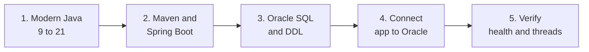

# Session 1: Modern Java, Spring Boot, and Oracle Connectivity

**Track:** Backend · **Day:** 1 of 12 · **Reference:** `solutions` branch → `solutions/day-01/`

Welcome to the first session. Today you set up everything the rest of the programme stands on: a modern Java toolchain, a Spring Boot project, and a live connection to your organization's Oracle database.

By the end of the day you have a running application that reports its own health. Every later session extends this same project, all the way to Day 12.

## Session at a glance

| | |
|---|---|
| **Focus** | JDK 21, Maven, Spring Boot bootstrap, Oracle connectivity |
| **You start with** | An empty folder and a tool checklist |
| **You finish with** | A running `helpdesk-pro` application, three Oracle tables, and a healthy `/actuator/health` |
| **Used again on** | Day 2 (entities), Day 8 (health check and deployment), Day 11 (admin metrics) |

## Why this session matters

Everything after today assumes the foundation is solid. A small mistake here shows up again, several days later, in a harder form.

| What you set up today | Why it matters later |
|---|---|
| JDK 21 and its language features | Records become your DTOs, sealed interfaces model ticket events, and pattern-matching `switch` drives status handling |
| Virtual threads | Request handling with blocking JDBC calls scales differently, which shapes how you think about the API on Day 3 onward |
| Maven and the Spring Boot plugin | The executable JAR you build here is the same artifact you deploy to the on-prem server on Day 8 |
| Hand-written Oracle DDL | Hibernate only validates the schema; Day 2 entities map onto the tables you write today |
| `application.yml` and HikariCP | Day 7 splits this into `dev` and `prod` profiles, and Day 8 loads it on the server |
| `/actuator/health` | It becomes the service health check you call from another machine on the LAN on Day 8 |

## How the day flows

You move from language, to build tool, to database, to a running service. Each stage prepares the next one.

How to read it: the language features go into the Spring Boot project, the project needs the Oracle schema before it can connect, and the final stage proves the whole chain works.

| Stage | You do | You leave with |
|---|---|---|
| **1. Modern Java** | Compare Java 8 style code with Java 17 and 21 features on small examples | Confidence reading and writing records, sealed types, and pattern matching |
| **2. Maven and Spring Boot** | Generate the `helpdesk-pro` project and explore what it contains | A project that builds and starts, and a clear idea of what auto-configuration does |
| **3. Oracle SQL and DDL** | Write `TICKETS`, `USERS`, and `COMMENTS` by hand with sequences and constraints | Three tables in the on-prem schema |
| **4. Connect app to Oracle** | Configure the datasource and HikariCP in `application.yml` | An application with a live connection pool |
| **5. Verify** | Check health, inspect pool metrics, switch on virtual threads | Evidence that every layer works |

## Topics we will cover

### Java 8 to 21, by LTS release

| Release | Topics |
|---|---|
| **Java 9-11** | `var`; `String` methods `isBlank`, `strip`, `repeat`, `lines`; `List.of`, `Set.of`, `Map.of`; `java.net.http.HttpClient`; single-file launch with `java Foo.java` |
| **Java 17** | Records; sealed classes and interfaces; pattern matching for `instanceof`; text blocks; switch expressions with `->` and `yield` |
| **Java 21** | Record patterns; pattern matching for `switch`; sequenced collections; virtual threads |

Applied to the case study: records for DTOs, a sealed interface for the closed set of ticket events, pattern-matching `switch` on ticket status, and text blocks for readable JPQL.

### Virtual threads

What changes for a request-per-thread, I/O-bound application that makes blocking JDBC calls, and how to enable them with `spring.threads.virtual.enabled=true`.

### Moving a Java 8 codebase to 21

Which parts are real blockers (`sun.*` APIs, `javax.*` to `jakarta.*`, libraries that use JDK internals) and which are additive language features you can adopt step by step.

### Maven and Spring Boot

- Dependency scopes and the `spring-boot-maven-plugin`.
- Why the packaged JAR matters for on-prem deployment.
- What `@SpringBootApplication` composes and how auto-configuration selects beans from the classpath.

### Oracle 19c

- Connecting to the existing on-prem instance, schema and user setup, and the `ojdbc11` driver.
- HikariCP pool sizing for a ticket workload.
- SQL essentials: `VARCHAR2`, `NUMBER`, `DATE`/`TIMESTAMP`, `CLOB`, and hand-written DDL for tables, primary keys, and sequences.

## What you build

You start the case study, **HelpDesk Pro**, an internal IT support ticketing system.

- A `helpdesk-pro` Maven project with Web, Data JPA, Oracle driver, Validation, Lombok, and Actuator, under the base package `com.helpdeskpro`.
- `schema.sql` creating `TICKETS`, `USERS`, and `COMMENTS`, each with a `<TABLE>_SEQ` sequence, run once against the on-prem schema.
- `application.yml` with the Oracle host, port, and SID, plus HikariCP tuning.
- A working `/actuator/health` endpoint.

## Hands-on

1. Write the same small class twice: a Java 8 style POJO with hand-written getters, `equals`, `hashCode`, and `toString`, and a Java 17 `record`. Compare the two.
2. Run `SELECT 1 FROM DUAL` in SQL Developer or SQL*Plus, then a basic `SELECT` and `INSERT` against your new tables.
3. Add a health indicator that runs `SELECT 1 FROM DUAL` and find it under `/actuator/health`.
4. Inspect the HikariCP pool through Actuator metrics.
5. Turn virtual threads on, send a request, and compare thread names in the log before and after.

## Outcomes

By the end of the session you can:

- Read and write Java 17 and 21 code using records, sealed interfaces, pattern matching, text blocks, and switch expressions.
- Explain what virtual threads change for blocking JDBC calls, and enable them in Spring Boot.
- Separate real Java 8 to 21 migration blockers from language features you can adopt gradually.
- Create a Maven-based Spring Boot project and explain what `@SpringBootApplication` and auto-configuration do.
- Write Oracle DDL by hand with sequences and constraints, and apply it to the on-prem schema.
- Configure the datasource and HikariCP pool, and confirm the connection is live.

## Before you start

Work through the [setup checklist](01-dev-setup.md) first. It gives a command and an expected result for every tool below.

| Check | Command or action | Expected |
|---|---|---|
| JDK 21 | `java -version` | Reports 21 |
| Maven 3.9 or later | `mvn -version` | Runs on Java 21 |
| Git | `git --version` | Prints a version |
| IDE with Java and Spring support | Open IntelliJ IDEA or VS Code | Recognises a Maven project |
| Oracle access | Connect with SQL Developer or SQL*Plus using your schema credentials | Connection succeeds |

> **Note:** Everything runs on your organization's network. The database is the existing on-prem Oracle 19c instance, and nothing you build is exposed to the internet.

## State at end of session

Use this list to compare your project with the reference solution.

| Item | What should exist |
|---|---|
| Project | `helpdesk-pro` on JDK 21 and Spring Boot 3.2 or later, with `jakarta.*` imports only |
| Package | `com.helpdeskpro` |
| Tables | `TICKETS`, `USERS`, `COMMENTS` |
| Sequences | `TICKETS_SEQ`, `USERS_SEQ`, `COMMENTS_SEQ` |
| Config | `application.yml` with Oracle datasource and HikariCP settings; the password comes from `${DB_PASSWORD}`, never a committed value |
| Endpoint | `GET /actuator/health` returns `UP` and includes the database check |
| Setting | `spring.jpa.hibernate.ddl-auto` is `validate` or `none` |

## What comes next

Session 2 (Day 2) maps these three tables to JPA entities and covers the persistence context, lazy loading, and the N+1 problem. It starts from the project you finish today.
