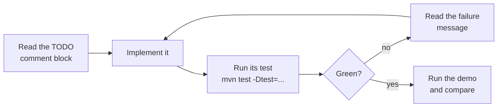

# Step 1 — How the lab works

> [Back to index](README.md) · Previous: [Step 0 — Setup](00-setup.md) · Next: [Step 2 — Records](02-records.md)

This step explains how the project is organized and how you work through it. You do not change any code here.

## What you are working with

The project has three kinds of code:

| Kind | What it is | What you do with it |
|---|---|---|
| **Demo** | A class with `main` that prints what a feature does | Run it, then change it and run it again |
| **Provided** | Working code, such as `TicketRow` or `labelJava8Style` | Read it and compare it with the new feature |
| **TODO** | A method or record body that throws `UnsupportedOperationException("TODO n.n: ...")` | Implement it so its tests pass |

Every TODO has an ID such as `1.1` and a comment block above it that states the contract and the hints. The ID appears in the exception message, in the demo output, and in the comment on the test that checks it.

## One package per feature

Packages are named after the feature they practise, so you can find a feature by name and the same names carry over to the Spring Boot project.

| Walkthrough step | Package | Demo class | TODOs | Test class |
|---|---|---|---|---|
| 2 | `records` | `RecordsDemo` | 1.1, 1.2 | `TicketSummaryTest`, `TicketSummaryMapperTest` |
| 3 | `sealedtypes` | `SealedTypesDemo` | none | none |
| 4 | `patternmatching` | `PatternMatchingDemo` | 2.1, 2.2 | `EventPatternsTest` |
| 5 | `switchexpressions` | `SwitchExpressionsDemo` | 3.1, 3.2 | `StatusLabelsTest` |
| 6 | `textblocks` | `TextBlocksDemo` | 4.1 | `TicketQueriesTest` |
| 7 | `virtualthreads` | `VirtualThreadsLab` | 5.1 | `VirtualThreadsLabTest` |

The `domain` package holds the shared `TicketStatus` enum. It is provided and has nothing to implement.

All classes live under `src/main/java/com/helpdeskpro/lab/` and `src/test/java/com/helpdeskpro/lab/`.

## The TODO loop



How to read it: the failure message tells you which TODO or which assertion is wrong, so you never have to guess. Once a test is green, run the demo to see the feature behave.

## Commands you will use

| Goal | Command |
|---|---|
| Run every test | `mvn test` |
| Run one test class | `mvn test -Dtest=TicketSummaryTest` |
| Run tests of one TODO | `mvn test -Dtest='EventPatternsTest#assignee*'` |
| Compile before running a demo | `mvn -q compile` |
| Run a demo | `java -cp target/classes com.helpdeskpro.lab.records.RecordsDemo` |

You can also run any demo's `main` from your IDE's run gutter. Both ways give the same output.

> **Note:** Quote the `-Dtest` value when it contains `#` or `*`, so your shell does not interpret it.

## Try it

Run the first demo to see what a TODO message looks like before you implement anything:

```bash
mvn -q compile
java -cp target/classes com.helpdeskpro.lab.records.RecordsDemo
```

**Expected:**

```text
row equals sameRow:         false
summary equals sameSummary: true
summary:                    TicketSummary[id=101, title=Printer jam, status=OPEN]
row title after change:     Printer on fire
summary title after change: Printer jam
blank title: accepted (complete TODO 1.1 to reject it)
zero id: accepted (complete TODO 1.1 to reject it)
TODO 1.2: implement toSummaries
```

The last three lines are the demo calling your TODOs and printing their hints instead of failing. They change as you complete them.

Next: **[Step 2 — Records](02-records.md)**.
