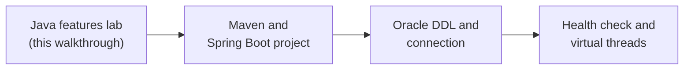

# Java features lab walkthrough

A hands-on walkthrough for [java-features-lab](../java-features-lab/README.md): you run provided demos, change them, and implement eight small TODOs that a test checks for you.

The lab covers the Java features that show up most in a Spring Boot application, and skips the rest.

## What you will build

You complete **eight TODOs** across five feature packages of the `java-features-lab` project:

| TODO | Package | What you implement | Feature |
|---|---|---|---|
| 1.1 | `records` | `TicketSummary` validation | Records and compact constructors |
| 1.2 | `records` | `TicketSummaryMapper.toSummaries` | Mapping entities to DTOs with `Stream.toList()` |
| 2.1 | `patternmatching` | `EventPatterns.assigneeOf` | Pattern matching for `instanceof` |
| 2.2 | `patternmatching` | `EventPatterns.describe` | Record patterns and `switch` over a sealed type |
| 3.1 | `switchexpressions` | `StatusLabels.label` | Switch expressions |
| 3.2 | `switchexpressions` | `StatusLabels.slaMessage` | `switch` with a block and `yield` |
| 4.1 | `textblocks` | `TicketQueries.byStatusAndPriority` | Text blocks |
| 5.1 | `virtualthreads` | `VirtualThreadsLab.runWithVirtualThreads` | Virtual threads |

The `sealedtypes` package has no TODO. You run it and experiment with it, because the `patternmatching` TODOs depend on it.

Everything else in the project is provided, so you spend your time on the features and not on scaffolding.

## Prerequisites

- JDK 21 and Maven 3.9 or later. Use the [setup checklist](../../notes/01-dev-setup.md) to confirm both.
- The [Java 8 to 21 note](../../notes/03-java-8-to-21.md) is the reference for every feature used here. Keep it open.
- About **80 minutes**, plus the exercises in the last step.

> **Note:** Everything runs on your machine. Nothing in this lab is exposed to the internet.

## Steps

| Step | File | What you will add | Est. time |
|---|---|---|---|
| 0 | [00-setup.md](00-setup.md) | Build the project and watch the tests fail | 10 min |
| 1 | [01-how-the-lab-works.md](01-how-the-lab-works.md) | The TODO loop, the project map, and the commands you use | 5 min |
| 2 | [02-records.md](02-records.md) | TODO 1.1 and 1.2 | 15 min |
| 3 | [03-sealed-types.md](03-sealed-types.md) | No TODO; experiments with a closed hierarchy | 8 min |
| 4 | [04-pattern-matching.md](04-pattern-matching.md) | TODO 2.1 and 2.2 | 15 min |
| 5 | [05-switch-expressions.md](05-switch-expressions.md) | TODO 3.1 and 3.2 | 10 min |
| 6 | [06-text-blocks.md](06-text-blocks.md) | TODO 4.1 | 7 min |
| 7 | [07-virtual-threads.md](07-virtual-threads.md) | TODO 5.1 | 10 min |
| 8 | [08-recap-and-exercises.md](08-recap-and-exercises.md) | Quick reference, questions, and exercises | 15 min |

## Relationship to the project

The code you work in is [../java-features-lab/](../java-features-lab/), and the walkthrough's file listings are copied from it.

- Each step ends with a **Checkpoint** that lists the file you edit exactly as it is provided. Your version should differ from it **only inside the TODO**. If something breaks, restore the file from the listing and try again.
- There is no completed version of the TODOs in this folder. The tests are your check.

## Where this fits

This lab is the language stage of Session 1. The next stages build the Maven and Spring Boot project that uses these features.

Start with [Step 0 — Setup](00-setup.md).
