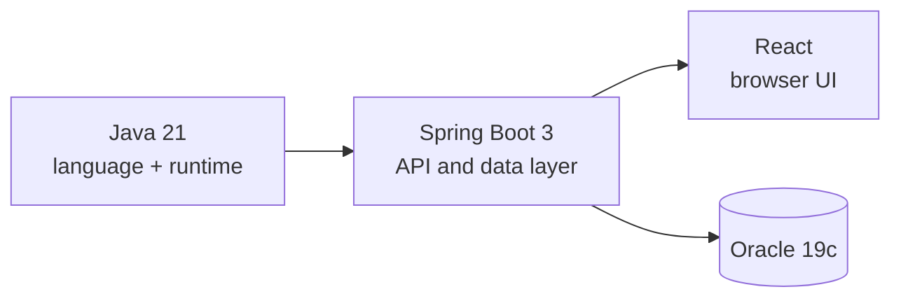
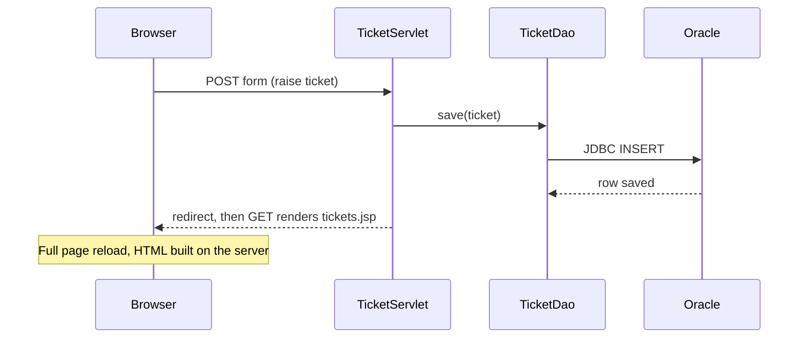
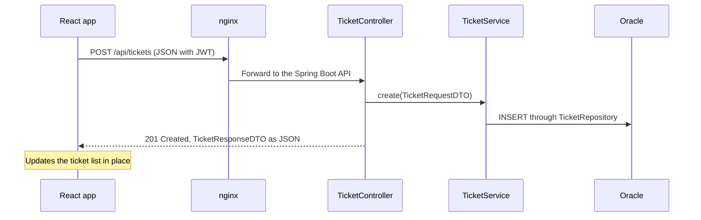

# Why Java 21, Spring Boot, and React

This programme builds one application on **Java 21**, **Spring Boot 3**, and **React**. This note explains the reasoning: what each choice gives you that a Servlet/JSP application does not, what it costs, and what stays the same.

The goal is a decision you can explain, not a slogan. Each section ends with what it means for HelpDesk Pro, the ticketing system you build over the 12 days.

## The decision at a glance

| Concern | Servlet/JSP application | Java 21 + Spring Boot + React |
|---|---|---|
| Language | Java 8 style: explicit getters, anonymous classes, verbose null and type checks | Records, sealed types, pattern matching, text blocks, virtual threads |
| Project setup | `web.xml`, manual dependency wiring, external Tomcat | Starters, auto-configuration, embedded server |
| Database access | Hand-written JDBC, or a DAO per table | Spring Data JPA repositories, Hibernate, HikariCP |
| Request handling | One servlet or a front controller you maintain | `@RestController`, `@Valid`, `@ControllerAdvice` |
| Security | Custom filters and `HttpSession` | Spring Security 6 filter chain, BCrypt, stateless JWT |
| UI | JSP renders full pages on the server | React renders in the browser and calls a JSON API |
| Packaging | WAR deployed into a separately managed Tomcat | One executable JAR run as a `systemd` service |
| Operations | Add your own health and metrics pages | Actuator: `/actuator/health`, metrics, readiness |



How to read it: each layer is replaceable on its own. The API in the middle is what lets the UI and the database change independently.

---

## 1. Why Java 21

### It is a long-term support release

Java 8, 11, 17, and 21 are long-term support (LTS) releases. Between them, every feature release adds language and runtime capabilities. Moving to 21 gives you everything added since Java 8 on a release that vendors keep patching.

**Spring Boot 3 sets the floor.** Spring Framework 6 and Spring Boot 3 require **Java 17 or later**. Java 21 is the LTS above that floor, and the one the programme pins in the `pom.xml`.

### What you gain, mapped to the case study

| Feature | Since | Where HelpDesk Pro uses it |
|---|---|---|
| `var`, `List.of`, `isBlank`, `strip` | 9 to 11 | Less ceremony in service and test code |
| Records | 16 (first LTS: 17) | `TicketRequestDTO` and `TicketResponseDTO` |
| Sealed interfaces | 17 | The closed set of ticket events |
| Pattern matching for `instanceof` | 16 (first LTS: 17) | Removes cast-after-check code |
| Text blocks | 15 (first LTS: 17) | Readable multi-line JPQL and SQL |
| Switch expressions | 14 (first LTS: 17) | Status handling without fall-through bugs |
| Record patterns, pattern matching for `switch` | 21 | Exhaustive handling of ticket status and events |
| Virtual threads | 21 | Blocking JDBC calls without a large platform-thread pool |

### Virtual threads change the cost of blocking

A Servlet or Spring MVC application assigns one thread per request, and that thread waits while Oracle answers. Platform threads are expensive, so the pool size caps how many requests wait at once.

Virtual threads are cheap enough to create one per request. With Spring Boot 3.2 or later, one property turns them on:

```yaml
spring:
  threads:
    virtual:
      enabled: true
```

The code stays blocking and readable. You do not have to move to a reactive style to get higher concurrency on I/O-bound work such as ticket queries.

> **Note:** Virtual threads help when threads spend their time waiting on I/O. They do not make CPU-heavy work faster. You measure the difference on Day 1.

### Language features are additive

You do not have to rewrite working code to run on Java 21. Records, sealed types, and pattern matching are opt-in; existing classes keep compiling. What can actually block a move is covered under [What really blocks an upgrade](#what-really-blocks-an-upgrade).

---

## 2. Why Spring Boot

### Same servlet container, less wiring

Spring MVC is built on the Servlet API. `DispatcherServlet` is a servlet, and the embedded Tomcat is a servlet container. The Servlet/JSP concepts carry over; what changes is how much of the plumbing you write.

| Servlet/JSP concept | Spring Boot equivalent |
|---|---|
| `HttpServlet.doGet` / `doPost` | `@GetMapping` / `@PostMapping` |
| `request.getParameter("id")` | `@PathVariable`, `@RequestParam`, `@RequestBody` |
| `web.xml` mappings | Annotations and `application.yml` |
| `Filter` | `OncePerRequestFilter` in the Spring Security chain |
| `HttpSession` for login state | Stateless JWT in the `Authorization` header |
| `ServletContextListener` | `@Configuration` beans, `ApplicationRunner` |
| Hand-managed `Connection` | `DataSource` backed by HikariCP |
| JSP + JSTL | React components (or Thymeleaf, see the supplementary segment) |

### The same endpoint, two styles

Listing tickets as a Servlet/JSP page:

```java
@WebServlet("/tickets")
public class TicketServlet extends HttpServlet {
    @Override
    protected void doGet(HttpServletRequest req, HttpServletResponse resp)
            throws ServletException, IOException {
        List<Ticket> tickets = new TicketDao().findAll();   // JDBC inside the DAO
        req.setAttribute("tickets", tickets);
        req.getRequestDispatcher("/WEB-INF/tickets.jsp").forward(req, resp);
    }
}
```

Listing tickets as a Spring Boot endpoint:

```java
@RestController
@RequestMapping("/tickets")
public class TicketController {
    private final TicketService service;

    public TicketController(TicketService service) { this.service = service; }

    @GetMapping
    public List<TicketResponseDTO> list() { return service.findAll(); }
}
```

The second class is not shorter by accident. Parsing, JSON conversion, validation, error mapping, and the database layer are handled by framework pieces you configure instead of code you write and maintain.

### What Spring Boot adds beyond less code

| Capability | Why it matters for HelpDesk Pro |
|---|---|
| Auto-configuration | Add `ojdbc11` and the datasource settings and a pooled connection exists; no manual factory code |
| Spring Data JPA | `TicketRepository` gives you CRUD, paging, and Specifications (Day 5) |
| `@Transactional` | Ticket state changes and comments commit or roll back together (Day 4) |
| Bean Validation | One consistent `ApiError` for bad payloads (Day 3) |
| Spring Security | Role-based access for `EMPLOYEE`, `AGENT`, and `ADMIN` (Day 6) |
| Actuator | The health check you call from another LAN machine on Day 8 |
| Test slices | `@WebMvcTest` and `@DataJpaTest` test one layer at a time (Day 7) |

### Packaging suits on-prem deployment

A WAR needs a Tomcat that someone installs, versions, and patches separately. A Spring Boot application is one executable JAR with the server inside it:

```bash
mvn clean package
java -jar target/helpdesk-pro.jar
```

On Day 8 that JAR runs as a `systemd` service behind nginx. Everything stays on your organization's network and nothing is exposed to the internet.

### Spring Boot 3 uses `jakarta.*`

Spring Boot 3 moved from `javax.*` to `jakarta.*` packages, which follows the Jakarta EE namespace change. In practice, every import in this programme is `jakarta.persistence`, `jakarta.validation`, or `jakarta.servlet`. Spring Boot 2.x no longer receives open-source updates, so new work targets 3.x.

---

## 3. Why React

### Two ways to raise a ticket

The same action, drawn for each approach.

**Servlet/JSP: the server builds the page**



**React: the browser builds the page from JSON**



How to read them: in the first, one server component produces HTML and every action reloads the page. In the second, the API only exchanges data, and the UI decides how to show it.

### JSP and React compared

| | JSP (server-rendered) | React (client-rendered) |
|---|---|---|
| Who builds the HTML | The server, per request | The browser, from JSON |
| Page updates | Full reload | Only the changed component |
| Logic and markup | Mixed in the same file unless you discipline it | Components with props and state, separate from the API |
| Reuse | Includes and tags | Components such as `TicketCard` and `TicketList` |
| Testing the UI | Needs a running container | Component tests run without a server |
| Clients supported | Browsers only | Any client that can call the API |
| API reuse | Business logic is tied to page flow | The same API serves React now and other tools later |

### Where HelpDesk Pro needs it

- **Agent queue.** An agent picks up a ticket and the row updates in place, without losing their place in the list.
- **Ticket detail.** Comments, status, and the transition control change independently on one screen.
- **Role-based views.** `EMPLOYEE`, `AGENT`, and `ADMIN` see different screens built from the same components.
- **Admin dashboard.** Counts by status and priority, plus the SLA-breach count, come from `GET /admin/metrics` and render as soon as data arrives.
- **One API, many screens.** The backend you finish on Day 8 is the same one the plain HTML client (Day 9) and the React app (Days 10 and 11) call.

---

## 4. What it costs

None of these choices is free. Know the trade-offs before you accept them.

| Cost | What it means | How the programme handles it |
|---|---|---|
| More concepts | Auto-configuration and annotations hide behaviour | Day 1 opens up `@SpringBootApplication` and auto-configuration |
| Two codebases | Backend and UI build and deploy separately | Day 12 serves both from one nginx server block |
| Frontend toolchain | Node.js, npm, and a build step | Introduced on Day 10 with Vite |
| Browser-to-API security | CORS and token handling | Day 9 adds CORS; Day 6 defines the JWT model |
| Hidden SQL | JPA can generate surprising queries | Day 2 shows N+1 through SQL logging, with the fix |

## 5. When Servlet/JSP is still a sound choice

A Servlet/JSP application is a reasonable fit when all of these hold:

- A small set of server-rendered pages with little interactivity.
- A single browser client and no plan for another.
- An existing, stable application where the cost of change is higher than the benefit.

For internal tools with a few forms and tables, server-side rendering with Thymeleaf on Spring Boot is also an option. The supplementary JSP and Thymeleaf segment compares them against the same `TicketService`.

HelpDesk Pro does not fit that profile: three roles, a state machine, SLA tracking, and live dashboards. That is why the case study uses REST and React.

---

## What really blocks an upgrade

When a Java 8 codebase moves to 21, these are the real blockers. The language features are not.

| Blocker | What happens | Fix |
|---|---|---|
| `javax.*` to `jakarta.*` | Spring Boot 3 and Tomcat 10 no longer load `javax.servlet`, `javax.persistence`, or `javax.validation` types | Update imports and dependency versions |
| `sun.*` and internal JDK APIs | Strong encapsulation blocks reflective access | Replace with supported APIs or upgrade the library |
| Libraries using JDK internals | Older versions fail at start-up or runtime | Move to a release that supports 17 or 21 |
| Removed APIs and modules | Code compiled against Java 8 may reference classes that no longer exist | Replace with the supported alternative |

You adopt records, sealed types, and pattern matching one class at a time, after the build runs on 21.

---

## Recap

- **Java 21** is an LTS release above Spring Boot 3's Java 17 floor, with records, sealed types, pattern matching, and virtual threads that fit the case study directly.
- **Spring Boot** keeps the Servlet model you know and replaces hand-written plumbing with configuration, a data layer, security, and Actuator, packaged as one JAR for on-prem deployment.
- **React** moves rendering to the browser so one JSON API serves several role-based screens without page reloads.
- The costs are real: more concepts, two codebases, and a frontend toolchain. Each one has a day in the programme that deals with it.

## Check yourself

1. Which version of Java does Spring Boot 3 require at minimum, and which LTS does this programme use?
2. Name three Servlet/JSP concepts and their Spring Boot equivalents.
3. What do virtual threads change for a request that waits on a blocking JDBC call, and when do they not help?
4. Why does returning JSON instead of HTML make a second client easier to add?
5. Which items in the blockers table apply to a Java 8 codebase, and which language features do not?
