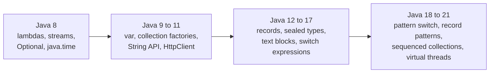

# Java 8 to 21: essential features and improvements

Between Java 8 and Java 21 there are three further long-term support (LTS) releases (11, 17, and 21) and many feature releases in between. Most of what changed is additive: you can keep writing Java 8 style code and adopt each feature when it helps.

This note covers the features you use in HelpDesk Pro, grouped by theme and release. The comparisons start from the Java 8 feature set (lambdas, streams, `Optional`, `java.time`).



How to read it: each box lists the headline features that became final in that range. Features arrive as previews first, so some appear one or two releases before the version listed here.

| Release | LTS | What it is remembered for |
|---|---|---|
| **Java 8** | Yes | Lambdas, streams, `Optional`, `java.time` |
| **Java 11** | Yes | `var`, the `String` API, standard `HttpClient`, single-file launch |
| **Java 17** | Yes | Records, sealed types, text blocks, switch expressions, pattern matching for `instanceof` |
| **Java 21** | Yes | Virtual threads, pattern matching for `switch`, record patterns, sequenced collections |

> **Note:** Spring Boot 3 needs Java 17 or later, and this programme targets Java 21. You never need to learn the intermediate releases one by one; the sections below are organized by what you write, not by release number.

---

## 1. Everyday API: Java 9 to 11

### `var` for local variables (Java 10)

The compiler infers the type from the right-hand side. The variable is still statically typed.

```java
// Java 8 style
Map<String, List<String>> byAssignee = new HashMap<String, List<String>>();

// Java 10+
var byAssignee = new HashMap<String, List<String>>();
```

Use `var` when the right-hand side already shows the type. Avoid it when the type would be hidden:

```java
var result = service.process(request);   // what type is this? keep the explicit type here
```

`var` works only for local variables, not fields, parameters, or return types.

### Collection factories (Java 9)

```java
// Java 8 style
List<String> priorities =
        Collections.unmodifiableList(Arrays.asList("LOW", "MEDIUM", "HIGH"));

// Java 9+
List<String> priorities = List.of("LOW", "MEDIUM", "HIGH");
Map<String, Integer> hours = Map.of("HIGH", 4);
```

| Behaviour | `List.of`, `Set.of`, `Map.of` |
|---|---|
| Mutable? | No. `add` or `put` throws `UnsupportedOperationException` |
| `null` elements | Rejected with `NullPointerException` |
| Duplicates in `Set.of` and `Map.of` | Rejected with `IllegalArgumentException` |
| Iteration order of `Set.of` and `Map.of` | Unspecified, and can differ between runs |

> **Warning:** `Collections.unmodifiableList(...)` is a read-only *view* of a list that someone else can still change. `List.of(...)` is truly immutable.

### `String` methods (Java 11)

| Method | Does | Example result |
|---|---|---|
| `isBlank()` | `true` for empty or whitespace-only strings | `"   ".isBlank()` is `true` |
| `strip()` | Removes leading and trailing whitespace, Unicode-aware | `"  hi ".strip()` is `"hi"` |
| `repeat(n)` | Repeats the string | `"ab".repeat(3)` is `"ababab"` |
| `lines()` | Splits on line breaks into a `Stream<String>` | `"a\nb\nc".lines().count()` is `3` |
| `formatted(...)` (Java 15) | Instance form of `String.format` | `"Ticket %d".formatted(42)` |

`isBlank()` is the check you want for a ticket title. `trim().isEmpty()` does the same job less clearly.

### `HttpClient` (standard in Java 11)

`java.net.http.HttpClient` replaces `HttpURLConnection` with a builder-style API.

```java
HttpClient client = HttpClient.newHttpClient();
HttpRequest request = HttpRequest
        .newBuilder(URI.create("http://localhost:8080/actuator/health"))
        .GET()
        .build();

HttpResponse<String> response =
        client.send(request, HttpResponse.BodyHandlers.ofString());
System.out.println(response.statusCode() + " " + response.body());
```

It supports HTTP/2, timeouts, and asynchronous calls (`sendAsync`). You can use it to call `/actuator/health` from a small Java program once the application runs.

### Single-file source launch (Java 11)

Run one `.java` file without a separate compile step:

```bash
java Check.java
```

The launcher compiles in memory and runs `main`. You use this for every small example in Session 1.

### Smaller additions worth knowing

| Addition | Since | Replaces |
|---|---|---|
| `Stream.toList()` | 16 | `collect(Collectors.toList())` |
| `takeWhile` / `dropWhile` on streams | 9 | A manual loop with a `break` |
| `Optional.ifPresentOrElse(...)` | 9 | `if (opt.isPresent()) ... else ...` |
| `Optional.orElseThrow()` with no argument | 10 | `opt.get()` without a check |
| `Predicate.not(...)` | 11 | `x -> !x.isBlank()` |
| `Files.readString` / `Files.writeString`, `Path.of` | 11 | Reader and writer boilerplate |
| `Objects.requireNonNullElse(a, b)` | 9 | `a != null ? a : b` |
| `Collectors.teeing(...)` | 12 | Two passes over the same stream |

> **Note:** `Stream.toList()` returns an unmodifiable list. If you need to add to the result, use `collect(Collectors.toCollection(ArrayList::new))`.

---

## 2. Modelling data and control flow: Java 12 to 17

### Records (final in Java 16)

A record is a class that exists to carry data. You declare the components; the compiler generates the constructor, accessors, `equals`, `hashCode`, and `toString`.

```java
public record Money(BigDecimal amount, String currency) {
    public Money {                       // compact constructor: validate here
        Objects.requireNonNull(amount);
        if (currency.length() != 3) {
            throw new IllegalArgumentException("ISO currency code expected");
        }
    }
}
```

| | Java 8 style POJO | `record` |
|---|---|---|
| Fields | `private final` fields you declare | Generated from the component list |
| Constructor | Written by hand | Generated, with an optional compact form for validation |
| Accessors | `getAmount()` | `amount()` |
| `equals`, `hashCode`, `toString` | Written or generated by the IDE | Generated, based on all components |
| Mutability | Setters possible | Immutable |

Records are a good fit for DTOs and value objects, which is why `TicketRequestDTO` and `TicketResponseDTO` are records.

> **Warning:** A record cannot be a JPA entity. Entities need a no-argument constructor, non-final fields, and mutable state that Hibernate manages. Day 2 covers entities; use records for the data you send and receive.

### Sealed classes and interfaces (final in Java 17)

A sealed type lists exactly which types may extend it. The compiler then knows the set is closed.

```java
public sealed interface Notification permits EmailNotice, SmsNotice, PushNotice {}

public record EmailNotice(String address, String subject) implements Notification {}
public record SmsNotice(String number) implements Notification {}
public record PushNotice(String deviceId) implements Notification {}
```

A new implementation anywhere else is a compile error. Combined with a `switch` (see section 3), this removes the "forgot to handle the new case" bug. On Day 1 you apply the same idea to the closed set of ticket events.

### Pattern matching for `instanceof` (Java 16)

```java
// Java 8 style
if (obj instanceof EmailNotice) {
    EmailNotice e = (EmailNotice) obj;
    send(e.address());
}

// Java 16+
if (obj instanceof EmailNotice e) {
    send(e.address());
}
```

The test, the cast, and the variable declaration become one step.

### Text blocks (Java 15)

Use text blocks for multi-line SQL and JPQL.

```java
// Java 8 style
String jpql = "SELECT t FROM Ticket t " +
              "WHERE t.status = :status " +
              "AND t.priority = :priority " +
              "ORDER BY t.dueBy";

// Java 15+
String jpql = """
        SELECT t FROM Ticket t
        WHERE t.status = :status
          AND t.priority = :priority
        ORDER BY t.dueBy
        """;
```

- Incidental indentation is removed. The position of the closing `"""` decides how much is stripped.
- A closing `"""` on its own line adds a trailing newline to the string.
- Quotes inside the block need no escaping.

### Switch expressions (Java 14)

A `switch` can produce a value. Arrow labels do not fall through, and several constants share one label.

```java
// Java 8 style
String label;
switch (status) {
    case OPEN:
    case REOPENED:
        label = "Waiting";
        break;
    default:
        label = "In progress";
}

// Java 14+
String label = switch (status) {
    case OPEN, REOPENED -> "Waiting";
    case RESOLVED -> {
        String when = LocalDate.now().toString();
        yield "Resolved on " + when;      // yield returns a value from a block
    }
    default -> "In progress";
};
```

When the switch is over an `enum` and has no `default`, the compiler checks that every constant is covered. Adding a constant to the `enum` later turns every incomplete switch into a compile error.

### Helpful `NullPointerException` messages (Java 14, on by default from 15)

The message now says what was null:

```text
Cannot invoke "String.trim()" because the return value of "Ticket.getTitle()" is null
```

You get this with no code change.

---

## 3. Pattern matching and concurrency: Java 18 to 21

### Pattern matching for `switch` and record patterns (Java 21)

A `switch` can test the *type* of a value and take it apart in the same step. On a sealed type with no `default`, the compiler checks that every permitted subtype is handled.

```java
static String describe(Notification n) {
    return switch (n) {
        case EmailNotice(String address, String subject) -> "Email to " + address + ": " + subject;
        case SmsNotice(String number)                    -> "SMS to " + number;
        case PushNotice p                                -> "Push to " + p.deviceId();
    };
}
```

| Piece | Meaning |
|---|---|
| `case PushNotice p` | Type pattern: matches and binds `p` |
| `case EmailNotice(String address, String subject)` | Record pattern: matches and extracts the components |
| `case EmailNotice e when e.subject().isBlank()` | Guard: an extra condition on the pattern |
| `case null` | Handle `null` explicitly instead of getting an exception |

Order matters. Put specific cases before general ones, or the compiler reports `this case label is dominated by a preceding case label`.

If you add a fourth `Notification` implementation, `describe` stops compiling until you handle it. That is the point.

### Sequenced collections (Java 21)

Collections with a defined order now share one API for the first and last element.

```java
List<String> events = new ArrayList<>(List.of("OPENED", "ASSIGNED", "RESOLVED"));

events.getFirst();    // "OPENED"
events.getLast();     // "RESOLVED"
events.reversed();    // a reverse-order view: RESOLVED, ASSIGNED, OPENED
```

| Interface | Implemented by | New methods |
|---|---|---|
| `SequencedCollection` | `List`, `Deque`, `LinkedHashSet`, `SortedSet` | `getFirst`, `getLast`, `addFirst`, `addLast`, `removeFirst`, `removeLast`, `reversed` |
| `SequencedSet` | `LinkedHashSet`, `SortedSet` | Same, with set semantics |
| `SequencedMap` | `LinkedHashMap`, `SortedMap` | `firstEntry`, `lastEntry`, `putFirst`, `putLast`, `reversed` |

Before Java 21 the last element of a `List` was `list.get(list.size() - 1)`, and a `LinkedHashSet` had no direct way to get it at all.

> **Warning:** `getFirst()` and `getLast()` on an empty collection throw `NoSuchElementException`.

### Virtual threads (final in Java 21)

A virtual thread is a lightweight thread managed by the JVM. When it blocks on I/O, the JVM parks it and lets the underlying platform thread run something else.

```java
Thread.ofVirtual().name("vt-demo").start(() ->
        System.out.println(Thread.currentThread()));

try (var executor = Executors.newVirtualThreadPerTaskExecutor()) {
    for (int i = 0; i < 1_000; i++) {
        executor.submit(() -> {
            Thread.sleep(Duration.ofMillis(100));
            return null;
        });
    }
}   // close() waits for the submitted tasks
```

Output of the first call looks like this. The number in brackets will differ:

```text
VirtualThread[#29,vt-demo]/runnable@ForkJoinPool-1-worker-1
```

Everything is ordinary blocking code, which keeps stack traces and debugging familiar. Session 1 covers what this means for blocking JDBC calls, and how Spring Boot enables it with `spring.threads.virtual.enabled=true`.

### Smaller additions

| Addition | Since | Notes |
|---|---|---|
| UTF-8 as the default charset | 18 | File reading no longer depends on the operating system's locale |
| `jwebserver` | 18 | Serves a folder of static files over HTTP; handy for trying a plain HTML page |
| `Math.clamp(value, min, max)` | 21 | Replaces `Math.min(max, Math.max(min, value))` |
| `StringBuilder.repeat(...)` | 21 | Append a string several times |

> **Note:** Java 21 contains *preview* features such as string templates and unnamed patterns. They need `--enable-preview` and can still change. This programme does not use them.

---

## 4. Runtime improvements you get without changing code

Moving to a newer JDK improves the platform even if you write no new syntax.

| Improvement | Since | Why it matters |
|---|---|---|
| G1 as the default garbage collector | 9 | Lower pause times than the Java 8 default for typical server heaps |
| Compact strings | 9 | Less memory for strings that contain only Latin-1 characters |
| Default class-data sharing archive | 12 | Faster start-up of the JVM |
| Java Flight Recorder in the open JDK | 11 | Built-in profiling you run on the server itself, with no extra service |
| Helpful `NullPointerException` messages | 14 | Faster diagnosis from a log line |
| ZGC production-ready | 15 | Low-pause collector available through `-XX:+UseZGC` |
| Generational ZGC | 21 | Enabled with `-XX:+UseZGC -XX:+ZGenerational` |

## 5. What to watch when moving from Java 8

The additions above are opt-in. These changes can break existing code, so check for them first:

| Change | Since | Effect |
|---|---|---|
| Java EE and CORBA modules removed from the JDK (JAXB, JAX-WS, `javax.activation`, and others) | 11 | Code using them needs an explicit dependency |
| Nashorn JavaScript engine removed | 15 | Scripts run through `ScriptEngine` stop working |
| Strong encapsulation of JDK internals | 16 and 17 | Reflective access to `sun.*` and other internals fails by default |
| Security Manager deprecated for removal | 17 | Code depending on it needs another approach |
| `finalize()` deprecated for removal | 18 | Move to `try`-with-resources or `Cleaner` |

The `javax.*` to `jakarta.*` change belongs to Spring Boot 3, not the JDK. It is covered in the previous note.

---

## 6. Where HelpDesk Pro uses each feature

| Feature | Where you use it | Day |
|---|---|---|
| `var`, collection factories | Test data and constants | 1 onward |
| `isBlank()`, `strip()` | Checking ticket titles and comment text | 1 and 3 |
| `HttpClient` | Calling `/actuator/health` from a small program | 1 |
| Records | `TicketRequestDTO`, `TicketResponseDTO`, value objects | 1 and 3 |
| Sealed interface | The closed set of ticket events | 1 |
| Pattern matching for `switch` | Handling ticket status and events | 1 and 4 |
| Switch expressions | Mapping status to labels and allowed transitions | 4 |
| Text blocks | Multi-line JPQL and native SQL | 2 and 5 |
| Sequenced collections | The latest comment on `Ticket.comments` | 2 and 3 |
| Virtual threads | Request handling with blocking JDBC calls | 1 |

---

## Try it

Create `Features.java`. It uses a sealed interface, records, a record-pattern `switch`, and `getLast()`.

```java
import java.util.List;

public class Features {
    sealed interface Notification permits Email, Sms {}
    record Email(String address) implements Notification {}
    record Sms(String number) implements Notification {}

    public static void main(String[] args) {
        List<Notification> notices = List.of(new Email("agent@helpdesk.example"), new Sms("+00-000000"));
        for (var notice : notices) {
            String text = switch (notice) {
                case Email(var address) -> "Email to " + address;
                case Sms(var number)    -> "SMS to " + number;
            };
            System.out.println(text);
        }
        System.out.println("Last: " + notices.getLast());
    }
}
```

```bash
java Features.java
```

**Expected:**

```text
Email to agent@helpdesk.example
SMS to +00-000000
Last: Sms[number=+00-000000]
```

Then change the sealed interface to `permits Email, Sms, Push`, add a `Push` record, and run it again. The compiler tells you the `switch` no longer covers every case.

## Common pitfalls

| Symptom | Likely cause | Fix |
|---|---|---|
| `UnsupportedOperationException` when adding to a list | The list came from `List.of`, `Stream.toList()`, or `Collections.unmodifiableList` | Copy into `new ArrayList<>(...)` first |
| `NullPointerException` from `List.of` or `Map.of` | A `null` element or value | Remove the `null`, or use `Arrays.asList` / `HashMap` |
| `Map.of` or `Set.of` prints in a different order on another run | Iteration order is unspecified | Use `LinkedHashMap` / `LinkedHashSet` when order matters |
| `this case label is dominated by a preceding case label` | A general pattern comes before a specific one | Reorder: most specific first |
| `switch expression does not cover all possible input values` | A new `enum` constant or sealed subtype is not handled | Add the case; this is the check working as intended |
| `... is a preview feature and is disabled by default` | You used a feature that is preview in this release | Remove it; this programme does not use preview features |
| Record fails as a JPA entity | Records are immutable and have no no-argument constructor | Keep entities as classes; use records for DTOs |
| Warning about dynamically loading an agent when running Mockito tests on JDK 21 | JDK 21 warns when a library attaches an agent at run time | A warning, not an error; tests still run |

## Recap

- **Java 9 to 11:** `var`, immutable collection factories, the `String` API, `HttpClient`, and single-file launch make everyday code shorter and safer.
- **Java 12 to 17:** records, sealed types, text blocks, switch expressions, and pattern matching for `instanceof` let you model data and control flow directly.
- **Java 18 to 21:** pattern matching for `switch`, record patterns, sequenced collections, and virtual threads close the remaining gaps, and the compiler checks closed hierarchies for you.
- **Runtime:** a newer JDK improves start-up, memory use, garbage collection, and diagnostics without code changes.
- **Moving over:** the real blockers are removed modules, locked-down JDK internals, and libraries that rely on them. Language features can be adopted one class at a time.

## Check yourself

1. What does `List.of(...)` give you that `Collections.unmodifiableList(Arrays.asList(...))` does not?
2. Why can't a record be a JPA entity, and where would you use a record instead?
3. What does the compiler do when you add a new subtype to a sealed interface that a `switch` over it does not handle?
4. Which parts of the text block's source text are removed as incidental indentation, and what controls that?
5. What does `getLast()` do on an empty list?
