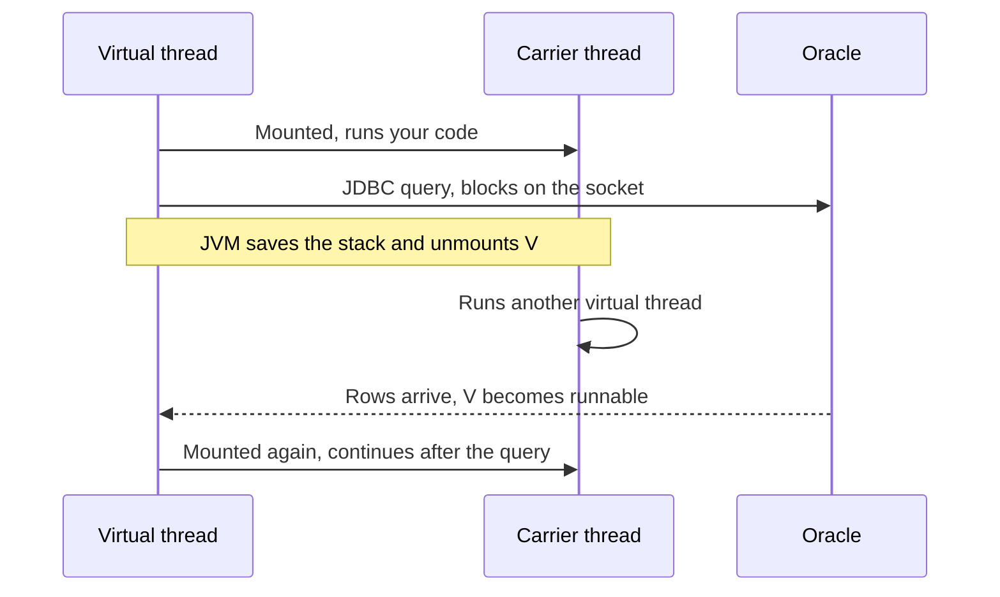
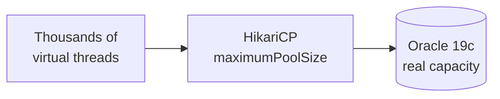
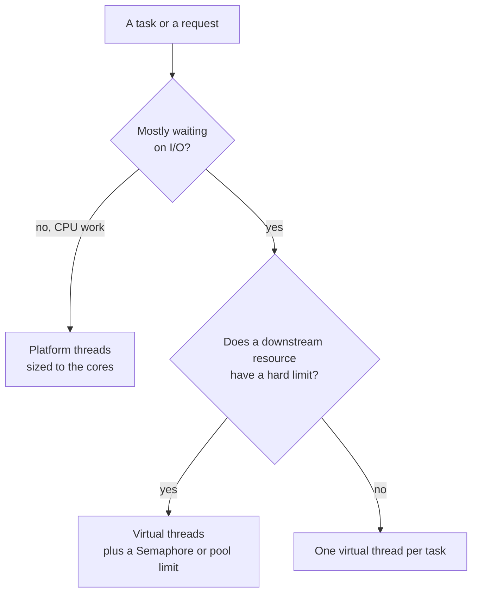

# Platform threads vs virtual threads

A thread is the unit that runs your code. For most of Java's history there was one kind: a thread backed one-to-one by an operating system thread. Java 21 adds a second kind, the *virtual thread*, which is cheap enough that you create one per task instead of sharing a few.

This note explains how each works, where each fits, and what to watch for, with three worked examples. Every code sample was compiled at the Java 21 language level, and every sample that prints or times something was run. The timings come from an 8-core laptop and will differ on your machine.

---

## 1. The idea in one minute

A thread is a worker that runs your code, one step at a time. Most of a request's time is spent *waiting*, for the database or another service. The two kinds of thread differ in what waiting costs.

| Kind | What it is | How many you can have |
|---|---|---|
| **Platform thread** | A worker handed to you by the operating system | Hundreds to a few thousand |
| **Virtual thread** | A light worker managed by Java itself | Thousands to millions |

A restaurant makes the difference easy to picture.

| In the restaurant | In your application |
|---|---|
| A table's order | A request |
| The kitchen | The database (Oracle) |
| A waiter | A real worker thread |
| An order slip | A virtual thread |

**Platform threads.** Each waiter takes an order, walks to the kitchen, and *stands at the window until the food is ready*. When all 20 waiters are standing there, the 21st table waits, even though every waiter is doing nothing.

**Virtual threads.** Each order is a slip. A waiter drops the slip at the kitchen and *picks up the next order*. When the food is ready, any free waiter carries on with that slip. Twenty waiters can look after thousands of slips, as long as the kitchen can cook them.

> **Note:** The kitchen still has a limit. Virtual threads let more orders be *in progress*, but the database can only cook so many at once.

### Words you will hear

| Word | Meaning |
|---|---|
| **Blocking** | The thread stops and waits, for example for a query result |
| **Carrier thread** | A real thread that virtual threads take turns running on. The waiter, in the picture |
| **Unmounted** | A waiting virtual thread that has stepped off its carrier and costs almost nothing. The slip at the kitchen |
| **Pinned** | A virtual thread stuck to its carrier while waiting, so it behaves like a platform thread. A performance problem to avoid, not an error |

---

## 2. Platform threads

A platform thread is a thin wrapper around an operating system thread. `new Thread(...)` and `Executors.newFixedThreadPool(...)` give you platform threads.

| Property | What it means |
|---|---|
| **Mapping** | One Java thread is one OS thread, for its whole life |
| **Scheduling** | The operating system decides when it runs, and can pre-empt it at any time |
| **Stack** | A fixed block of memory is reserved per thread, typically 1 MB on 64-bit platforms; you change it with `-Xss` |
| **Creation** | Asking the OS for a thread is slow enough that you avoid doing it per task |
| **Blocking** | A blocked thread keeps its OS thread and its stack until it wakes up |

Because they are expensive and few, platform threads are pooled, and the pool size becomes a ceiling on concurrency. The formula is *threads ÷ time waiting*:

| Pool size | Time per request (waiting) | Most requests you can finish per second |
|---|---|---|
| 20 | 100 ms | 200 |
| 200 | 100 ms | 2,000 |
| 2,000 | 100 ms | 20,000, if memory and the scheduler cope |

The pool is sized for the worst case. When requests wait longer than expected, throughput drops while the CPU sits idle.

---

## 3. Virtual threads

A virtual thread is a `java.lang.Thread` that the JVM schedules itself, instead of the operating system. It has the same API as a platform thread, so existing code and libraries work with it.

| Property | What it means |
|---|---|
| **Mapping** | Many virtual threads run on a small number of carrier threads |
| **Scheduling** | The JVM runs them on a `ForkJoinPool`; the parallelism defaults to the number of available processors |
| **Stack** | Kept on the heap, starts small, and grows and shrinks with the call depth |
| **Creation** | Cheap enough to create one per task, and then discard |
| **Blocking** | A blocked virtual thread is unmounted: its stack is saved, and the carrier runs something else |

### Mounting and unmounting

A virtual thread only occupies a carrier while it has CPU work to do. When it blocks on something the JVM understands, it steps off.



How to read it: your code does not change. The `executeQuery` call still looks blocking. What changes is that waiting no longer holds an OS thread, so the carrier does useful work during those 100 ms.

| Unmounts the virtual thread | Notes |
|---|---|
| `Thread.sleep` | |
| Socket and `HttpClient` I/O | The JDBC network read is in this group |
| `java.util.concurrent` locks, queues, and `Future.get()` | `ReentrantLock`, `BlockingQueue`, `Semaphore` |
| File I/O | Not unmounted; it blocks the carrier, and the scheduler temporarily adds carriers to compensate |

> **Note:** There is no time-slicing. A virtual thread runs until it blocks or finishes, so a CPU loop that never blocks keeps its carrier for as long as it runs.

---

## 4. Side by side

| | Platform thread | Virtual thread |
|---|---|---|
| Backed by | An OS thread | A JVM-managed object on a carrier |
| Typical count | Hundreds to a few thousand | Thousands to millions |
| Cost to create | High, so pool them | Low, so create per task |
| Stack | Fixed reservation, about 1 MB | Heap, grows with use |
| Scheduling | OS, pre-emptive | JVM, cooperative at blocking points |
| Blocking | Holds the OS thread | Unmounts, carrier is reused |
| Daemon | Inherited from the creating thread, usually `false` | Always `true`; `setDaemon(false)` throws |
| Priority | Honoured by the OS (loosely) | Always `NORM_PRIORITY`; changes are ignored |
| Default name | `Thread-0`, `pool-1-thread-1` | Empty string `""` |
| Pooling | Standard practice | Do not pool them |
| Best for | CPU-bound work | I/O-bound work with high concurrency |

### Creating threads

```java
Runnable task = () -> {
    var t = Thread.currentThread();
    System.out.println("virtual=" + t.isVirtual() + " daemon=" + t.isDaemon()
            + " priority=" + t.getPriority() + " name='" + t.getName() + "'");
};

Thread.ofPlatform().name("worker-1").start(task);
Thread.ofVirtual().name("vt-1").start(task);
Thread.startVirtualThread(task);
```

```text
virtual=false daemon=false priority=5 name='worker-1'
virtual=true daemon=true priority=5 name='vt-1'
virtual=true daemon=true priority=5 name=''
```

| Way to start | Use it when |
|---|---|
| `Thread.ofPlatform()...start(task)` | You need a platform thread with a name, priority, or non-daemon behaviour |
| `Executors.newVirtualThreadPerTaskExecutor()` | The normal choice: one virtual thread per submitted task |
| `Executors.newFixedThreadPool(n)` | A platform pool, for CPU-bound work |

> **Note:** `ExecutorService` is `AutoCloseable` from Java 19. A `try`-with-resources block calls `close()`, which waits for the submitted tasks to finish, so the examples below need no `shutdown()`.

---

## 5. Use cases

Three examples from HelpDesk Pro. Each is a pattern you will meet again.

### Use case 1: one virtual thread per request

**Situation.** At the start of the working day, a few hundred employees open `/tickets`. Each request runs a query against Oracle and waits for the rows.

**With virtual threads.** Each request gets its own virtual thread. While it waits for Oracle it costs almost nothing, so you stop sizing a thread pool for the morning peak. In Spring Boot 3.2 or later this is one setting, with no controller code changed:

```yaml
spring:
  threads:
    virtual:
      enabled: true
```

**Try the difference.** Create `Waiters.java`. It runs 100 tasks that each wait 200 ms, once on 10 platform threads and once on virtual threads:

```java
import java.time.Duration;
import java.util.concurrent.ExecutorService;
import java.util.concurrent.Executors;

public class Waiters {

    static long run(ExecutorService executor) {
        long start = System.nanoTime();
        try (executor) {
            for (int i = 0; i < 100; i++) {
                executor.submit(() -> {
                    Thread.sleep(Duration.ofMillis(200));
                    return null;
                });
            }
        }
        return (System.nanoTime() - start) / 1_000_000;
    }

    public static void main(String[] args) {
        System.out.println("10 platform threads: " + run(Executors.newFixedThreadPool(10)) + " ms");
        System.out.println("virtual threads:     " + run(Executors.newVirtualThreadPerTaskExecutor()) + " ms");
    }
}
```

```bash
java Waiters.java
```

**Measured:**

```text
10 platform threads: 2042 ms
virtual threads:     207 ms
```

100 tasks on 10 workers is 10 rounds of 200 ms. On virtual threads all 100 wait at once, so the total is about one 200 ms wait. Each task still takes 200 ms: virtual threads do not make a task faster, they let more tasks wait at the same time.

**Watch out.** The HikariCP pool (`maximumPoolSize`) is now the real limit. Requests queue for a connection instead of for a thread.

### Use case 2: fan out and join

**Situation.** `GET /tickets/{id}` needs the ticket, its comments, and the assignee's profile. The three lookups are independent, so there is no reason to wait for them one after another.

**With virtual threads.** Start all three at once and join the results. The code is plain blocking code with `Future.get()`:

```java
try (var executor = Executors.newVirtualThreadPerTaskExecutor()) {
    Future<String> ticket   = executor.submit(() -> loadTicket(id));
    Future<String> comments = executor.submit(() -> loadComments(id));
    Future<String> agent    = executor.submit(() -> loadAssignee(id));
    return ticket.get() + ", " + comments.get() + ", " + agent.get();
}
```

**Measured** with each lookup simulated as a 200 ms wait:

| Approach | Elapsed |
|---|---|
| Three calls one after another | about 612 ms |
| Three calls on virtual threads | about 207 ms |

**Watch out.** Three parallel queries use three connections from the pool. With a pool of 10, a handful of detail requests can use all of them. Fan out only where the saving is worth the connections.

### Use case 3: fan out with a limit

**Situation.** When a bulk close resolves many tickets, the system sends a notification for each one. Every send waits on a mail server that accepts only a few connections at once.

**With virtual threads.** Virtual threads remove the thread cap, so nothing limits access to the mail server any more. You add the limit yourself with a `Semaphore`:

```java
Semaphore mailSlots = new Semaphore(5);      // the mail server allows 5 at a time

executor.submit(() -> {
    mailSlots.acquire();
    try {
        return sendMail(message);
    } finally {
        mailSlots.release();
    }
});
```

**Measured:** 50 notifications of about 100 ms each, 5 at a time, took about 1,045 ms. That is 10 rounds of 100 ms, as the limit predicts. The waiting threads are parked and cost almost nothing until a slot is free.

**Watch out.** The same pattern protects the database. A `Semaphore` the size of the connection pool keeps a burst of virtual threads from all asking for a connection at once.

---

## 6. When virtual threads do not help

| Situation | Why not | Use instead |
|---|---|---|
| **CPU-bound work** | There is no waiting to hide. Measured on 8 cores: 32 tasks of 200 ms of computation took about 803 ms on 8 platform threads and 801 ms on virtual threads | A fixed pool near the core count |
| **One slow SQL query** | They change how many requests can wait, not how long a query takes. More concurrency makes a slow query worse | Fix the query: the index and the plan (Day 2 and Day 5) |
| **Thread priority or non-daemon threads** | Virtual threads ignore priority and are always daemon | `Thread.ofPlatform()` |
| **Blocking inside `synchronized` or a native call** | The virtual thread is pinned to its carrier (section 8) | Fix the pinning first |

---

## 7. Virtual threads in Spring Boot

The `spring.threads.virtual.enabled=true` setting from use case 1 switches several things at once:

| Aspect | What happens |
|---|---|
| **Request handling** | The embedded Tomcat runs each request on its own virtual thread instead of a pooled platform thread |
| **Async and scheduled work** | The application task executor and scheduler use virtual threads too |
| **Controller and service code** | Unchanged; it is the same blocking code |
| **Thread names in the log** | The `%thread` field changes: pooled names such as `http-nio-8080-exec-1` give way to virtual-thread names such as `tomcat-handler-0` (verified on Spring Boot 3.5). Compare the log before and after you set the property |

### The connection pool is still the cap



How to read it: before, the thread pool was usually the first bottleneck. After, the connection pool is. Size it for what Oracle can handle and treat it as the throttle. Day 1 sets the pool values in `application.yml`.

### Check the driver

Older JDBC drivers use `synchronized` internally, which can hold a carrier thread while a call blocks. Check the release notes of the `ojdbc` version you use for virtual-thread support, and measure under load rather than assuming.

---

## 8. Pitfalls

### Pinning

A virtual thread is *pinned* when it cannot unmount while blocked, so it holds its carrier like a platform thread.

| Cause | Java 21 behaviour | Later |
|---|---|---|
| Blocking inside a `synchronized` block | Pins the carrier | Fixed in Java 24 (JEP 491) |
| Blocking inside a native method or foreign call | Pins the carrier | Still pins |

On Java 21, guard blocking code with a `ReentrantLock` instead:

```java
// Java 21: can pin the carrier while callDatabase() blocks
synchronized (monitor) {
    callDatabase();
}

// Does not pin
lock.lock();
try {
    callDatabase();
} finally {
    lock.unlock();
}
```

To find it, run with `-Djdk.tracePinnedThreads=full` on Java 21, or record the `jdk.VirtualThreadPinned` event with Java Flight Recorder.

### Other pitfalls

| Pitfall | What happens | What to do |
|---|---|---|
| **Pooling virtual threads** | You recreate the limit they remove | Create one per task |
| **No limit on downstream resources** | A burst of requests all reach Oracle or the mail server at once | Bound with the connection pool or a `Semaphore` |
| **CPU loops** | A virtual thread that never blocks holds its carrier | Keep CPU-bound work on a bounded platform pool |
| **Heavy `ThreadLocal` use** | Each virtual thread has its own copy, and there may be many | Pass values explicitly, or keep thread-local state small |
| **Thread dumps** | `jstack` shows platform threads only | Use `jcmd <pid> Thread.dump_to_file -format=json <file>` |

---

## 9. Choosing



How to read it: first ask what the task spends its time doing. Waiting means virtual threads. Computing means platform threads. Then ask what sits behind it, because virtual threads remove the thread cap but not the database's.

### Adoption checklist

1. Run on Java 21 and Spring Boot 3.2 or later.
2. Turn on `spring.threads.virtual.enabled=true` in one profile first.
3. Size the HikariCP pool for Oracle's real capacity.
4. Check the `ojdbc` driver and other blocking libraries for `synchronized` pinning.
5. Compare thread names in the log before and after.
6. Load-test, and watch pool wait time and database sessions, not only CPU.

### Common misconceptions

| Statement | Reality |
|---|---|
| "Virtual threads make each request faster." | A single request takes the same time. They let more requests wait at once. |
| "They remove the need to size anything." | They remove the *thread* pool. The connection pool and the database still set the limit. |
| "They replace parallel streams or `ForkJoinPool` for computation." | They help waiting, not computing. CPU-bound work still needs cores. |
| "We should stop using platform threads." | CPU-bound pools, priority-sensitive work, and the carriers themselves are platform threads. |

---

## Recap

- A **platform thread** is one OS thread. It is expensive, so you pool a few, and the pool size caps how many requests can wait.
- A **virtual thread** is a JVM-managed thread that unmounts from its carrier while it blocks, so waiting is almost free and you create one per task.
- Virtual threads help **I/O-bound** work with high concurrency, such as request handling over blocking JDBC. They do nothing for **CPU-bound** work.
- In Spring Boot 3.2 or later, `spring.threads.virtual.enabled=true` switches request handling over without changing controller or service code.
- The **connection pool and the database** become the real limit. Guard other limited resources with a `Semaphore`.
- On Java 21, avoid blocking inside `synchronized` blocks; use `ReentrantLock`.

## Check yourself

1. A request waits 100 ms on the database. How many requests per second can a pool of 50 platform threads finish at most, and what changes with virtual threads?
2. What does it mean that a virtual thread is "unmounted", and which operation in your code triggers it?
3. In use case 2, why can fan-out make a busy system slower even though one request gets faster?
4. What stops 50 virtual threads from sending 50 mails at once in use case 3?
5. Why do CPU-bound tasks take the same time on 8 platform threads and on virtual threads?
6. After you enable virtual threads, requests start queuing. Where do you look first, and why?
