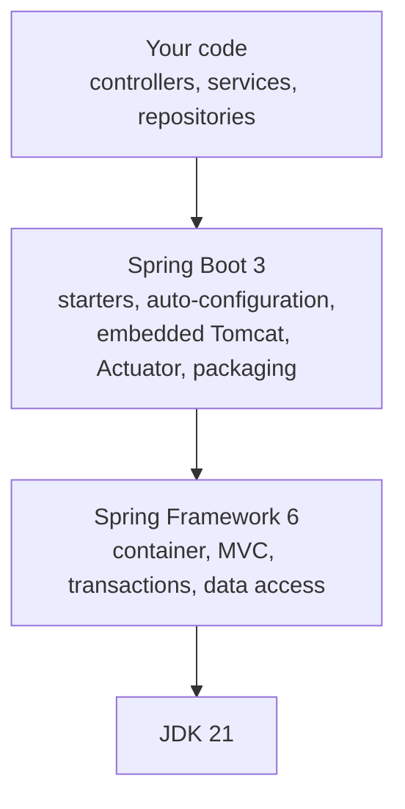
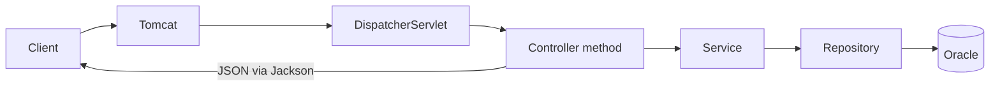

# Spring Framework 6 and Spring Boot 3

This programme builds on **Spring Framework 6** and **Spring Boot 3**. This note explains what each one is, how they fit together, what changed from the versions before them, and where each piece shows up in HelpDesk Pro.

The version numbers and outputs below were measured on Spring Boot 3.5.16, which resolves to Spring Framework 6.2.19. That is the version the `test-app` in this repository uses. The programme itself targets **Spring Boot 3.2 or later**, which is the first line that supports virtual threads.

---

## 1. Two projects, one stack

| | Spring Framework | Spring Boot |
|---|---|---|
| **What it is** | The core toolkit: a container that creates and wires your objects, plus web, transaction, and data access support | An opinionated layer on top that configures the framework for you and packages the result |
| **Question it answers** | "How do my objects find each other, and how do requests reach them?" | "How do I get a running application with the least setup?" |
| **You write** | Components, controllers, services, and their configuration | Mostly your own code, plus a few properties |
| **Without it** | You wire the container, the web server, and the JSON converters by hand | You use the framework directly and do that wiring yourself |



How to read it: you write the top box. Spring Boot assembles the middle boxes for you, and the framework underneath does the actual work. Boot does not replace the framework; every annotation you use in a Boot application comes from Spring Framework.

---

## 2. Spring Framework 6

### The core idea: inversion of control

In a Servlet/JSP style application, each class creates the objects it needs. In Spring, you *declare* the components and the container creates them and passes their dependencies in.

```java
// Wiring by hand
DataSource dataSource = new DataSourceFactory().create();
TicketDao dao = new TicketDao(dataSource);
TicketService service = new TicketService(dao);
TicketServlet servlet = new TicketServlet(service);
```

```java
// Spring: declare the class, and the container passes the dependency in
@Service
public class TicketService {

    private final TicketRepository repository;

    public TicketService(TicketRepository repository) {
        this.repository = repository;
    }
}
```

A class with a single constructor needs no `@Autowired`. Spring sees the constructor parameter, finds a bean of that type, and passes it in.

| Term | Meaning |
|---|---|
| **Bean** | An object the container creates and manages |
| **`ApplicationContext`** | The container: it holds the beans and wires them together |
| **Dependency injection** | The container passing a bean into another bean, preferably through the constructor |
| **Scope** | How long a bean lives. The default is *singleton*: one shared instance per application |

> **Note:** Constructor injection makes dependencies explicit and lets you create the class in a unit test with plain `new`, without Spring.

### Stereotype annotations

These mark a class as a bean, and say what role it plays:

| Annotation | Layer | Package in HelpDesk Pro |
|---|---|---|
| `@RestController` | Receives HTTP requests, returns JSON | `web` |
| `@Service` | Business rules and transactions | `service` |
| `@Repository` | Data access (translates persistence exceptions) | `repository` |
| `@Configuration` with `@Bean` methods | Creates beans you define yourself | `config` |
| `@Component` | Any other bean | any |

### What the framework gives you

| Capability | What it does | You meet it on |
|---|---|---|
| **IoC container** | Creates and wires beans | Day 1 |
| **Spring MVC** | Maps HTTP requests to controller methods, converts JSON | Day 3 |
| **Validation** | Runs Bean Validation (`@Valid`) on request bodies | Day 3 |
| **Transactions** | `@Transactional` begins, commits, and rolls back | Day 4 |
| **AOP proxies** | Wraps a bean to add behaviour, which is how `@Transactional` works | Day 4 |
| **Data access** | JDBC and JPA integration, used by Spring Data | Day 2 |
| **Test support** | Loads a context, or a slice of one, for tests | Day 7 |

### A request through Spring MVC



How to read it: `DispatcherServlet` is an ordinary servlet. It is the single entry point, and it chooses the controller method for each request. The controller returns an object and Spring converts it to JSON. It is the same Servlet API underneath, with the routing done for you.

### What is new in Spring Framework 6

| Change | What it means for you |
|---|---|
| **Java 17 baseline** | The framework needs Java 17 or later. This programme uses 21 |
| **Jakarta EE namespace** | Packages moved from `javax.*` to `jakarta.*` (see section 4) |
| **Virtual thread support (6.1)** | Executors and the web layer can run on virtual threads |
| **`RestClient` (6.1)** | A fluent synchronous HTTP client |
| **`JdbcClient` (6.1)** | A fluent API over `JdbcTemplate` |
| **HTTP interface clients** | Declare a client as an annotated interface |
| **`ProblemDetail`** | Standard error body for HTTP APIs (RFC 7807) |
| **Observability** | Built-in Micrometer observation support |
| **AOT processing** | Ahead-of-time processing for native images |
| **Trailing slash** | `/tickets/` no longer matches `/tickets` by default |

---

## 3. Spring Boot 3

Spring Boot adds five things on top of the framework.

| Feature | What it gives you |
|---|---|
| **Starters** | One dependency that brings a compatible set of libraries |
| **Auto-configuration** | Beans created for you from what is on the classpath and in your properties |
| **Embedded server** | Tomcat inside your JAR, so there is nothing to install |
| **Externalized configuration** | One place for settings, with profiles and environment overrides |
| **Operational features** | Actuator endpoints such as `/actuator/health`, and an executable JAR |

### Starters

A starter is a dependency that pulls in everything for one capability, at versions that work together:

```xml
<parent>
    <groupId>org.springframework.boot</groupId>
    <artifactId>spring-boot-starter-parent</artifactId>
    <version>3.5.16</version>
</parent>

<dependency>
    <groupId>org.springframework.boot</groupId>
    <artifactId>spring-boot-starter-web</artifactId>
</dependency>
```

The parent manages every version, so the starter dependency has none. That one starter resolved to:

| Library | Version (Boot 3.5.16) |
|---|---|
| `spring-core`, `spring-webmvc` | 6.2.19 |
| `tomcat-embed-core` | 10.1.55 |
| `jackson-databind` | 2.21.4 |
| `logback-classic` | 1.5.34 |

> **Warning:** Do not set the version of a library the Boot parent manages. A mismatched `spring-core` is a common source of errors that do not point at the cause.

### `@SpringBootApplication`

One annotation on the main class combines three:

| It includes | What it does |
|---|---|
| `@SpringBootConfiguration` | Marks the class as a source of bean definitions |
| `@EnableAutoConfiguration` | Turns on auto-configuration |
| `@ComponentScan` | Finds your `@Component`, `@Service`, `@RestController`, and other beans in this package and below |

```java
@SpringBootApplication
public class HelpDeskProApplication {
    public static void main(String[] args) {
        SpringApplication.run(HelpDeskProApplication.class, args);
    }
}
```

> **Warning:** `@ComponentScan` starts at the package of this class. A bean in a package *outside* it is never found. See the common mistakes at the end.

### Auto-configuration

Auto-configuration decides what to create by checking conditions. The two most common are *is this class on the classpath?* and *has the user already defined this bean?*

| Condition | Meaning |
|---|---|
| `@ConditionalOnClass` | Configure this only when a class is present |
| `@ConditionalOnMissingBean` | Configure this only when you have not defined your own bean |
| `@ConditionalOnProperty` | Configure this only when a property has a given value |

Because of `@ConditionalOnMissingBean`, **your bean always wins**. Define your own `ObjectMapper` and Boot's is not created.

To see every decision, start the application with `--debug`:

```bash
java -jar helpdesk-pro.jar --debug
```

The conditions report that follows lists each auto-configuration as a match or not, with the reason. This is a shortened excerpt from a web-only application:

```text
Positive matches:
   DispatcherServletAutoConfiguration matched:
      - @ConditionalOnClass found required class 'org.springframework.web.servlet.DispatcherServlet'
   JacksonAutoConfiguration matched:
      - @ConditionalOnClass found required class 'com.fasterxml.jackson.databind.ObjectMapper'

Negative matches:
   DataSourceAutoConfiguration:
      Did not match:
         - @ConditionalOnClass did not find required class
           'org.springframework.jdbc.datasource.embedded.EmbeddedDatabaseType'
   HibernateJpaAutoConfiguration:
      Did not match:
         - @ConditionalOnClass did not find required class 'jakarta.persistence.EntityManager'
```

The report for that small application had 77 matched entries and 168 that did not match. Most of auto-configuration stays off until you add the starter that triggers it.

How to read it: there is no data source because there is no JDBC starter on the classpath. Add `spring-boot-starter-data-jpa` and `ojdbc11` on Day 1, and those two negative matches become positive.

In Boot 3, auto-configurations are registered in `META-INF/spring/org.springframework.boot.autoconfigure.AutoConfiguration.imports`. Boot 2 used `spring.factories` for this.

### Configuration and profiles

Settings live in `application.yml`. Keep secrets out of it by using placeholders that read an environment variable:

```yaml
server:
  port: 8080

spring:
  datasource:
    url: jdbc:oracle:thin:@//<db-host>:<db-port>/<service-name>
    username: helpdesk
    password: ${DB_PASSWORD}
```

| Higher wins | Source |
|---|---|
| 1 | Command-line arguments, for example `--server.port=9090` |
| 2 | Environment variables |
| 3 | `application-<profile>.yml`, for the active profile |
| 4 | `application.yml` |

Profiles (`dev`, `prod`) select a different file per environment. Day 7 splits the configuration; Day 8 loads the production values from an environment file on the server.

### The executable JAR

The `spring-boot-maven-plugin` repackages your classes and all their dependencies into one runnable JAR:

```bash
mvn clean package
java -jar target/helpdesk-pro.jar
```

Measured on the web-only scratch application, the repackaged JAR was about 21 MB and contained:

| Entry | What it is |
|---|---|
| `META-INF/MANIFEST.MF` | `Main-Class: org.springframework.boot.loader.launch.JarLauncher`, `Start-Class: <your main class>` |
| `BOOT-INF/classes/` | Your compiled classes |
| `BOOT-INF/lib/` | Every dependency JAR (30 here, including `spring-core-6.2.19.jar` and `tomcat-embed-core-10.1.55.jar`) |
| `BOOT-INF/classpath.idx`, `layers.idx` | Indexes the launcher uses |
| `org/springframework/boot/loader/` | The launcher classes that start your application |

The server is inside the JAR, which is why a single `java -jar` command is the whole deployment. On Day 8 that command becomes the `ExecStart` of a `systemd` service.

### The thread your code runs on

By default each request runs on a pooled Tomcat thread. With `spring.threads.virtual.enabled=true`, it runs on a virtual thread. Measured on Boot 3.5.16, the same controller reported:

| Setting | `Thread.currentThread()` seen by the controller |
|---|---|
| Default | `virtual=false`, name `http-nio-auto-1-exec-1` (the middle part is your port, such as `http-nio-8080-exec-1`) |
| `spring.threads.virtual.enabled=true` | `virtual=true`, name `tomcat-handler-0` |

The [platform threads vs virtual threads note](04-platform-vs-virtual-threads.md) covers what that changes.

---

## 4. Versions and namespaces

### Which Spring Framework does each Boot line use?

| Spring Boot | Spring Framework | Tomcat | Hibernate ORM |
|---|---|---|---|
| 3.2.1 | 6.1.2 | 10.1.17 | 6.4.1 |
| 3.4.5 | 6.2.6 | 10.1.40 | 6.6.13 |
| 3.5.16 | 6.2.19 | 10.1.55 | 6.6.53 |

These rows come from the dependency management of each Boot version. Boot 3.0 and 3.1 use Spring Framework 6.0, and Boot 3.3 uses 6.1.

> **Note:** Newer major versions, Spring Boot 4 and Spring Framework 7, exist. This programme stays on Boot 3 and Framework 6 so that every example, version, and error message in the material matches.

Two rules keep this simple:

- You choose the **Spring Boot version**. The framework, Tomcat, Hibernate, Jackson, and HikariCP versions follow from it.
- Pin the Boot version in your `pom.xml` through the parent, and do not override the versions the parent manages.

### `javax` became `jakarta`

Spring Framework 6 and Spring Boot 3 use the Jakarta EE packages. The classes did not change; the package prefix did.

| Java 8 style import | Spring Boot 3 import |
|---|---|
| `javax.servlet.http.HttpServlet` | `jakarta.servlet.http.HttpServlet` |
| `javax.persistence.Entity` | `jakarta.persistence.Entity` |
| `javax.validation.constraints.NotNull` | `jakarta.validation.constraints.NotNull` |
| `javax.annotation.PostConstruct` | `jakarta.annotation.PostConstruct` |

Measured in the scratch application: `jakarta.servlet.http.HttpServlet` is on the classpath and `javax.servlet.http.HttpServlet` is not. The resolved tree shows `jakarta.persistence-api` 3.1.0 and `jakarta.validation-api` 3.0.2.

---

## 5. Spring Framework 5 and Boot 2 compared with 6 and 3

| Area | Spring Framework 5 / Boot 2 | Spring Framework 6 / Boot 3 |
|---|---|---|
| Java | 8 or later | 17 or later |
| Packages | `javax.*` | `jakarta.*` |
| Tomcat | 9 | 10.1 |
| Hibernate | 5 | 6 |
| Security configuration | Extend `WebSecurityConfigurerAdapter` | Define a `SecurityFilterChain` bean |
| Auto-configuration registration | `spring.factories` | `AutoConfiguration.imports` |
| Trailing slash matching | On by default | Off by default |
| Virtual threads | Not available | `spring.threads.virtual.enabled` (3.2+) |

---

## 6. Where each piece appears in HelpDesk Pro

| Day | What you use | From |
|---|---|---|
| 1 | Project creation, starters, `application.yml`, datasource, Actuator health | Boot |
| 2 | Entities, repositories, lazy loading | Data JPA, Hibernate |
| 3 | `@RestController`, DTOs, `@Valid`, `@ControllerAdvice` | Framework MVC, validation |
| 4 | `@Transactional`, the service layer | Framework transactions, AOP |
| 5 | Pagination, Specifications, `@Scheduled` | Data JPA, Framework |
| 6 | Filter chain, JWT, `@PreAuthorize` | Spring Security 6 |
| 7 | `@WebMvcTest`, `@DataJpaTest`, profiles, logging | Boot test slices |
| 8 | Executable JAR, `systemd`, `/actuator/health` from the LAN | Boot packaging, Actuator |

---

## Common mistakes

| Symptom | Cause | Fix |
|---|---|---|
| `package javax.servlet does not exist` or `javax.persistence` not found | Old import style on a Boot 3 project | Use `jakarta.*` imports |
| `no main manifest attribute, in target/<name>.jar` | The `spring-boot-maven-plugin` is missing, so the JAR is a plain one (about 5 KB) | Add the plugin to the `pom.xml` and run `mvn clean package` again |
| `Parameter 1 of constructor in <Class> required a bean of type '<Type>' that could not be found.` | The bean is in a package outside the one `@SpringBootApplication` scans, or it has no stereotype annotation | Move it under the main class's package, or annotate it |
| `/tickets/` returns 404 but `/tickets` works | Trailing-slash matching is off in Framework 6 | Call the exact path, or register both explicitly |
| Odd `NoSuchMethodError` or `ClassNotFoundException` at startup | A library version overrides one the Boot parent manages | Remove the explicit version and let the parent decide |
| Auto-configuration you did not expect, or one you expected is missing | A starter is or is not on the classpath | Run with `--debug` and read the conditions report |

---

## Recap

- **Spring Framework 6** is the toolkit: the container that wires beans through constructor injection, plus MVC, transactions, and data access.
- **Spring Boot 3** is the assembled application: starters, auto-configuration, an embedded Tomcat, externalized configuration, Actuator, and an executable JAR.
- `@SpringBootApplication` combines configuration, auto-configuration, and component scanning. Scanning starts at the main class's package.
- Auto-configuration is a set of conditions on the classpath and your own beans. Use `--debug` to see each decision. Your bean always wins.
- Boot 3 needs Java 17 or later, uses `jakarta.*` packages, Tomcat 10.1, and Hibernate 6. You pick the Boot version and the rest follows.
- `spring.threads.virtual.enabled=true`, available from Boot 3.2, runs request handling on virtual threads without changing controller code.

## Check yourself

1. What does the container do that `new TicketService(new TicketDao(...))` does by hand?
2. Which three annotations does `@SpringBootApplication` combine, and what does each do?
3. You define your own `ObjectMapper` bean. Which auto-configured bean is skipped, and why?
4. Which Spring Framework version does Spring Boot 3.5 use, and what do you change to move to a different one?
5. What does `java -jar` run inside the repackaged JAR, and where are your dependencies?
6. A request to `/tickets/` returns 404 after upgrading to Framework 6. Why?
